# Geospatial Representation Learning

## Course Structure and Format

Winter Semester 2026/27  
Mobile Robotics, Geodesy and Geoinformation & Geodetic Engineering

---
section: course-format
sectionTitle: Course organization
---

# Course Learning Outcomes

After completing the course, you will be able to:

1. Explain the principles of geospatial representation learning, how geospatial embeddings are created, and their potential and limitations for different applications.

2. Compare geospatial data sources and create and curate datasets from satellite imagery, time series, GIS layers, and other environmental and socio-economic data.

3. Implement Python-based machine-learning workflows using both fixed representations of existing geospatial data and representations learned through modern deep-learning methods.

4. Evaluate and compare models and representations for environmental and socio-ecological applications, considering predictive performance, generalization, and suitability for the task.

5. Critically assess and discuss research papers on geospatial representation learning, foundation models, and Earth embeddings, examining their methods, evidence, and limitations.

6. Design and conduct a research-oriented geospatial analysis project in a student group, and communicate its methods, results, and limitations through scientific writing and oral presentations.

---

# Three Phases: 

<h3>Phase 1: Lectures &amp; Labs </h3>

Build conceptual and technical foundations through lectures and hands-on exercises.

<strong>Examination:</strong> final written exam on the course content.

<h3>Phase 2: Paper Analysis </h3>

Analyze and review recent research papers in student groups.

<strong>Examination:</strong> pass/fail paper presentation with questions.

<h3>Phase 3: Group Projects </h3>

Develop code and conduct a research-oriented geospatial analysis project in groups.

<strong>Examination:</strong> written project report.

Bloom's cognitive levels across the course

Remember

Understand

Apply

Analyze

Evaluate

Create

---

# Timeline at a Glance

<strong>Fridays:</strong> Lectures 10:00–12:00, labs 13:00–15:00.

Course week

1

2

3

4

5

6

7

8

9

10

11

12

13

14

15

Event date

Oct 16

Oct 23

Oct 30

Nov 6

Nov 13

Nov 20

Nov 27

Dec 4

Dec 11

Dec 18

Christmas + Jan 8

Jan 15

Jan 22

Jan 29

Feb 5

Phase 1: Lectures

Intro

<a href="./1-why-geospatial-representation-learning/" class="course-gantt-bar course-gantt-event phase-1" style="grid-column: 3;" title="Lecture 1">L1</a>
<a href="./2-geospatial-data-images-maps-time-series/" class="course-gantt-bar course-gantt-event phase-1" style="grid-column: 4;" title="Lecture 2">L2</a>
<a href="./3-machine-learning-on-data-representations/" class="course-gantt-bar course-gantt-event phase-1" style="grid-column: 5;" title="Lecture 3">L3</a>
<a href="./4-deep-representation-learning-i/" class="course-gantt-bar course-gantt-event phase-1" style="grid-column: 6;" title="Lecture 4">L4</a>

No class

<a href="./5-deep-representation-learning-ii/" class="course-gantt-bar course-gantt-event phase-1" style="grid-column: 8;" title="Lecture 5">L5</a>
<a href="./8-geospatial-embeddings/" class="course-gantt-bar course-gantt-event phase-1" style="grid-column: 9;" title="Lecture 6">L6</a>

Phase 1: Labs

<a href="./labs/lab-1/" class="course-gantt-bar course-gantt-event phase-1" style="grid-column: 3;" title="Lab 1">Lab 1</a>
<a href="./labs/lab-2/" class="course-gantt-bar course-gantt-event phase-1" style="grid-column: 4;" title="Lab 2">Lab 2</a>
<a href="./labs/lab-3/" class="course-gantt-bar course-gantt-event phase-1" style="grid-column: 5;" title="Lab 3">Lab 3</a>
<a href="./labs/lab-4/" class="course-gantt-bar course-gantt-event phase-1" style="grid-column: 6;" title="Lab 4">Lab 4</a>

Phase 2: Papers

P1

P2

P3

P4

Phase 3: Projects

Group Projects

## Presence and Examination Events

  

    <strong>Paper Presentations pass/fail</strong>
    Nov 27, Dec 4, 11 &amp; 18, 2026
  

  

    <strong>Phase 1 Written exam</strong>
    February 5th, 2027
  

  

    <strong>Phase 3 report deadline</strong>
    Date: TBD
  

---

# Phase 1: Lectures and Labs

<h3>Lectures</h3>

**1-2 hours**

Presentation slides introduce the core concepts, terminology, and research context.

They provide the shared conceptual foundation for the hands-on work.

<h3>Labs</h3>

**Remaining 2 hours**

Interactive activities reinforce the lecture through self-directed, collaborative, and hands-on learning:

- Explore representations using PCA and t-SNE
- Collect, clean, and combine geodata
- Train and evaluate machine-learning models
- Investigate model architectures and explain them through peer teaching

---

# Phase 1: Overview - Lectures & Labs

<a href="./1-why-geospatial-representation-learning/" class="phase-content-tile no-underline text-current hover:bg-gray-50">
<h3>Lecture 1</h3>
<strong>Representations</strong> What is a representation?
</a>

<a href="./2-geospatial-data-images-maps-time-series/" class="phase-content-tile no-underline text-current hover:bg-gray-50">
<h3>Lecture 2</h3>
<strong>Geospatial Data</strong> What is geodata?
</a>

<a href="./3-machine-learning-on-data-representations/" class="phase-content-tile no-underline text-current hover:bg-gray-50">
<h3>Lecture 3</h3>
<strong>Machine Learning on Data Representations</strong> Learning on fixed representations
</a>

<a href="./4-deep-representation-learning-i/" class="phase-content-tile no-underline text-current hover:bg-gray-50">
<h3>Lecture 4</h3>
<strong>Deep Representation Learning I</strong> Learning the representation itself
</a>

<a href="./5-deep-representation-learning-ii/" class="phase-content-tile no-underline text-current hover:bg-gray-50">
<h3>Lecture 5</h3>
<strong>Deep Representation Learning II</strong> Learning beyond memorization
</a>

<a href="./8-geospatial-embeddings/" class="phase-content-tile no-underline text-current hover:bg-gray-50">
<h3>Lecture 6</h3>
<strong>Geospatial Embeddings</strong> Giving location a meaning
</a>

<a href="./labs/lab-1/" class="phase-content-tile no-underline text-current hover:bg-gray-50">
<h3>Lab 1</h3>
Visualizing high-dimensional representations
</a>

<a href="./labs/lab-2/" class="phase-content-tile no-underline text-current hover:bg-gray-50">
<h3>Lab 2</h3>
Geodata Scavanger Hunt
</a>

<a href="./labs/lab-3/" class="phase-content-tile no-underline text-current hover:bg-gray-50">
<h3>Lab 3</h3>
Machine Learning on Geospatial Data.
</a>

<a href="./labs/lab-4/" class="phase-content-tile no-underline text-current hover:bg-gray-50">
<h3>Lab 4</h3>
Practical: Supervised Deep Learning
</a>

---
layout: bonn-two-cols-header
---

# Phase 2: Paper Analysis

<a href="./slides/paper-analysis/" class="phase-content-tile paper-analysis-resource no-underline text-current hover:bg-gray-50">
<carbon-presentation-file class="paper-analysis-resource-icon" aria-hidden="true" />
<strong>Paper Analysis slides</strong> Open the session deck
</a>

<carbon-template class="paper-analysis-resource-icon" aria-hidden="true" />
<strong>PowerPoint presentation template</strong> Coming soon

::left::

## Format

Each topical session introduces a new research area and assigns papers to the student groups.

1. **Read (between classes):** Study the assigned paper with your group.
2. **Analyze (between classes):** Identify the problem, method, evidence, limitations, and impact, and prepare your presentation.
3. **Present (in class):** Present your analysis, answer questions, and discuss the paper with the class.

::right::

## Four Topics

| Session | Topic |
| --- | --- |
| **1** | Implicit Neural Representations and Approximation |
| **2** | Location Encoders |
| **3** | Self-Supervised Representation Learning |
| **4** | Geospatial Embeddings |

---

# Phase 3: Group Project

## Core project idea

Students investigate geospatial questions by **conducting a research study** or **developing GeoAI agents**.

Example themes:

- Deforestation monitoring
- Marine litter monitoring
- Urban expansion
- Agricultural change
- Flood or drought impacts
- Biodiversity and habitat suitability
- Land-cover and land-use change
- Climate-risk indicators
- Infrastructure and mobility patterns
- Human-environment interactions

## Examination Method: Short Research Paper

<h3 class="text-center">Application Paper</h3>

An in-depth study of a specific environmental or socio-economic phenomenon using geospatial AI models and representations.

<h3 class="text-center">Method Paper</h3>

A methodology paper describing how the group developed an AI agent to dynamically study a specific environmental or socio-economic phenomenon.

---

# Live Understanding Pulse

Throughout this course, I will show this widget to touch base on your level of understanding. It synchronizes across all devices, including in-class and virtual participants.

Try it out - click on the line:

  <UnderstandingPulse
    session-id="rootslide-demo"
    poll-id="understanding-pulse-test"
    left-label="I am completely lost"
    right-label="I fully understand"
    instruction="Click on the line to vote."
    :kernel-amplitude="12"
  />

This gives me feedback during class and also tracks the general understandability of the slides, so I can improve them in future iterations.

<!--
<UnderstandingPulse
  session-id="lecture-01-test"
  poll-id="ready-check"
  left-label="Not ready"
  right-label="Ready"
  instruction="Are you ready to continue?"
/>
-->

---
layout: bonn-section
sectionColor: "#00457c"
section: why-this-course
sectionTitle: Why this course?
---

# Why this course?

---
class: course-intro
---

# The Earth faces global challenges

  <figure>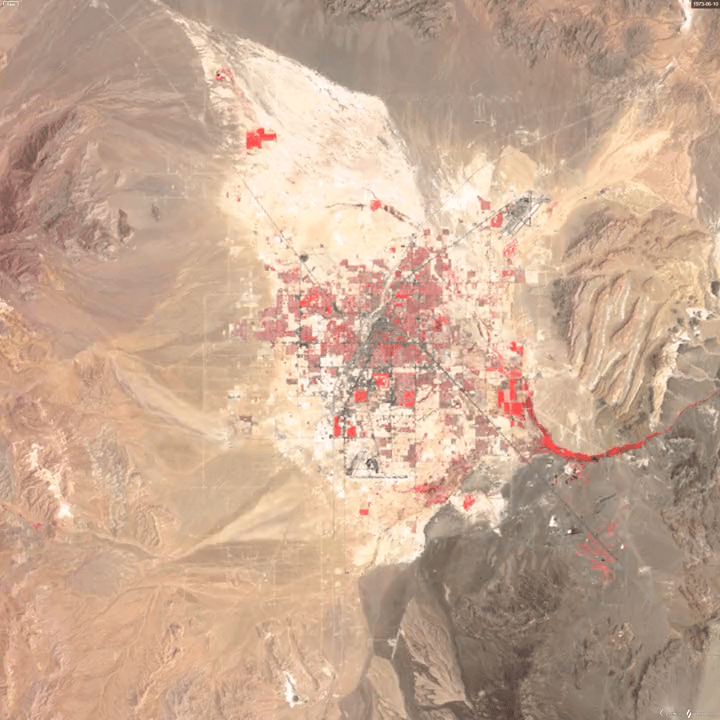<figcaption>Urbanization</figcaption></figure>
  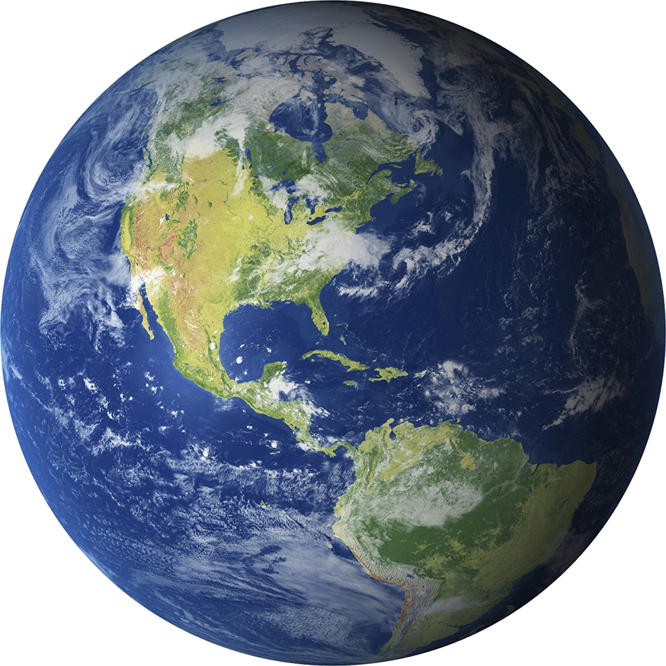
  <figure>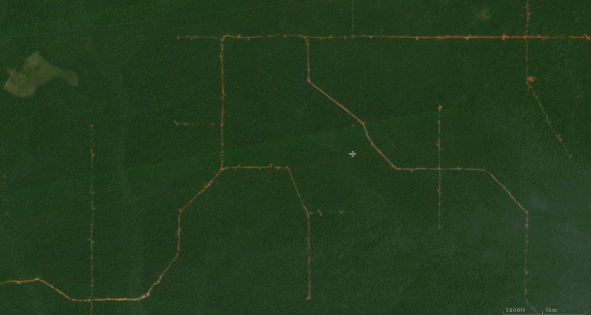<figcaption>Deforestation</figcaption></figure>

<strong>We need to analyze geodata at large scale</strong> to inform policies on biodiversity, food security, human health, and livelihoods.

Images: Google Earth Engine Time Series Gallery · Adapted from the Open Earth Monitor talk, October 2026.

<!-- Source: why_need_representations.pptx, slide 1. Original GIFs retained. -->

---
class: course-intro
---

# Observing the Earth at unprecedented scales

  
  
Sentinel-2 archive: <strong>45 petabytes</strong> Growing by <strong>4 PB per year</strong><small>Figures reported in the October 2026 talk</small>

Image: European Space Agency · Archive figures reproduced from the source talk.

<!-- Source: why_need_representations.pptx, slide 2. Figures are source-talk values, not a live estimate. -->

---
class: course-intro
---

# Pollution monitoring

  <figure>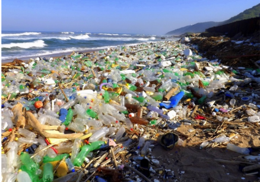<figcaption>Cuttings Beach, Durban, South Africa Image: Lisa Guastella</figcaption></figure>
  <figure>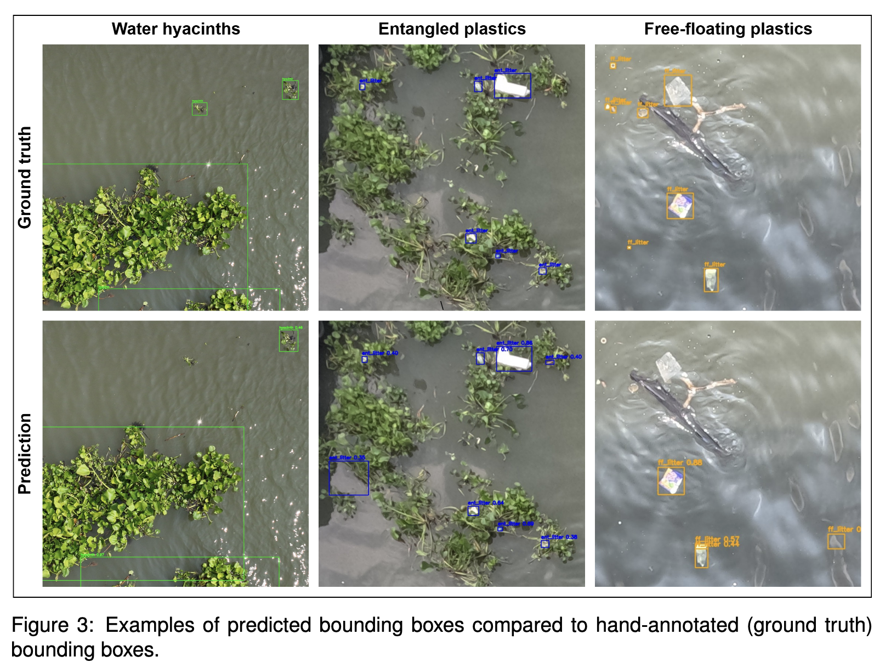</figure>

Giel Hagenbeek · Wageningen University &amp; Research

Hagenbeek, G. W., van Emmerik, et al., including Rußwurm, M. (2026). Exploring transferability of plastic-water hyacinth interaction and detection in rivers. <em>iScience</em>, 29(6).

<!-- Source: why_need_representations.pptx, slide 3. -->

---
class: course-intro
---

# Finding meteorites in Antarctic blue ice

  

Veronica Tollenaar Vrije Universiteit Brussel
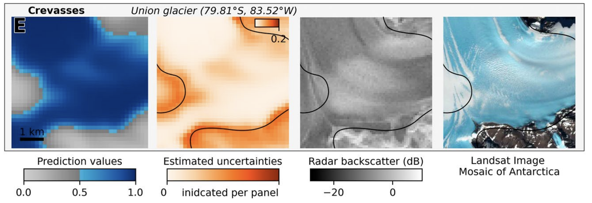

  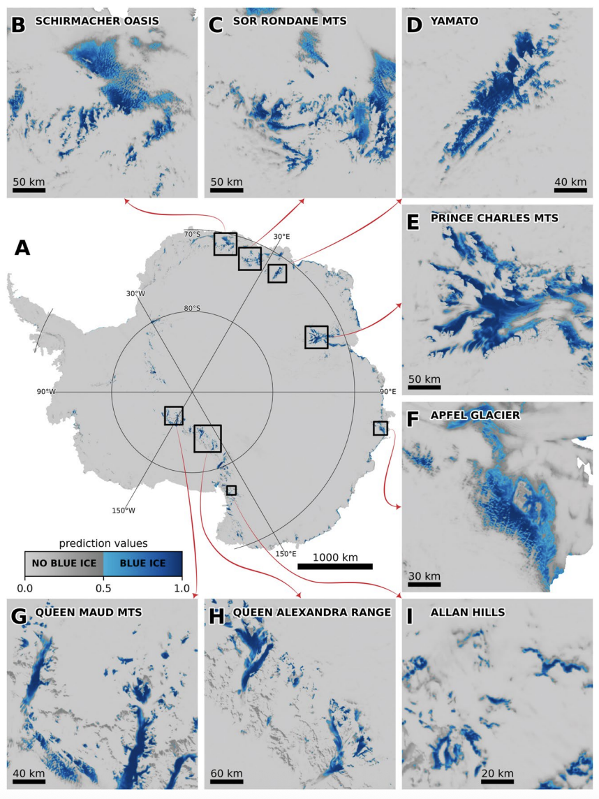

Tollenaar, V., Zekollari, H., Pattyn, F., Rußwurm, M., Kellenberger, B., Lhermitte, S., Izeboud, M., &amp; Tuia, D. (2024). Where the White Continent Is Blue: Deep Learning Locates Bare Ice in Antarctica. <em>Geophysical Research Letters</em>, 51(3), e2023GL106285. <a href="https://doi.org/10.1029/2023GL106285">doi:10.1029/2023GL106285</a>

<!-- Source: why_need_representations.pptx, slide 4. -->

---
class: course-intro
---

# Detecting litter in open waters

  <figure><figcaption>Cuttings Beach, Durban · Image: Lisa Guastella</figcaption>
Sentinel-2 satellite
</figure>
  <video controls muted loop playsinline preload="none" poster="./assets/course-introduction/image13.png" aria-label="Marine debris detection demonstration"><source src="./assets/course-introduction/marine-debris.mp4" type="video/mp4" /></video>

Rußwurm, M., Venkatesa, S. J., &amp; Tuia, D. (2023). Large-scale detection of marine debris in coastal areas with Sentinel-2. <em>iScience</em>, 26(12). <a href="https://go.epfl.ch/marinedebrisdetector">Marine debris detector</a>

<!-- Source: why_need_representations.pptx, slide 5. Original movie remuxed without re-encoding; controls allow deliberate playback. -->

---
class: course-intro
---

# Tracking litter patches across sensors

Gabrielė Tijūnaitytė · Wageningen, Bonn

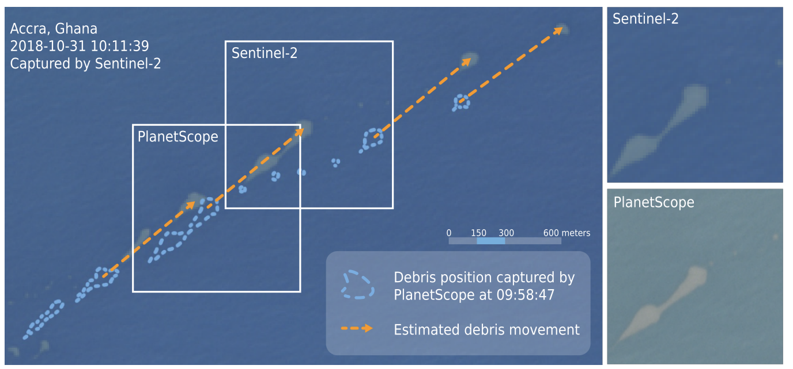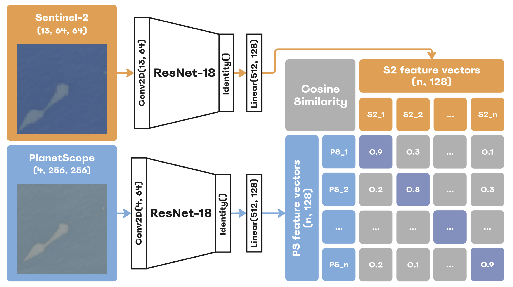

Tijūnaitytė, G., Dalsasso, E., &amp; Rußwurm, M. (2026). Cross-Sensor Matching of Marine Litter Patches in Satellite Double Acquisitions. ECCV Marine Vision Workshop (MaVi).

<!-- Source: why_need_representations.pptx, slide 6. -->

---
class: course-intro
---

# Text-based image retrieval on camera traps

  

Trained on the Snapshot Serengeti camera-trap dataset (Swanson et al., 2015) with more than <strong>seven million images</strong>.

Valentin Gabeff · EPFL

  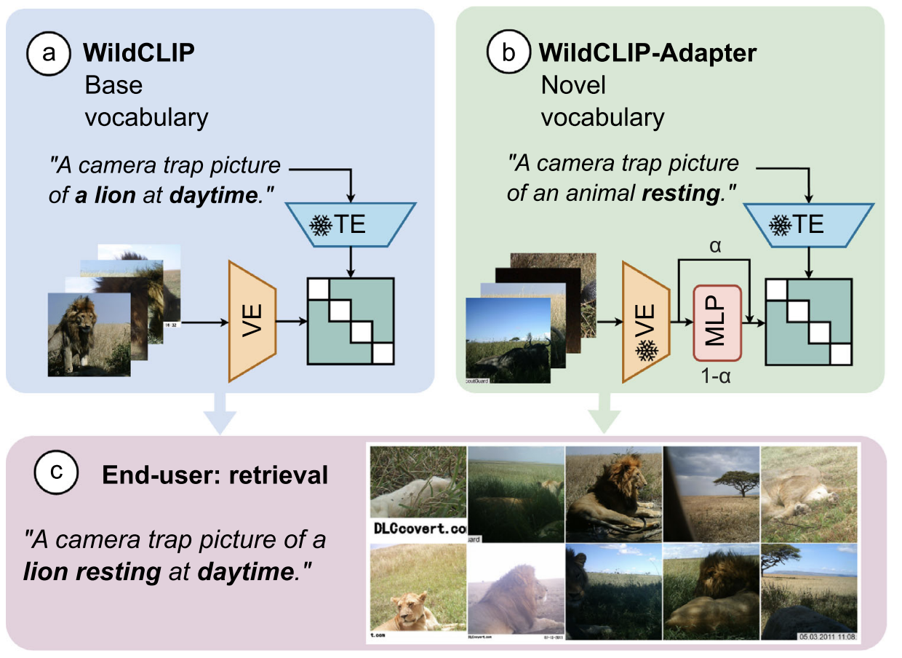

Gabeff, V., Rußwurm, M., Tuia, D., &amp; Mathis, A. (2024). WildCLIP: Scene and animal attribute retrieval from camera trap data with domain-adapted vision-language models. <em>International Journal of Computer Vision</em>, 132(9), 3770–3786.

<!-- Source: why_need_representations.pptx, slide 7. -->

---
class: course-intro
---

# Tree species classification

Takayuki Ishikawa · WUR MSc student

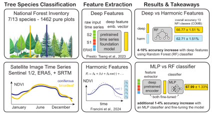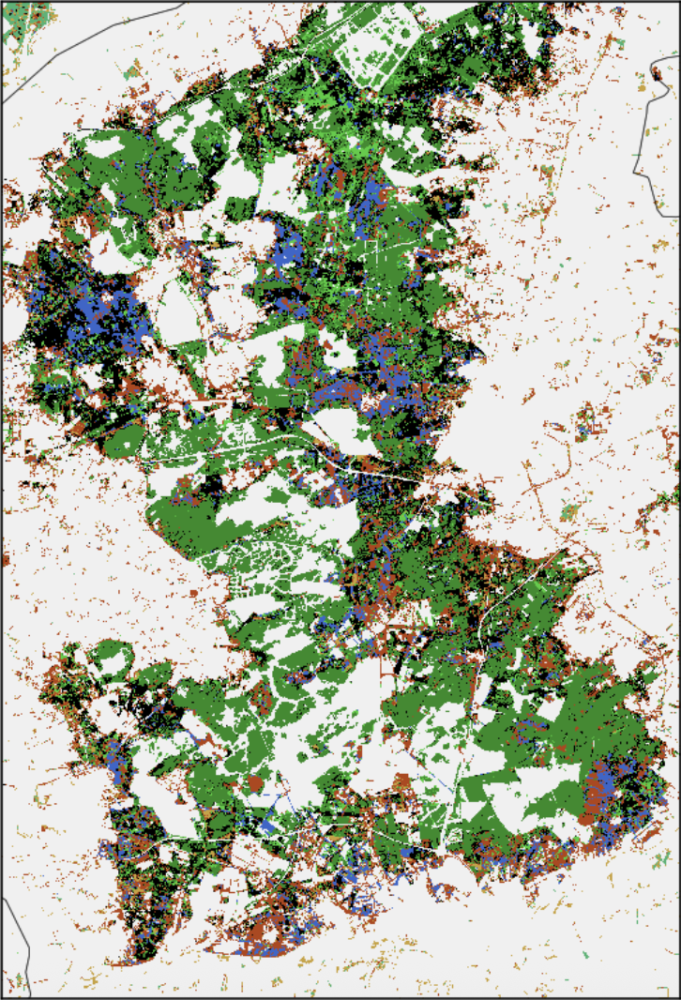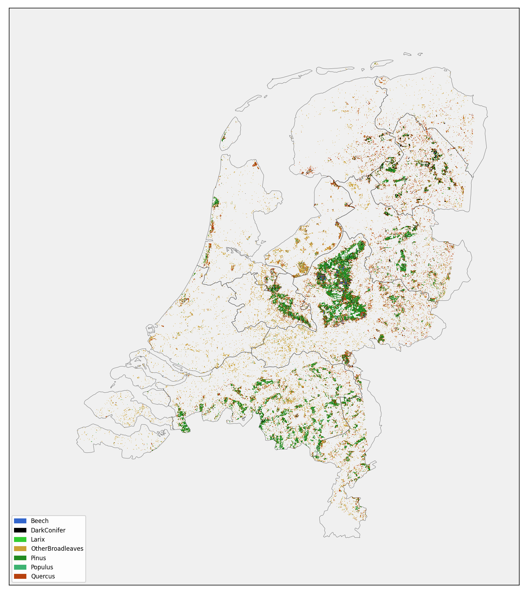

Ishikawa, T., Bonannella, C., Lerink, B. J. W., &amp; Rußwurm, M. (2026). Assessing the effectiveness of deep embeddings for tree species classification in the Dutch Forest Inventory. <em>Science of Remote Sensing</em>, 14, 100498. <a href="https://doi.org/10.1016/j.srs.2026.100498">doi:10.1016/j.srs.2026.100498</a>

<!-- Source: why_need_representations.pptx, slide 8. Source chart recovered from the PDF embedded in image23.emf and converted to SVG; original EMF also retained. -->

---
class: course-intro
---

# Forest change in the Swiss Alps

  

Historic aerial photos (1946–2020) reveal forest gains at high altitudes as the tree line advances upwards with a warming climate.

Data: 2,660 tiles of 1 km × 1 km, with 12–20 time steps.
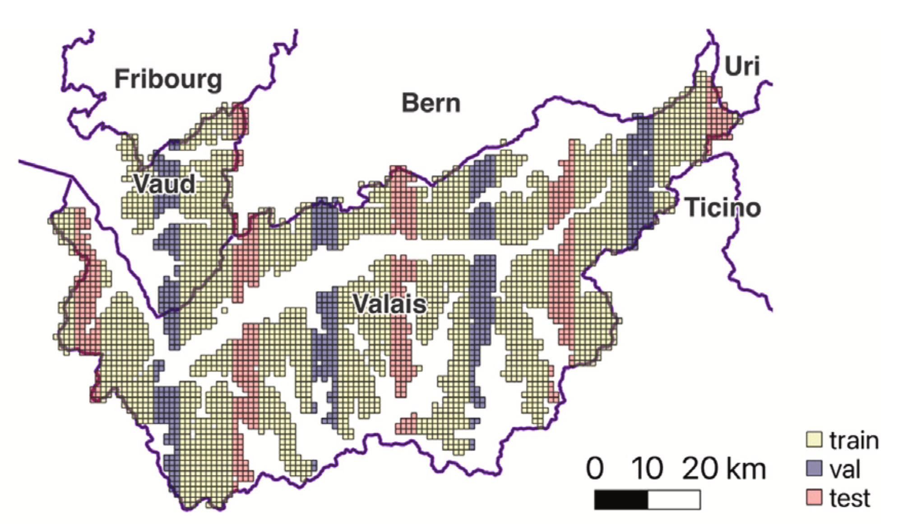

  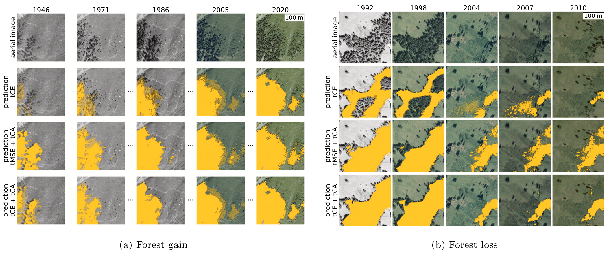

Thien-Anh Nguyen · EPFL · Research example reproduced from the source talk, slide 9.

<!-- Source: why_need_representations.pptx, slide 9. -->

---
class: course-intro
---

# Effective representations of geodata

  
  

  
<strong>Geodata</strong>
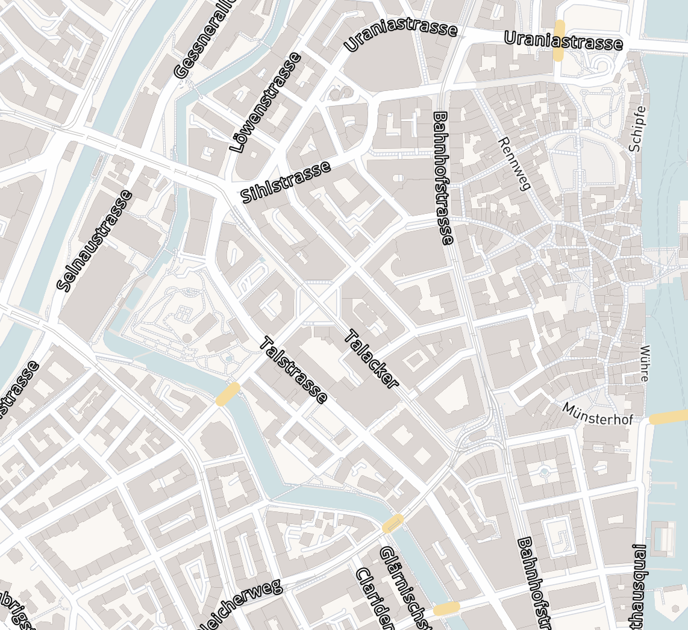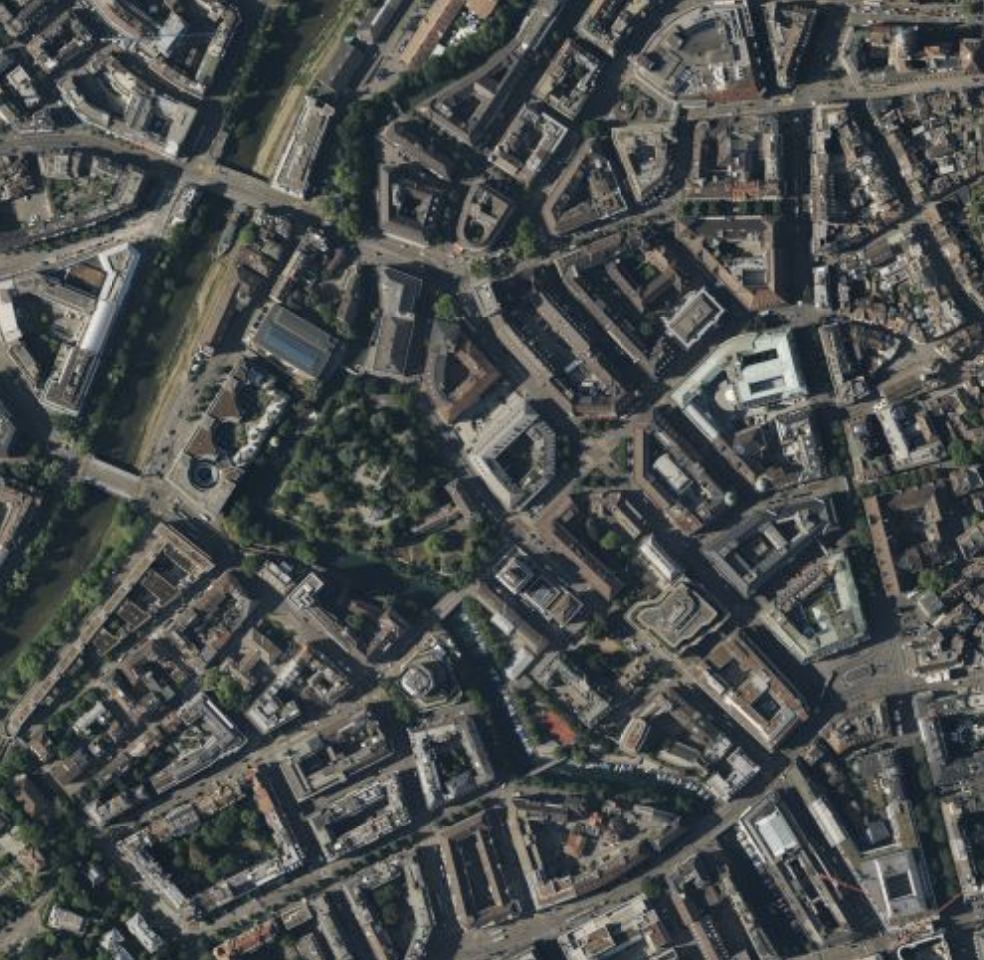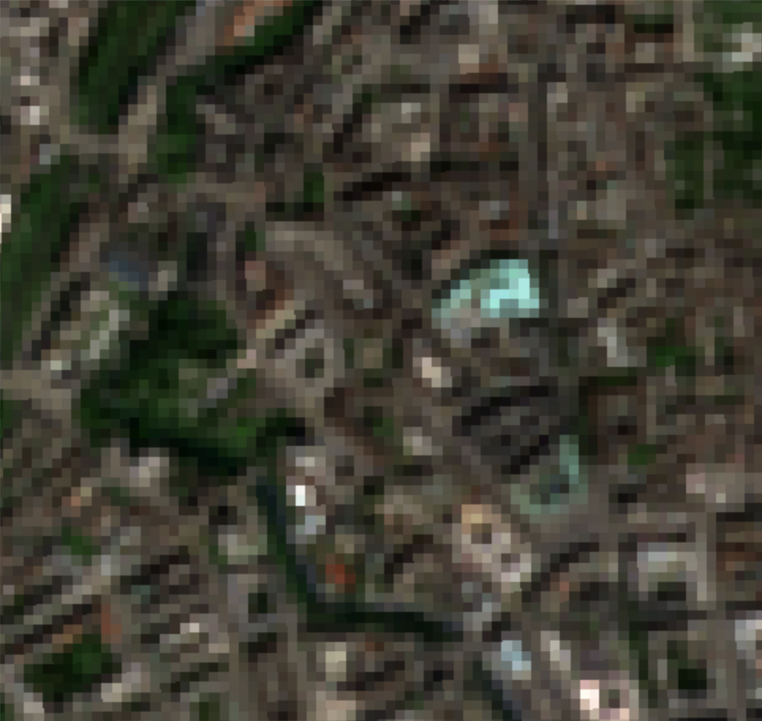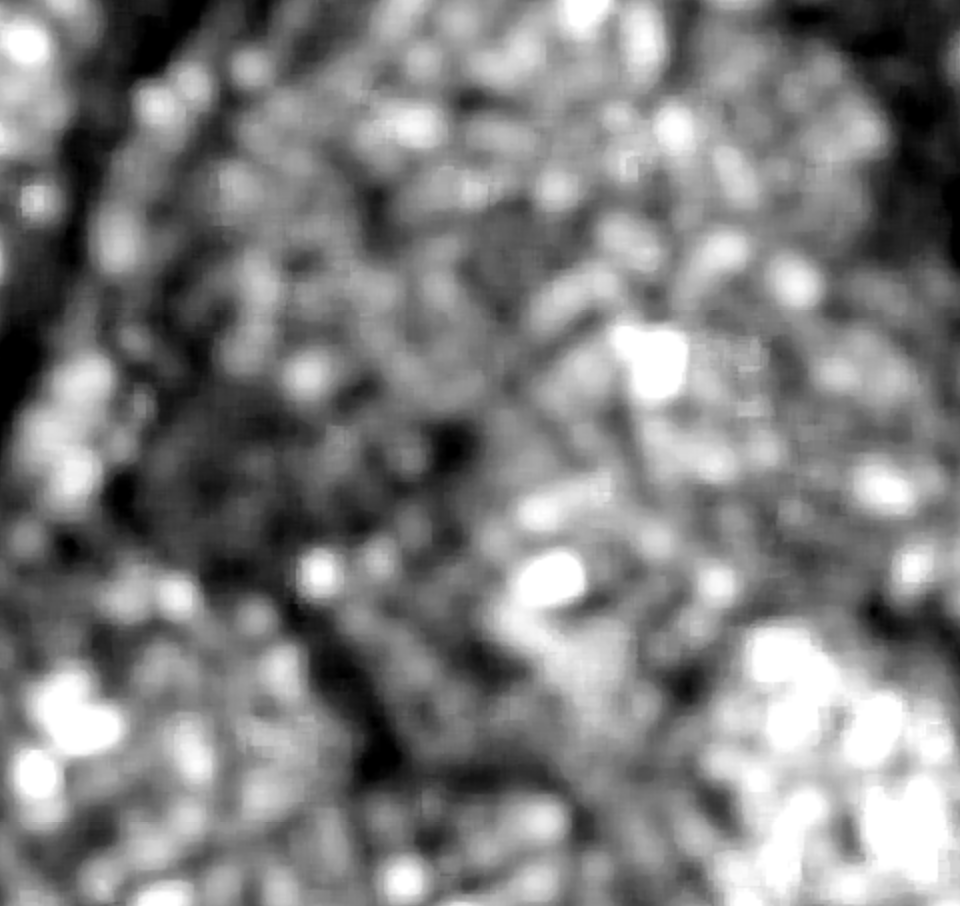

  
<strong>Effective geospatial representations</strong>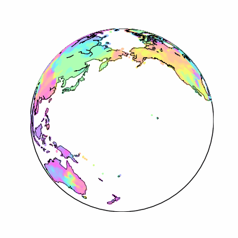

  <strong class="intro-decisions">Informed decisions</strong>

Satellite and weather data at enormous scaleEffective geospatial data representations

<!-- Source: why_need_representations.pptx, slide 10. Original images and animated globe retained. Source data-store and arrow geometry reconstructed in editable HTML/CSS. Source describes thousands of petabytes; phrased qualitatively here without introducing a new estimate. -->
