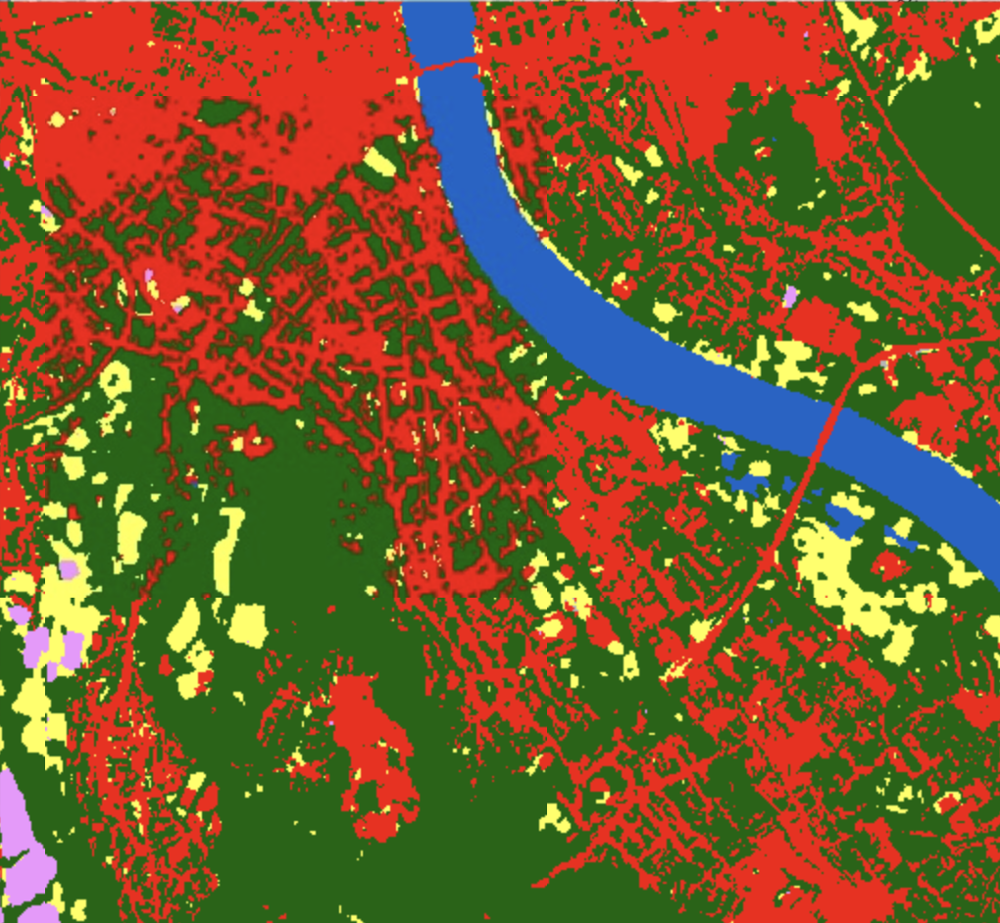
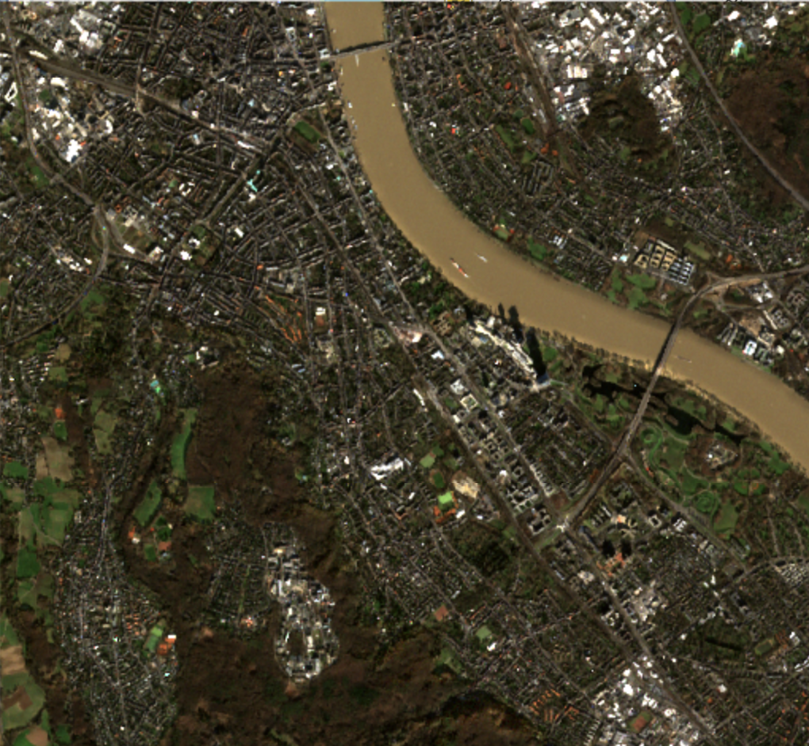
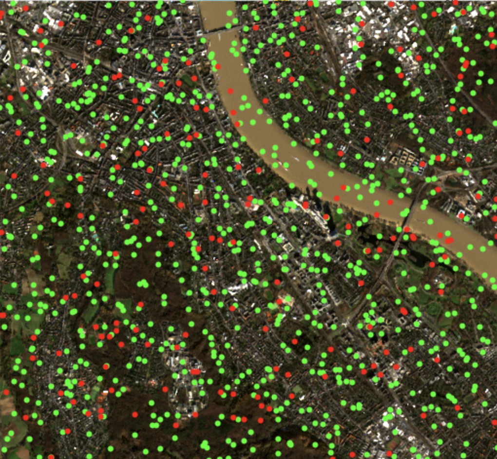
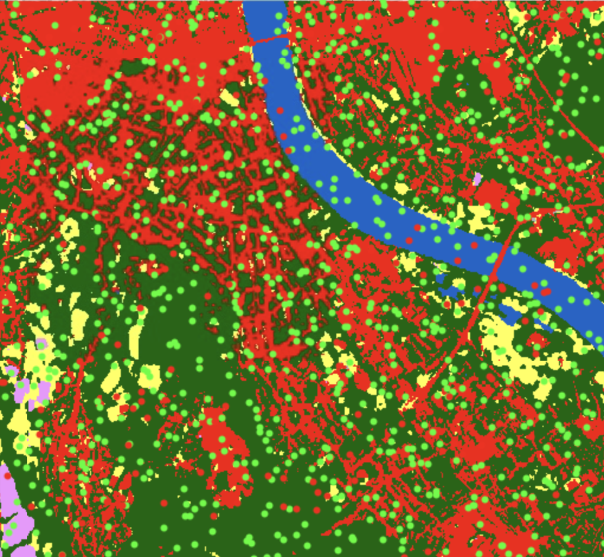

# Lab 3 — Improve a Land-Cover Classifier

Start from the provided notebook and improve its accuracy.

<!--
Two-hour lab in the Lab 2 groups. Everyone starts from the same Sentinel-2 random forest notebook.
The task: improve the accuracy by any means (more data, PCA, domain features, tuning), re-run the evaluation and report the accuracy.
At the end, groups report their accuracies for a leaderboard.
-->

---

# Task: Land-Cover Classification in Bonn

Build a **random forest** that predicts the land-cover class at each location &mdash; and improve its test accuracy **by any means necessary**:

<strong class="text-[#00457c]">1 &middot; More data</strong> &mdash; add geodata from Lab 2

<strong class="text-[#00457c]">2 &middot; Decorrelated data</strong> &mdash; PCA on the input variables

<strong class="text-[#00457c]">3 &middot; Domain-specific features</strong> &mdash; e.g. NDVI

<strong class="text-[#ff7900]">4 &middot; Better-tuned random forests</strong> &mdash; hyperparameters

<!--
The four options follow the four sections of Lecture 3: more data, less redundant data (PCA), more descriptive data (domain knowledge), better models (random forests).
Blue = feature side, orange = model side, as in the lecture's machine learning pipeline.
-->

---

# Dataset

Input X (e.g., Sentinel-2 pixel reflectances)

| Pt | Red | Green | Blue | NIR |
|---|---|---|---|---|
| Pt1 | 0.08 | 0.11 | 0.09 | 0.42 |
| Pt2 | 0.21 | 0.19 | 0.15 | 0.05 |
| &vellip; | &vellip; | &vellip; | &vellip; | &vellip; |

Target y (e.g., land cover labels)

| Pt | Land Cover |
|---|---|
| Pt1 | Vegetation |
| Pt2 | Built-up |
| &vellip; | &vellip; |

Raw bands

| Pt | Red | Green | Blue | NIR | Land Cover |
|---|---|---|---|---|---|
| Pt1 | 0.08 | 0.11 | 0.09 | 0.42 | **Vegetation** |
| Pt2 | 0.21 | 0.19 | 0.15 | 0.05 | **Built-up** |
| &vellip; | &vellip; | &vellip; | &vellip; | &vellip; | &vellip; |

<PlotlyHistogram dataset="green" x-label="Green reflectance" :height="145" />

Engineered feature

$$
\text{NDVI} = \frac{\text{NIR} - \text{Red}}{\text{NIR} + \text{Red}}
$$

| Pt | NDVI | Land Cover |
|---|---|---|
| Pt1 | 0.68 | **Vegetation** |
| Pt2 | -0.62 | **Built-up** |
| &vellip; | &vellip; | &vellip; |

<PlotlyHistogram dataset="ndvi" x-label="NDVI" :show-legend="false" :height="120" />

<!--
Presenter note: This slide is the bridge from geospatial images to tabular ML data.
Click 1: sample points on both the input image and the target map.
Click 2: collapse both into one tabular dataset, X columns plus y column, one row per point &mdash; the format every classic ML model consumes.
Click 3: combine red and NIR into NDVI. The new feature separates vegetation from built-up more clearly than green reflectance alone, making the classification easier.
-->

---

# Your Task in Four Steps

1

<strong>Study</strong> the provided notebook

2

<strong>Improve</strong> the classifier by any of the four means

3

<strong>Run</strong> the evaluation and note the accuracy

4

<strong>Report</strong> your accuracy with your group number for the leaderboard

- **Notebook:** [Lab 3 land-cover classification notebook](https://drive.google.com/file/d/1Hie8H-nR5DAvS5pawNaKaO_DTFgiqWz6/view?usp=drive_link) &mdash; make a copy for your group
- **Lab 3 files:** [Sentinel-2 image, land-cover raster and sample coordinates](https://drive.google.com/drive/folders/1EeJd6xvcZpgvdPJ8TgLOrogf_2n-Jg9q?usp=sharing)
- **Additional geodata:** [Lab 2 data collection](https://drive.google.com/drive/folders/10w5toFK7Hv9QeXCRJTYN4MgWE2TDqgeT)

Stay in your Lab 2 groups. Work with pandas; a CPU runtime is sufficient.

---

# Step 1 &middot; Study the Provided Notebook

Open the [notebook](https://drive.google.com/file/d/1Hie8H-nR5DAvS5pawNaKaO_DTFgiqWz6/view?usp=drive_link), save a copy, and run it once from top to bottom with the [Lab 3 files](https://drive.google.com/drive/folders/1EeJd6xvcZpgvdPJ8TgLOrogf_2n-Jg9q?usp=sharing). Find out:

- **Locations:** where are the sample coordinates loaded, and which rows are <code>train</code> and <code>test</code>?
- **Features:** how are the Sentinel-2 bands sampled at these locations?
- **Labels:** how is the land-cover class sampled as the target?

- **DataFrame:** which columns form the features X and the target y?
- **Model:** how is the random forest fitted?
- **Evaluation:** where are the test accuracy and the confusion matrix computed?

Write down the <strong>baseline accuracy</strong> of the unchanged notebook. You will compare against it in Step 3.

---

# Step 2 &middot; Improve the Classifier

Try one or more of the four means &mdash; one change at a time, so you know what helped.

<strong class="text-[#00457c]">1 &middot; More data</strong> 
sample sources from the <a href="https://drive.google.com/drive/folders/10w5toFK7Hv9QeXCRJTYN4MgWE2TDqgeT" target="_blank" rel="noopener noreferrer">Lab 2 data collection</a> at the same coordinates; add them as new columns, matched by <code>sample_id</code>

<strong class="text-[#00457c]">2 &middot; Decorrelated data</strong> 
transform the input columns with <code>sklearn.decomposition.PCA</code>; fit it on the <code>train</code> rows only

<strong class="text-[#00457c]">3 &middot; Domain-specific features</strong> 
compute indices such as NDVI from the bands; S2 bands: <strong>B2, B3, B4, B8</strong> (blue, green, red, NIR)

<strong class="text-[#ff7900]">4 &middot; Better-tuned random forests</strong> 
e.g. <code>n_estimators</code>, <code>max_depth</code>, <code>max_features</code>; tune with cross-validation on the <code>train</code> rows

Checks: transform coordinates to each source's CRS (S2: EPSG:32632, land cover: EPSG:4326) &middot; check missing values &middot; never use the land-cover label or the <code>test</code> rows to build features or tune the model.

---

# Step 3 &middot; Run the Evaluation

Re-run the notebook's evaluation with your improved model.

- keep the supplied <code>train</code> / <code>test</code> split unchanged
- if your new data has gaps, evaluate the baseline and your model on the **same rows**

| Model | Train rows | Test rows | Test accuracy |
| --- | --- | --- | --- |
| Baseline (Sentinel-2 only) | &hellip; | &hellip; | &hellip; |
| Your improved model (what you changed: &hellip;) | &hellip; | &hellip; | &hellip; |

Look at the confusion matrix: which classes improve, and which errors remain?

