# PCA: Orthogonalizing Data

<!--
Backup slides for Lecture 3 (Data Representations): Principal Component Analysis as the algorithmic way to orthogonalize correlated dimensions. Moved out of the main deck; it follows on from the More Data block.
-->

---
section: pca
sectionTitle: PCA
---

# Reducing Dimensions: Two Approaches

<div class="mx-auto w-fit mt-3 px-4 py-1.5 rounded-lg border-2 border-[#00457c] text-[.85rem] text-[#00457c] font-semibold">
Keep as many dimensions as necessary, but as few as possible.
</div>

<div class="grid grid-cols-2 gap-6 mt-4 text-[.72rem]">

<div class="rounded-xl border-2 border-[#00457c] px-4 py-2">

**1 &middot; Feature selection** <span class="text-gray-500">(domain knowledge)</span>

- design features that summarise correlated bands: spectral indices (NDVI, SAVI, EVI, &hellip;), radar ratios
- automatically select the most important features

</div>

<div class="rounded-xl border-2 border-[#0f7d5c] px-4 py-2">

**2 &middot; Dimensionality reduction** <span class="text-gray-500">(domain-agnostic)</span>

- project the data into fewer, less correlated, more informative dimensions
- algorithms: **Principal Component Analysis (PCA)**, Minimum Noise Fraction (MNF), &hellip;

</div>

</div>

<!--
Two ways to get rid of redundant, correlated dimensions:
1. with domain knowledge: we know which bands carry which physical signal and combine them into indices (the "Better Features" block in Lecture 3);
2. algorithmically: PCA finds uncorrelated, orthogonal combinations from the data alone, without knowing what the bands mean (next block).
-->

---
layout: bonn-section
sectionColor: "#0f7d5c"
section: pca
---

# PCA: Orthogonalizing Data

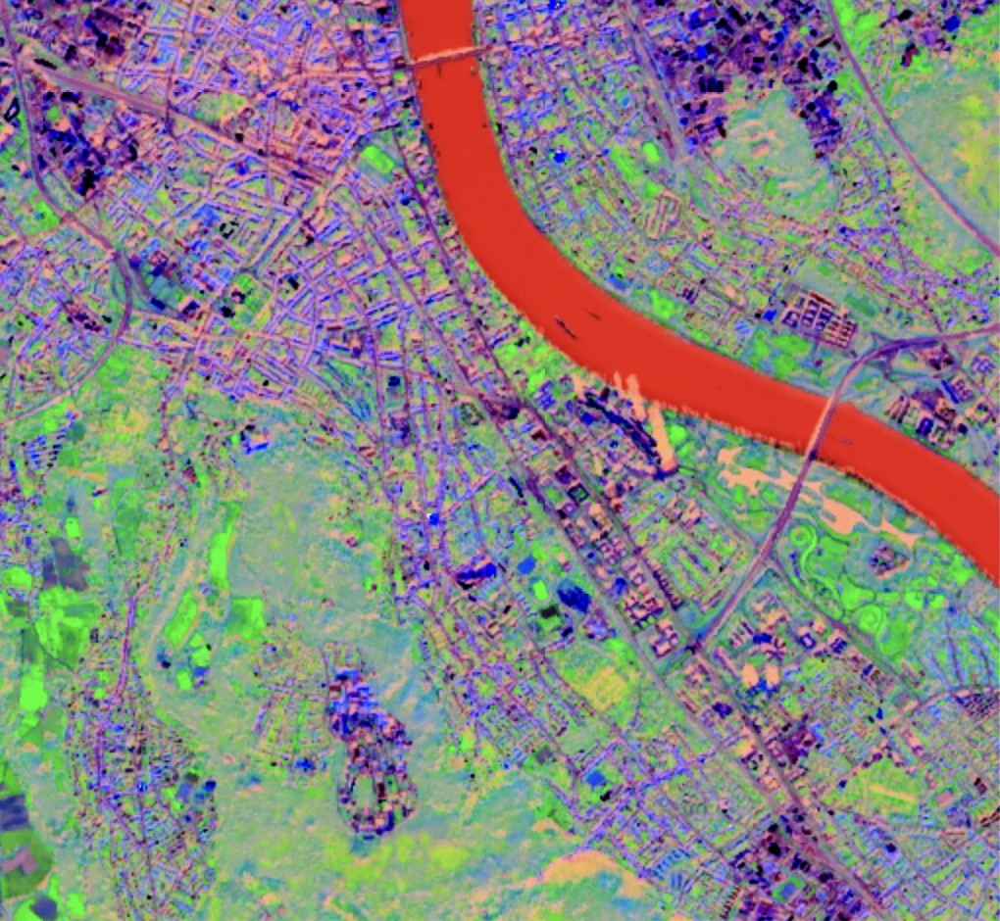

<div class="bonn-section-citation">
Sentinel-2 scene of Bonn, first three principal components as RGB.
</div>

<!--
Approach 2 to reduce correlated dimensions: instead of expert knowledge, let an algorithm find new, uncorrelated combinations of the bands.
Path through the block: measure redundancy (variance, covariance) -> remove it by translating and rotating the data -> how to compute the rotation (eigendecomposition) -> how many components to keep -> what PCA gives us in practice.
Material adapted from the Wageningen Remote Sensing course (GRS-20306).
-->

---
section: pca
---

<script setup>
import StatsDataMatrix from './components/StatsDataMatrix.vue'
import NormalCurve from './components/NormalCurve.vue'
</script>

# (Image) Statistics 1: A Single Variable

<div class="grid grid-cols-2 gap-8 mt-2">

<div class="text-[.84rem] compact-math stats-boxes">

<div class="font-semibold text-[#00457c] mb-1">Statistical moments of one band <em>d</em></div>

<div class="rounded-lg border-2 border-[#00457c] px-3 py-1 mb-2">

**1st moment: mean**

$$
\mu_d = \frac{1}{N} \sum_{n=1}^{N} x_{n,d}
$$

</div>

<div class="rounded-lg border-2 border-[#00457c] px-3 py-1 mb-2">

**2nd moment: variance**

$$
\sigma_d^2 = \frac{1}{N-1} \sum_{n=1}^{N} (x_{n,d} - \mu_d)^2
$$

</div>

<div class="rounded-lg border-2 border-[#00457c] px-3 py-1 mb-2 text-gray-500">

**3rd moment: skewness** &nbsp;&middot;&nbsp; **4th moment: kurtosis**

</div>

</div>

<div>

<div class="w-[62%] mx-auto">
<StatsDataMatrix :dims="1" />
</div>

<div class="w-full mt-2">
<NormalCurve />
</div>

</div>

</div>

<!--
Start with one band (one column of the data matrix): iterate through all N pixels.
The mean is the centre, the variance the spread. For a normal distribution, 68 % of the pixels lie within one standard deviation.
Skewness and kurtosis exist, but PCA only needs the first two moments.
-->

---
section: pca
---

<script setup>
import StatsDataMatrix from './components/StatsDataMatrix.vue'
import CovarianceSketch from './components/CovarianceSketch.vue'
</script>

# (Image) Statistics 2: Two Variables

<div class="grid gap-6 mt-2" style="grid-template-columns: 1fr 1.15fr">

<div class="text-[.84rem] compact-math stats-boxes">

<div class="font-semibold text-[#00457c] mb-1">Statistical moments of two bands <em>d</em><sub>1</sub>, <em>d</em><sub>2</sub></div>

<div class="rounded-lg border-2 border-[#00457c] px-3 py-1 mb-2">

**1st moment: mean vector**

$$
\boldsymbol{\mu} = \begin{pmatrix} \mu_{d_1} \\ \mu_{d_2} \end{pmatrix}, \quad \mu_d = \frac{1}{N} \sum_{n=1}^{N} x_{n,d}
$$

</div>

<div class="rounded-lg border-2 border-[#00457c] px-3 py-1 mb-2">

**2nd moment: covariance matrix**

$$
\mathbf{C} = \begin{pmatrix} \sigma_{d_1}^2 & \sigma_{d_1 d_2} \\ \sigma_{d_2 d_1} & \sigma_{d_2}^2 \end{pmatrix}
$$

with the **covariance**

$$
\sigma_{d_1 d_2} = \sigma_{d_2 d_1} = \frac{1}{N-1} \sum_{n=1}^{N} (x_{n,d_1} - \mu_{d_1})(x_{n,d_2} - \mu_{d_2})
$$

</div>

</div>

<div class="grid grid-cols-2 gap-3 items-center">

<div>
<StatsDataMatrix :dims="2" />
</div>

<div>
<CovarianceSketch />
</div>

</div>

</div>

<!--
Two bands at once: the mean becomes a vector, the variance a 2 × 2 covariance matrix.
The diagonal holds the variances (spread along each axis); the off-diagonal holds the covariance, the diagonal spread of the cloud. It is symmetric.
Positive covariance: both bands rise together (e.g. green and red).
-->

---
section: pca
---

<script setup>
import StatsDataMatrix from './components/StatsDataMatrix.vue'
import CovarianceSketch from './components/CovarianceSketch.vue'
</script>

# (Image) Statistics 3: Many Variables

<div class="grid gap-6 mt-2" style="grid-template-columns: 1fr 1.15fr">

<div class="text-[.84rem] compact-math stats-boxes">

<div class="font-semibold text-[#00457c] mb-1">Statistical moments of all <em>D</em> bands</div>

<div class="rounded-lg border-2 border-[#00457c] px-3 py-1 mb-2">

**1st moment: mean vector**

$$
\boldsymbol{\mu} = (\mu_1, \mu_2, \ldots, \mu_D)
$$

</div>

<div class="rounded-lg border-2 border-[#00457c] px-3 py-1 mb-2">

It is advised to **center** the data matrix:

$$
\tilde{\mathbf{X}} = \mathbf{X} - \boldsymbol{\mu}
$$

</div>

<div class="rounded-lg border-2 border-[#00457c] px-3 py-1 mb-2">

**2nd moment: covariance matrix** ($D \times D$)

$$
\mathbf{C} =
\begin{pmatrix}
\sigma_{1}^2 & \cdots & \sigma_{1 D} \\
\vdots & \ddots & \vdots \\
\sigma_{D 1} & \cdots & \sigma_{D}^2
\end{pmatrix}
= \frac{1}{N-1} \tilde{\mathbf{X}}^\top \tilde{\mathbf{X}}
$$

</div>

</div>

<div class="grid grid-cols-2 gap-3 items-center">

<div>
<StatsDataMatrix dims="D" />
</div>

<div>
<CovarianceSketch />
<div class="text-[.62rem] text-gray-600 text-center mt-1">every pair of bands has such a covariance</div>
</div>

</div>

</div>

<!--
Generalise to D bands: one mean per band, and a D × D covariance matrix with all pairwise covariances.
After centering, the whole matrix is one matrix product: C = X̃ᵀX̃ / (N − 1). This is also why PCA is fast to compute.
-->

---
section: pca
---

# Covariance vs. Correlation Matrix

<div class="grid grid-cols-[1fr_1fr_.9fr] gap-5 mt-2 items-start">

<div class="text-center">
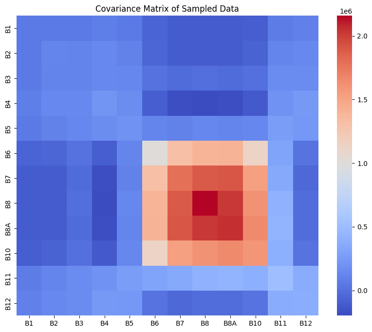
<div class="text-[.66rem] text-gray-600 mt-1">Covariances are dominated by bands with large variance (NIR).</div>
</div>

<div class="text-center">
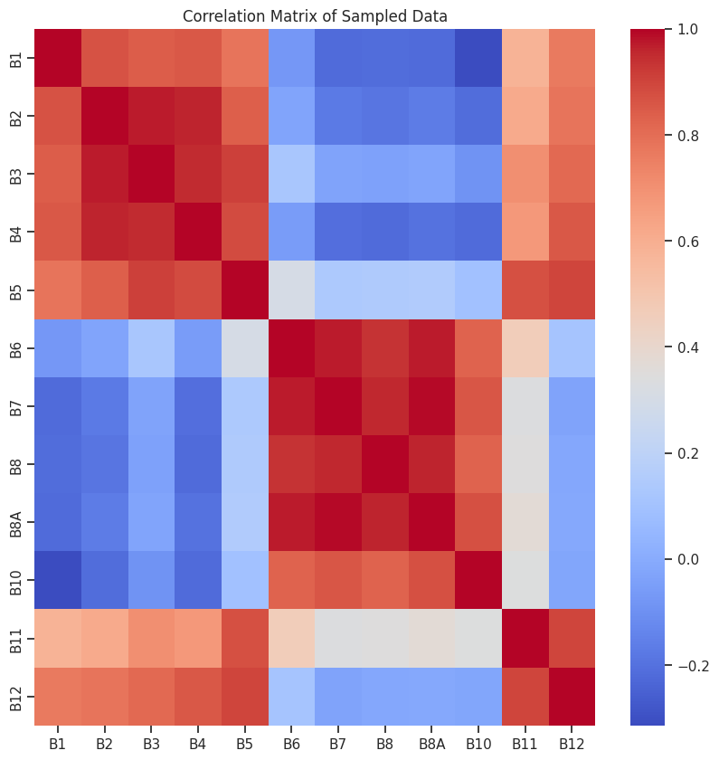
<div class="text-[.66rem] text-gray-600 mt-1">Correlation = normalised covariance</div>
</div>

<div class="text-[.72rem]">

$$
\rho_{d_1 d_2} = \frac{\sigma_{d_1 d_2}}{\sigma_{d_1}\, \sigma_{d_2}} \in [-1, 1]
$$

Correlation is the **normalised** covariance: it removes the effect of the band variances and makes bands comparable.

</div>

</div>

---
section: pca
---

<script setup>
import CovariancePcaDemo from './components/CovariancePcaDemo.vue'
</script>

# Which Covariance Do We Want?

<div class="mt-1">
<CovariancePcaDemo />
</div>

<div class="text-[.74rem] mt-2 text-gray-700">
For a high <strong>information density</strong>, we want <strong>small covariances</strong>. We can <strong>translate</strong> (center) and <strong>rotate</strong> the data so that the covariances vanish: this is <strong>Principal Component Analysis</strong>.
</div>

<!--
Ask first: what covariance would we like our data to have? Then demo:
- vary the correlation: positive / negative / no covariance
- step 1 centres the data (translation by -μ)
- step 2 rotates onto the principal axes: the off-diagonal entries become 0, the diagonal entries are the eigenvalues
PC 1 is the direction of highest "explained" variance.
-->

---
section: pca
---

<script setup>
import PcaGeometry from './components/PcaGeometry.vue'
</script>

# PCA: A Linear Orthogonal Transformation

<div class="grid grid-cols-2 gap-8 mt-3 items-center">

<div class="text-[.8rem]">

1. **translation**: $\tilde{\mathbf{X}} = \mathbf{X} - \boldsymbol{\mu}$
2. **rotation** by angle $\alpha$

$D$ original **correlated** variables $x_1, \ldots, x_D$

<div class="pl-8 text-[#00457c] font-semibold">&darr; PCA</div>

$D$ new **uncorrelated** variables $p_1, \ldots, p_D$

<blockquote class="blockquote3">
Translation and rotation do not lose information: with all <em>D</em> components, the data can be fully reconstructed.
</blockquote>

</div>

<div>
<PcaGeometry />
</div>

</div>

---
section: pca
---

# PCs Are Uncorrelated &ldquo;Synthetic Bands&rdquo;

<div class="grid grid-cols-[1fr_auto_1fr] gap-6 items-center mt-4">

<div class="text-center">
<div class="text-[.74rem] font-semibold text-[#00457c] mb-1">12 correlated Sentinel-2 bands</div>

</div>

<div class="flex flex-col items-center gap-1 text-[.7rem] text-[#00457c] font-semibold">
  <div class="px-5 py-3 bg-[#00457c] text-white rounded" style="clip-path: polygon(0 0, 100% 25%, 100% 75%, 0 100%);">PCT</div>
  principal component<br>transformation
</div>

<div class="text-center">
<div class="text-[.74rem] font-semibold text-[#0f7d5c] mb-1">(fewer) uncorrelated principal components</div>
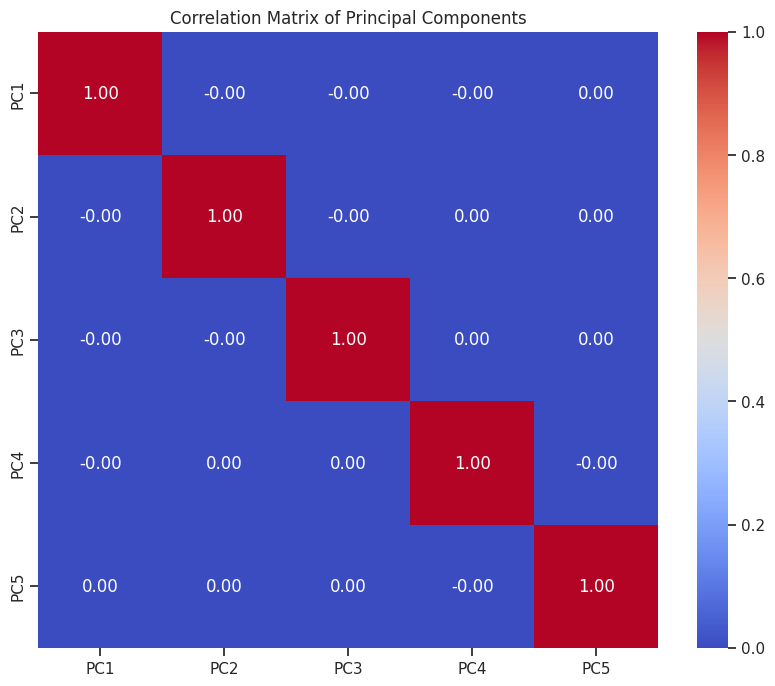
</div>

</div>

<div class="text-[.76rem] text-center mt-3">
Same goal as a spectral index &ndash; remove redundancy &ndash; but found <strong>from the data alone</strong>, without knowing what the bands mean.
</div>

<!--
This is the result we are after: the correlation matrix of the principal components is the identity. Every PC carries information that no other PC carries.
Compare with the Better Features block: NDVI also merges correlated bands, but we had to know the physics. PCA only needs the covariance matrix. How to compute the rotation: next slides.
-->

---
section: pca
---

<script setup>
import EigenTransformDemo from './components/EigenTransformDemo.vue'
</script>

# Covariance as a Linear Transformation

<div class="mt-1">
<EigenTransformDemo />
</div>

<div class="mt-1 text-[.68rem] flex items-center gap-6">
<div>

Applied to a unit circle, $\mathbf{C}$ describes the **spread of the data**: $\mathbf{x} = \mathbf{C}\mathbf{a}$.

</div>
<div class="rounded-lg border-2 border-[#00457c] px-3 py-1">

**Eigenvectors** $\mathbf{v}$ and **eigenvalues** $\lambda$ of $\mathbf{C}$: $\;\mathbf{C}\mathbf{v} = \lambda \mathbf{v}$

</div>
</div>

<!--
How do we find the rotation that removes the covariances? The covariance matrix itself tells us.
Rotate the probe vector a. In most directions, Ca points somewhere else. Only along the eigenvectors is Ca a scaled copy of a; the scaling factor is the eigenvalue.
For a symmetric (covariance) matrix, the eigenvectors are orthogonal.
In practice: eigvals, eigvecs = np.linalg.eig(C)
-->

---
section: pca
---

<script setup>
import EvdDiagram from './components/EvdDiagram.vue'
</script>

# Eigendecomposition: Rotation and Scaling

<div class="mt-2">
<EvdDiagram geometry />
</div>

<div class="text-[.74rem] -mt-1">

$\mathbf{C} = \mathbf{V}\mathbf{L}\mathbf{V}^\top$: the rotation $\mathbf{V}^\top \tilde{\mathbf{x}}$ **decorrelates** the data, and the **eigenvalues are the variances** in the rotated space.

</div>

<!--
Any symmetric D×D matrix can be decomposed: eigvals, eigvecs = np.linalg.eig(C).
Read the bottom row from left to right: rotate into the eigenvector frame, scale each axis by its eigenvalue, rotate back.
-->

---
section: pca
---

<script setup>
import EvdDiagram from './components/EvdDiagram.vue'
</script>

# Few Large Eigenvalues: Principal Components

<div class="mt-1">
<EvdDiagram variant="truncated" />
</div>

<div class="grid grid-cols-4 gap-4 mt-1 items-center text-[.64rem] text-center text-gray-600">
<div>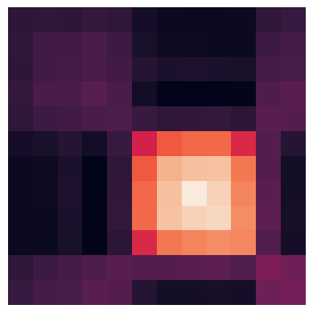covariance of 12 bands</div>
<div>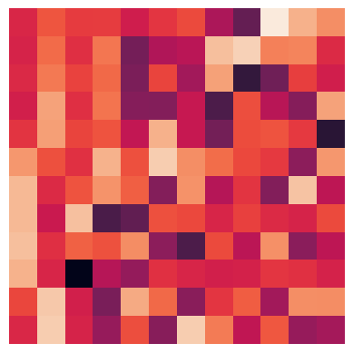eigenvectors</div>
<div>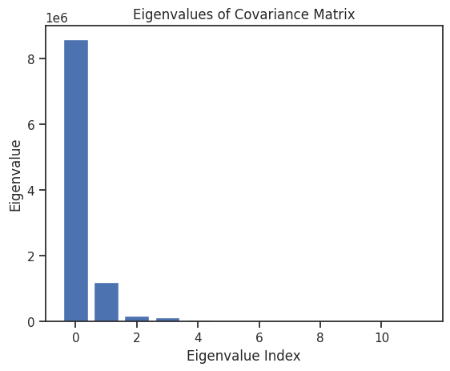eigenvalues: only few are large</div>
<div class="text-left text-[.7rem] text-gray-800">

If bands are strongly correlated, **most eigenvalues are close to 0**: keep only the $P \ll D$ eigenvectors with the largest eigenvalues, the **principal components**.

</div>
</div>

<!--
Terminology: the truncated eigenvector matrix is the PCA or loading matrix P; projecting data onto it gives the scores.
Note: it is common to scale eigenvectors to loading vectors p = v·sqrt(λ).
-->

---
section: pca
---

<script setup>
import PctPipeline from './components/PctPipeline.vue'
</script>

# Principal Component Transformation (PCT)

<div class="mt-3">
<PctPipeline />
</div>

<div class="mx-auto w-fit mt-1 px-4 py-1 rounded-lg border-2 border-[#00457c] text-[.78rem] text-[#00457c]">
Once the eigenvectors are known: <strong>one matrix multiplication</strong> per pixel.
</div>

---
section: pca
---

<script setup>
import ScreePlotDemo from './components/ScreePlotDemo.vue'
</script>

# How Many Principal Components to Choose?

<div class="grid grid-cols-5 gap-8 mt-2 items-start">

<div class="col-span-3">
<ScreePlotDemo />
</div>

<div class="col-span-2 text-[.78rem]">

It depends on the **correlation** in the data: the stronger the correlation, the fewer components are needed.

1. sort the eigenvalues $\lambda_1 \geq \lambda_2 \geq \ldots$
2. compute the **explained variance ratio** $\lambda_i / \sum_j \lambda_j$
3. choose $P$ so that the cumulative ratio exceeds e.g. **90 %, 95 % or 99 %**

<div class="text-[.7rem] text-gray-600 mt-3">
Exercise: eigenvalues (0.4, 0.3, 0.2, 0.1, 0.0). How many PCs for 90 %?
</div>

</div>

</div>

<!--
Solution of the exercise: 3, since 0.4 + 0.3 + 0.2 = 0.9.
Demo: compare the Sentinel-2 spectrum (2 PCs for 90 %) with weakly correlated features (many more PCs needed).
-->

---
section: pca
clicks: 2
---

<script setup>
import PctReconstruction from './components/PctReconstruction.vue'
</script>

# Principal Components &ldquo;Densify&rdquo; Information

<div class="text-[.74rem] text-gray-600 -mt-2">by removing the correlation between bands</div>

<div class="mt-2">
<PctReconstruction :clicks="$clicks" />
</div>

<!--
The inverse transformation reconstructs all 13 bands from only a few principal components.
Click through: 2 PCs explain 93 %, 3 PCs 96 %, 6 PCs 99 % of the variance.
-->

---
section: pca
---

<script setup>
import PcaGeometry from './components/PcaGeometry.vue'
</script>

# Summary: Calculating Principal Components

<div class="grid grid-cols-2 gap-8 mt-3 items-center">

<div class="text-[.76rem]">

The **principal components** $\mathbf{p}_1, \mathbf{p}_2, \ldots$ are the **eigenvectors** with the largest **eigenvalues** of the **covariance matrix** $\mathbf{C}$.

1. center the data matrix: $\tilde{\mathbf{X}} = \mathbf{X} - \boldsymbol{\mu}$ &nbsp;<span class="text-gray-500">($N$ pixels &times; $D$ bands)</span>
2. calculate the $D \times D$ covariance matrix $\mathbf{C}$
3. calculate eigenvectors $\mathbf{v}_1, \ldots, \mathbf{v}_D$ and eigenvalues $\lambda_1, \ldots, \lambda_D$
4. sort by eigenvalue and keep the $P \ll D$ eigenvectors with the largest $\lambda$
5. project $\tilde{\mathbf{X}}$ onto the principal components to obtain the reduced dataset

</div>

<div>
<PcaGeometry />
</div>

</div>

---
section: pca
---

# What Do We Get? Visualization and Analysis

<div class="grid grid-cols-[1fr_auto_1.35fr] gap-6 items-center mt-3">

<div class="relative h-[300px]">
  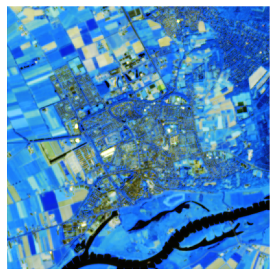
  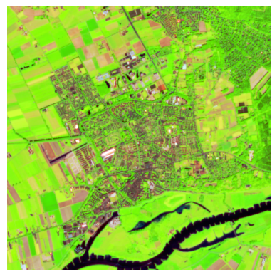
  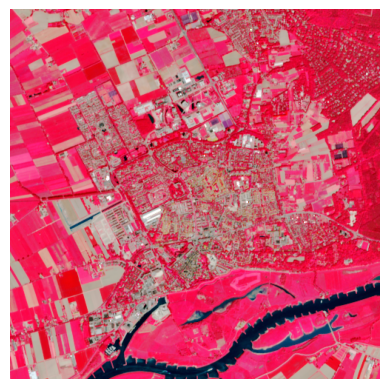
  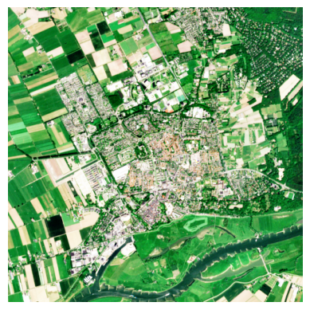
  <div class="absolute left-0 bottom-0 text-[.68rem] text-gray-600">13 Sentinel-2 bands</div>
</div>

<div class="flex flex-col items-center gap-1 text-[.7rem] text-[#00457c] font-semibold">
  <div class="px-4 py-3 bg-[#00457c] text-white rounded" style="clip-path: polygon(0 0, 100% 25%, 100% 75%, 0 100%);">PCT</div>
  <span class="w-10 h-4 rounded bg-[#e8706f] text-white text-[.55rem] grid place-items-center">PC1</span>
  <span class="w-10 h-4 rounded bg-[#5fbf6a] text-white text-[.55rem] grid place-items-center">PC2</span>
  <span class="w-10 h-4 rounded bg-[#7fb0de] text-white text-[.55rem] grid place-items-center">PC3</span>
</div>

<div class="flex flex-col gap-3">

<div class="rounded-xl border-2 border-[#00457c] p-2 flex gap-3 items-center">
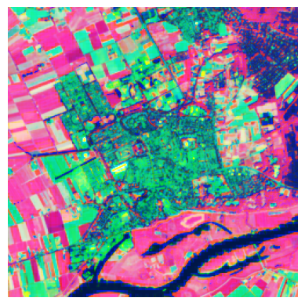
<div class="text-[.72rem]"><strong>Purpose 1: Visualization</strong><br>the 3 most informative principal components shown as red, green and blue</div>
</div>

<div class="rounded-xl border-2 border-[#00457c] p-2">
<div class="text-[.72rem] mb-1"><strong>Purpose 2: Analysis</strong></div>
<div class="grid grid-cols-3 gap-2 text-[.6rem] text-center text-gray-600">
<div>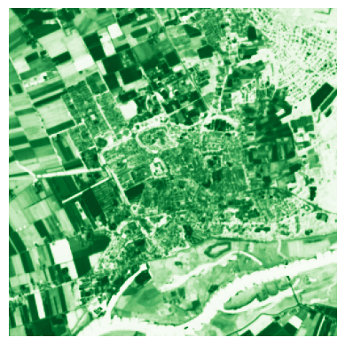PC1 &ndash; &ldquo;vegetation&rdquo;</div>
<div>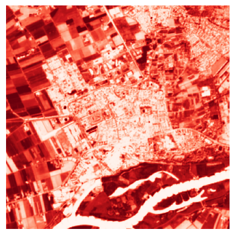PC2 &ndash; &ldquo;built-up &amp; veg.&rdquo;</div>
<div>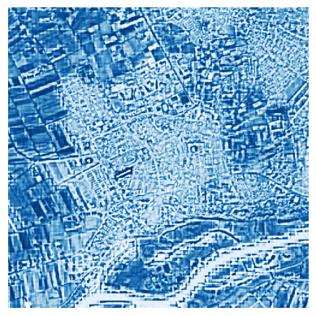PC3 &ndash; &ldquo;built-up&rdquo;</div>
</div>
</div>

</div>

</div>

<!--
The principal component transformation (PCT) maps 13 correlated bands to a few synthetic bands. We use them for visualization (any 3 PCs fit into RGB) and for analysis (each PC highlights a different surface type).
-->

---
section: pca
---

# Purpose 1: Visualization

<div class="grid grid-cols-3 gap-5 mt-2">

<div class="text-center">
<div class="text-[.72rem] font-semibold text-[#00457c] mb-1">True colour: 3 of 12 bands</div>
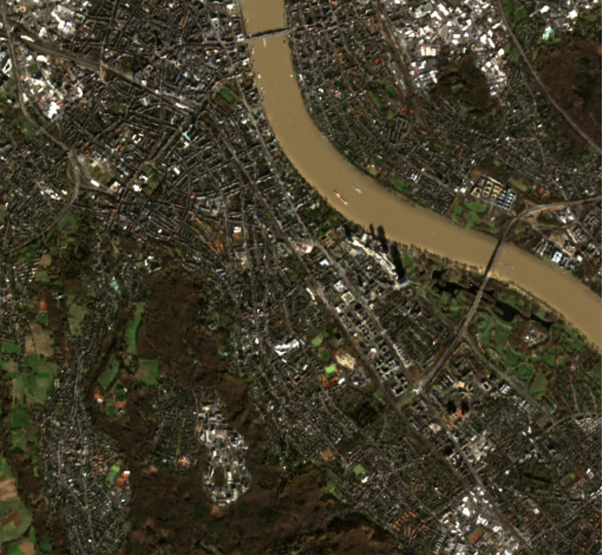
</div>

<div class="text-center">
<div class="text-[.72rem] font-semibold text-[#6a3d9a] mb-1">NDVI: one <em>designed</em> feature</div>
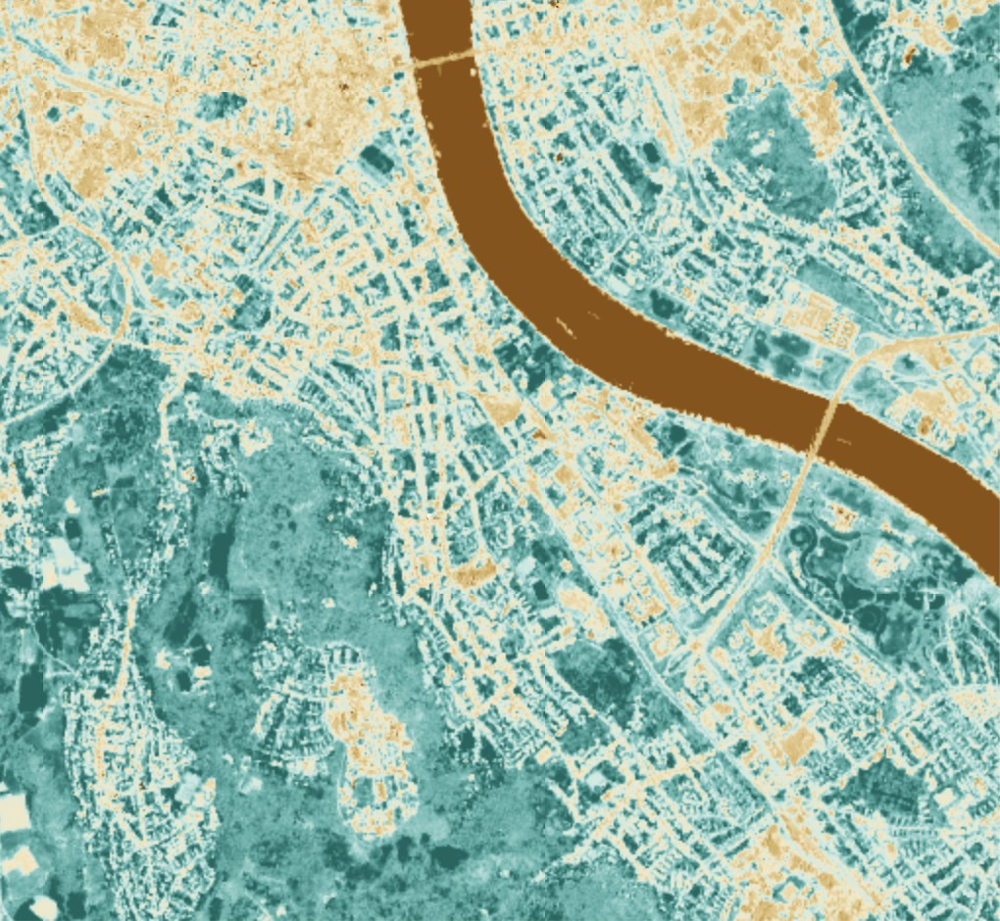
</div>

<div class="text-center">
<div class="text-[.72rem] font-semibold text-[#0f7d5c] mb-1">PC 1&ndash;3 as RGB: <em>learned</em> features</div>

</div>

</div>

<div class="grid grid-cols-3 gap-5 mt-2 text-[.68rem] text-gray-700">
<div>Leaf-off forest and dense city both look dark.</div>
<div>Vegetation (teal) vs. built-up (beige) vs. water (brown) &ndash; one dimension, interpretable.</div>
<div>Water, grassland, forest and built-up separate at once &ndash; no expert knowledge needed, but no physical unit.</div>
</div>

<!--
Same Sentinel-2 scene of Bonn as in the Dataset slide at the beginning of the lecture.
Left: in true colour, the leaf-off forest on the Venusberg and the dense city centre are both dark and hard to tell apart.
Middle: NDVI, the designed feature from the Better Features block, compresses red and NIR into one number.
Right: three principal components computed from all bands show water (red), grassland and sports fields (bright green), forest (pale green) and built-up areas (purple/blue) in one image.
-->

---
section: pca
---

# Purpose 2: Analysis

<div class="grid grid-cols-[1fr_1fr_1.1fr] gap-6 mt-4 items-center">

<div class="text-center">
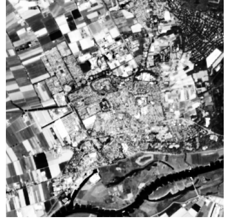
<div class="text-[.7rem] mt-1">PC1 &ndash; &ldquo;grass/crop &amp; healthy vegetation&rdquo;</div>
</div>

<div class="text-center">
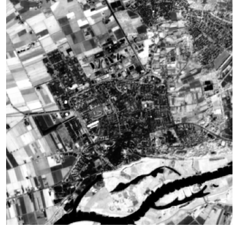
<div class="text-[.7rem] mt-1">PC2 &ndash; &ldquo;built-up / bare soil&rdquo;</div>
</div>

<div class="text-[.78rem]">

Just **2 principal components** already yield a basic land-cover map.

<blockquote class="blockquote2">
Curse of dimensionality: with few labelled data points, classification and regression work much better on fewer dimensions.
</blockquote>

</div>

</div>

---
section: pca
---

# PCA in Practice

<div class="grid grid-cols-5 gap-8 mt-4 items-center">

<div class="col-span-3">

```python
import numpy as np
from sklearn.decomposition import PCA

# demo data: 100 samples, 5 features
X = np.random.rand(100, 5)

# initialize the PCA transform object
pca = PCA(n_components=2)

# fit (eigendecomposition) and apply the transformation
pc_features = pca.fit_transform(X)

pc_features.shape              # (100, 2)
pca.explained_variance_ratio_  # per component
```

</div>

<div class="col-span-2 text-[.8rem]">

Fitting PCA on thousands of pixels with a dozen bands takes **milliseconds**.

Once fitted, transforming new data is **a single matrix multiplication**.

<blockquote class="blockquote3">
The tedious part is computing by hand &ndash; not for the computer.
</blockquote>

<div class="mt-3 text-[.66rem] text-gray-600 rounded-lg border border-gray-300 px-3 py-1.5">
<strong>FYI</strong> &ndash; PCA on whole images in Google Earth Engine:
<a href="https://developers.google.com/earth-engine/guides/arrays_eigen_analysis" target="_blank" rel="noopener noreferrer">eigen-analysis guide</a> &middot;
<a href="https://code.earthengine.google.com/23846e4ae9ab6ee37f9618563d24afbc" target="_blank" rel="noopener noreferrer">example script</a>
</div>

</div>

</div>

<!--
Exam experience from Wageningen: students thought PCA is computationally expensive because the hand calculation is tedious. Emphasize that it is a few lines of code and very fast.
The GEE links are for reference only; there is no exercise on them. The GEE example implements exactly the steps from "Summary: Calculating Principal Components" (center, covariance, eigen-decomposition, projection).
-->

---
section: pca
---

# PCA: Advantages and Limitations

<div class="grid grid-cols-2 gap-8 mt-3 text-[.72rem]">

<div>

<div class="text-[.82rem] font-bold text-[#0f7d5c] mb-1">Advantages</div>

- **dimensionality reduction:** fewer features that keep most of the variance
- **noise reduction:** dropping small components filters noise
- **efficiency:** less memory, faster training
- **uncorrelated features:** can improve model performance
- **visualization:** 2&ndash;3 components fit into a plot or an RGB image

</div>

<div>

<div class="text-[.82rem] font-bold text-[#b02b37] mb-1">Limitations</div>

- **loss of interpretability:** components have no unit and mix all bands
- **assumes linearity:** captures only linear correlations
- **sensitive to scaling:** features with large values dominate &rarr; normalize (less critical for reflectances in the same unit)
- **sensitive to outliers:** outliers pull the principal axes
- **loss of information:** fine-grained information in small components is lost

</div>

</div>

<blockquote class="blockquote3">
PCA is one of the most widely used data analysis tools: remote sensing, image compression, genomics, social sciences, recommender systems.
</blockquote>

<!--
Exam experience: students struggled to name the limitations of PCA. Spend time on the right column.
-->

---
section: pca
---

# Summary and Core Concepts

<div class="flex flex-col gap-2 mt-2 text-[.72rem]">

<div class="grid grid-cols-[13rem_1fr_auto] gap-4 items-center">
<div class="rounded-lg border-2 border-[#5f625f] bg-[#ececec] px-3 py-1.5 text-center">Statistics<br><strong>covariances &amp; correlations</strong></div>
<div>Correlated bands are <strong>redundant</strong>; PCA translates and rotates the data so that the components are <strong>uncorrelated</strong>.</div>
<div class="flex gap-1 items-center">&rarr;</div>
</div>

<div class="grid grid-cols-[13rem_1fr_auto] gap-4 items-center">
<div class="rounded-lg border-2 border-[#c4581c] bg-[#fbd9c8] px-3 py-1.5 text-center">Linear algebra<br><strong>eigenvalue decomposition</strong></div>
<div>The principal components are the <strong>eigenvectors</strong> of the covariance matrix; the eigenvalues are their variances. Applying PCA is <strong>one matrix multiplication</strong>.</div>
<div class="font-mono text-[.7rem] text-[#00457c]">p = P(x &minus; &mu;)</div>
</div>

<div class="grid grid-cols-[13rem_1fr_auto] gap-4 items-center">
<div class="rounded-lg border-2 border-[#00457c] bg-[#dbe9f6] px-3 py-1.5 text-center">Machine learning<br><strong>dimensionality reduction</strong></div>
<div>Few principal components keep most of the variance and serve as compact <strong>features</strong>, e.g. for land-cover classification.</div>
<div class="flex gap-1"></div>
</div>

<div class="grid grid-cols-[13rem_1fr_auto] gap-4 items-center">
<div class="rounded-lg border-2 border-[#2e8b3a] bg-[#d9efd9] px-3 py-1.5 text-center">Remote sensing<br><strong>multi-spectral visualization</strong></div>
<div>Three PCs show high-dimensional Sentinel-2 data in <strong>one RGB image</strong>.</div>

</div>

</div>

<div class="text-[.72rem] mt-3 text-center">
Domain knowledge (indices) and PCA both reduce correlated dimensions: <strong>indices are interpretable</strong>, <strong>PCA needs no expert knowledge</strong>.
</div>

<!--
Wrap-up of the representation story: data cubes give many, correlated dimensions; we reduce them with domain knowledge or algorithmically with PCA.
-->
