# Machine Learning on Data Representations

## Learning on fixed representations

<!--
Connect the heterogeneous data collected in Lecture 2 to classical machine learning.
Frame the lecture question: how can many data sources become one representation for prediction?
-->

---

# Learning Outcome Roadmap

<div class="mt-3 text-[.58rem] leading-tight whitespace-nowrap">

| | Learning outcome | Lecture | Block |
|---|---|---|---|
| ⬜ | Explain how heterogeneous datasets align to a common coordinate support and form a geospatial data cube. | <span class="text-blue-700 font-semibold">Lecture 3</span> | Geospatial Data Cubes |
| ⬜ | Represent locations as fixed feature vectors extracted from a geospatial data cube. | <span class="text-blue-700 font-semibold">Lecture 3</span> | Geospatial Data Cubes |
| ⬜ | Explain how linear regression maps a fixed representation to a continuous target. | <span class="text-blue-700 font-semibold">Lecture 3</span> | Linear Models |
| ⬜ | Explain how logistic regression maps a fixed representation to categories with a linear decision boundary. | <span class="text-blue-700 font-semibold">Lecture 3</span> | Linear Models |
| ⬜ | Explain how decision trees partition a fixed representation space into nonlinear decision regions. | <span class="text-blue-700 font-semibold">Lecture 3</span> | Decision Trees &amp; Random Forests |
| ⬜ | Explain how random forests combine trees for robust predictions from fixed representations. | <span class="text-blue-700 font-semibold">Lecture 3</span> | Decision Trees &amp; Random Forests |

</div>

<!--
Establish the three-block route from heterogeneous data to robust nonlinear prediction.
Emphasize that every model in this lecture learns on a representation that we construct first.
-->

---
layout: bonn-section
sectionColor: "#00457c"
section: geospatial-data-cubes
sectionTitle: Geospatial Data Cubes
---

# Geospatial Data Cubes

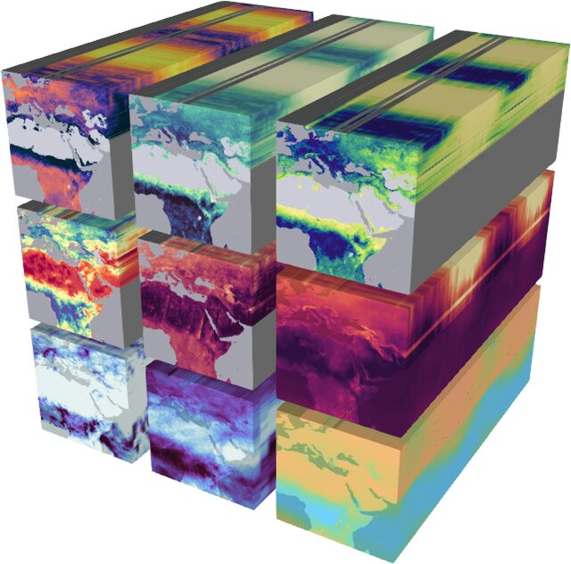

<div class="bonn-section-citation">
Image by <a href="https://www.researchgate.net/profile/Miguel-Mahecha-2?_tp=eyJjb250ZXh0Ijp7ImZpcnN0UGFnZSI6Il9kaXJlY3QiLCJwYWdlIjoicHVibGljYXRpb24ifX0" target="_blank" rel="noopener noreferrer">Miguel D. Mahecha</a>
</div>

<!--
Begin with the heterogeneous layers from Lecture 2.
This section will establish common coordinate support, stacking, and fixed feature extraction.
-->

---
section: geospatial-data-cubes
---

# Recap: Geospatial Data

<div class="grid grid-cols-5 gap-8 mt-4 items-start">

<div class="col-span-2">

- satellite imagery
- thematic rasters such as land cover
- vector geometries and attributes
- model and reanalysis fields
- observations collected at different times and scales

</div>

<div class="col-span-3">

<blockquote class="blockquote3">
Each source describes locations on its own spatial and temporal support.
</blockquote>

</div>

</div>

<div class="grid grid-cols-4 gap-4 mt-8">

<div class="text-center">
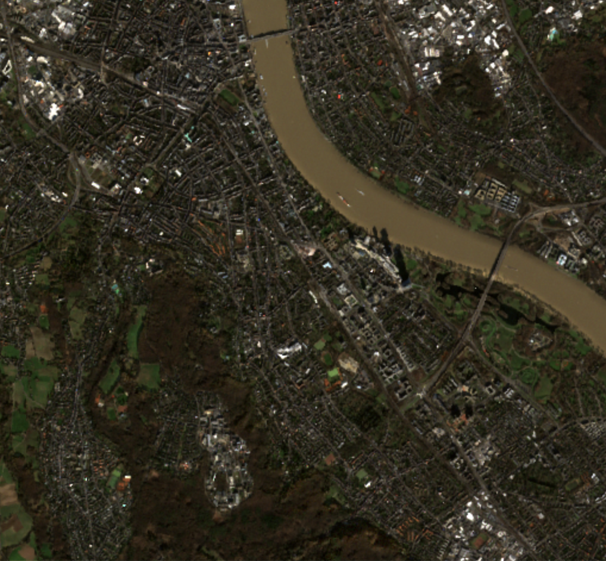
<div class="text-[.62rem] text-gray-500 mt-1">Satellite imagery (Bonn, Sentinel-2)</div>
</div>

<div class="text-center">
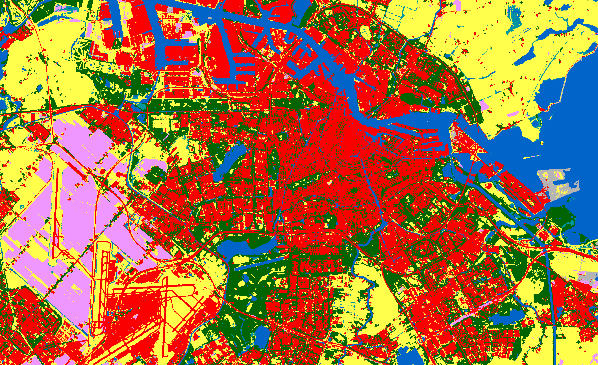
<div class="text-[.62rem] text-gray-500 mt-1">Thematic raster (land cover, Amsterdam)</div>
</div>

<div class="text-center">

<div class="text-[.62rem] text-gray-500 mt-1">Vector geometries (OpenStreetMap)</div>
</div>

<div class="text-center">
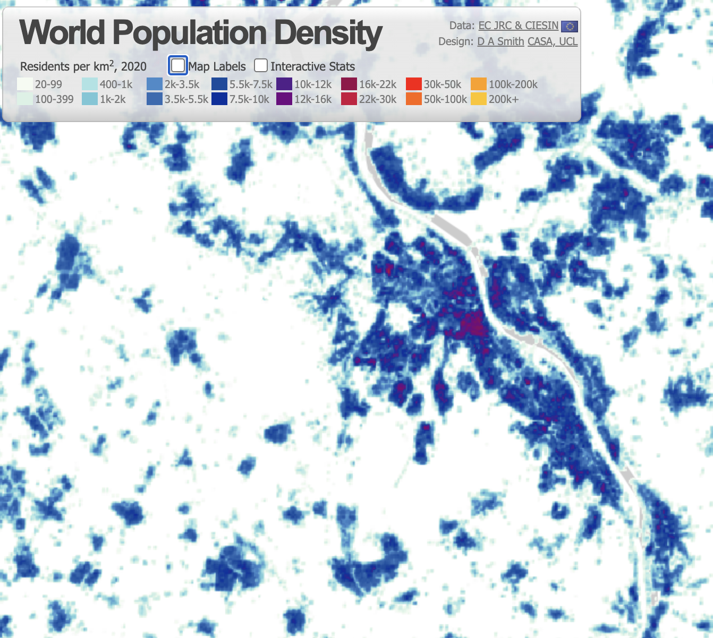
<div class="text-[.62rem] text-gray-500 mt-1">Model / reanalysis field (population density)</div>
</div>

</div>

<!--
Presenter note: Activate prior knowledge from Lecture 2 without repeating its details. Ask students what spatial and temporal support each source uses.
-->

---
section: geospatial-data-cubes
---

# Datacubes align Data Spatially and Temporally

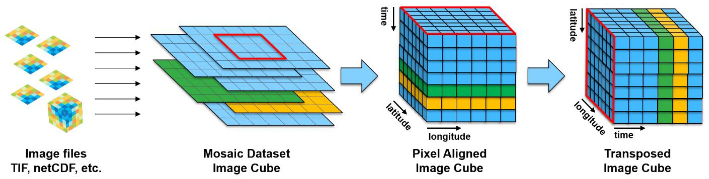

<div class="figure-copyright">
Source: Kopp et al. (2019), <a href="https://www.mdpi.com/2306-5729/4/3/94" target="_blank" rel="noopener noreferrer"><em>Achieving the Full Vision of Earth Observation Data Cubes</em></a>, <em>Data</em> 4(3), 94.
</div>

---
section: geospatial-data-cubes
---

# Rasterization and Interpolation

<div class="grid grid-cols-2 gap-10 mt-3">

<div>
<div class="text-sm font-semibold text-blue-800 mb-1 text-center">Rasterization</div>
<RasterizationDiagram />
<div class="mt-3 text-[.64rem] leading-relaxed text-gray-600 text-left">
Open-source tools:<br>
<code class="font-mono text-[.6rem] bg-gray-100 text-gray-700 rounded px-1">gdal_rasterize</code> (CLI)<br>
<code class="font-mono text-[.6rem] bg-gray-100 text-gray-700 rounded px-1">rasterio.features.rasterize</code> (Python)
</div>
</div>

<div>
<div class="text-sm font-semibold text-blue-800 mb-1 text-center">Interpolation</div>

<div class="flex items-center justify-center gap-8 mt-1">
<InterpolationDiagram />

<div class="text-[.75rem]">

<div class="text-[.66rem] font-semibold text-blue-800">Bilinear</div>
<div class="text-[.58rem] text-gray-500 -mt-0.5">2&times;2 neighborhood</div>

$$
\hat{z} = \frac{\sum_{i=1}^{4} z_i / d_i}{\sum_{i=1}^{4} 1 / d_i}
$$

<div class="text-[.66rem] font-semibold text-blue-800 mt-3">Cubic</div>
<div class="text-[.58rem] text-gray-500 -mt-0.5">4&times;4 neighborhood</div>

$$
\hat{z} = \frac{\sum_{i=1}^{16} z_i / d_i^{3}}{\sum_{i=1}^{16} 1 / d_i^{3}}
$$

</div>

</div>

<div class="mt-2 text-[.64rem] leading-relaxed text-gray-600 text-left">
Open-source tools:<br>
<code class="font-mono text-[.6rem] bg-gray-100 text-gray-700 rounded px-1">gdalwarp</code> /
<code class="font-mono text-[.6rem] bg-gray-100 text-gray-700 rounded px-1">gdal_translate</code> (CLI)<br>
<code class="font-mono text-[.6rem] bg-gray-100 text-gray-700 rounded px-1">rasterio.warp.reproject</code> (Python)
</div>
</div>


</div>

<!--
Presenter note: Rasterization converts vector geometries to grid cells using a majority-area rule.
Interpolation resamples values between misaligned grids using distance-weighted (linear) interpolation.
-->

---
section: geospatial-data-cubes
---

# From Data Cube to Feature Vector

<div class="grid grid-cols-5 gap-8 mt-4 items-center">

<div class="col-span-2">
  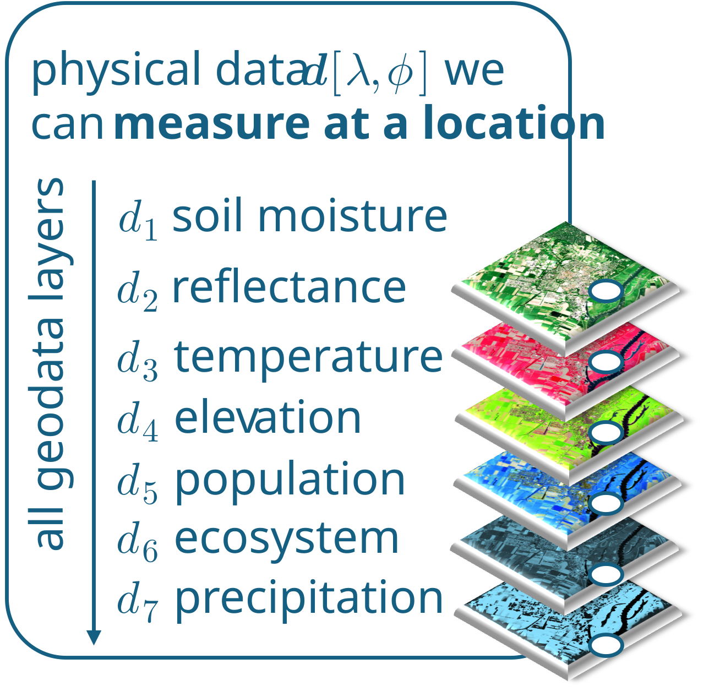
</div>

<div class="col-span-3 text-[.78rem] leading-snug">

Sampling all $p$ variables at location $i$ produces a fixed feature vector:

$$
\mathbf{x}_i = [x_{i1}, x_{i2}, \ldots, x_{ip}]
$$

For example:

$$
\begin{aligned}
\mathbf{x}_i = [&\text{elevation},\ \text{slope},\ \text{spectral bands},\\
                 &\text{temperature},\ \text{building density}]
\end{aligned}
$$

Repeating the extraction at $n$ locations creates a feature matrix:

$$
\mathbf{X} \in \mathbb{R}^{n \times p}
$$

<div class="mt-4 flex items-center justify-center gap-3 font-semibold text-blue-800">
  <span>features xᵢ</span>
  <span aria-hidden="true">&rarr;</span>
  <span>machine-learning model</span>
  <span aria-hidden="true">&rarr;</span>
  <span>prediction ŷᵢ</span>
</div>

<div class="mt-3 border-l-4 border-yellow-400 pl-3 text-[.66rem] text-gray-600">
Training target yᵢ: kept separate from the input features.
</div>

</div>

</div>

<!--
Presenter note: A time-dependent cube yields fixed-length vectors only after selecting a time, a fixed window, or temporal summary statistics.
TODO: Replace the placeholder with a cube-to-vector illustration and add a provisional prediction task.
-->

---
section: geospatial-data-cubes
---

# Dataset

<div class="relative mt-1">

<div v-click-hide="2" class="grid grid-cols-2 gap-8">

<div>
<div class="text-sm font-semibold text-blue-800 mb-1 text-center">Input X <span class="font-normal text-gray-500">(e.g., Sentinel-2 pixel reflectances)</span></div>

<div class="relative" style="height: 195px;">
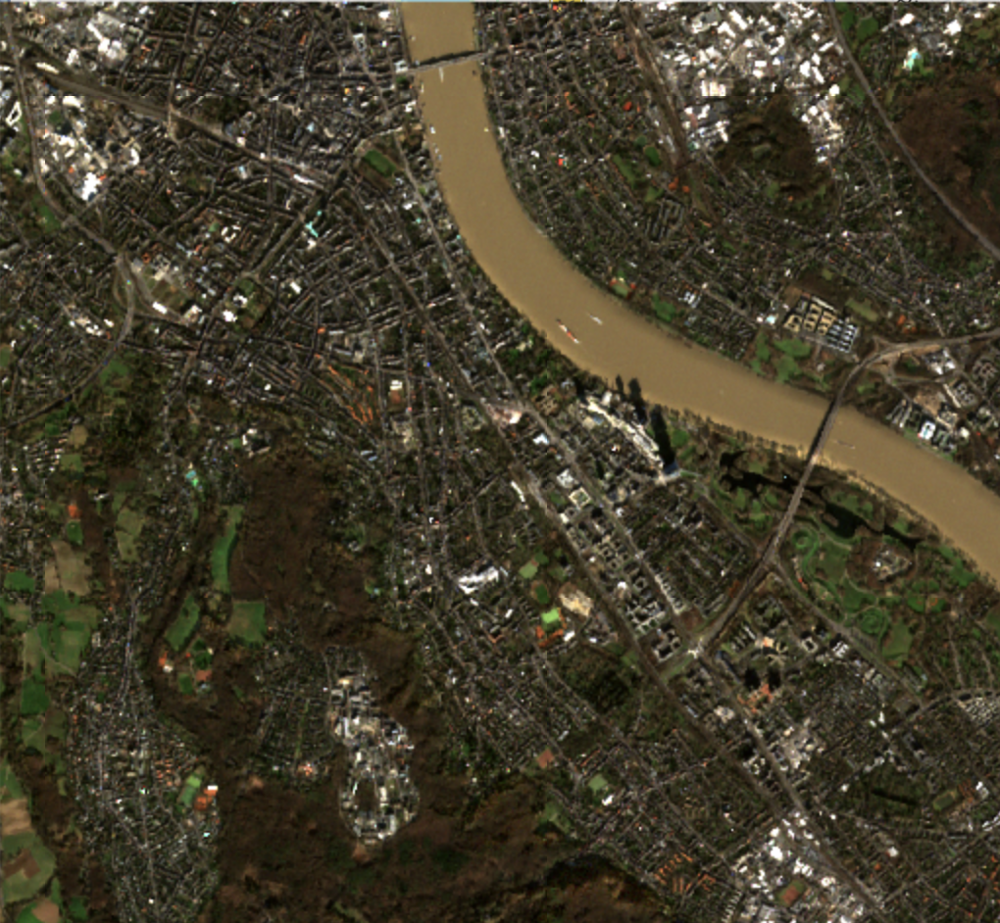
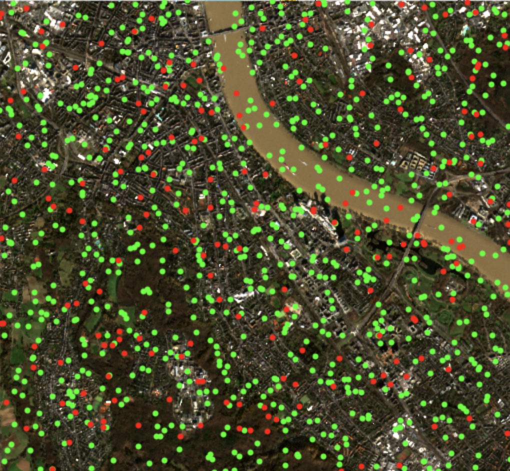
</div>

<div v-click="1" class="compact-table mt-2">

| Pt | Red | Green | Blue | NIR |
|---|---|---|---|---|
| Pt1 | 0.08 | 0.11 | 0.09 | 0.42 |
| Pt2 | 0.21 | 0.19 | 0.15 | 0.05 |
| &vellip; | &vellip; | &vellip; | &vellip; | &vellip; |

</div>
</div>

<div>
<div class="text-sm font-semibold text-blue-800 mb-1 text-center">Target y <span class="font-normal text-gray-500">(e.g., land cover labels)</span></div>

<div class="relative" style="height: 195px;">
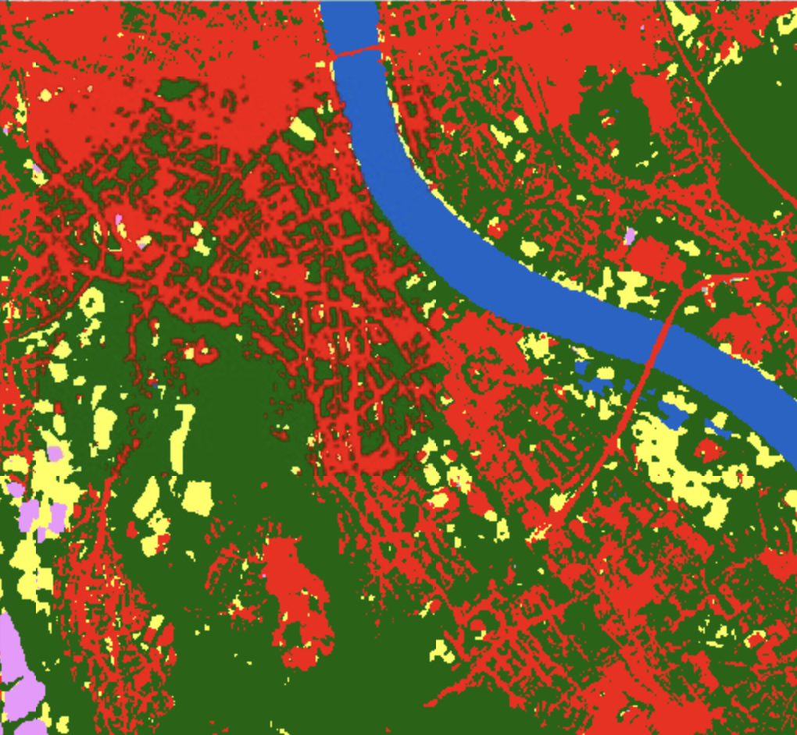
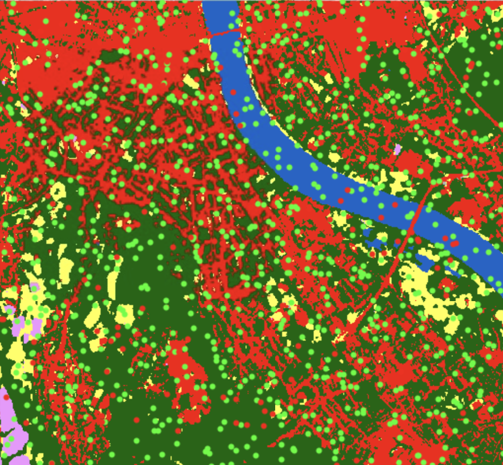
</div>

<div v-click="1" class="compact-table mt-2">

| Pt | Land Cover |
|---|---|
| Pt1 | Vegetation |
| Pt2 | Built-up |
| &vellip; | &vellip; |

</div>
</div>

</div>

<div v-click="2" class="absolute inset-0 top-0">

<div class="grid grid-cols-3 gap-3 items-center">

<div class="col-span-2">
<div class="text-[.66rem] font-semibold text-gray-500 mb-1">Raw bands</div>

<div class="compact-table">

| Pt | Red | Green | Blue | NIR | Land Cover |
|---|---|---|---|---|---|
| Pt1 | 0.08 | 0.11 | 0.09 | 0.42 | **Vegetation** |
| Pt2 | 0.21 | 0.19 | 0.15 | 0.05 | **Built-up** |
| &vellip; | &vellip; | &vellip; | &vellip; | &vellip; | &vellip; |

</div>
</div>

<div style="height: 125px;">
<PlotlyHistogram dataset="green" x-label="Green reflectance" />
</div>

</div>

<div v-click="3" class="grid grid-cols-3 gap-3 items-center mt-4">

<div class="col-span-2">
<div class="text-[.66rem] font-semibold text-gray-500 mb-1">Engineered feature</div>

<div class="text-[.68rem] text-gray-600 mb-1">

$$
\text{NDVI} = \frac{\text{NIR} - \text{Red}}{\text{NIR} + \text{Red}}
$$

</div>

<div class="compact-table">

| Pt | NDVI | Land Cover |
|---|---|---|
| Pt1 | 0.68 | **Vegetation** |
| Pt2 | -0.62 | **Built-up** |
| &vellip; | &vellip; | &vellip; |

</div>
</div>

<div style="height: 110px;">
<PlotlyHistogram dataset="ndvi" x-label="NDVI" :show-legend="false" />
</div>

</div>

</div>

</div>

<!--
Presenter note: This slide is the bridge from geospatial images to tabular ML data.
Click 1: sample points on both the input image and the target map.
Click 2: collapse both into one tabular dataset, X columns plus y column, one row per point &mdash; the format every classic ML model in this lecture consumes.
-->

---
section: geospatial-data-cubes
---

# Classic Machine Learning Pipeline

<div class="mt-1 text-gray-700 text-[.82rem] text-center">
Good, hand-selected features combined with a suitable model determine the quality of the result.
</div>

<div class="relative mt-8">


<div class="absolute" style="left: 36.2%; top: 100%; transform: translate(0, 10px);">
<div class="flex items-center gap-1.5 text-[.68rem] font-semibold whitespace-nowrap" style="color: var(--grl-data-orange);">
<span class="w-2 h-2 rounded-full flex-shrink-0" style="background: var(--grl-data-orange);"></span>
Section 1 &middot; Geospatial Data Cubes
</div>
</div>

<div class="absolute" style="left: 73%; top: 100%; transform: translate(0, 10px);">
<div class="flex items-center gap-1.5 text-[.68rem] font-semibold whitespace-nowrap text-red-600">
<span class="w-2 h-2 rounded-full flex-shrink-0 bg-red-600"></span>
Sections 2&ndash;3 &middot; Linear Models &amp; Random Forests
</div>
</div>

</div>

<!--
Presenter note: This slide is the lecture map. Feature design (orange) is Section 1; the model (red) is what Sections 2-3 build, first as a linear model, then as a decision tree / random forest.
-->

---
layout: bonn-section
sectionColor: "#00457c"
section: linear-models
sectionTitle: Linear Models
---

# Linear Regression

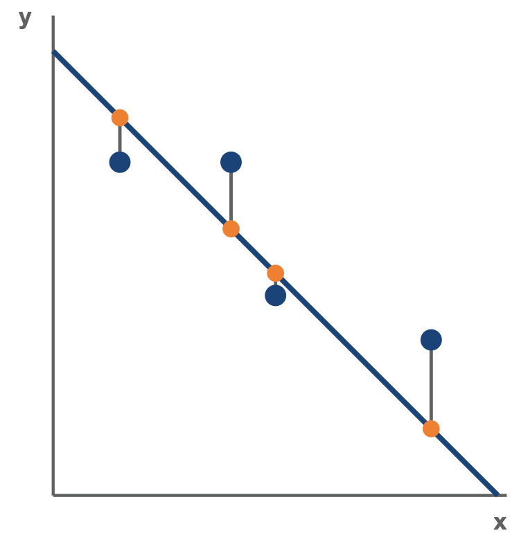

<div class="bonn-section-citation">
Figure: M. Rußwurm &amp; D. Tuia, <em>Linear Regression</em>, ENV-408 course materials, EPFL, 2023.
</div>

<!--
Move from constructed feature vectors to prediction.
This section will progress from continuous targets to categorical predictions and linear boundaries.
-->

---

# Why Linear Regression?

<ul>
<li>a simple, classical approach to supervised learning</li>
<li v-click>predicts a <strong>continuous</strong> response from one or more predictors</li>
<li v-click>around for a long time, yet still one of the most used tools in science</li>
<li v-click>a strong, interpretable baseline &mdash; and a stepping stone to more complex models</li>
</ul>

<blockquote v-click class="blockquote3 mt-4">
Learning linear regression helps understand more complex methods, and it is practically useful and easy to implement for many real-world problems.
</blockquote>

---

# Measuring Relationships Between Variables

<div class="grid grid-cols-2 gap-10 mt-6">

<div>
<div class="text-sm font-semibold text-blue-800 mb-2 text-center">Classic example</div>
<FeatureTargetDiagram
  :features="[
    { label: 'TV ads', symbol: 'x₁', width: 5 },
    { label: 'radio ads', symbol: 'x₂', width: 4 },
    { label: 'newspaper ads', symbol: 'x₃', width: 2.5 },
  ]"
  target="sales"
  target-symbol="y"
/>
</div>

<div>
<div class="text-sm font-semibold text-blue-800 mb-2 text-center">Geospatial example</div>
<FeatureTargetDiagram
  :features="[
    { label: 'elevation', symbol: 'x₁', width: 5 },
    { label: 'slope', symbol: 'x₂', width: 4 },
    { label: 'aspect', symbol: 'x₃', width: 2.5 },
  ]"
  target="surface temperature"
  target-symbol="y"
/>
</div>

</div>

<div class="mt-4 text-gray-700">
Linear regression models how one or more predictor variables (features) relate to a continuous target &mdash; exactly the fixed representations built in the previous section.
</div>

---

# A Closer Look at the Data

<div class="text-gray-700">

$\mathcal{D} = \{((x_{1,i}, x_{2,i}, x_{3,i}), y_i)\}_{i=1}^N$

</div>

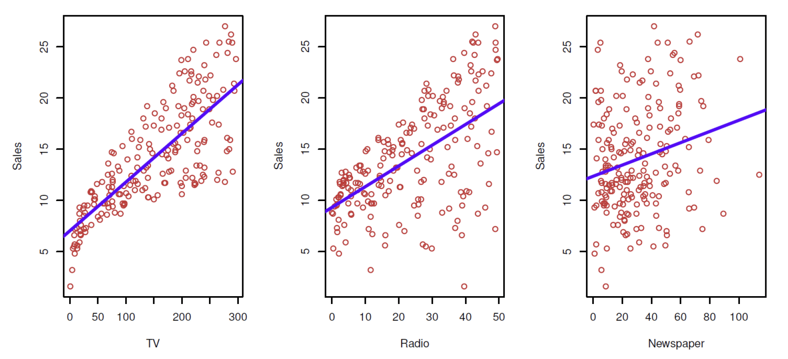

<div class="grid grid-cols-3 gap-4 mt-1 text-center text-gray-700 text-sm">

<div>

$x_1 \mapsto y$ (TV &rarr; sales)

</div>

<div>

$x_2 \mapsto y$ (radio &rarr; sales)

</div>

<div>

$x_3 \mapsto y$ (newspaper &rarr; sales)

</div>

</div>

<div class="figure-copyright">
Figure: James, Witten, Hastie &amp; Tibshirani, <a href="https://www.statlearning.com/" target="_blank" rel="noopener noreferrer"><em>An Introduction to Statistical Learning</em></a>, Advertising dataset.
</div>

---

# Linear Regression Answers Important Questions

<div class="grid grid-cols-3 gap-8 mt-6 items-center">

<div class="col-span-2">

<ul>
<li>is there a relationship between advertising budget and sales?</li>
<li v-click>how strong is the relationship?</li>
<li v-click>is there synergy among the advertising media?</li>
</ul>

</div>

<div>
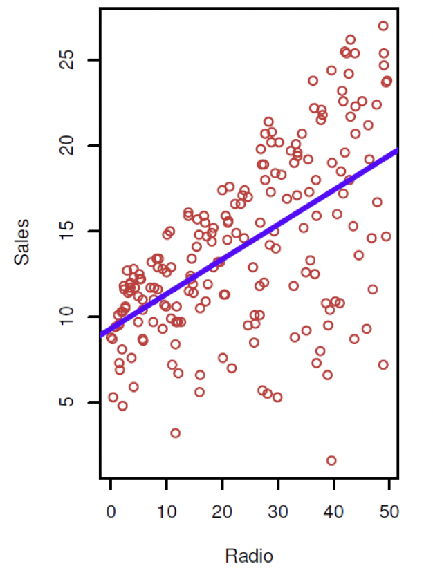
</div>

</div>

<div class="mt-4 text-gray-700">
The same questions apply to our geospatial example: is there a relationship between elevation and surface temperature &mdash; and how strong is it?
</div>

---

# Univariate Linear Regression

<div class="grid grid-cols-2 gap-8 mt-4 items-center">

<div class="flex items-center justify-center gap-3">
<div class="relative">
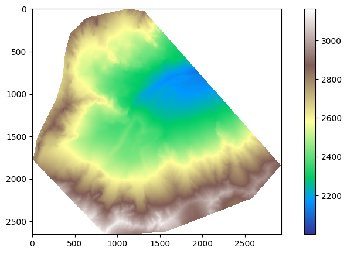
<div v-click="1" class="absolute w-2.5 h-2.5 rounded-full" style="top: 50%; left: 50%; transform: translate(-50%, -50%); background: var(--grl-data-orange); box-shadow: 0 0 0 2px white;"></div>
</div>
<div class="text-2xl text-blue-800">&rarr;</div>
<div class="relative">
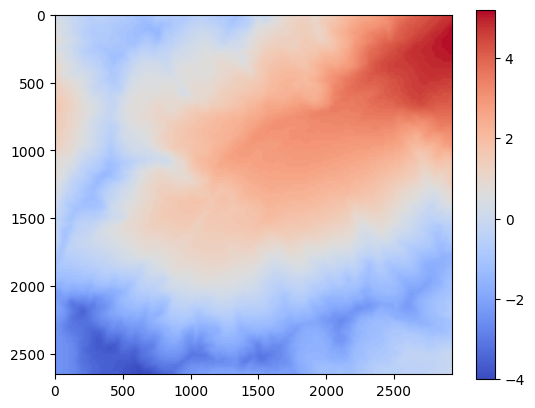
<div v-click="1" class="absolute w-2.5 h-2.5 rounded-full" style="top: 50%; left: 50%; transform: translate(-50%, -50%); background: var(--grl-data-orange); box-shadow: 0 0 0 2px white;"></div>
</div>
</div>

<div>

A simple (but powerful) linear model

$$
\hat{y} = f(x;\beta_0,\beta_1) = \beta_0 + x\beta_1
$$

maps an elevation $x$ to an estimated temperature $\hat{y}$, with $\beta_0$ the y-intercept and $\beta_1$ the slope.

</div>

</div>

<div class="figure-copyright">
Figure: M. Rußwurm &amp; D. Tuia, <em>Linear Regression</em>, ENV-408 course materials, EPFL, 2023.
</div>

---

# The Problem: Finding $\hat{\boldsymbol{\beta}}$

<div class="grid grid-cols-2 gap-8 mt-6 items-center">

<div class="flex justify-center">
<RegressionScatterDemo variant="points" x-label="elevation x" y-label="temperature y" :clicks="$clicks" />
</div>

<div>

We have a dataset of data samples $(x_i, y_i)$.

<blockquote v-click class="blockquote3 mt-4">

<strong>Problem:</strong> how do we find good model parameters $\hat{\boldsymbol{\beta}} = (\hat{\beta}_0, \hat{\beta}_1)$ for our linear model $f(x;\hat{\boldsymbol{\beta}}) = \hat{\beta}_0 + x\hat{\beta}_1$?

</blockquote>

</div>

</div>

---

# What Is a Good Model &mdash; Formally?

<div class="grid grid-cols-2 gap-8 mt-6 items-center">

<div class="flex justify-center">
<RegressionScatterDemo variant="error-band" x-label="elevation x" y-label="temperature y" />
</div>

<div>

$$
\begin{aligned}
y_i &= f(x_i;\hat{\boldsymbol{\beta}}) \pm \overbrace{\varepsilon}^{\text{error}} \\
\hat{y}_i &= f(x_i;\hat{\boldsymbol{\beta}})
\end{aligned}
$$

with the error $\varepsilon$ as a random variable &mdash; the model never fits the data perfectly.

</div>

</div>

---

# Residuals

<div class="grid grid-cols-2 gap-8 mt-6 items-center">

<div class="flex justify-center">
<RegressionScatterDemo variant="residual-segments" x-label="elevation x" y-label="temperature y" :clicks="$clicks" />
</div>

<div>

Concretely, the error &mdash; the "residual" $\varepsilon_i$ &mdash; for each sample $i$:

$$
\vert \hat{y}_i - y_i \vert = \varepsilon_i
$$

<div v-click>

We want to minimize the residuals over the whole dataset

$$
\min \frac{1}{N} \sum_{i=1}^N \varepsilon_i
$$

</div>

</div>

</div>

---

# Mean Absolute Error (MAE)

<div class="grid grid-cols-2 gap-8 mt-6 items-center">

<div class="flex justify-center">
<RegressionScatterDemo variant="residual-segments" x-label="x" y-label="y" />
</div>

<div>

$$
\text{MAE}(\mathcal{D}, \boldsymbol{\beta}) = \frac{1}{N} \sum_{i=1}^N \vert \hat{y}_i - y_i \vert
$$

over model $\boldsymbol{\beta}$ with $\hat{y}_i = f(x_i;\boldsymbol{\beta})$ and dataset $\mathcal{D} = \{x_i, y_i\}_{i=1}^N$

<blockquote class="blockquote1 mt-3">
Very intuitive &mdash; but does not punish large errors.
</blockquote>

</div>

</div>

---

# Mean Squared Error (MSE)

<div class="grid grid-cols-2 gap-8 mt-6 items-center">

<div class="flex justify-center">
<RegressionScatterDemo variant="residual-squares" x-label="x" y-label="y" />
</div>

<div>

$$
\text{MSE}(\mathcal{D}, \boldsymbol{\beta}) = \frac{1}{2N} \sum_{i=1}^N (\hat{y}_i - y_i)^2
$$

Punishes large errors with a square penalty.

<blockquote class="blockquote2 mt-3">
<strong>Geometric intuition:</strong> find a model that minimizes the total area of these squares.
</blockquote>

</div>

</div>

---
layout: bonn-two-cols-header
---

# Vertical vs. Perpendicular Error Offsets

Both measure a residual &mdash; but they disagree on what "error" means for a spatial variable.

::left::

<div class="text-center text-sm font-semibold text-blue-800 mb-2">Vertical offsets</div>

<RegressionScatterDemo variant="offsets-vertical" x-label="x" y-label="y" :clicks="$clicks" />

<div v-click.hide="1">

$$
\min \frac{1}{N}\sum_i \vert (\beta_0+x_i\beta_1) - y_i\vert
$$

</div>
<div v-click="1">

$$
\min \frac{1}{2N}\sum_i \left((\beta_0+x_i\beta_1) - y_i\right)^2
$$

</div>

- simple, and often sufficient (e.g. temperature vs. elevation)
- **but:** the error changes with how the axes are chosen

::right::

<div class="text-center text-sm font-semibold text-blue-800 mb-2">Perpendicular offsets</div>

<RegressionScatterDemo variant="offsets-perpendicular" x-label="x" y-label="y" :clicks="$clicks" />

<div v-click.hide="1">

$$
\min \frac{1}{N}\sum_i \frac{\vert (\beta_0+x_i\beta_1) - y_i\vert}{\sqrt{1+\beta_1^2}}
$$

</div>
<div v-click="1">

$$
\min \frac{1}{2N}\sum_i \frac{\left((\beta_0+x_i\beta_1) - y_i\right)^2}{1+\beta_1^2}
$$

</div>

- makes the error depend only on the fitted model, not the coordinate system
- useful when both axes represent comparable spatial quantities

<div class="figure-copyright mt-2">
Ordinary least squares (next) uses vertical offsets. See <a href="https://mathworld.wolfram.com/LeastSquaresFittingPerpendicularOffsets.html" target="_blank" rel="noopener noreferrer">Least Squares Fitting &mdash; Perpendicular Offsets</a>, MathWorld.
</div>

---

# Ordinary Least Squares (OLS) &mdash; Intuition

The closed-form solution $\hat{\beta}_0, \hat{\beta}_1$ for a linear model under MSE.

<blockquote class="blockquote3 mt-6">

<strong>Task:</strong> find $\hat{\beta}_0,\hat{\beta}_1$ that minimize the Mean Squared Error

</blockquote>

$$
\hat{\beta}_0,\hat{\beta}_1 = \operatorname*{arg\,min}_{\beta_0,\beta_1} \frac{1}{2N} \sum_{i=1}^N \left(\overbrace{\beta_0 + x_i \beta_1}^{\hat{y}_i} - y_i \right)^2
$$

<div v-click class="mt-6">

**Question:** how do we minimize a function with respect to its parameters?

</div>

<div v-click>

- calculate the partial derivatives $\frac{\partial \text{MSE}}{\partial \beta_0}$ and $\frac{\partial \text{MSE}}{\partial \beta_1}$
- set the derivatives to zero: $\frac{\partial \text{MSE}}{\partial \beta_0} = 0$, $\frac{\partial \text{MSE}}{\partial \beta_1} = 0$
- solve for $\beta_0$ and $\beta_1$

</div>

---

# Ordinary Least Squares (OLS) &mdash; Solution

Model $y = \beta_0 + x\beta_1$ on a dataset $\mathcal{D} = \{x_i, y_i\}_{i=1}^N$

Ordinary Least Squares objective

$$
\hat{\beta}_0,\hat{\beta}_1 = \operatorname*{arg\,min}_{\beta_0,\beta_1} \frac{1}{2N} \sum_{i=1}^N \left(\overbrace{\beta_0 + x_i \beta_1}^{\hat{y}_i} - y_i \right)^2
$$

Closed-form solution

$$
\begin{aligned}
\hat{\beta}_0 &= \frac{1}{N}\sum_{i=1}^N y_i - \hat{\beta}_1 \frac{1}{N}\sum_{i=1}^N x_i = \bar{y} - \hat{\beta}_1 \bar{x} \\[.3em]
\hat{\beta}_1 &= \frac{\text{Cov}[x,y]}{\text{Var}[x]} = \frac{\frac{1}{N}\sum_i (x_i - \bar{x})(y_i - \bar{y})}{\frac{1}{N}\sum_i (x_i - \bar{x})^2}
\end{aligned}
$$

<div class="figure-copyright">
See <a href="https://en.wikipedia.org/wiki/Ordinary_least_squares" target="_blank" rel="noopener noreferrer">Ordinary Least Squares</a>, Wikipedia.
</div>

---
layout: bonn-two-cols-header
---

# Limits of Univariate Models

Some relationships are well-described by a single variable &mdash; most are not.

::left::

<div class="text-center text-sm font-semibold text-blue-800 mb-2">Roughly linear</div>

<div class="flex items-center justify-center gap-2">

<div class="text-lg text-blue-800">&rarr;</div>

</div>

<div class="mt-3 text-center text-gray-700 text-sm">

elevation &rarr; average temperature, roughly $-0.006\frac{\text{°C}}{\text{m}}$

</div>

::right::

<div class="text-center text-sm font-semibold text-blue-800 mb-2">Clearly non-linear</div>

<div class="flex items-center justify-center gap-2">

<div class="text-lg text-blue-800">?</div>
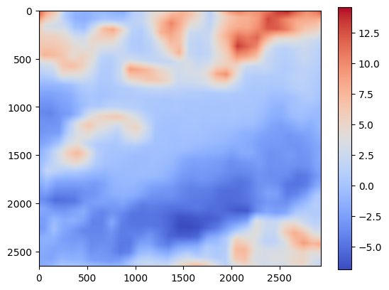
</div>

<div class="mt-3 text-center text-gray-700 text-sm">
elevation &rarr; surface temperature &mdash; shading, wind, and local terrain also matter
</div>

---

# Multivariate Models: Linearize With Good Feature Design

<div class="grid grid-cols-2 gap-8 mt-4 items-center">

<div class="flex justify-center">
<FeatureTargetDiagram
  :features="[
    { label: 'elevation', symbol: 'x₁' },
    { label: 'slope', symbol: 'x₂' },
    { label: 'aspect', symbol: 'x₃' },
  ]"
  target="surface temperature"
  target-symbol="y"
/>
</div>

<div>

Many non-linear relationships can be linearized with good feature design: elevation alone under-explains surface temperature, but elevation **and** slope **and** aspect together explain it much better.

<div class="mt-4 text-gray-700 text-sm">
Same pattern as classical feature extraction: extract informative features, then fit a simple model.
</div>


</div>

</div>

---

# From Uni- to Multivariate Linear Models

**Univariate model** $y = f(x;\beta_0,\beta_1)$ with scalar $x,y$ and two parameters

$$
y = \beta_0 + \overbrace{x_1}^{\text{e.g., elev.}}\beta_1
$$

**Multivariate linear model**

- one input sample $\mathbf{x}_i = (1, x_1, x_2, x_3, \dots, x_p)$ of $p$ features
- corresponding target $y_i$
- one weight per feature $\boldsymbol{\beta} = (\beta_0, \beta_1, \beta_2, \dots, \beta_p)$

$$
y_i = \beta_0 + \overbrace{x_1}^{\text{e.g., elev.}}\beta_1 + \overbrace{x_2}^{\text{e.g., slope}}\beta_2 + \overbrace{x_3}^{\text{e.g., aspect}}\beta_3 + \dots = \boldsymbol{\beta}^\top \mathbf{x}_i
$$

---

# Multivariate Linear Model in Matrix Form

<div class="grid grid-cols-2 gap-8 mt-4 items-center">

<div>

A multivariate dataset $\mathcal{D} = \{\mathbf{x}_i, y_i\}_{i=1}^n$ as matrix $\mathbf{X}$ and target vector $\mathbf{y}$, with $n$ samples and $p$ features

$$
\mathbf{X} =
\begin{pmatrix}
1 & \overbrace{x_{11}}^{\text{elev.}} & \overbrace{x_{21}}^{\text{slope}} & \overbrace{x_{31}}^{\text{aspect}} & \dots \\
1 & x_{12} & x_{22} & x_{32} & \dots \\
\vdots & \vdots & \vdots & \vdots & \ddots \\
1 & x_{1n} & x_{2n} & x_{3n} & \dots
\end{pmatrix}\!,\;\;
\mathbf{y} = \begin{pmatrix} y_1 \\ y_2 \\ \vdots \\ y_n \end{pmatrix}
$$

<div v-click>

And the model

$$
\mathbf{y} = \mathbf{X}\hat{\boldsymbol{\beta}} + \overbrace{\boldsymbol{\varepsilon}}^{\text{errors}}
$$

with $p{+}1$ parameters $\hat{\boldsymbol{\beta}} = (\hat{\beta}_0, \hat{\beta}_1, \dots, \hat{\beta}_p)$

</div>

<div v-click>

$$
\boldsymbol{\varepsilon} = \overbrace{\left\Vert \mathbf{X}\hat{\boldsymbol{\beta}} - \mathbf{y} \right\Vert^2}^{\text{MSE}}
$$

</div>

</div>

<div class="flex justify-center">
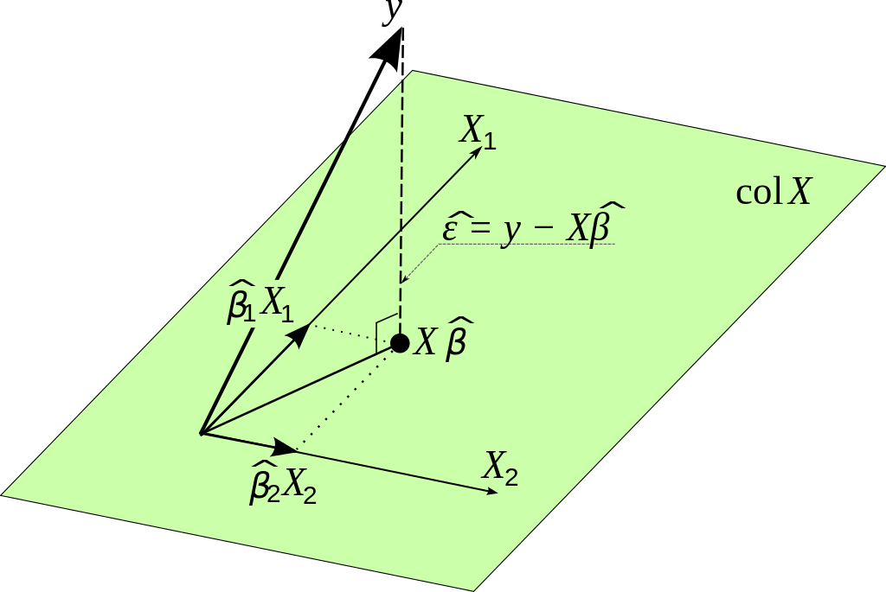
</div>

</div>

---

# Multivariate Ordinary Least Squares

$$
\hat{\boldsymbol{\beta}} = \operatorname*{arg\,min}_{\hat{\boldsymbol{\beta}}} \text{MSE}(\hat{\boldsymbol{\beta}}) = \operatorname*{arg\,min}_{\hat{\boldsymbol{\beta}}} \left\Vert \mathbf{X}\hat{\boldsymbol{\beta}} - \mathbf{y} \right\Vert^2
$$

<div v-click class="mt-8">

**Question:** how do we minimize a function with respect to its parameters &mdash; now a whole vector $\hat{\boldsymbol{\beta}}$?

</div>

<div v-click>

- calculate the partial derivatives $\frac{\partial \text{MSE}}{\partial \hat{\boldsymbol{\beta}}}$
- set the derivatives to zero: $\frac{\partial \text{MSE}}{\partial \hat{\boldsymbol{\beta}}} = 0$
- solve for $\hat{\boldsymbol{\beta}}$

</div>

---

# Multivariate OLS &mdash; Closed-form Derivation

With Mean Squared Error

$$
\text{MSE}(\hat{\boldsymbol{\beta}}) = \left\Vert \mathbf{y} - \mathbf{X}\hat{\boldsymbol{\beta}} \right\Vert^2 = \mathbf{y}^\top\mathbf{y} - 2\hat{\boldsymbol{\beta}}^\top\mathbf{X}^\top\mathbf{y} + \hat{\boldsymbol{\beta}}^\top\mathbf{X}^\top\mathbf{X}\hat{\boldsymbol{\beta}}
$$

and its derivative set to zero

$$
\begin{aligned}
\frac{\partial \text{MSE}(\hat{\boldsymbol{\beta}})}{\partial \hat{\boldsymbol{\beta}}} &= -2\mathbf{X}^\top\mathbf{y} + 2\mathbf{X}^\top\mathbf{X}\hat{\boldsymbol{\beta}} = 0 \\
\mathbf{X}^\top\mathbf{X}\hat{\boldsymbol{\beta}} &= \mathbf{X}^\top\mathbf{y} \\[.4em]
\hat{\boldsymbol{\beta}} &= \left(\mathbf{X}^\top\mathbf{X}\right)^{-1} \mathbf{X}^\top\mathbf{y}
\end{aligned}
$$

<blockquote class="blockquote2 mt-4">
This is the <strong>normal equation</strong> &mdash; a closed-form solution, no iterative optimization required.
</blockquote>

---

# Let's Appreciate the Elegance

<div class="grid grid-cols-2 gap-8 mt-6 items-center">

<div class="text-center">

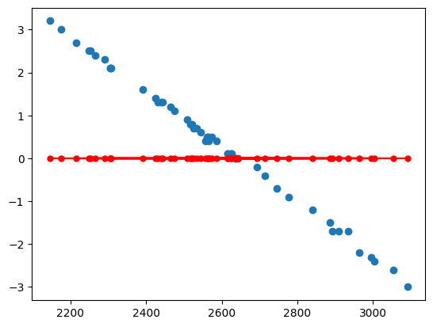

<div class="mt-2 text-sm text-gray-600">

$\boldsymbol{\beta} = (0,0,0,0,\dots)$

</div>

</div>

<div class="text-center">

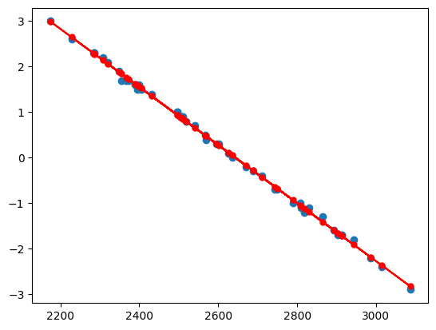

<div class="mt-2 text-sm text-gray-600">

$\boldsymbol{\beta} = (-.1,.2,.5,-.5,\dots)$

</div>

</div>

</div>

<blockquote class="blockquote3 mt-6 text-center">

$\hat{\boldsymbol{\beta}} = \left(\mathbf{X}^\top\mathbf{X}\right)^{-1} \mathbf{X}^\top\mathbf{y}$ &mdash; a single line of code, and blazing fast.

</blockquote>

---

# Interpretable Coefficients

<div class="grid grid-cols-2 gap-8 mt-4 items-center">

<div class="flex justify-center">
<FeatureTargetDiagram
  :features="[
    { label: 'elevation', symbol: 'x₁', width: 5 },
    { label: 'slope', symbol: 'x₂', width: 4 },
    { label: 'aspect', symbol: 'x₃', width: 2.5 },
  ]"
  target="surface temperature"
  target-symbol="y"
/>
</div>

<div>
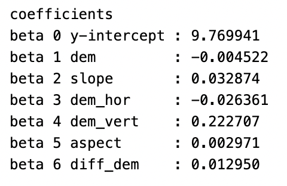

<div class="mt-3 text-gray-700 text-sm">

Each $\hat{\beta}_j$ tells us how $\hat{y}$ changes per unit of $x_j$, holding the other features fixed.

</div>

<blockquote class="blockquote1 mt-2">
Caveat: coefficients are only directly comparable across features when the features share units &mdash; or are normalized.
</blockquote>

</div>

</div>

<div class="figure-copyright">
Figure: M. Rußwurm &amp; D. Tuia, <em>Linear Regression</em>, ENV-408 course materials, EPFL, 2023.
</div>

---

# Model Evaluation

<div class="grid grid-cols-2 gap-8 mt-4 items-center">

<div class="flex justify-center">
<RegressionScatterDemo variant="trainval-3" x-label="elevation x" y-label="temperature y" :clicks="$clicks" />
</div>

<div>

We can now fit a model $(\hat{\beta}_0, \hat{\beta}_1, \dots)$ to any set of data samples $\mathcal{D} = \{(x_i,y_i)\}_{i=1}^N$ &mdash; but different samples give different fits.

<div v-click="2">

$$
Y = \beta_0 + \beta_1 X_1 + \dots + \varepsilon
$$

**Did we capture the true, underlying relationship** $(\beta_0, \beta_1, \dots)$?

</div>

<ol>

<li v-click="3">

how large is the data error $\varepsilon$? &rarr; RSE

</li>

<li v-click="4">

does our model explain the target variable well? &rarr; R²

</li>

<li v-click="5">

how close is $\hat{\beta}$ to the true $\beta$? &rarr; $\text{SE}[\hat{\beta}]$

</li>

</ol>

</div>

</div>

<blockquote v-click="6" class="blockquote3 mt-2">
&rarr; a hypothesis test tells us whether the relationship is significant given the dataset size.
</blockquote>

---

# Residual Sum of Squares (RSS)

<div class="grid grid-cols-2 gap-8 mt-6 items-center">

<div>

$$
\text{RSS} = \sum_{i=1}^N (y_i - \hat{y}_i)^2
$$

RSS increases with the dataset size $N$.

<blockquote class="blockquote2 mt-3">
Idea: normalize by the number of data samples.
</blockquote>

</div>

<div class="flex justify-center">
<RegressionScatterDemo variant="residual-squares" x-label="x" y-label="y" />
</div>

</div>

---

# Residual Standard Error (RSE)

<div class="grid grid-cols-2 gap-8 mt-6 items-center">

<div>

$$
\text{RSE} = \sqrt{\frac{1}{\underbrace{N-M-1}_{\text{DoF}}} \text{RSS}}
$$

- normalized by the number of samples $N$
- and the degrees of freedom (DoF): $M$ slope parameters and one y-intercept

<blockquote v-click class="blockquote3 mt-3">

The RSE estimates $\text{std}(\varepsilon)$ and is a good measure of fit.

</blockquote>

<blockquote v-click class="blockquote3 mt-2">

&rarr; but it is in the <strong>units of the target variable</strong>: what number counts as a good fit?

</blockquote>

</div>

<div class="flex justify-center">
<RegressionScatterDemo variant="error-band" x-label="x" y-label="y" />
</div>

</div>

---

# R² Metric: Coefficient of Determination

The R² is a **unitless proportion**, typically between 0 and 1: it measures how much of the variability in $Y$ is explained by $\hat{Y}$.

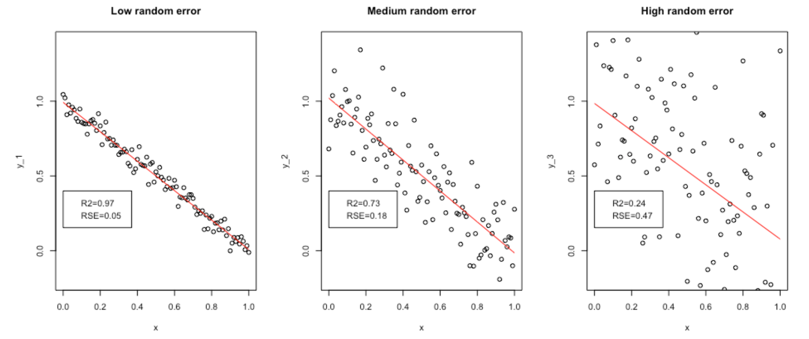

<div v-click="1" class="mt-2 text-gray-700 text-sm">

In the univariate case, R² is the square of the <strong>Pearson correlation coefficient</strong>
$r(Y,\hat{Y}) = \dfrac{\text{Cov}[Y,\hat{Y}]}{\sigma_Y \sigma_{\hat{Y}}}$.

</div>

<div class="figure-copyright">
Figure: M. Rußwurm &amp; D. Tuia, <em>Linear Regression</em>, ENV-408 course materials, EPFL, 2023. See also <a href="https://en.wikipedia.org/wiki/Coefficient_of_determination" target="_blank" rel="noopener noreferrer">Coefficient of Determination</a>, Wikipedia.
</div>

---

# R²: Comparison to an Averaging Model

How much better is our model than a simple averaging model that always predicts $\bar{y}$, no matter the input $x$?

<div class="grid grid-cols-2 gap-8 mt-4 items-center">

<div>

$$
\text{R}^2 = 1 - \frac{\text{RSS}}{\text{TSS}}
$$

Residual Sum of Squares

$$
\text{RSS} = \sum_{i=1}^N (y_i-\hat{y}_i)^2
$$

Total Sum of Squares

$$
\text{TSS} = \sum_{i=1}^N (y_i-\bar{y})^2
$$

</div>

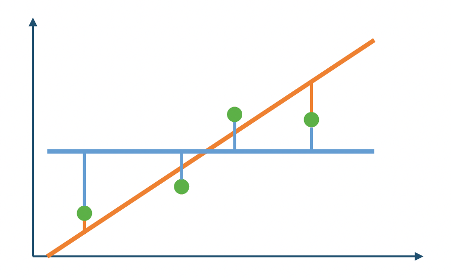

</div>

---

# Estimating the Standard Error for Coefficients

In the underlying model

$$
Y = \beta_0 + \beta_1 X_1 + \dots + \varepsilon
$$

we can estimate the residual standard error $\sigma = \text{std}(\varepsilon) = \text{RSE}$ &mdash; the better the fit, the smaller the standard deviation of $\varepsilon$.

<div v-click>

<blockquote class="blockquote3 mt-4">

How close are the estimated coefficients $\hat{\boldsymbol{\beta}}$ to the true, underlying relationship $\boldsymbol{\beta}$?

</blockquote>

We can calculate the Standard Error (SE) for each coefficient:

$$
\text{SE}[\hat{\beta}_0] = \sigma^2\left[\frac{1}{N} + \frac{\bar{x}^2}{\sum_{i=1}^N (x_i-\bar{x})^2}\right], \qquad
\text{SE}[\hat{\beta}_1] = \frac{\sigma^2}{\sum_{i=1}^N (x_i-\bar{x})^2}
$$

</div>

---

# Student's t-test: Is Our Model Significant?

**Question:** is an estimated relationship a random artifact of the data?

<div class="grid grid-cols-2 gap-8 mt-4 items-center">

<div>

Model: $Y = \beta_0 + \beta_1 X_1 + \varepsilon$

Testing the slope $\beta_1$

$$
H_0: \beta_1 = 0 \qquad H_1: \beta_1 \neq 0
$$

<div v-click="1">

Test statistic

$$
t_0 = \frac{\hat{\beta}_1}{\text{SE}[\hat{\beta}_1]}
$$

</div>

<blockquote v-click="2" class="blockquote3 mt-2">

Reject $H_0$ if $t_0 < -t_{\alpha,N-2}$ or $t_0 > t_{\alpha,N-2}$

</blockquote>

</div>

<div v-click="2">

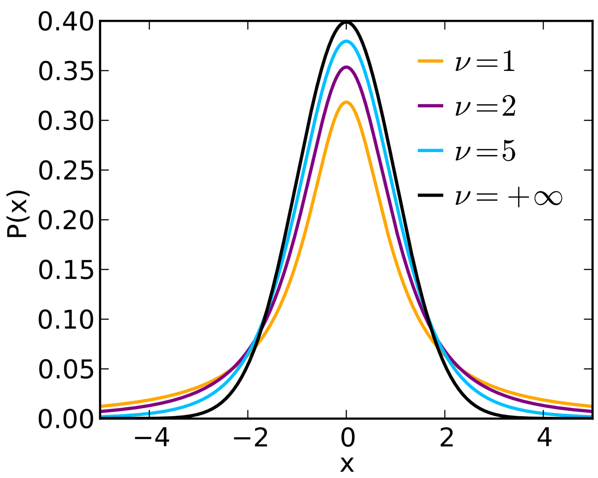

<div class="mt-2 text-sm text-gray-600">

$t_{\alpha,N-2}$ comes from the Student-t distribution with $\nu = N-2$ degrees of freedom.

</div>

</div>

</div>

<div class="figure-copyright">
Figure: Wikipedia, author Skbkekas, <a href="https://en.wikipedia.org/wiki/Student%27s_t-distribution" target="_blank" rel="noopener noreferrer">Student's t-distribution</a>. CC BY-SA.
</div>

---

# P-value: The Probability of a Lucky Shot

<div class="grid grid-cols-2 gap-8 mt-4 items-center">

<div>

The (two-sided) p-value integrates the Student-t distribution to $t_0$ on both sides.

<div v-click class="grid grid-cols-2 gap-3 mt-4">
<div class="p-3 rounded-xl border box-card box-2 text-center text-sm">high p-value &rarr; not enough data</div>
<div class="p-3 rounded-xl border box-card box-3 text-center text-sm">high p-value &rarr; no relationship</div>
</div>

<blockquote v-click class="blockquote3 mt-4">
We can use the p-value of different coefficients to select significant features.
</blockquote>

</div>

<div>
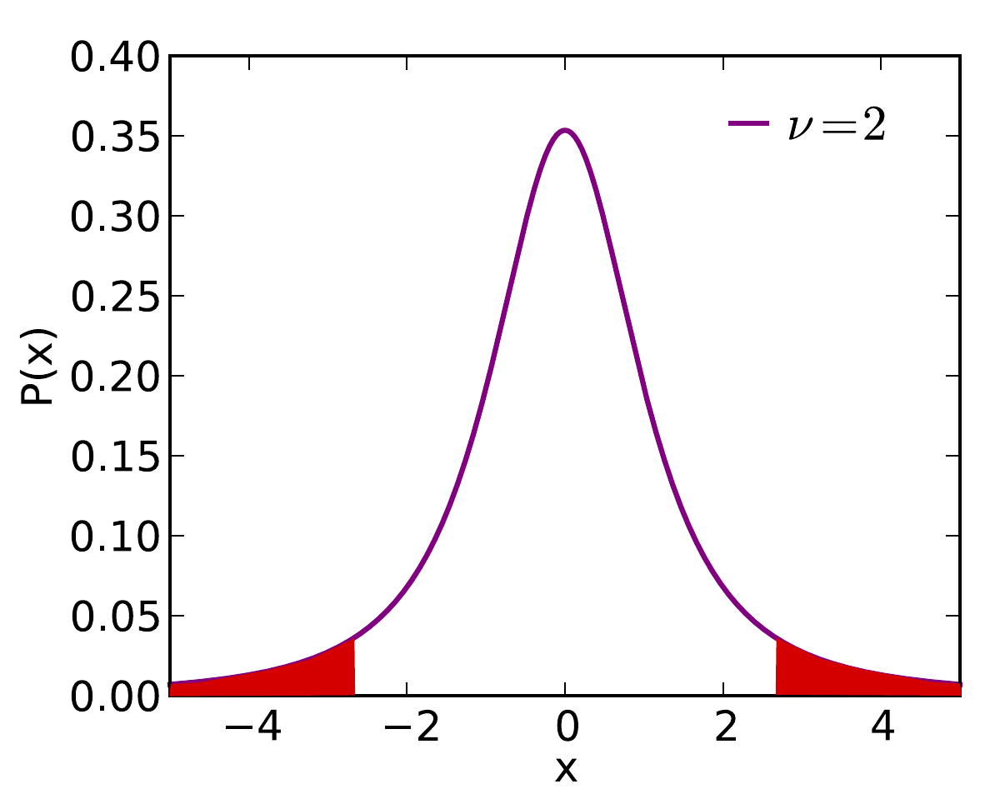
<div class="mt-1 text-sm text-gray-600 text-center">p-value shown in red</div>
</div>

</div>

<div class="figure-copyright">
Figure modified from Wikipedia, original author Skbkekas, <a href="https://en.wikipedia.org/wiki/Student%27s_t-distribution" target="_blank" rel="noopener noreferrer">Student's t-distribution</a>. CC BY-SA.
</div>

---

# Recap: Linear Regression

This part covered how to:

<ul>
<li v-click>implement a univariate and multivariate linear model from scratch</li>
<li v-click>fit the parameters with the Ordinary Least Squares (OLS) method</li>
<li v-click>evaluate the goodness of fit with RSE and R²</li>
<li v-click>test individual parameters for significance with Student's t-test</li>
<li v-click>select features dynamically based on their significance</li>
</ul>

<blockquote v-click class="blockquote3 mt-6">
Next: logistic regression extends the same linear model to map a fixed representation to <strong>categories</strong> with a linear decision boundary.
</blockquote>

---
layout: bonn-section
sectionColor: "#00457c"
section: decision-trees-and-random-forests
sectionTitle: "Decision Trees & Random Forests"
---

# Non-linear models: Decision Trees & Random Forests


<div class="bonn-section-citation">
Image by Bing Image Generator
</div>

<!--
Extend the linear-model view with recursive partitions and ensembles.
This section will end with random forests as robust predictors on fixed representations.
-->

---

# Decision Trees: The Core Idea

<div class="grid grid-cols-3 gap-8 mt-4 items-center">

<div class="col-span-2">

We categorize data through a <strong>chain of simple decisions</strong>.

<ul>
<li v-click>each decision is a simple test on a single feature (e.g., <em>is the temperature below 10 °C?</em>)</li>
<li v-click>implemented in computer science as a <strong>binary tree</strong>: a graph data structure in which each node has at most two children</li>
<li v-click>a universal tool for <strong>classification and regression</strong> of non-linear relationships</li>
</ul>

</div>

<div>

<div class="figure-copyright">Image by Bing Image Generator</div>
</div>

</div>

<!--
Part 1 of the section. Trees are the first non-linear model of the course.
Keep the "chain of simple decisions" picture in mind for everything that follows.
-->

---

# Recap: Data, Data Distributions &amp; Models

<div class="grid grid-cols-3 gap-6 mt-2 items-center">

<div class="text-sm">

<div v-click="1">
<strong class="text-blue-800">1 · collect data</strong> of the real world: we "sample" training data from a distribution

$$\{(X_i, y_i)\}_{i=1}^N \sim P(X, y)$$
</div>

<div v-click="3" class="mt-3">
<strong class="text-blue-800">3 · validate / evaluate</strong> the model on test data sampled from the same distribution

$$\{(X_i, y_i)\}_{i=1}^M \sim P(X, y)$$
</div>

</div>

<div>

<div class="figure-copyright text-center">Image by Bing Image Generator</div>
</div>

<div class="text-sm">

<div v-click="2">
<strong class="text-blue-800">2 · create / fit</strong> a mathematical model that approximates the world on training data

$$\hat{y}_i = f(X_i), \qquad \min E_\text{train}(\hat{y}_i, y_i)$$
</div>

<div v-click="4" class="mt-3">
<blockquote class="blockquote3">

We are interested in the test error $E_\text{test}(\hat{y}_i, y_i)$.

</blockquote>
</div>

</div>

</div>

<!--
Running example for the whole section: sunflowers are happy at warm temperatures and unhappy when it is too cold or too hot.
-->

---
clicks: 2
---

# Linear Models Fail in Non-linear Situations

<div class="grid grid-cols-5 gap-6 mt-1 items-center">

<div class="col-span-3">
<SunflowerRegions :clicks="$clicks" />
</div>

<div class="col-span-2">

<div v-if="$clicks === 0">

$$f(X) = \beta_0 + \sum_{j=1}^{p} X_j \beta_j$$

<blockquote class="blockquote2">
Linear models are well-suited for <strong>linear</strong> relationships with data from <strong>uni-modal</strong> distributions.
</blockquote>

</div>

<div v-else-if="$clicks === 1">

$$f(X) = \beta_0 + \sum_{j=1}^{p} X_j \beta_j$$

<blockquote class="blockquote4">
Most relationships in the real world are <strong>non-linear</strong>, and data distributions are <strong>not uni-modal</strong>: no line separates cold, warm and hot.
</blockquote>

</div>

<div v-else>

We need a different model: a <strong>piecewise constant</strong> function over regions $R_m$

$$f(X) = \sum_{m=1}^{M} c_m \cdot \mathbb{1}_{(X \in R_m)}$$

with one value $c_m$ per region.

</div>

</div>

</div>

<!--
Click 1: add the hot, unhappy sunflowers — the best line becomes flat and useless.
Click 2: split the temperature axis into three regions with one constant value each.
-->

---
layout: bonn-two-cols-header
columns: "minmax(0, 1.25fr) minmax(0, 1fr)"
---

# Decision Trees: Regions from Binary Decisions

$f(X) = \sum_{m=1}^{M} c_m \cdot \mathbb{1}_{(X \in R_m)}$ &mdash; regions defined by intervals: $R_1 = \{X \le 10\,°\text{C}\}$, $R_2 = \{10\,°\text{C} < X \le 30\,°\text{C}\}$, $R_3 = \{X > 30\,°\text{C}\}$

::left::

<SunflowerRegions :stage="3" />

::right::

<div class="text-center text-sm font-semibold text-blue-800 mb-1">A simple decision tree</div>

<TreeDiagram
  :width="320" :height="230"
  :nodes="[
    { id: 'in', x: 150, y: 14, label: 'X', type: 'input' },
    { id: 'n1', x: 150, y: 66, label: 'X < 10 °C' },
    { id: 'l1', x: 70, y: 136, icon: 'unhappy' },
    { id: 'n2', x: 225, y: 136, label: 'X > 30 °C' },
    { id: 'l2', x: 170, y: 206, icon: 'unhappy' },
    { id: 'l3', x: 280, y: 206, icon: 'happy' },
  ]"
  :edges="[
    { from: 'in', to: 'n1' },
    { from: 'n1', to: 'l1', label: 'yes' },
    { from: 'n1', to: 'n2', label: 'no' },
    { from: 'n2', to: 'l2', label: 'yes' },
    { from: 'n2', to: 'l3', label: 'no' },
  ]"
/>

<div class="text-center text-xs text-gray-500 mt-1">(drawn upside down: the root is at the top)</div>

<!--
Each region corresponds to a path from the root to a leaf.
The tree is just a compact way to write the interval definitions as a sequence of yes/no questions.
-->

---
clicks: 4
---

# A Classification Decision Tree: Terminology

<div class="grid grid-cols-2 gap-8 mt-2 items-center">

<TreeDiagram
  :width="320" :height="240"
  :nodes="[
    { id: 'in', x: 150, y: 14, label: 'X', type: 'input' },
    { id: 'n1', x: 150, y: 66, label: 'X < 10 °C' },
    { id: 'l1', x: 70, y: 140, icon: 'unhappy' },
    { id: 'n2', x: 225, y: 140, label: 'X > 30 °C' },
    { id: 'l2', x: 170, y: 214, icon: 'unhappy' },
    { id: 'l3', x: 280, y: 214, icon: 'happy' },
  ]"
  :edges="[
    { from: 'in', to: 'n1' },
    { from: 'n1', to: 'l1', label: 'yes' },
    { from: 'n1', to: 'n2', label: 'no' },
    { from: 'n2', to: 'l2', label: 'yes' },
    { from: 'n2', to: 'l3', label: 'no' },
  ]"
  :highlight="[[], ['in'], ['n1'], ['n1', 'n2'], ['l1', 'l2', 'l3']][Math.min($clicks, 4)]"
/>

<div>
<ul>
<li v-click="1"><strong>input features</strong>: the data to be classified</li>
<li v-click="2">the <strong>root node</strong> starts the decision process</li>
<li v-click="3"><strong>decision nodes</strong> (split nodes) implement a <strong>test function with discrete outcomes</strong>; each test splits the input space into regions</li>
<li v-click="4"><strong>leaf nodes</strong> mark the end of a sequence of decisions; a single (output) class is associated with each leaf</li>
</ul>
</div>

</div>

---
clicks: 3
---

# A Simple Algorithm to Classify a Test Sample

<div class="grid grid-cols-2 gap-8 mt-2 items-center">

<div>
<TreeDiagram
  :width="320" :height="240"
  :nodes="[
    { id: 'in', x: 150, y: 14, label: 'X = 15 °C', type: 'input' },
    { id: 'n1', x: 150, y: 66, label: 'X < 10 °C' },
    { id: 'l1', x: 70, y: 140, icon: 'unhappy' },
    { id: 'n2', x: 225, y: 140, label: 'X > 30 °C' },
    { id: 'l2', x: 170, y: 214, icon: 'unhappy' },
    { id: 'l3', x: 280, y: 214, icon: 'happy' },
  ]"
  :edges="[
    { from: 'in', to: 'n1' },
    { from: 'n1', to: 'l1', label: 'yes' },
    { from: 'n1', to: 'n2', label: 'no' },
    { from: 'n2', to: 'l2', label: 'yes' },
    { from: 'n2', to: 'l3', label: 'no' },
  ]"
  :highlight="[['n1'], ['n1', 'n1-n2', 'n2'], ['n1', 'n1-n2', 'n2', 'n2-l3', 'l3'], ['n1', 'n1-n2', 'n2', 'n2-l3', 'l3']][Math.min($clicks, 3)]"
/>
</div>

<div>

<ol>
<li>start at the root node</li>
<li>if the current node is a leaf node, return its class label</li>
<li>perform the test of the current decision node and follow the corresponding branch</li>
<li>go to 2</li>
</ol>

<blockquote v-click="3" class="blockquote2 mt-4">

$15\,°\text{C}$: not below $10\,°\text{C}$, not above $30\,°\text{C}$ &rarr; <strong>happy</strong>.

</blockquote>

</div>

</div>

<!--
Walk through the example with the class: each click follows one branch.
Ask what happens for 5 °C (yes at the root → unhappy after one test).
-->

---

# Multivariate Data Example: Land Cover Classification

<div class="grid grid-cols-2 gap-8 mt-2 items-center">

<div>
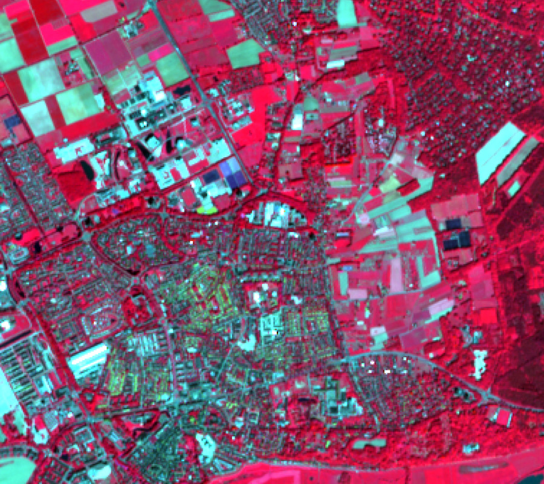
<div class="figure-copyright">Sentinel-2, false-colour composite (Wageningen, NL). Contains modified Copernicus Sentinel data.</div>
</div>

<div v-click>
<LandCoverSplits :clicks="0" />
<div class="text-sm text-gray-700 mt-2">Each pixel is a point in feature space: its <strong>red</strong> and <strong>near-infrared</strong> reflectance.</div>
</div>

</div>

---
clicks: 4
---

# Decision Tree for Multivariate Data

<div class="grid grid-cols-2 gap-8 mt-2 items-center">

<LandCoverSplits :clicks="$clicks" />

<TreeDiagram
  :width="340" :height="200"
  :nodes="[
    { id: 'r', x: 170, y: 20, label: 'red > t₁' },
    { id: 'a', x: 85, y: 92, label: 'nir > t₃' },
    { id: 'b', x: 255, y: 92, label: 'nir > t₂' },
    { id: 'u', x: 35, y: 168, label: 'urban', type: 'leaf' },
    { id: 'g', x: 135, y: 168, label: 'bare ground', type: 'leaf' },
    { id: 'w', x: 210, y: 168, label: 'water', type: 'leaf' },
    { id: 'v', x: 300, y: 168, label: 'vegetation', type: 'leaf' },
  ]"
  :edges="[
    { from: 'r', to: 'a', label: 'yes' },
    { from: 'r', to: 'b', label: 'no' },
    { from: 'a', to: 'u', label: 'no' },
    { from: 'a', to: 'g', label: 'yes' },
    { from: 'b', to: 'w', label: 'no' },
    { from: 'b', to: 'v', label: 'yes' },
  ]"
  :show="[[], ['r'], ['r', 'a', 'u', 'g'], ['r', 'a', 'u', 'g', 'b', 'w', 'v'], ['r', 'a', 'u', 'g', 'b', 'w', 'v']][Math.min($clicks, 4)]"
/>

</div>

<div v-click="4" class="mt-2 text-gray-700">
Every split is <strong>axis-aligned</strong>: each decision tests one feature against one threshold, so the regions are rectangles.
</div>

---
clicks: 2
---

# Increasing Node Purity: Split &amp; Repeat

<div class="grid grid-cols-5 gap-4 mt-1 items-start">

<div class="col-span-2">
<LandCoverSplits :clicks="$clicks === 0 ? 0 : ($clicks === 1 ? 1 : 2)" />
<blockquote class="blockquote2 mt-3">
Idea: every decision should <strong>increase the node purity</strong>.
</blockquote>
</div>

<div class="col-span-3 flex flex-col items-center">
<div class="w-[128px]"><PurityBars :counts="[20, 20, 20, 20]" :max="20" title="all samples" /></div>

<div v-click="1" class="w-full">
<div class="text-center text-sm text-blue-800 italic">red &gt; t₁</div>
<div class="grid grid-cols-2 gap-6 justify-items-center">
<div class="w-[128px]"><PurityBars :counts="[20, 20, 1, 2]" :max="20" title="yes" /></div>
<div class="w-[128px]"><PurityBars :counts="[0, 0, 19, 18]" :max="20" title="no" /></div>
</div>
</div>

<div v-click="2" class="w-full">
<div class="grid grid-cols-2 gap-6">
<div class="flex flex-col items-center">
<div class="text-center text-sm text-blue-800 italic">nir &gt; t₃</div>
<div class="grid grid-cols-2 gap-1">
<div class="w-[104px]"><PurityBars :counts="[20, 1, 0, 1]" :max="20" title="no" /></div>
<div class="w-[104px]"><PurityBars :counts="[0, 19, 1, 1]" :max="20" title="yes" /></div>
</div>
</div>
<div class="flex items-center justify-center text-sm text-gray-500">&hellip; and so on</div>
</div>
</div>

</div>

</div>

<!--
After each split the class histograms of the children are more peaked than the parent: the children are purer.
Next: how do we put a number on purity?
-->

---

# Quantifying Node Purity: Entropy

$$H(\mathbf{p}) = -\sum_i p_i \log(p_i) \qquad \text{(here with } \log_{10}\text{)}$$

<div class="grid grid-cols-2 gap-10 mt-2">

<div>
<div class="text-center text-sm font-semibold text-blue-800">lower entropy: more pure</div>
<div class="w-[190px] mx-auto"><PurityBars :counts="[90, 90, 10, 10]" :max="90" /></div>

<div class="compact-math text-sm" v-click>

$p_1 = p_2 = \tfrac{90}{200} = 0.45, \quad p_3 = p_4 = \tfrac{10}{200} = 0.05$

$H = -(2 \cdot 0.45 \log 0.45 + 2 \cdot 0.05 \log 0.05) \approx \mathbf{0.44}$

</div>
</div>

<div>
<div class="text-center text-sm font-semibold text-blue-800">higher entropy: less pure</div>
<div class="w-[190px] mx-auto"><PurityBars :counts="[50, 50, 50, 50]" :max="90" /></div>

<div class="compact-math text-sm" v-click>

$p_{1,2,3,4} = \tfrac{50}{200} = 0.25$

$H = -4 \cdot 0.25 \log 0.25 \approx \mathbf{0.60}$

</div>
</div>

</div>

---

# Pen &amp; Paper Exercise: Gini Index

$$G(\mathbf{p}) = \sum_i p_i (1 - p_i)$$

<div class="grid grid-cols-2 gap-10 mt-2">

<div>
<div class="text-center text-sm font-semibold text-blue-800">higher Gini index: less pure</div>
<div class="w-[190px] mx-auto"><PurityBars :counts="[50, 50, 50, 50]" :max="90" /></div>
<div class="compact-math text-sm" v-click="2">

$G = 4 \cdot 0.25 \cdot 0.75 = \mathbf{0.75}$

</div>
</div>

<div>
<div class="text-center text-sm font-semibold text-blue-800">lower Gini index: more pure</div>
<div class="w-[190px] mx-auto"><PurityBars :counts="[90, 90, 10, 10]" :max="90" /></div>
<div class="compact-math text-sm" v-click="2">

$G = 2 \cdot 0.45 \cdot 0.55 + 2 \cdot 0.05 \cdot 0.95 = \mathbf{0.59}$

</div>
</div>

</div>

<blockquote v-click="1" class="blockquote2 mt-3">
Exercise: calculate the Gini index for both distributions.
</blockquote>

<!--
Give the students two minutes. The Gini index is the default criterion in scikit-learn (criterion='gini').
-->

---

# Classification versus Regression Trees

So far, we only considered <strong>classification trees</strong>: each leaf represents one class (the majority of the training samples in the leaf).

<ul>
<li v-click>in <strong>classification</strong> problems, the target variable is <strong>categorical</strong> (e.g., happy / not happy sunflower)</li>
<li v-click>in <strong>regression</strong> problems, the target variable is <strong>continuous</strong> (e.g., a happiness score between 0 and 1)</li>
</ul>

<div v-click class="mt-4">

<strong class="text-blue-800">Regression trees</strong> follow exactly the same principles, but use

<ul>
<li>a different metric for node purity: the <strong>sample variance</strong></li>
<li>a different interpretation of the leaves: the <strong>sample mean</strong></li>
</ul>

</div>

---
clicks: 1
---

# Regression Trees: Leaves Return the Average

<div class="grid grid-cols-2 gap-8 mt-2 items-center">

<RegressionTreeDemo :variant="$clicks < 1 ? 'points' : 'leaf-means'" />

<div v-click="1">
<TreeDiagram
  :width="300" :height="200"
  :nodes="[
    { id: 'in', x: 140, y: 12, label: 'X', type: 'input' },
    { id: 'n1', x: 140, y: 62, label: 'X < 10 °C' },
    { id: 'l1', x: 60, y: 130, label: 'μ₁', type: 'leaf', w: 46 },
    { id: 'n2', x: 210, y: 130, label: 'X > 30 °C' },
    { id: 'l3', x: 160, y: 188, label: 'μ₃', type: 'leaf', w: 46 },
    { id: 'l2', x: 260, y: 188, label: 'μ₂', type: 'leaf', w: 46 },
  ]"
  :edges="[
    { from: 'in', to: 'n1' },
    { from: 'n1', to: 'l1', label: 'yes' },
    { from: 'n1', to: 'n2', label: 'no' },
    { from: 'n2', to: 'l3', label: 'yes' },
    { from: 'n2', to: 'l2', label: 'no' },
  ]"
/>

$$\mu_m = \frac{1}{N_m} \sum_{i:\, x_i \in R_m} y_i$$

</div>

</div>

---
clicks: 2
---

# Sample Variance as Node Purity

<div class="grid grid-cols-2 gap-8 mt-2 items-center">

<RegressionTreeDemo variant="variance" :clicks="$clicks" />

<div>

$$\sigma^2 = \frac{1}{N} \sum_{i=1}^{N} (y_i - \mu)^2$$

<blockquote v-if="$clicks === 0" class="blockquote2">

<strong>Before splitting</strong> the node $X \le 30\,°\text{C}$: cold and warm sunflowers are mixed &mdash; the variance is <strong>high</strong>. Interpret variance as the <strong>average squared distance to the mean</strong>.

</blockquote>

<blockquote v-else-if="$clicks === 1" class="blockquote3">
<strong>Geometric interpretation:</strong> each squared distance is the area of a square. A large average square area = high variance, i.e., a <strong>low node purity</strong>.
</blockquote>

<blockquote v-else class="blockquote2">

<strong>After splitting</strong> at $10\,°\text{C}$: smaller average squares = lower variance = <strong>higher node purity</strong>.

</blockquote>

</div>

</div>

<!--
Same picture as the MSE squares of linear regression: the tree now minimizes the squares around each region mean instead of around a line.
-->

---

# How to Find the Threshold $\tau$?

<div class="grid grid-cols-2 gap-8 mt-2 items-center">

<RegressionTreeDemo variant="threshold" :tau="20" />

<div>

Formal definition of the regions by the threshold

$$R_1 = \{X \mid X < \tau\}, \qquad R_2 = \{X \mid X \ge \tau\}$$

<div v-click>

Minimization objective

$$
t^* = \arg\min_\tau \underbrace{\sum_{i:\, x_i \in R_1} (y_i - \mu_{R_1})^2}_{\text{left variance}} + \underbrace{\sum_{i:\, x_i \in R_2} (y_i - \mu_{R_2})^2}_{\text{right variance}}
$$

</div>

<div v-click class="text-gray-700">

The impurity is a function of $\tau$ &mdash; we look for its minimum $t^*$.

</div>

</div>

</div>

---

# Naïve Approach: Try Different Thresholds

<div class="w-[86%] mx-auto"><ThresholdScan /></div>

<blockquote class="blockquote3 mt-3">

Easy to implement &mdash; but we need to choose which thresholds to test. Drag the slider to scan the thresholds; the best recorded threshold is $t^*$.

</blockquote>

<div class="slide-citation">
Original Colab notebook: <a href="https://colab.research.google.com/drive/1-9FmziUq53R44xehKnzm3v4Pcvs43TXl?usp=sharing" target="_blank" rel="noopener noreferrer">threshold search</a>
</div>

<!--
Interactive: drag τ from left to right. The impurity curve has a clear minimum where the two groups separate.
Question to the class: how fine should the grid of thresholds be?
-->

---
clicks: 6
---

# Binary Splitting

<div class="w-[88%] mx-auto"><BinarySplitting :clicks="$clicks" /></div>

<blockquote v-click="6" class="blockquote1 mt-1">
Only thresholds between neighbouring points change the split &mdash; we test as many thresholds as we have points.
</blockquote>

<!--
Click through the five candidate thresholds. The plot on the bottom right records the impurity of each split; the last click marks the optimum.
-->

---
clicks: 4
---

# Growing a Tree: Recursive Binary Splitting

<div class="grid grid-cols-5 gap-6 mt-2 items-center">

<div class="col-span-2">

Growing a decision tree:

<ul>
<li>perform binary splitting</li>
<li>recursively for each decision node</li>
<li>to maximize node purity</li>
</ul>

<blockquote v-click="2" class="blockquote3 mt-4">
When to stop splitting?
</blockquote>

<blockquote v-click="4" class="blockquote4 mt-3">
Without a stopping rule we end up with <strong>one sample per leaf</strong> = a 1-nearest-neighbour regressor / classifier.
</blockquote>

</div>

<div class="col-span-3">
<TreeGrowth :clicks="$clicks" :depth="4" />
</div>

</div>

---

# Overfitting of Decision Trees

<div class="grid grid-cols-5 gap-6 mt-1 items-center">

<div class="col-span-2">
<ul>
<li>the tree fits the training data perfectly (zero variance in every leaf)</li>
<li v-click>the tree is extremely large and uninterpretable</li>
<li v-click>test MSE: <strong>0.092</strong> happiness</li>
</ul>
</div>

<div class="col-span-3">
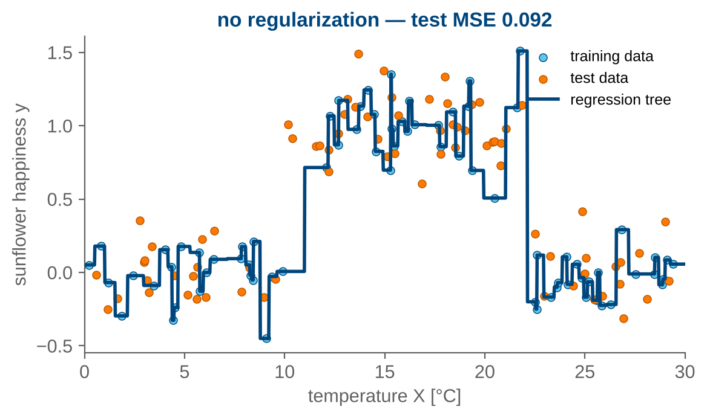
</div>

</div>

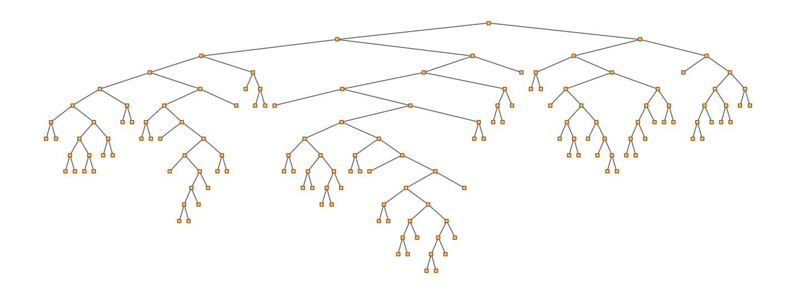

<!--
Synthetic sunflower data (75 training and 75 test samples). Figure script: figures-source/lecture-3/make_dt_figures.py
-->

---

# Regularization: Restricting the Depth

<div class="grid grid-cols-5 gap-6 mt-1 items-center">

<div class="col-span-2">
<ul>
<li>we can manually restrict the depth</li>
<li v-click>the tree remains interpretable</li>
<li v-click>test MSE lower: <strong>0.077</strong> happiness</li>
</ul>
</div>

<div class="col-span-3">
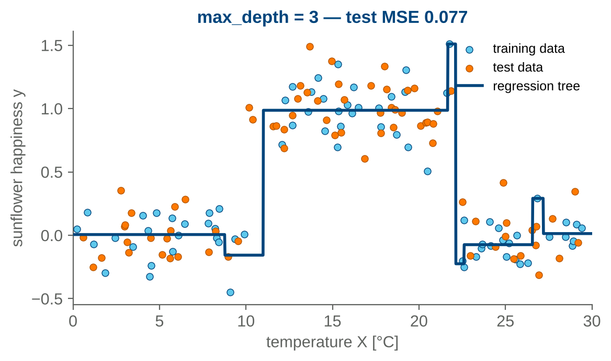
</div>

</div>

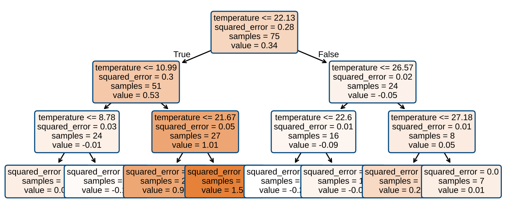

<div class="slide-citation">
Original Colab notebook: <a href="https://colab.research.google.com/drive/1vP8XTPmVpnN3OdROYYkauT9y2XZlqf2r?usp=sharing" target="_blank" rel="noopener noreferrer">regularization of decision trees</a>
</div>

---
layout: bonn-two-cols-header
---

# Regularization: Tree Pruning

Two families of algorithms restrict the tree complexity and counteract overfitting.

::left::

<div class="border rounded-xl p-4 h-full">
<h3>Slow growers (pre-pruning)</h3>

<strong>Strategy:</strong> grow the tree slowly, with additional checks during growing.

<ul>
<li>simple checks: <strong>maximum depth</strong>, <strong>maximum number of leaf nodes</strong></li>
<li>add a decision node only if the <strong>increase in node purity</strong> is above a threshold</li>
</ul>
</div>

::right::

<div v-click class="border rounded-xl p-4 h-full">
<h3>Fast cutters (post-pruning)</h3>

<strong>Strategy:</strong> grow the full tree, then remove unimportant nodes.

<ul>
<li><strong>cost complexity pruning</strong>: we identify the weakest link in the tree and remove it</li>
</ul>
</div>

---

# Cost Complexity Pruning

<div class="grid grid-cols-2 gap-8 mt-1 items-center">

<div>

$$C_\alpha(T) = \underbrace{C(T)}_{\substack{\text{cost} \\ \text{(training error)}}} + \alpha \underbrace{|T|}_{\substack{\text{complexity} \\ \text{(number of leaves)}}}$$

<strong class="text-blue-800">Idea:</strong> remove leaves to <strong>reduce the complexity</strong> while keeping a <strong>low training error</strong> (cost). The hyperparameter $\alpha$ balances both objectives.

<div v-click>

<strong class="text-blue-800">Algorithm:</strong>

<ul>
<li>

iteratively remove sub-trees and record the decrease in the cost-complexity function $C_\alpha(T)$

</li>
<li>

sub-trees can be ordered by importance, each with an associated $\alpha$

</li>
</ul>

</div>

</div>

<TreeDiagram
  :width="300" :height="230"
  :nodes="[
    { id: 'x', x: 150, y: 12, label: 'X', type: 'input' },
    { id: 'r', x: 150, y: 58, label: ' ', w: 30 },
    { id: 'a', x: 100, y: 112, label: ' ', w: 30 },
    { id: 'b', x: 200, y: 112, label: ' ', w: 30 },
    { id: 'a1', x: 60, y: 166, label: ' ', w: 30 },
    { id: 'a2', x: 130, y: 166, label: ' ', w: 30 },
    { id: 'm1', x: 40, y: 214, label: 'μ₁', type: 'leaf', w: 34 },
    { id: 'm2', x: 85, y: 214, label: 'μ₂', type: 'leaf', w: 34 },
    { id: 'm3', x: 175, y: 166, label: 'μ₃', type: 'leaf', w: 34 },
    { id: 'm4', x: 240, y: 166, label: 'μ₄', type: 'leaf', w: 34 },
  ]"
  :edges="[
    { from: 'x', to: 'r' },
    { from: 'r', to: 'a' }, { from: 'r', to: 'b' },
    { from: 'a', to: 'a1' }, { from: 'a', to: 'a2' },
    { from: 'a1', to: 'm1' }, { from: 'a1', to: 'm2' },
    { from: 'b', to: 'm3' }, { from: 'b', to: 'm4' },
  ]"
  :dim="$clicks >= 1 ? ['a1', 'm1', 'm2'] : []"
/>

</div>

---

# Cost Complexity Pruning: The Effect of $\alpha$

<div class="grid grid-cols-2 gap-8 items-center">

<div>

$$C_\alpha(T) = C(T) + \alpha |T|$$

</div>

<div>

A higher $\alpha$

- produces a **shallower tree** with fewer nodes (reduces complexity)
- increases the impurity, i.e., the **training error** (increases cost)

</div>

</div>

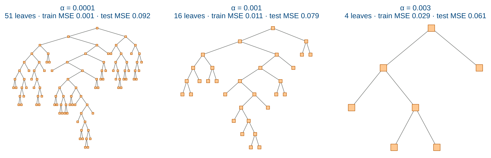

<!--
With increasing α the training error goes up but the test error goes down: we trade fit for generalization.
-->

---

# Building a Tree with Cost Complexity Pruning

<div class="grid grid-cols-4 gap-6 mt-2 items-center">

<div class="col-span-3">

1. use ***recursive binary splitting*** to grow a large tree on the training data
2. apply **cost complexity pruning** to the large tree to obtain a sequence of best sub-trees as a function of $\alpha$
3. use **K-fold cross-validation to choose $\alpha$**:
   1. repeat steps 1 and 2 on all but the $k$-th fold of the training data
   2. evaluate the error on the left-out $k$-th fold as a function of $\alpha$; average the results for each $\alpha$ and pick $\alpha$ to minimize the average error
4. return the sub-tree from step 2 that corresponds to the chosen value of $\alpha$

</div>

<div>

<div class="figure-copyright text-center">Image by Bing Image Generator</div>
</div>

</div>

<div class="slide-citation">
Algorithm after James, Witten, Hastie &amp; Tibshirani, <a href="https://www.statlearning.com/" target="_blank" rel="noopener noreferrer"><em>An Introduction to Statistical Learning</em></a>, Algorithm 8.1.
</div>

---

# Decision Trees in scikit-learn: Hyperparameters

```python {2,3,4|all}
from sklearn.tree import DecisionTreeClassifier, DecisionTreeRegressor

clf = DecisionTreeClassifier(criterion="gini",          # or "entropy" — node purity
                             max_depth=None, max_leaf_nodes=None,      # pre-pruning
                             min_samples_split=2, min_samples_leaf=1,
                             min_impurity_decrease=0.0,
                             ccp_alpha=0.0)                            # post-pruning

reg = DecisionTreeRegressor(criterion="squared_error",  # variance as node purity
                            max_depth=3, ccp_alpha=0.0)
```

<div class="mt-3 text-gray-700">
All hyperparameters in the snippet were covered in this part: the <strong>purity criterion</strong>, <strong>pre-pruning</strong> limits and <strong>cost complexity pruning</strong> via <code>ccp_alpha</code>.
</div>

<div class="slide-citation">
Documentation: <a href="https://scikit-learn.org/stable/modules/generated/sklearn.tree.DecisionTreeClassifier.html" target="_blank" rel="noopener noreferrer">DecisionTreeClassifier</a> · <a href="https://scikit-learn.org/stable/modules/generated/sklearn.tree.DecisionTreeRegressor.html" target="_blank" rel="noopener noreferrer">DecisionTreeRegressor</a>
</div>

---
layout: bonn-two-cols-header
---

# Recap: Decision Trees

::left::

<h3>Advantages</h3>

<ul>
<li><strong>inexpensive</strong> to construct</li>
<li>extremely <strong>fast at prediction</strong> time</li>
<li><strong>easy to interpret</strong> for small trees</li>
<li><strong>robust to noise</strong> (when regularized)</li>
<li>can easily handle <strong>redundant or irrelevant attributes</strong> (unless the attributes are interacting)</li>
</ul>

::right::

<div v-click>
<h3>Disadvantages</h3>

<ul>
<li>decision trees are prone to <strong>overfitting</strong> and need regularization</li>
<li><strong>greedy</strong> approaches often fail to find the best tree (restricting growth is too short-sighted)</li>
<li>do <strong>not take interactions between features</strong> into account: each decision boundary involves only a single attribute</li>
</ul>
</div>

---

# Bagging, Random Forests &amp; Boosting

## Increasing robustness by redundancy

<div class="grid grid-cols-3 gap-8 mt-6 text-center">

<div>

<div class="text-blue-800 font-semibold mt-2">Bagging</div>
</div>

<div>
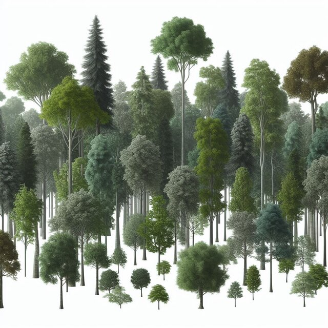
<div class="text-blue-800 font-semibold mt-2">Random Forests</div>
</div>

<div>

<div class="text-blue-800 font-semibold mt-2">Boosting</div>
</div>

</div>

<div class="slide-citation">
Images by Bing Image Generator (DALL·E 3): "a stylized image of a bag of green trees", "… of a random forest", "… of a flying tree that gets faster and faster", white background.
</div>

<!--
Part 2: single trees have high variance. We fix this by combining many trees.
-->

---

# An Artificial Classification Dataset

<div class="grid grid-cols-2 gap-8 mt-2 items-center">

<div>
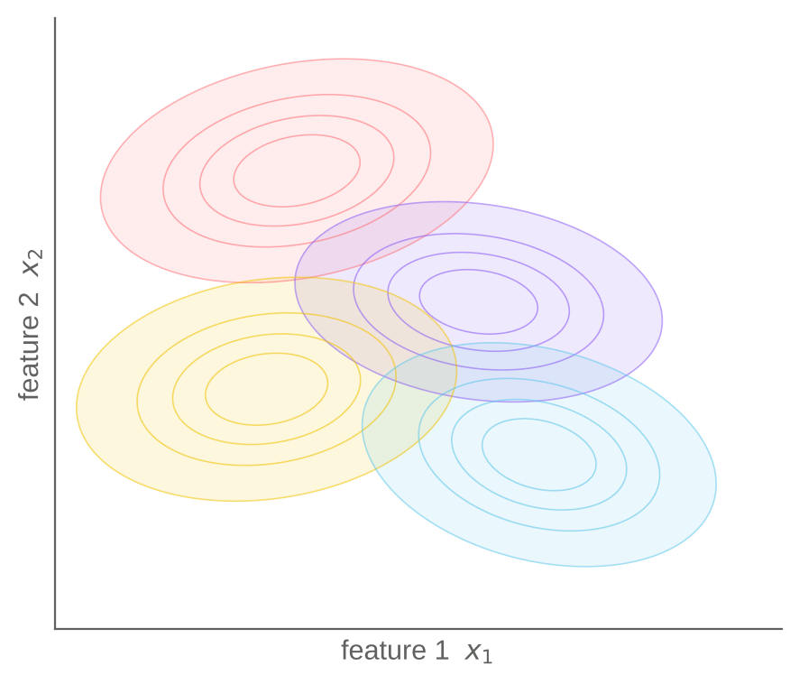
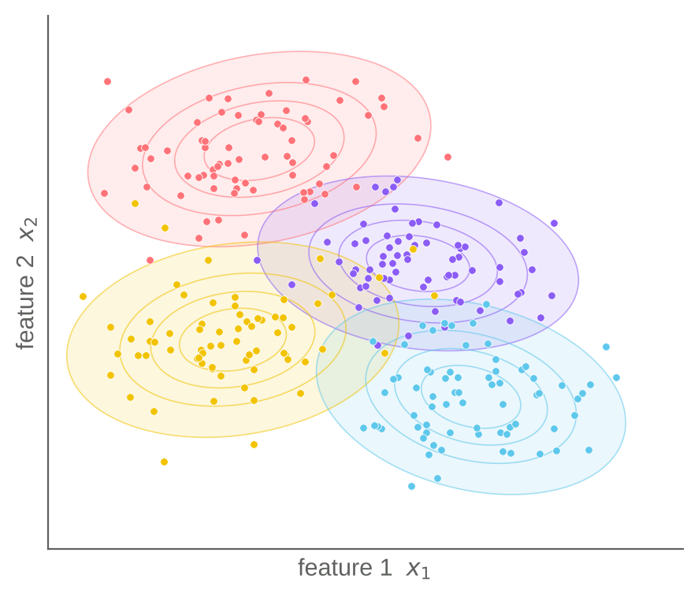
</div>

<div>

Assume four distributions, one per class, over a random feature vector $\mathbf{X} = (x_1, x_2)$:

<ul>
<li>

<span style="color:#ff7378">■</span> class 1: $p(x_1, x_2 \mid y = 1)$

</li>
<li>

<span style="color:#8b5cf6">■</span> class 2: $p(x_1, x_2 \mid y = 2)$

</li>
<li>

<span style="color:#f2c300">■</span> class 3: $p(x_1, x_2 \mid y = 3)$

</li>
<li>

<span style="color:#5ec8ec">■</span> class 4: $p(x_1, x_2 \mid y = 4)$

</li>
</ul>

<div v-click="1">

We <strong>sample a dataset</strong> from the distribution

$$\mathcal{D} = \{(\mathbf{x}_i, y_i)\}_{i=1}^{N} \sim p(\mathbf{X}, Y)$$

</div>

<blockquote class="blockquote1 mt-3">
Remember: we are always working with distributions.
</blockquote>

</div>

</div>

---
clicks: 2
---

# Let's Fit a Decision Tree to the Data

<div class="grid grid-cols-2 gap-8 mt-2 items-center">

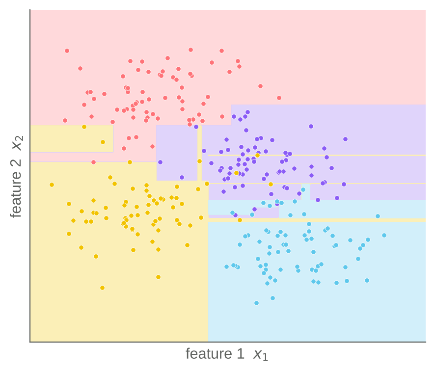

<div>

Again, we split the feature space into <strong>regions</strong>.

<blockquote v-click="1" class="blockquote2 mt-4">
The <strong>modes</strong> (i.e., centers) of the data distributions are well assigned to the correct classes.
</blockquote>

<blockquote v-click="2" class="blockquote4 mt-4">
But the uncertain, <strong>overlapping region</strong> is not well defined: thin slivers and islands follow individual training points.
</blockquote>

</div>

</div>

---

# Different Samples Lead to Very Different Trees

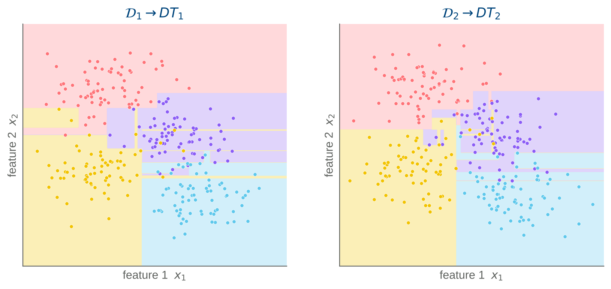

<div class="grid grid-cols-2 gap-8 mt-2">

<blockquote v-click class="blockquote2">
<strong>Low bias:</strong> each tree fits its own training data perfectly.
</blockquote>

<blockquote v-click class="blockquote3">

<strong>High variance:</strong> the trees are very different on different dataset samples $\mathcal{D}_1, \mathcal{D}_2 \sim p(\mathbf{X}, Y)$.

</blockquote>

</div>

---
layout: bonn-two-cols-header
---

# Bias–Variance Trade-off

Finding a good balance between fitting and overfitting is the fundamental challenge in machine learning. For tree-like classifiers:

::left::

<div class="grid grid-cols-4 gap-3 items-center">
<div class="col-span-3">
<h3>Strategy 1: reduce tree complexity</h3>
<span class="text-gray-500 text-sm">(recap: seen in Part 1)</span>
<ul>
<li>greedy: restrict the tree complexity while growing</li>
<li>non-greedy: post-hoc pruning of the tree</li>
</ul>
</div>
<div class="text-center">

<div class="text-sm italic text-blue-800">"cut the tree"</div>
</div>
</div>

::right::

<div v-click class="grid grid-cols-4 gap-3 items-center">
<div class="col-span-3">
<h3>Strategy 2: ensemble many trees</h3>
<ul>
<li>bagging</li>
<li>random forests</li>
<li>boosting</li>
</ul>
</div>
<div class="text-center">

<div class="text-sm italic text-blue-800">"grow a forest"</div>
</div>
</div>

---

# Let's Grow a Forest — Step 1: Bagging

<div class="grid grid-cols-5 gap-6 mt-1 items-center">

<div class="col-span-2">

<div class="text-center text-sm">

$\mathcal{D}_\text{train} = \{(\mathbf{x}_i, y_i)\}_{i=1}^{N} \sim p(\mathbf{X}, Y)$

<div class="text-gray-500 text-xs my-1">&darr; randomly sampled subsets (with replacement), i.e., a <strong>"bootstrap"</strong> &darr;</div>

</div>

<div class="border-2 rounded-xl p-2 mt-1" style="border-color: var(--bonn-blue)">
<div class="text-center text-sm font-semibold text-blue-800">Bag of decision trees</div>
<div class="flex justify-around">
<MiniTree label="𝒟₁ → DT₁" size="70px" />
<MiniTree label="𝒟₂ → DT₂" size="70px" />
<MiniTree label="𝒟₃ → DT₃" size="70px" />
</div>
<div class="text-center text-xs text-gray-500">each tree is deep and not pruned</div>
</div>

<div v-click="1" class="mt-3 text-sm">
<strong class="text-blue-800">Ensemble prediction:</strong>
<ul>
<li><strong>majority voting</strong> for classification</li>
<li><strong>output averaging</strong> for regression</li>
</ul>
</div>

</div>

<div class="col-span-3" v-click="2">
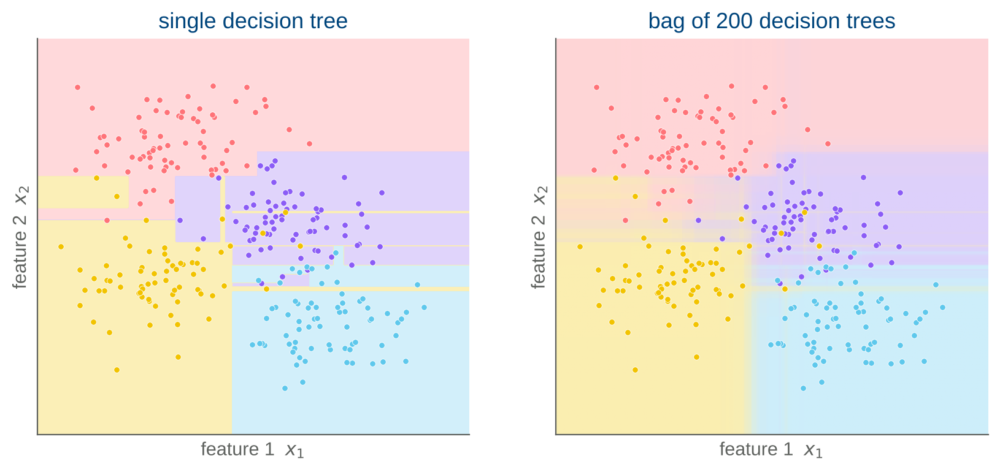
<blockquote class="blockquote2 mt-1">
Effect: trees agree in the modes and disagree in the overlap &mdash; decision boundaries become <strong>blurry</strong>, a more realistic result.
</blockquote>
</div>

</div>

<!--
Right plot: colours are blended by the fraction of trees voting for each class; uncertain regions appear as mixed colours.
-->

---

# Bagging: Out-of-Bag Error

<div class="grid grid-cols-2 gap-10 mt-4 items-center">

<div class="text-center">

$\mathcal{D}_\text{train}$

<div class="flex justify-center gap-6 mt-3 text-sm">
<div class="border-2 rounded-xl px-3 py-2" style="border-color: var(--bonn-blue)">

bootstrap 𝒟ᵢ<br><span class="text-gray-500 text-xs">1. fit DTᵢ</span>

</div>
<div class="border-2 rounded-xl px-3 py-2" style="border-color: var(--grl-data-orange)">

remaining samples 𝒟<sub>OOB</sub><br><span class="text-gray-500 text-xs">2. estimate the OOB error of DTᵢ</span>

</div>
</div>

</div>

<div>

<strong class="text-blue-800">Out-of-bag (OOB) error estimation</strong>

<ol>
<li>

fit decision tree $DT_i$ on $\mathcal{D}_i$

</li>
<li>

test its performance on the out-of-bag set $\mathcal{D}_\text{OOB}$

</li>
<li>repeat for each tree in the bag</li>
<li>average the individual OOB errors across trees</li>
</ol>

<blockquote v-click class="blockquote2 mt-3">
The OOB error <strong>approximates the test error</strong> without using test data &mdash; a similar idea to cross-validation.
</blockquote>

</div>

</div>

---

# Bagging Trees: Re-gaining Interpretability

<div class="grid grid-cols-5 gap-6 mt-1 items-center">

<div class="col-span-3">
<ul>
<li>bagging <strong>improves accuracy</strong> over a single tree through increasing diversity in the decisions</li>
<li>but we <strong>lose interpretability</strong>: each tree has different decision rules, and interpreting many rules in parallel is difficult</li>
</ul>

<div v-click="1" class="mt-3">
<strong class="text-blue-800">Variable importance</strong> &mdash; across all trees in the bag:
<ol>
<li>look at all decision nodes that involve the feature of interest <span style="color: var(--grl-data-orange)">●</span> (for instance, temperature)</li>
<li>measure the <strong>increase in node purity</strong> at each of these nodes and average it</li>
</ol>
</div>
</div>

<div class="col-span-2">
<div class="flex justify-around">
<MiniTree root="a" label="DT₁" size="64px" />
<MiniTree left="a" right="a" label="DT₂" size="64px" />
<MiniTree left="a" label="DT₃" size="64px" />
</div>
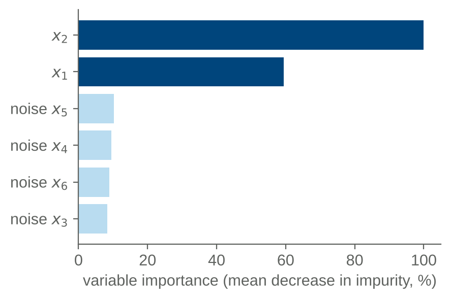
</div>

</div>

<!--
The importance plot is computed on the four-class dataset with four extra pure-noise features: the informative features x1 and x2 clearly stand out.
-->

---

# Bagging Limitation: Correlated Trees

<div class="grid grid-cols-5 gap-6 mt-2 items-center">

<div class="col-span-3">
<ul>
<li>bagging improves accuracy through increasing <strong>diversity</strong> in the decisions</li>
<li v-click>but bagged trees are still <strong>highly correlated</strong>: an important feature <span style="color: var(--grl-data-orange)">●</span> is split first, followed by the second most important feature <span style="color: var(--grl-data-green)">●</span>, and so on&hellip;</li>
<li v-click>all trees in a bag look similar &rarr; this <strong>correlates the trees</strong>, reduces diversity &amp; test accuracy</li>
</ul>

<blockquote v-click class="blockquote3 mt-4">
Idea: increase diversity by <strong>removing features</strong> from individual trees.
</blockquote>
</div>

<div class="col-span-2 border-2 rounded-xl p-3" style="border-color: var(--bonn-blue)">
<div class="text-center text-sm font-semibold text-blue-800 mb-1">Bag of decision trees</div>
<div class="flex justify-around">
<MiniTree root="a" left="b" right="b" label="𝒟₁ → DT₁" size="72px" />
<MiniTree root="a" left="b" right="b" label="𝒟₂ → DT₂" size="72px" />
<MiniTree root="a" left="b" label="𝒟₃ → DT₃" size="72px" />
</div>
</div>

</div>

---

# Random Forest — Step 2: Remove Features

<blockquote class="blockquote3">
Idea: increase diversity by removing features from individual trees.
</blockquote>

<div class="grid grid-cols-2 gap-8 mt-3 items-center">

<div>

<strong class="text-blue-800">Implementation:</strong> we take a random sample of predictors for each tree (usually $\sqrt{F}$ of $F$ features, e.g., 4 out of 15).

In a random forest, each decision tree is

<ol>
<li>

trained with a bootstrapped dataset $\mathcal{D}_i$

</li>
<li>

using a subset of features $\mathcal{F}_i$

</li>
</ol>

</div>

<div v-click class="border-2 rounded-xl p-3" style="border-color: var(--bonn-blue)">
<div class="text-center text-sm font-semibold text-blue-800 mb-1">Random forest</div>
<div class="flex justify-around">
<MiniTree root="a" left="o" right="o" label="𝒟₁ → DT₁" sub="using ℱ₁" :without="['b']" size="80px" />
<MiniTree root="b" left="o" right="b" label="𝒟₂ → DT₂" sub="using ℱ₂" :without="['a']" size="80px" />
<MiniTree root="o" left="o" right="o" label="𝒟₃ → DT₃" sub="using ℱ₃" :without="['a', 'b']" size="80px" />
</div>
</div>

</div>

<!--
In scikit-learn the feature subset is drawn per split (max_features), not once per tree — the effect on diversity is the same.
-->

---
layout: bonn-two-cols-header
---

# Summary: Bagging and Random Forests

::left::

<h3>Bags &amp; random forests</h3>
<ul>
<li>each tree is trained on a different <strong>bootstrapped</strong> set of training data</li>
<li>trees are trained separately from each other, <strong>in parallel</strong></li>
</ul>

<div class="flex justify-around mt-4">
<MiniTree root="a" left="b" right="b" label="DT₁" size="62px" />
<MiniTree root="a" left="b" right="b" label="DT₂" size="62px" />
<MiniTree root="a" left="b" label="DT₃" size="62px" />
</div>
<div class="text-center text-sm text-blue-800 font-semibold">bag of decision trees</div>

::right::

<h3>Random forests</h3>
<ul>
<li>additionally, each tree is trained with a <strong>different subset of features</strong></li>
</ul>

<div class="flex justify-around mt-4">
<MiniTree root="a" label="DT₁" :without="['b']" size="62px" />
<MiniTree root="b" right="b" label="DT₂" :without="['a']" size="62px" />
<MiniTree label="DT₃" :without="['a', 'b']" size="62px" />
</div>
<div class="text-center text-sm text-blue-800 font-semibold">random forest</div>

---

# Bagging &amp; Random Forests in scikit-learn

```python {3-5|7-9|all}
from sklearn.ensemble import BaggingClassifier, RandomForestClassifier

bag = BaggingClassifier(estimator=DecisionTreeClassifier(),  # any base model
                        n_estimators=10, max_samples=1.0,     # number & size of bootstraps
                        bootstrap=True, oob_score=False, n_jobs=None)

rf = RandomForestClassifier(n_estimators=100, criterion="gini", max_depth=None,
                            max_features="sqrt",              # feature subset → diversity
                            bootstrap=True, oob_score=False, n_jobs=None)
```

<div class="mt-3 text-gray-700">
Pass a <code>DecisionTreeClassifier</code> as <code>estimator</code> into the bagging classifier. <code>oob_score=True</code> computes the out-of-bag error; <code>n_jobs</code> trains trees in parallel.
</div>

<div class="slide-citation">
Documentation: <a href="https://scikit-learn.org/stable/modules/generated/sklearn.ensemble.BaggingClassifier.html" target="_blank" rel="noopener noreferrer">BaggingClassifier</a> · <a href="https://scikit-learn.org/stable/modules/generated/sklearn.ensemble.RandomForestClassifier.html" target="_blank" rel="noopener noreferrer">RandomForestClassifier</a>
</div>

---
layout: bonn-two-cols-header
---

# Random Forest versus Boosting Philosophy

::left::

<div class="grid grid-cols-2 gap-3 items-center">
<div>
<h3>Random forest</h3>
<ul>
<li>accuracy through <strong>classifier diversity</strong></li>
<li>all trees grown <strong>in parallel</strong></li>
</ul>
</div>

</div>

::right::

<div v-click class="grid grid-cols-2 gap-3 items-center">
<div>
<h3>Boosting</h3>
<ul>
<li>many small <strong>"weak" classifiers</strong></li>
<li>trees grown <strong>sequentially</strong></li>
</ul>
</div>

</div>

---

# Boosting: Principles

<div class="grid grid-cols-3 gap-6 mt-2 items-center">

<div>
<ul>
<li>train one classifier after another</li>
<li v-click>reweight the data so that <strong>wrongly classified samples become more important</strong> for the next classifier</li>
</ul>
</div>

<div class="col-span-2">
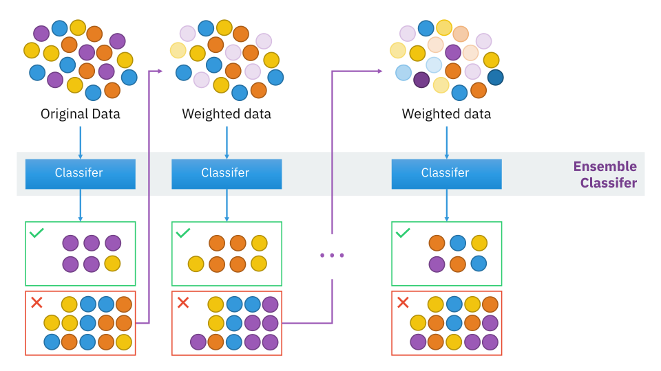
<div class="figure-copyright">
Figure: Sirakorn, <a href="https://commons.wikimedia.org/wiki/File:Ensemble_Boosting.svg" target="_blank" rel="noopener noreferrer">Ensemble Boosting</a>, Wikimedia Commons, CC BY-SA 4.0.
</div>
</div>

</div>

---

# AdaBoost: Ideas

<div class="grid grid-cols-2 gap-8 mt-2 items-center">

<div>

Three core ideas:

<ul>
<li v-click>combine many <strong>"weak learners"</strong>, i.e., <strong>stumps</strong></li>
<li v-click>some stumps are <strong>weighted higher</strong> than others</li>
<li v-click>each stump takes the <strong>previous stumps</strong> into account</li>
</ul>

</div>

<div class="text-center">

<div class="text-sm">Base classifier / regressor: a <strong>"stump"</strong> is a single decision node</div>

<TreeDiagram
  :width="160" :height="90" max-width="140px"
  :nodes="[
    { id: 'r', x: 80, y: 20, label: 'X < t', w: 60 },
    { id: 'a', x: 45, y: 72, type: 'dot', color: 'var(--grl-data-orange)' },
    { id: 'b', x: 115, y: 72, type: 'dot', color: 'var(--grl-data-orange)' },
  ]"
  :edges="[{ from: 'r', to: 'a' }, { from: 'r', to: 'b' }]"
/>


<div class="figure-copyright">Image by Bing Image Generator</div>
</div>

</div>

---
clicks: 3
---

# AdaBoost: Algorithm

<div class="grid grid-cols-2 gap-8 mt-1 items-center">

<div class="text-sm">
<ol>
<li>start with all data samples at <strong>equal weight</strong></li>
<li>create a first stump on the feature that <strong>increases node purity the most</strong></li>
<li>estimate the <strong>error of the stump</strong> (bad stumps with a high error contribute less)</li>
<li>make <strong>incorrectly classified samples more important</strong> for the next stump</li>
<li>repeat until no improvement or the maximum number of stumps is reached</li>
</ol>
</div>

<AdaBoostDemo :clicks="$clicks" />

</div>

<!--
Click through three boosting rounds. The size of each chip is the sample weight for the next stump; the size of each stump is its say (alpha) in the final vote.
-->

---
layout: bonn-two-cols-header
---

# Recap: Decision Trees &amp; Ensembles

::left::

<h3>Decision trees</h3>
<ul>
<li>a simple chain of decisions</li>
<li>well interpretable, but inaccurate on the test set (<strong>low bias, high variance</strong>)</li>
</ul>

<h3 class="mt-3">Bag of trees</h3>
<ul>
<li>an ensemble "bag" of trees, each trained on a different data subset ("bootstrap")</li>
<li>better test accuracy through tree consensus; all trees learned <strong>simultaneously</strong></li>
</ul>

::right::

<h3>Random forest</h3>
<ul>
<li>like a bag, but each tree also uses a different <strong>feature subset</strong></li>
<li>trees are as <strong>diverse</strong> as possible; learned simultaneously</li>
</ul>

<h3 class="mt-3">Boosting (AdaBoost)</h3>
<ul>
<li>an ensemble of small trees (stumps), each trained on the <strong>errors of the previous</strong> ones</li>
<li>trees learned <strong>sequentially</strong>; each additional tree "boosts" the performance</li>
</ul>
