# Data Representations

---
layout: learning-outcomes
mode: before
meeting: lecture-03
section: representations
---

# Learning outcomes

<LearningOutcome id="ml-pipeline">
<strong>Understand</strong> the classic machine learning pipeline: feature design followed by a classification model.
</LearningOutcome>

<LearningOutcome id="curse-of-dimensionality">
<strong>Understand</strong> the curse of dimensionality and why we select features.
</LearningOutcome>

<LearningOutcome id="pca-decorrelation">
<strong>Understand</strong> how principal component analysis de-correlates data.
</LearningOutcome>

<LearningOutcome id="domain-features">
<strong>Know</strong> examples of problem-specific features designed with domain knowledge.
</LearningOutcome>

<LearningOutcome id="decision-trees-random-forests">
<strong>Understand</strong> the mechanisms behind decision trees and random forests.
</LearningOutcome>

<LearningOutcome id="bias-variance">
<strong>Understand</strong> the principle of bias and variance in classification.
</LearningOutcome>

<!--
One outcome per part of the lecture: ML pipeline (introduction), curse of dimensionality (More Data), PCA, domain-knowledge features (Better Features), decision trees & random forests, and the bias-variance trade-off (Bagging & Random Forests).
Students rate their understanding now and again at the end of the lecture.
-->

---
section: representations
---

# Recap: Geospatial Data

<div class="grid grid-cols-5 gap-8 mt-4 items-start">

<div class="col-span-2">

- satellite imagery
- thematic rasters such as land cover
- vector geometries and attributes
- model and reanalysis fields
- observations collected at different times and scales

</div>

<div class="col-span-3">

<blockquote class="blockquote3">
Each source describes locations on its own spatial and temporal support.
</blockquote>

</div>

</div>

<div class="grid grid-cols-4 gap-4 mt-8">

<div class="text-center">
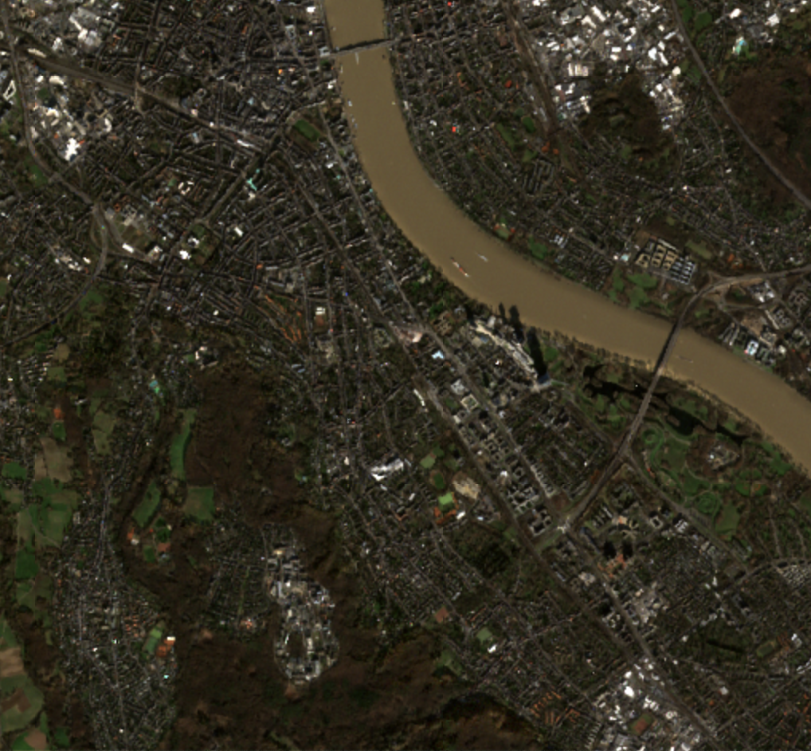
<div class="text-[.62rem] text-gray-500 mt-1">Satellite imagery (Bonn, Sentinel-2)</div>
</div>

<div class="text-center">
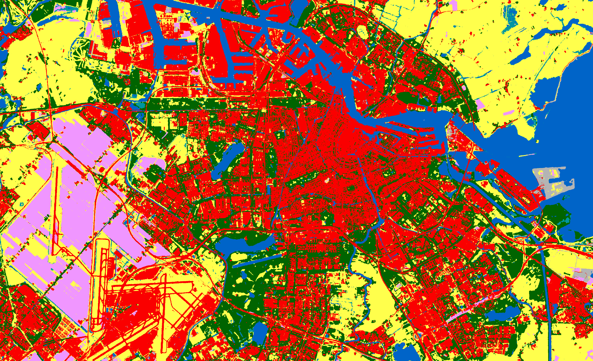
<div class="text-[.62rem] text-gray-500 mt-1">Thematic raster (land cover, Amsterdam)</div>
</div>

<div class="text-center">
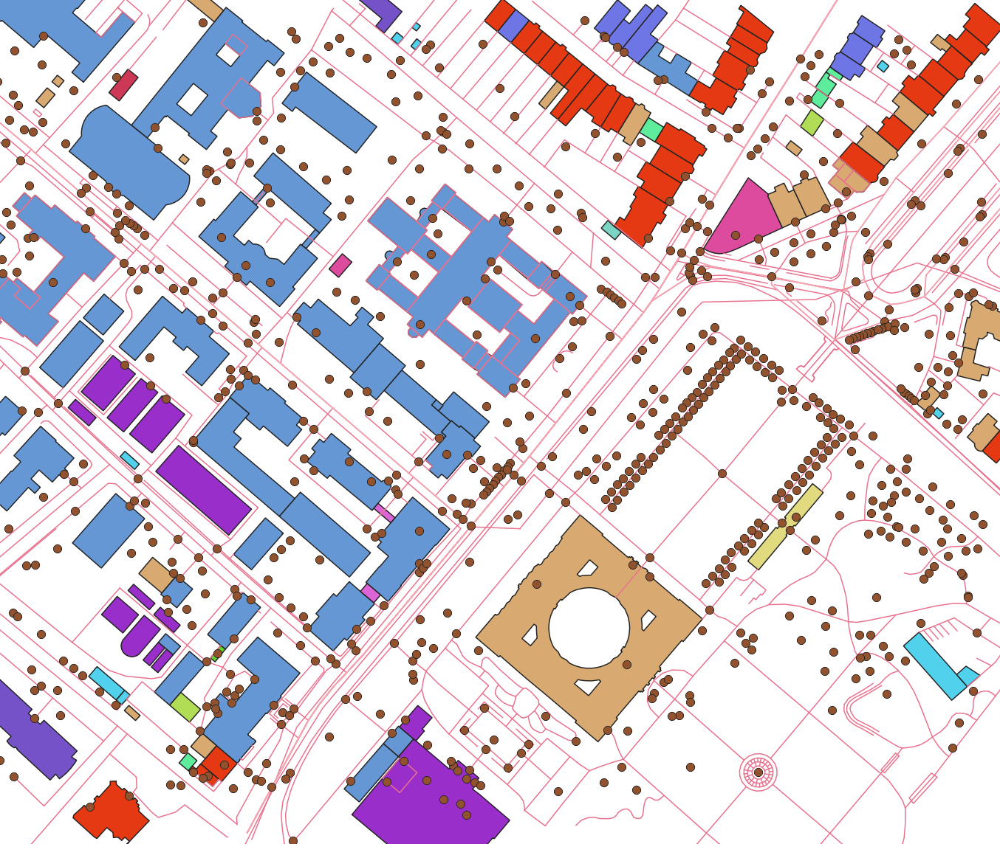
<div class="text-[.62rem] text-gray-500 mt-1">Vector geometries (OpenStreetMap)</div>
</div>

<div class="text-center">
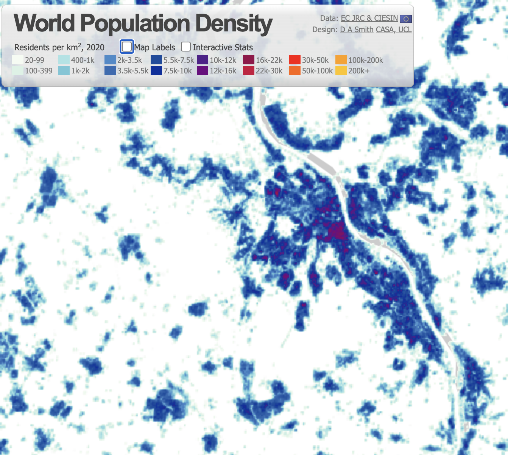
<div class="text-[.62rem] text-gray-500 mt-1">Model / reanalysis field (population density)</div>
</div>

</div>

<!--
Presenter note: Activate prior knowledge from Lecture 2 without repeating its details. Ask students what spatial and temporal support each source uses.
-->

---
section: representations
---

# Represent a Coordinate by Geospatial Data

<div class="grid grid-cols-5 gap-8 mt-4 items-center">

<div class="col-span-2">
  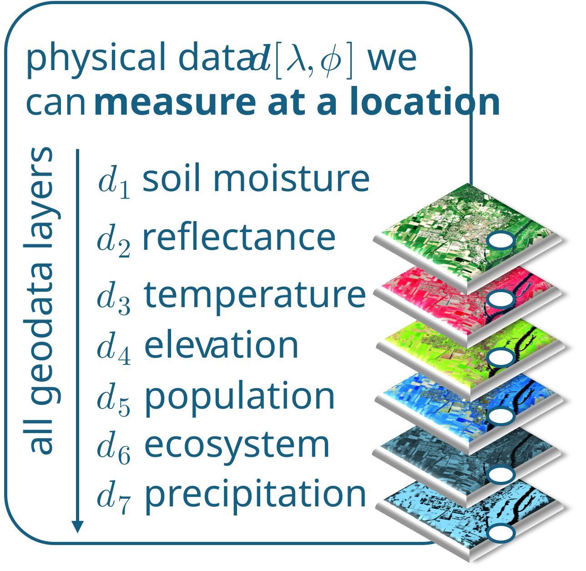
</div>

<div class="col-span-3 text-[.78rem] leading-snug">

Sampling all $p$ variables at location $i$ produces a fixed feature vector:

$$
\mathbf{x}_i = [x_{i1}, x_{i2}, \ldots, x_{ip}]
$$

For example:

$$
\begin{aligned}
\mathbf{x}_i = [&\text{elevation},\ \text{slope},\ \text{spectral bands},\\
                 &\text{temperature},\ \text{building density}]
\end{aligned}
$$

Repeating the extraction at $n$ locations creates a feature matrix:

$$
\mathbf{X} \in \mathbb{R}^{n \times p}
$$

<div class="mt-4 flex items-center justify-center gap-3 font-semibold text-blue-800">
  <span>features xᵢ</span>
  <span aria-hidden="true">&rarr;</span>
  <span>machine-learning model</span>
  <span aria-hidden="true">&rarr;</span>
  <span>prediction ŷᵢ</span>
</div>

<div class="mt-3 border-l-4 border-yellow-400 pl-3 text-[.66rem] text-gray-600">
Training target yᵢ: kept separate from the input features.
</div>

</div>

</div>

<!--
Presenter note: A time-dependent cube yields fixed-length vectors only after selecting a time, a fixed window, or temporal summary statistics.
TODO: Replace the placeholder with a cube-to-vector illustration and add a provisional prediction task.
-->

---
section: representations
---

# Example: Counting Trees Outside Forests

<div class="grid grid-cols-[7fr_5fr] gap-6 items-center mt-3">

<div>
  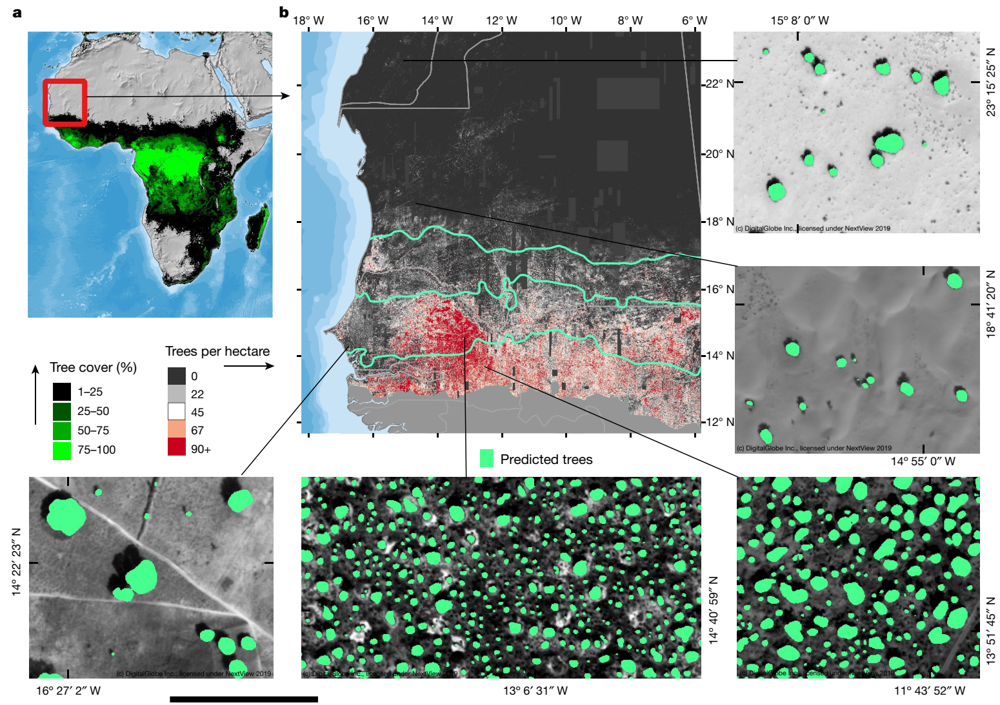
</div>

<div class="text-[.74rem] leading-snug">
  <div class="text-[1.65rem] font-bold text-[#00457c]">1.8 billion trees</div>
  <div class="mt-1 text-gray-600">across 1.3 million km² of West African drylands</div>

  <div class="mt-5"><strong>Land cover:</strong> isolated trees also occur outside areas classified as forest.</div>
  <div class="mt-3"><strong>Measurement:</strong> 0.5 m satellite imagery and deep learning identify individual crowns larger than 3 m².</div>
  <div class="mt-4 font-semibold text-[#00457c]">A land cover class and an individual-tree count describe different properties of a place.</div>
</div>

</div>

<div class="text-[.51rem] text-gray-500 mt-2">Brandt et al. (2020), <em>Nature</em> 587, 78–82 · <a href="https://doi.org/10.1038/s41586-020-2824-5" target="_blank" rel="noopener noreferrer">An unexpectedly large count of trees in the West African Sahara and Sahel</a> · Fig. 1, caption cropped. Satellite imagery © DigitalGlobe, NextView licence.</div>

<!--
Presenter note: Follow WorldCover by asking: does the tree-cover class tell us how many individual trees exist? A categorical map groups pixels; a crown map resolves objects. Brandt et al. show that many trees occur outside areas represented as forests in earlier maps. This does not imply a measured error in ESA WorldCover: this paper predates the WorldCover 2021 product.
Study scope: 1.3 million km² in the West African Sahara, Sahel and sub-humid zone, not the entire Sahara or the planet. More than 1.8 billion woody crowns >3 m², including shrubs. This is a deep-learning example, previewing later lectures rather than an example of a random forest.
Full citation: Brandt, M., Tucker, C.J., Kariryaa, A. et al. (2020). An unexpectedly large count of trees in the West African Sahara and Sahel. Nature 587, 78–82. https://doi.org/10.1038/s41586-020-2824-5
Figure: original Fig. 1, cropped to remove caption and surrounding article text, preserving panel labels, map legends, scale and imagery credits. Author manuscript: https://geog.umd.edu/sites/geog.umd.edu/files/pubs/An%20unexpectedly%20large%20count%20of%20trees%20in%20the%20West%20African%20Sahara%20and%20Sahel_0.pdf
-->

---
section: representations
---

# Example: Measuring Global Urban Expansion

<div class="grid grid-cols-[7fr_5fr] gap-6 items-center mt-5">

<div>
  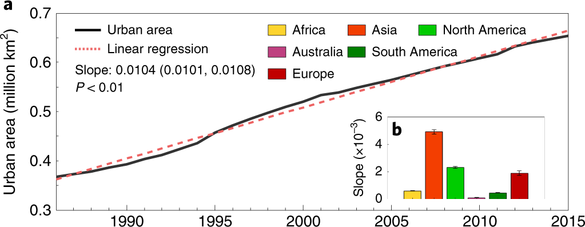
  <div class="text-[.58rem] text-gray-500 mt-2">Global urban area and continental growth rates, 1985–2015</div>
</div>

<div class="text-[.74rem] leading-snug">
  <div class="text-[1.65rem] font-bold text-[#00457c]">+80% urban area</div>
  <div class="mt-1 text-gray-600">362,747 to 653,354 km², 1985–2015</div>

  <div class="mt-5"><strong>Land cover:</strong> annual maps distinguish built-up from non-urban surfaces.</div>
  <div class="mt-3"><strong>Measurement:</strong> 30 m Landsat imagery, random forests and temporal change analysis.</div>
  <div class="mt-4 font-semibold text-[#00457c]">Consistent land cover maps turn pixels into estimates of global change.</div>
</div>

</div>

<div class="text-[.51rem] text-gray-500 mt-6">Liu et al. (2020), <em>Nature Sustainability</em> 3, 564–570 · <a href="https://doi.org/10.1038/s41893-020-0521-x" target="_blank" rel="noopener noreferrer">High-spatiotemporal-resolution mapping of global urban change from 1985 to 2015</a> · Original Fig. 1.</div>

<!--
Presenter note: The built-up class can be aggregated over space and compared over time. Here, land cover is the mapped output used to estimate urban expansion. This is not an analysis using ESA WorldCover as input. The study maps annual global urban dynamics from Landsat; locally adaptive random forests fuse urban extent maps at the endpoints, and temporal segmentation identifies change years.
Study scope: +80% refers to global urban land area under the study's built-up definition, not urban population, all impervious surfaces, or every individual city. The study reports urban population growth of 52% over the same period. Use the dates explicitly: these are historical findings, not current totals.
Full citation: Liu, X., Huang, Y., Xu, X. et al. (2020). High-spatiotemporal-resolution mapping of global urban change from 1985 to 2015. Nature Sustainability 3, 564–570. https://doi.org/10.1038/s41893-020-0521-x
Figure: original publisher Fig. 1, unchanged. https://media.springernature.com/lw1200/springer-static/image/art%3A10.1038%2Fs41893-020-0521-x/MediaObjects/41893_2020_521_Fig1_HTML.png
-->

---
section: representations
---

# Example ESA WorldCover

<div class="text-[.76rem] text-gray-700 mt-1 mb-3">WorldCover classifies each 10 m pixel into one of 11 land cover classes.</div>

<div class="grid grid-cols-[5fr_7fr] gap-6 items-start">

<div>
  
  <div class="text-[.58rem] text-gray-500 mt-1">ESA WorldCover 2021 · Amsterdam detail</div>

<div class="grid grid-cols-2 gap-x-2 gap-y-1 mt-3 text-[.57rem] leading-tight text-gray-700" aria-label="ESA WorldCover land cover legend">
  <div class="flex items-center gap-1.5"><span class="w-2.5 h-2.5 shrink-0 border border-gray-300" style="background:#006400"></span>Tree cover</div>
  <div class="flex items-center gap-1.5"><span class="w-2.5 h-2.5 shrink-0 border border-gray-300" style="background:#ffbb22"></span>Shrubland</div>
  <div class="flex items-center gap-1.5"><span class="w-2.5 h-2.5 shrink-0 border border-gray-300" style="background:#ffff4c"></span>Grassland</div>
  <div class="flex items-center gap-1.5"><span class="w-2.5 h-2.5 shrink-0 border border-gray-300" style="background:#f096ff"></span>Cropland</div>
  <div class="flex items-center gap-1.5"><span class="w-2.5 h-2.5 shrink-0 border border-gray-300" style="background:#fa0000"></span>Built-up</div>
  <div class="flex items-center gap-1.5"><span class="w-2.5 h-2.5 shrink-0 border border-gray-300" style="background:#b4b4b4"></span>Bare / sparse vegetation</div>
  <div class="flex items-center gap-1.5"><span class="w-2.5 h-2.5 shrink-0 border border-gray-300" style="background:#f0f0f0"></span>Snow and ice</div>
  <div class="flex items-center gap-1.5"><span class="w-2.5 h-2.5 shrink-0 border border-gray-300" style="background:#0064c8"></span>Permanent water</div>
  <div class="flex items-center gap-1.5"><span class="w-2.5 h-2.5 shrink-0 border border-gray-300" style="background:#0096a0"></span>Herbaceous wetland</div>
  <div class="flex items-center gap-1.5"><span class="w-2.5 h-2.5 shrink-0 border border-gray-300" style="background:#00cf75"></span>Mangroves</div>
  <div class="flex items-center gap-1.5"><span class="w-2.5 h-2.5 shrink-0 border border-gray-300" style="background:#fae6a0"></span>Moss and lichen</div>
</div>

<div class="text-[.5rem] text-gray-500 mt-2">© ESA WorldCover project 2021 · <a href="https://doi.org/10.5281/zenodo.7254221" target="_blank" rel="noopener noreferrer">Zanaga et al. (2022)</a></div>

</div>

<div>
  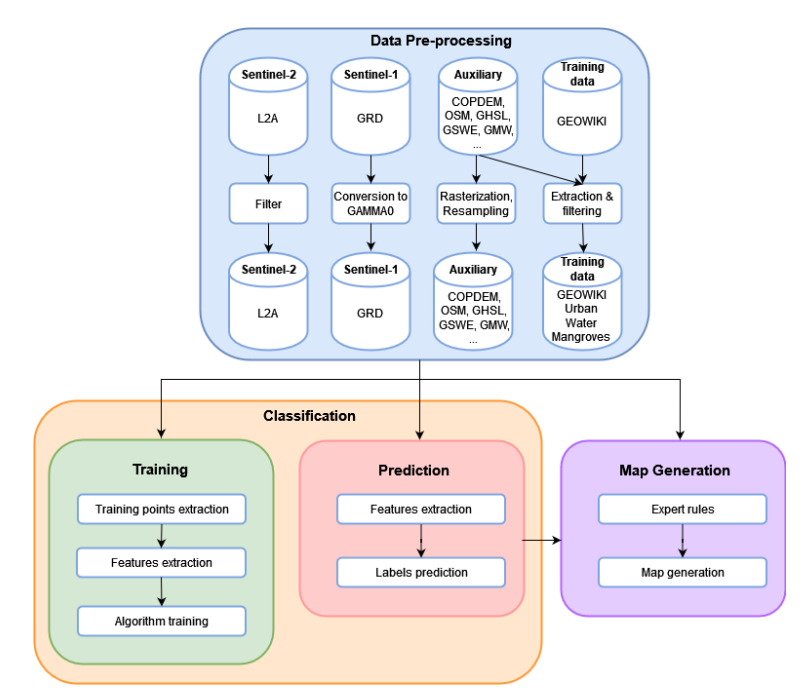
  <div class="text-[.56rem] text-gray-500 mt-1">2020 workflow: <a href="https://docs.terrascope.be/DataProducts/WorldCover/WorldCover.html" target="_blank" rel="noopener noreferrer">Terrascope, ESA WorldCover Product</a>. <a href="https://docs.terrascope.be/DataProducts/WorldCover/fig/Algorithm.png" target="_blank" rel="noopener noreferrer">Open full-size diagram</a>.</div>
</div>

</div>

<!--
Presenter note: Each output pixel is a land cover label, while the input feature vector combines observations from several sources. WorldCover v200 extracts 115 features from Sentinel-1, Sentinel-2, elevation, location, and meteorology. OpenStreetMap is auxiliary information for expert rules, not a raw satellite feature. The manual describes vegetation indices as features; NDVI is a familiar example and is explored later in this lecture.
The 2020 technical workflow shows data preprocessing, a training branch, a prediction branch, and map generation with expert rules. The map on the left is the 2021 product, which uses a later algorithm version.
Full citation: Zanaga, D., Van De Kerchove, R., Daems, D., De Keersmaecker, W., Brockmann, C., Kirches, G., Wevers, J., Cartus, O., Santoro, M., Fritz, S., Lesiv, M., Herold, M., Tsendbazar, N.E., Xu, P., Ramoino, F., Arino, O., 2022. ESA WorldCover 10 m 2021 v200. https://doi.org/10.5281/zenodo.7254221
Source: https://esa-worldcover.s3.eu-central-1.amazonaws.com/v200/2021/docs/WorldCover_PUM_V2.0.pdf
-->

---
section: representations
---

# Machine Learning Pipeline

<div class="mt-1 text-gray-700 text-[.82rem] text-center">
Good, hand-selected features combined with a suitable model determine the quality of the result.
</div>

<div class="relative mt-8">


<div class="absolute" style="left: 36.2%; top: 100%; transform: translate(0, 10px);">
<div class="flex items-center gap-1.5 text-[.68rem] font-semibold whitespace-nowrap" style="color: var(--bonn-blue);">
<span class="w-2 h-2 rounded-full flex-shrink-0" style="background: var(--bonn-blue);"></span>
This lecture &middot; More Data, PCA &amp; Better Features
</div>
</div>

<div class="absolute" style="left: 73%; top: 100%; transform: translate(0, 10px);">
<div class="flex items-center gap-1.5 text-[.68rem] font-semibold whitespace-nowrap" style="color: var(--grl-data-orange);">
<span class="w-2 h-2 rounded-full flex-shrink-0" style="background: var(--grl-data-orange);"></span>
This lecture &middot; Decision Trees &amp; Random Forests
</div>
</div>

</div>

<!--
Presenter note: Outlook. Feature design (blue): better features (e.g. NDVI) and more data (data cubes). The model (orange): decision trees and random forests at the end of this lecture; linear models follow in the next lecture.
-->

---
section: representations
hide: true
---

<script setup>
import PlotlyHistogram from './components/PlotlyHistogram.vue'
</script>

# Dataset

<div class="relative mt-1">

<div v-click-hide="2" class="grid grid-cols-2 gap-8">

<div>
<div class="text-sm font-semibold text-blue-800 mb-1 text-center">Input X <span class="font-normal text-gray-500">(e.g., Sentinel-2 pixel reflectances)</span></div>

<div class="relative" style="height: 195px;">


</div>

<div v-click="1" class="compact-table mt-2">

| Pt | Red | Green | Blue | NIR |
|---|---|---|---|---|
| Pt1 | 0.08 | 0.11 | 0.09 | 0.42 |
| Pt2 | 0.21 | 0.19 | 0.15 | 0.05 |
| &vellip; | &vellip; | &vellip; | &vellip; | &vellip; |

</div>
</div>

<div>
<div class="text-sm font-semibold text-blue-800 mb-1 text-center">Target y <span class="font-normal text-gray-500">(e.g., land cover labels)</span></div>

<div class="relative" style="height: 195px;">

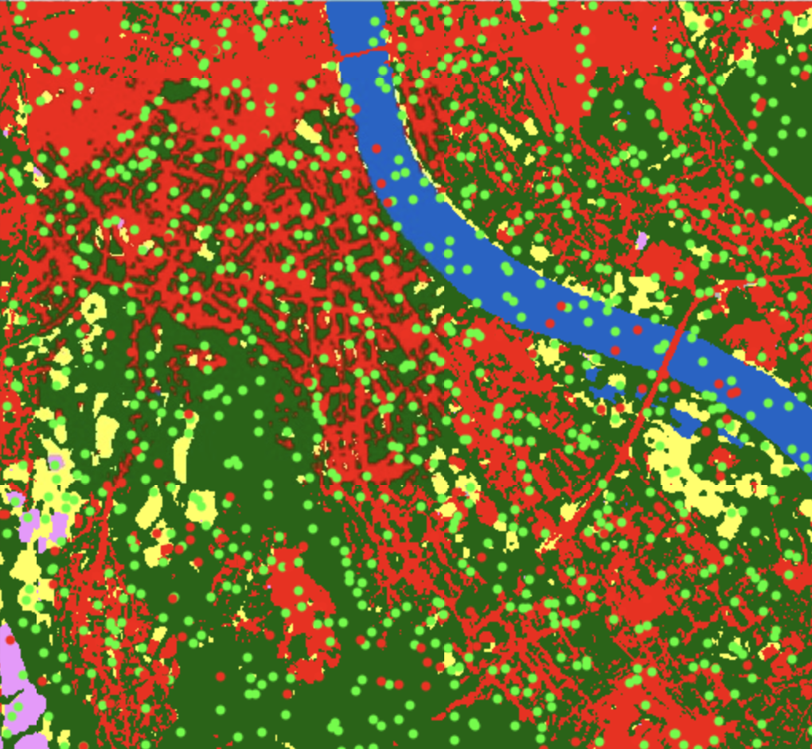
</div>

<div v-click="1" class="compact-table mt-2">

| Pt | Land Cover |
|---|---|
| Pt1 | Vegetation |
| Pt2 | Built-up |
| &vellip; | &vellip; |

</div>
</div>

</div>

<div v-click="2" class="absolute inset-0 top-0">

<div class="grid grid-cols-3 gap-3 items-center">

<div class="col-span-2">
<div class="text-[.66rem] font-semibold text-gray-500 mb-1">Raw bands</div>

<div class="compact-table">

| Pt | Red | Green | Blue | NIR | Land Cover |
|---|---|---|---|---|---|
| Pt1 | 0.08 | 0.11 | 0.09 | 0.42 | **Vegetation** |
| Pt2 | 0.21 | 0.19 | 0.15 | 0.05 | **Built-up** |
| &vellip; | &vellip; | &vellip; | &vellip; | &vellip; | &vellip; |

</div>
</div>

<div style="height: 145px;">
<PlotlyHistogram dataset="green" x-label="Green reflectance" :height="145" />
</div>

</div>

<div v-click="3" class="grid grid-cols-3 gap-3 items-center mt-4">

<div class="col-span-2">
<div class="text-[.66rem] font-semibold text-gray-500 mb-1">Engineered feature</div>

<div class="text-[.68rem] text-gray-600 mb-1">

$$
\text{NDVI} = \frac{\text{NIR} - \text{Red}}{\text{NIR} + \text{Red}}
$$

</div>

<div class="compact-table">

| Pt | NDVI | Land Cover |
|---|---|---|
| Pt1 | 0.68 | **Vegetation** |
| Pt2 | -0.62 | **Built-up** |
| &vellip; | &vellip; | &vellip; |

</div>
</div>

<div style="height: 120px;">
<PlotlyHistogram dataset="ndvi" x-label="NDVI" :show-legend="false" :height="120" />
</div>

</div>

</div>

</div>

<!--
Presenter note: This slide is the bridge from geospatial images to tabular ML data.
Click 1: sample points on both the input image and the target map.
Click 2: collapse both into one tabular dataset, X columns plus y column, one row per point &mdash; the format every classic ML model consumes.
Click 3: combine red and NIR into NDVI. The new feature separates vegetation from built-up more clearly than green reflectance alone, making the classification easier.
-->

---
section: representations
clicks: 4
---

<script setup>
import LectureOverview from './components/LectureOverview.vue'
</script>

# Lecture Overview

## How to Improve Machine Learning Models?

<div class="mt-6">
<LectureOverview :clicks="$clicks" />
</div>

<div v-click="4" class="mt-4 mx-auto w-fit px-4 py-1.5 rounded-lg border-2 border-[#00457c] text-[.78rem] text-[#00457c] text-center">
More data and better features improve machine learning &ndash; as long as the dimensions stay informative.
</div>

<!--
Roadmap of the lecture in four blocks:
1. More data: data cubes integrate more variables (multispectral vs. hyperspectral) and other modalities (e.g. population and urban land cover). Blessing and curse of dimensionality: we need informative dimensions.
Click 1: PCA de-correlates correlated dimensions into a few dominant directions.
Click 2: better features: domain knowledge (vegetation and water spectra, radar backscatter) designs informative features such as NDVI.
Click 3: decision trees and random forests, non-linear models that learn from these features.
Click 4: the take-home message that connects the four blocks.
The overview returns between the blocks.
-->

---
layout: bonn-section
sectionColor: "#00457c"
section: more-data
sectionTitle: More Data
---

# More Data - Integrating More Data Dimensions

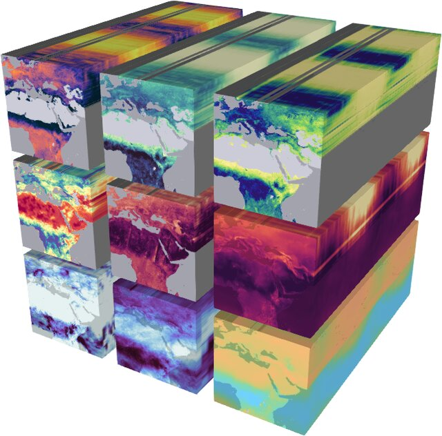

<div class="bonn-section-citation">
Image by <a href="https://www.researchgate.net/profile/Miguel-Mahecha-2?_tp=eyJjb250ZXh0Ijp7ImZpcnN0UGFnZSI6Il9kaXJlY3QiLCJwYWdlIjoicHVibGljYXRpb24ifX0" target="_blank" rel="noopener noreferrer">Miguel D. Mahecha</a>
</div>

<!--
First way to improve machine learning: more data. Two kinds:
- more variables from the same sensor, e.g. hyperspectral instead of multispectral bands;
- other modalities that carry complementary information, e.g. population density is closely connected to urban land cover.
Begin with the heterogeneous layers from Lecture 2.
This section will establish common coordinate support, stacking, and fixed feature extraction.
-->

---
section: more-data
---

# Datacubes align Data Spatially and Temporally

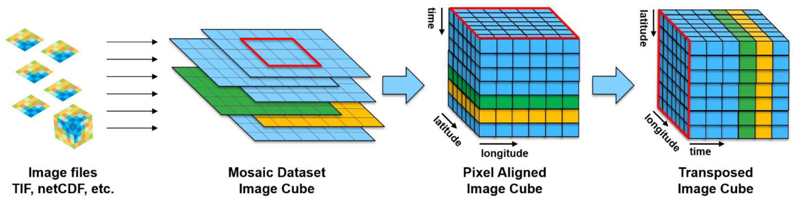

<div class="figure-copyright">
Source: Kopp et al. (2019), <a href="https://www.mdpi.com/2306-5729/4/3/94" target="_blank" rel="noopener noreferrer"><em>Achieving the Full Vision of Earth Observation Data Cubes</em></a>, <em>Data</em> 4(3), 94.
</div>

---
hide: true
section: more-data
---

# Rasterization and Interpolation

<div class="grid grid-cols-2 gap-10 mt-3">

<div>
<div class="text-sm font-semibold text-blue-800 mb-1 text-center">Rasterization</div>
<RasterizationDiagram />
<div class="mt-3 text-[.64rem] leading-relaxed text-gray-600 text-left">
Open-source tools:<br>
<code class="font-mono text-[.6rem] bg-gray-100 text-gray-700 rounded px-1">gdal_rasterize</code> (CLI)<br>
<code class="font-mono text-[.6rem] bg-gray-100 text-gray-700 rounded px-1">rasterio.features.rasterize</code> (Python)
</div>
</div>

<div>
<div class="text-sm font-semibold text-blue-800 mb-1 text-center">Interpolation</div>

<div class="flex items-center justify-center gap-8 mt-1">
<InterpolationDiagram />

<div class="text-[.75rem]">

<div class="text-[.66rem] font-semibold text-blue-800">Bilinear</div>
<div class="text-[.58rem] text-gray-500 -mt-0.5">2&times;2 neighborhood</div>

$$
\hat{z} = \frac{\sum_{i=1}^{4} z_i / d_i}{\sum_{i=1}^{4} 1 / d_i}
$$

<div class="text-[.66rem] font-semibold text-blue-800 mt-3">Cubic</div>
<div class="text-[.58rem] text-gray-500 -mt-0.5">4&times;4 neighborhood</div>

$$
\hat{z} = \frac{\sum_{i=1}^{16} z_i / d_i^{3}}{\sum_{i=1}^{16} 1 / d_i^{3}}
$$

</div>

</div>

<div class="mt-2 text-[.64rem] leading-relaxed text-gray-600 text-left">
Open-source tools:<br>
<code class="font-mono text-[.6rem] bg-gray-100 text-gray-700 rounded px-1">gdalwarp</code> /
<code class="font-mono text-[.6rem] bg-gray-100 text-gray-700 rounded px-1">gdal_translate</code> (CLI)<br>
<code class="font-mono text-[.6rem] bg-gray-100 text-gray-700 rounded px-1">rasterio.warp.reproject</code> (Python)
</div>
</div>


</div>

<!--
Presenter note: Rasterization converts vector geometries to grid cells using a majority-area rule.
Interpolation resamples values between misaligned grids using distance-weighted (linear) interpolation.
-->

---
section: more-data
clicks: 3
---

<script setup>
import DimensionsAddUp from './components/DimensionsAddUp.vue'
</script>

# Dimensions Add Up Quickly

<div class="mt-2">
<DimensionsAddUp :clicks="$clicks" />
</div>

<!--
Stacking geospatial layers multiplies the number of variables per location.
Click 1: a monthly time series. Click 2: the 5 × 5 neighbourhood as local context. Click 3: auxiliary layers.
A few innocent design choices already give thousands of dimensions per data point.
-->

---
hide: true
section: more-data
clicks: 2
---

<script setup>
import ImageAsVectors from './components/ImageAsVectors.vue'
</script>

# Example: An Image as a Dataset of Pixels

<div class="mt-3">
<ImageAsVectors variant="pixels" :clicks="$clicks" />
</div>

<div v-click="2" class="mx-auto w-fit mt-1 px-4 py-1 rounded-lg border-2 border-[#00457c] text-[.76rem] text-[#00457c]">
We have <strong>N = HW</strong> pixel data points in 3 dimensions &rarr; no information about the pixel neighbourhood.
</div>

---
hide: true
section: more-data
clicks: 2
---

<script setup>
import ImageAsVectors from './components/ImageAsVectors.vue'
</script>

# Example: An Image as One Data Point

<div class="mt-3">
<ImageAsVectors variant="image" :clicks="$clicks" />
</div>

<div v-click="2" class="mx-auto w-fit mt-1 px-4 py-1 rounded-lg border-2 border-[#00457c] text-[.76rem] text-[#00457c]">
We have <strong>one</strong> image data point in 48 dimensions &rarr; fewer data points, but the neighbourhood is preserved.
</div>

---
section: more-data
clicks: 2
---

<script setup>
import VectorSpaceChoice from './components/VectorSpaceChoice.vue'
</script>

# You Design the Vector Space

<div class="mt-2">
<VectorSpaceChoice :clicks="$clicks" />
</div>

<div v-click="2" class="mx-auto w-fit mt-2 px-4 py-1 rounded-lg border-2 border-[#00457c] text-[.78rem] text-[#00457c] font-semibold">
The same data can easily be represented in few or in many dimensions.
</div>

<!--
Takeaway of the two examples: we choose how to turn data into vectors.
Click 1: each pixel is one data point in a 3-D colour space. Many data points, but no information about the neighbourhood.
Click 2: the whole image is one data point in a 48-D space (flatten / vectorize). Few data points, but the neighbourhood is preserved.
Ask: is high dimensionality a blessing or a curse?
-->

---
section: more-data
clicks: 2
---

<script setup>
import SeparabilityPlot from './components/SeparabilityPlot.vue'
</script>

# Blessing of Dimensionality: More Information

<div class="grid grid-cols-5 gap-8 mt-4 items-center">

<div class="col-span-3 w-full">
<SeparabilityPlot :clicks="$clicks" />
</div>

<div class="col-span-2 text-[.8rem]">

**More dimensions can make data separable** &ndash; good for classification.

<div v-click="1">

Urban and water pixels overlap in the near-infrared band alone.

</div>

<blockquote v-click="2" class="blockquote2">
Data is not separable in nir alone &ndash; adding red makes it separable.
</blockquote>


</div>

</div>

<!--
Click 1: lift the points into 2-D by adding the red band.
Click 2: a single linear boundary now separates the two classes.
-->

---
hide: true
section: more-data
clicks: 1
---

<script setup>
import PixelPatternBlessing from './components/PixelPatternBlessing.vue'
</script>

# Blessing of Dimensionality: Complex Patterns

<div class="grid grid-cols-4 gap-6 mt-3 items-center">

<div class="col-span-3">
<PixelPatternBlessing :clicks="$clicks" />
</div>

<div class="text-[.8rem]">

Some **complex patterns** and relationships are missed in a low-dimensional colour space.

<div v-click="1">

Pixel **neighbourhoods** reveal spatial patterns that only emerge in the **high-dimensional** representation.

</div>

</div>

</div>

<!--
Click 0: 30 pixels as a dataset of 3-D colour vectors: we see dark and bright, green and grey pixels, but no structure.
Click 1: the same 30 pixels as one 90-dimensional image: the face appears.
-->

---
section: more-data
---

# Curse of Dimensionality: Redundancy

<div class="grid grid-cols-2 gap-10 mt-4">

<div class="text-center">

**Remote sensing bands are highly correlated**

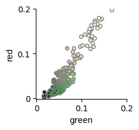

<div class="text-[.7rem] text-gray-600 mt-2">Pixels are often bright or dark overall: a very green pixel is usually also very red.</div>

</div>

<div class="text-center">

**Image pixels are spatially correlated**

<div class="relative w-[230px] h-[230px] mx-auto mt-3 overflow-hidden rounded border border-gray-300">
  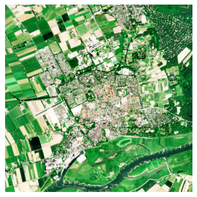
  <div class="absolute inset-0" style="background-image: linear-gradient(to right, rgba(255,255,255,.75) 1px, transparent 1px), linear-gradient(to bottom, rgba(255,255,255,.75) 1px, transparent 1px); background-size: 25.6px 25.6px;"></div>
</div>

<div class="text-[.7rem] text-gray-600 mt-2">Neighbouring pixels most likely have a very similar colour.</div>

</div>

</div>

<blockquote class="blockquote4">
Correlated dimensions add redundancy, not information.
</blockquote>

---
section: more-data
---

<script setup>
import EmptySpaceSketch from './components/EmptySpaceSketch.vue'
import CurseOfDimensionalityDemo from './components/CurseOfDimensionalityDemo.vue'
</script>

# Curse of Dimensionality: Empty Spaces

<div class="grid grid-cols-2 gap-8 mt-2">

<div class="text-[.78rem]">

A higher-dimensional space becomes **emptier** &ndash; we need **exponentially more data** to fill it evenly.

<EmptySpaceSketch class="mt-2" />

In high dimensions, all samples are **similarly far apart**: distances lose their meaning, and classifiers that rely on "closeness" (e.g. nearest neighbours) become less effective.

</div>

<div>
<CurseOfDimensionalityDemo />
</div>

</div>

<!--
Demo: move the slider from d = 1 to d = 1000. The histogram of pairwise distances narrows around its mean: the nearest and the farthest neighbour become almost equally far away. The relative contrast drops towards zero.
-->

---
hide: true
section: more-data
---

<script setup>
import NearestNeighborCurse from './components/NearestNeighborCurse.vue'
</script>

# Curse of Dimensionality: Nearest Neighbours

<div class="grid grid-cols-5 gap-6 mt-2">

<div class="col-span-3">
<NearestNeighborCurse />
</div>

<div class="col-span-2 text-[.78rem]">

Example: **nearest-neighbour classification**: a test point gets the class of its closest training point.

In high dimensions, almost all points are **far away &mdash; and equally far**.

This weakens the meaning of **&ldquo;closeness&rdquo;**: uninformative dimensions drown the informative ones.

<blockquote class="blockquote4">
More dimensions are not automatically more information.
</blockquote>

</div>

</div>

<!--
Demo: both classes differ only in the first two dimensions. Every extra dimension is pure noise.
At d = 2 almost every test point finds a neighbour of its own class. Move the slider: the distance bars flatten, the orange (wrong) links appear, and the accuracy drops towards chance.
-->

---
section: more-data
---

# Blessing and Curse of Dimensionality

<div class="compact-table mt-6 text-[.8rem]">

| Blessing | Curse |
|---|---|
| Extra dimensions can provide new, independent information | Correlated (redundant) dimensions add no information |
| More dimensions help capture complex patterns | More data is needed to fill the emptier high-dimensional space |
| | Distances lose meaning; classifiers become less effective |

</div>

<div class="mx-auto w-fit mt-8 px-5 py-2 rounded-lg border-2 border-[#00457c] text-[.95rem] text-[#00457c] font-semibold">
Keep as many dimensions as necessary, but as few as possible.
</div>

<div class="text-center mt-3 text-[.85rem] text-gray-700">
&rArr; We need <strong>informative</strong> dimensions.
</div>

---
section: more-data
---

<script setup>
import LectureOverview from './components/LectureOverview.vue'
</script>

# Lecture Overview

<div class="mt-6">
<LectureOverview :next="2" />
</div>

<!--
Block 1 done: more data brings more, but often correlated dimensions. Next: PCA to keep the informative ones.
-->

---
layout: bonn-section
sectionColor: "#00457c"
section: pca
sectionTitle: Less Redundant Data
---

# PCA: De-correlating Data


<div class="bonn-section-citation">
Sentinel-2 scene of Bonn, first three principal components as RGB.
</div>

<!--
More dimensions only help if they are informative. Correlated bands repeat the same information.
PCA is the algorithmic way to de-correlate data: it finds a few dominant directions. The full derivation is in the backup deck lecture-3-pca.
-->

---
hide: true
section: pca
---

<script setup>
import DataMatrixDiagram from './components/DataMatrixDiagram.vue'
</script>

# Bands as Variables: The Data Matrix

<div class="mt-4">
<DataMatrixDiagram />
</div>

<blockquote class="blockquote3">
Reflectance data has high covariance and correlation between bands.
</blockquote>

<!--
Every pixel is a row, every band is a column (the same X ∈ R^{N×D} as the feature matrix from the data cube). Plotting two band columns against each other shows the correlation.
-->

---
section: pca
---

# Sentinel-2 Bands Are Highly Correlated

<div class="grid grid-cols-2 gap-8 mt-2 items-center">

<div class="text-center">

<div class="text-[.66rem] text-gray-600 mt-1">Correlation matrix of 12 Sentinel-2 bands (red = +1, blue = &minus;1)</div>
</div>

<div class="text-[.8rem]">

- **visible** bands (B1&ndash;B5) are highly correlated with each other
- visible bands are **not** correlated with **near-infrared** (B6&ndash;B9)
- visible bands are again correlated with **SWIR** (B11, B12)

<blockquote class="blockquote3">
Many of our dimensions carry (almost) the same information.
</blockquote>

</div>

</div>

<!--
Keep this intuitive: red means two bands rise and fall together. PCA (next slides) removes exactly this correlation; the full derivation is in the backup deck lecture-3-pca.
-->

---
section: pca
---

<script setup>
import PcaEmbeddingDemo from '../lecture-1/components/PcaEmbeddingDemo.vue'
</script>

# Recap Lecture 1: PCA

<div class="grid grid-cols-[auto_1fr] gap-10 mt-2 items-center">

<div>
<PcaEmbeddingDemo />
</div>

<div class="text-[.8rem]">

In Lecture 1, we used **Principal Component Analysis (PCA)** to **visualize** high-dimensional vectors.

<blockquote class="blockquote3">
Now: PCA rotates correlated data onto its few most dominant directions.
</blockquote>

</div>

</div>

<!--
Same demo as in Lecture 1 ("Excurse: Dimensionality Reduction"). Click "Rotate to PCA projection": the data is rotated so that the first axis follows the direction of largest spread.
Back then PCA was a visualization tool. Here we look at why it works: correlated bands share information, and PCA turns them into a few uncorrelated directions.
-->

---
section: pca
---

<script setup>
import CovariancePcaDemo from './components/CovariancePcaDemo.vue'
</script>

# PCA to De-correlate Data

<div class="mt-1">
<CovariancePcaDemo />
</div>

<div class="text-[.74rem] mt-2 text-gray-700">
PCA <strong>centres</strong> and <strong>rotates</strong> the data so that the covariances vanish. The new axes, the <strong>principal components</strong>, point along the most dominant directions of the data.
</div>

<!--
Ask first: what covariance would we like our data to have? Then demo:
- vary the correlation: positive / negative / no covariance
- step 1 centres the data (translation by -μ)
- step 2 rotates onto the principal axes: the off-diagonal entries become 0, the diagonal entries are the eigenvalues
PC 1 is the direction of highest "explained" variance.
The mathematics (covariance matrix, eigendecomposition) is in the backup deck lecture-3-pca.
-->

---
section: pca
---

# PCs Are Uncorrelated &ldquo;Synthetic Bands&rdquo;

<div class="grid grid-cols-[1fr_auto_1fr] gap-6 items-center mt-4">

<div class="text-center">
<div class="text-[.74rem] font-semibold text-[#00457c] mb-1">12 correlated Sentinel-2 bands</div>

</div>

<div class="flex flex-col items-center gap-1 text-[.7rem] text-[#00457c] font-semibold">
  <div class="px-5 py-3 bg-[#00457c] text-white rounded" style="clip-path: polygon(0 0, 100% 25%, 100% 75%, 0 100%);">PCT</div>
  principal component<br>transformation
</div>

<div class="text-center">
<div class="text-[.74rem] font-semibold text-[#00457c] mb-1">(fewer) uncorrelated principal components</div>
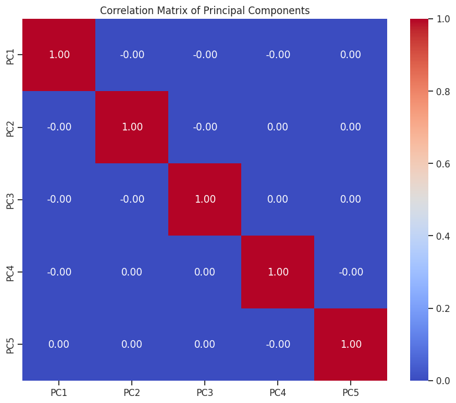
</div>

</div>

<div class="text-[.76rem] text-center mt-3">
Same goal as a spectral index &ndash; remove redundancy &ndash; but found <strong>from the data alone</strong>, without knowing what the bands mean.
</div>

<!--
This is the result we are after: the correlation matrix of the principal components is the identity. Every PC carries information that no other PC carries.
Compare with spectral indices such as NDVI (next block): they also merge correlated bands, but we need to know the physics. PCA only needs the data.
-->

---
section: pca
---

<script setup>
import ScreePlotDemo from './components/ScreePlotDemo.vue'
</script>

# Few Directions Carry Most Information

<div class="grid grid-cols-5 gap-8 mt-2 items-start">

<div class="col-span-3">
<ScreePlotDemo />
</div>

<div class="col-span-2 text-[.78rem]">

Principal components are sorted by the **variance** they explain: PC 1 is the most dominant direction, PC 2 the next, &hellip;

For the correlated Sentinel-2 bands, **2 of 12 components** keep more than 90 % of the variance.

<blockquote class="blockquote3">
The stronger the correlation, the fewer components we need.
</blockquote>

</div>

</div>

<!--
Demo: compare the Sentinel-2 spectrum (2 PCs for 90 %) with weakly correlated features (many more PCs needed).
-->

---
section: pca
---

<script setup>
import LectureOverview from './components/LectureOverview.vue'
</script>

# Lecture Overview

<div class="mt-6">
<LectureOverview :next="3" />
</div>

<!--
Block 2 done: PCA de-correlates data algorithmically. Next: better features designed with domain knowledge.
-->

---
layout: bonn-section
sectionColor: "#00457c"
section: better-features
sectionTitle: More Descriptive Data
---

# Choosing Better Features through Domain Knowledge

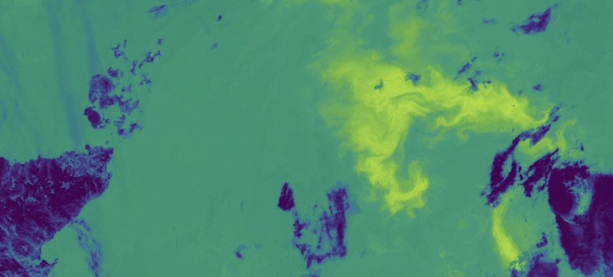

<div class="bonn-section-citation">
Chlorophyll-a index from Sentinel-3 OLCI, algal bloom off Scotland (2013-06-14).
</div>

<!--
Second way to improve machine learning: better features. We use what we know about the physics of the signal. Knowing why vegetation and algae reflect light the way they do, we combine a few bands into one meaningful index (optical) or design features and simple rules (radar).
Designed features separate the classes better, and they compress several correlated bands into one number.
-->

---
section: better-features
clicks: 1
---

<script setup>
import RedEdgeProfile from './components/RedEdgeProfile.vue'
</script>

# Recap: Vegetation Spectra

<div class="grid grid-cols-2 gap-8 mt-2 items-center">

<div>
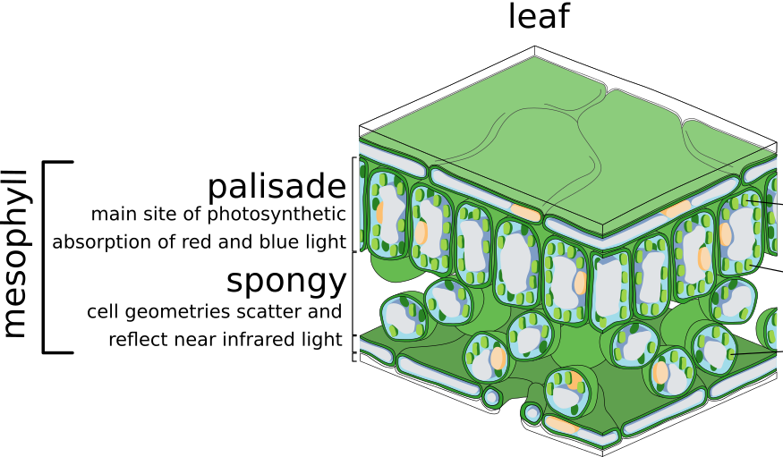

<div class="mt-3 rounded-xl bg-[#e7f5e7] border-2 border-[#2e8b3a] px-4 py-2 text-[.74rem]">

1. **absorption** of blue (&asymp;&thinsp;450 nm) and red (&asymp;&thinsp;670 nm) light by chlorophyll a/b
2. strong **reflectance** of near-infrared light (&gt;&thinsp;750 nm) due to scattering in the leaf structure

</div>
</div>

<div>
<RedEdgeProfile :clicks="$clicks" />
<div class="figure-copyright mt-1">
Curran, P. J., Dungan, J. L., &amp; Gholz, H. L. (1990). Exploring the relationship between reflectance red edge and chlorophyll content in slash pine. <em>Tree Physiology</em>, 7(1-4), 33&ndash;48.
</div>
</div>

</div>

<!--
Recap from remote sensing: why does vegetation look the way it does in a spectrum?
The palisade layer absorbs blue and red light for photosynthesis; the spongy layer scatters near-infrared light.
Click 1: the steep transition between red absorption and NIR reflectance is the red edge. Higher chlorophyll content shifts it to longer wavelengths.
This is the domain knowledge behind NDVI (next slide).
-->

---
section: better-features
clicks: 1
---

<script setup>
import PlotlyHistogram from './components/PlotlyHistogram.vue'
</script>

# A Better Feature: NDVI

<div class="grid grid-cols-3 gap-3 items-center mt-2">

<div class="col-span-2">
<div class="text-[.66rem] font-semibold text-gray-500 mb-1">Raw bands</div>

<div class="compact-table">

| Pt | Red | Green | Blue | NIR | Land Cover |
|---|---|---|---|---|---|
| Pt1 | 0.08 | 0.11 | 0.09 | 0.42 | **Vegetation** |
| Pt2 | 0.21 | 0.19 | 0.15 | 0.05 | **Built-up** |
| &vellip; | &vellip; | &vellip; | &vellip; | &vellip; | &vellip; |

</div>
</div>

<div style="height: 145px;">
<PlotlyHistogram dataset="green" x-label="Green reflectance" :height="145" />
</div>

</div>

<div v-click="1" class="grid grid-cols-3 gap-3 items-center mt-4">

<div class="col-span-2">
<div class="text-[.66rem] font-semibold text-gray-500 mb-1">Engineered feature</div>

<div class="text-[.68rem] text-gray-600 mb-1">

$$
\text{NDVI} = \frac{\text{NIR} - \text{Red}}{\text{NIR} + \text{Red}}
$$

</div>

<div class="compact-table">

| Pt | NDVI | Land Cover |
|---|---|---|
| Pt1 | 0.68 | **Vegetation** |
| Pt2 | -0.62 | **Built-up** |
| &vellip; | &vellip; | &vellip; |

</div>
</div>

<div style="height: 120px;">
<PlotlyHistogram dataset="ndvi" x-label="NDVI" :show-legend="false" :height="120" />
</div>

</div>

<!--
Domain knowledge replaces several correlated bands by one descriptive variable. NDVI uses exactly the vegetation profile: strong red absorption (chlorophyll) and strong NIR reflectance (leaf structure).
Click 1: NDVI combines red and NIR into a single number that separates vegetation from built-up far better than any single raw band.
-->

---
section: better-features
---

# Photosynthetically Active Pigments

<div class="grid grid-cols-5 gap-8 mt-4 items-center">

<div class="col-span-2 text-[.8rem]">

- **chlorophylls** and other pigments capture the energy of light
- different organisms use **different pigments** for photosynthesis
- terrestrial plants use both **CHL-a and CHL-b**
- algae and cyanobacteria do not: e.g. **phycocyanin**, phycoerythrin, fucoxanthin

<blockquote class="blockquote2">
Each pigment leaves its own fingerprint in the spectrum.
</blockquote>

</div>

<div class="col-span-3">
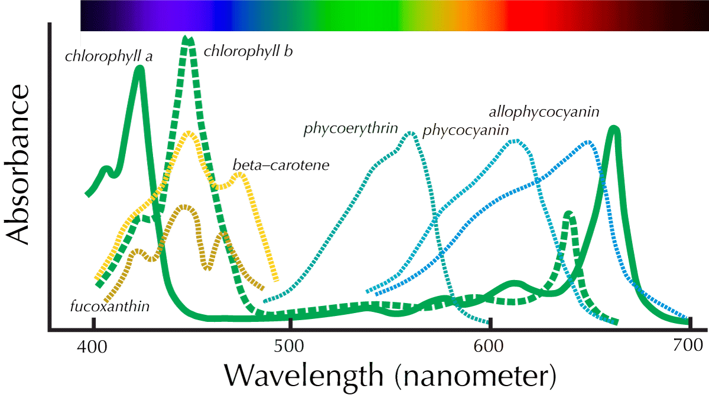
<div class="figure-copyright mt-1">
Source: <a href="https://www.yorku.ca/planters/photosynthesis/2014_08_15_lab_manual_static_html/index.html" target="_blank" rel="noopener noreferrer">York University, Photosynthesis lab manual</a>
</div>
</div>

</div>

---
hide: true
section: better-features
---

# The Red Edge Also Appears in Algae

<div class="grid grid-cols-5 gap-6 mt-2 items-start">

<div class="col-span-3">
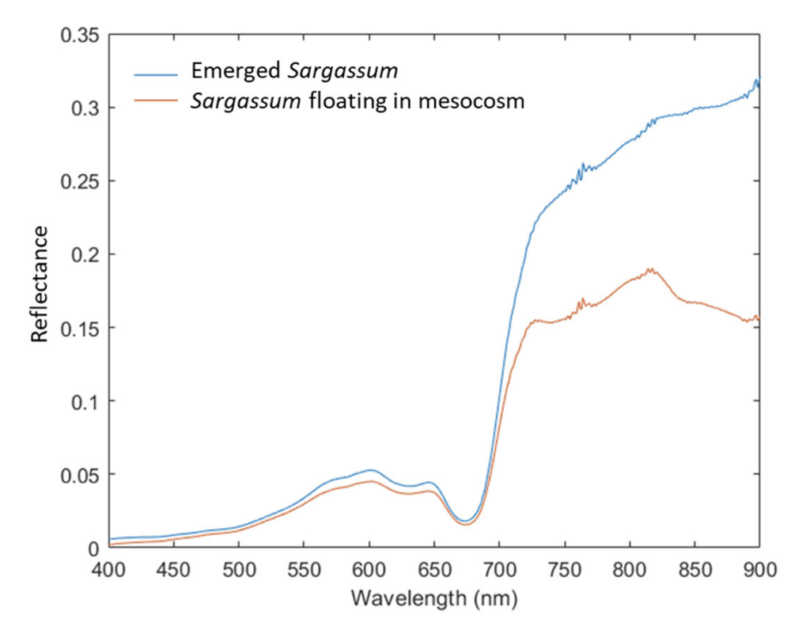
<div class="figure-copyright mt-1">
Descloitres, J., Minghelli, A., Steinmetz, F., Chevalier, C., Chami, M., &amp; Berline, L. (2021). Revisited estimation of moderate resolution Sargassum fractional coverage using decametric satellite data (S2-MSI). <em>Remote Sensing</em>, 13(24), 5106.
</div>
</div>

<div class="col-span-2">
<div class="text-[.78rem] font-semibold text-[#00457c] mb-1"><em>Sargassum</em> (macroalgae)</div>
<div class="grid grid-cols-2 gap-2">
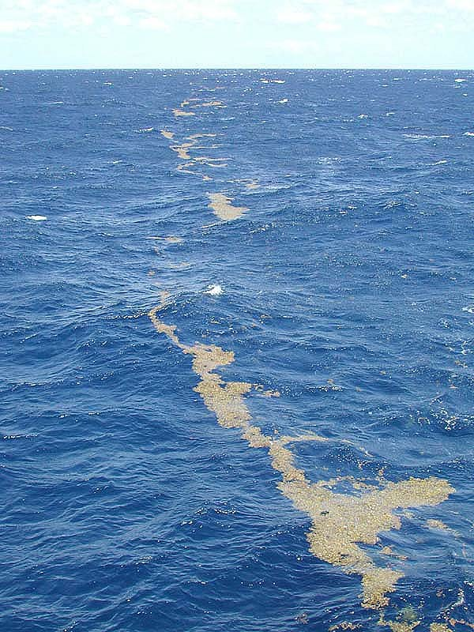
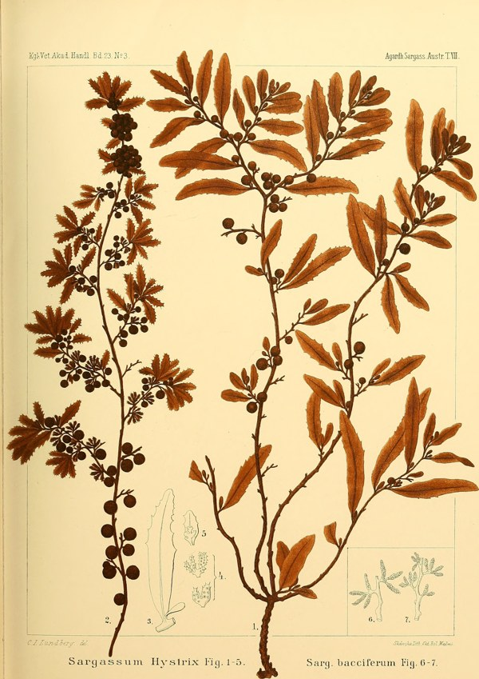
</div>
<div class="text-[.72rem] mt-2">The same <strong>red edge</strong> as land vegetation: the vegetation signal is not limited to land.</div>
</div>

</div>

---
section: better-features
clicks: 2
---

<script setup>
import PigmentIndicators from './components/PigmentIndicators.vue'
</script>

# Indicators for CHL-a and Phycocyanin (PC)

<div class="grid gap-5 mt-1 items-start" style="grid-template-columns: 2.5fr 1fr">

<div>
<PigmentIndicators :clicks="$clicks" />
<div class="figure-copyright mt-1">
Modified from: Legleiter, C. J., et al. (2022). Spectral mixture analysis for surveillance of harmful algal blooms (SMASH). <em>Remote Sensing of Environment</em>, 279, 113089.
</div>
</div>

<div>
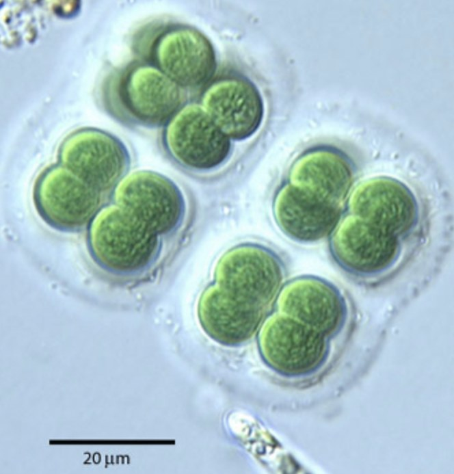
<div class="text-[.6rem] text-[#00457c] mt-1"><em>Eucapsis</em>, image: Jason Oyadomari, Michigan Technological University, USA</div>
<div class="text-[.72rem] mt-3" v-click="1">The <strong>shape</strong> of the spectrum around 620&ndash;700 nm distinguishes pigments.</div>
</div>

</div>

<!--
Spectra of two cyanobacteria genera and clear water.
Click 1: the phycocyanin (PC) indicator: the small peak near 630 nm above the line between its neighbours.
Click 2: the chlorophyll-a indicator: the absorption dip near 665 nm.
Band ratios or differences around these features become dedicated indices for harmful algal blooms.
-->

---
section: better-features
---

<script setup>
import OlciChlBands from './components/OlciChlBands.vue'
</script>

# Example: Design a CHL-a Index

<div class="grid gap-6 mt-1 items-start" style="grid-template-columns: 1.25fr 1fr">

<div>
<div class="text-[.76rem] font-semibold text-[#00457c]">Sentinel-3 OLCI bands overlaid with chlorophyll absorbance</div>
<OlciChlBands />

<div class="text-[.74rem] mt-3">

Pick two OLCI bands and combine them like NDVI, as a <strong>normalized difference</strong>:

$$
\text{index} = \frac{b_i - b_j}{b_i + b_j}
$$

</div>

<div class="text-[.64rem] mt-1">
<a href="https://code.earthengine.google.com/5ff8835611e6206a2a659414e781bfa2" target="_blank" rel="noopener noreferrer">Exercise script (Google Earth Engine)</a> &middot;
<a href="https://code.earthengine.google.com/72d18f833aa00e3c38fd1ebb8af2c51b" target="_blank" rel="noopener noreferrer">Solution</a>
</div>
</div>

<div>
<div class="relative">
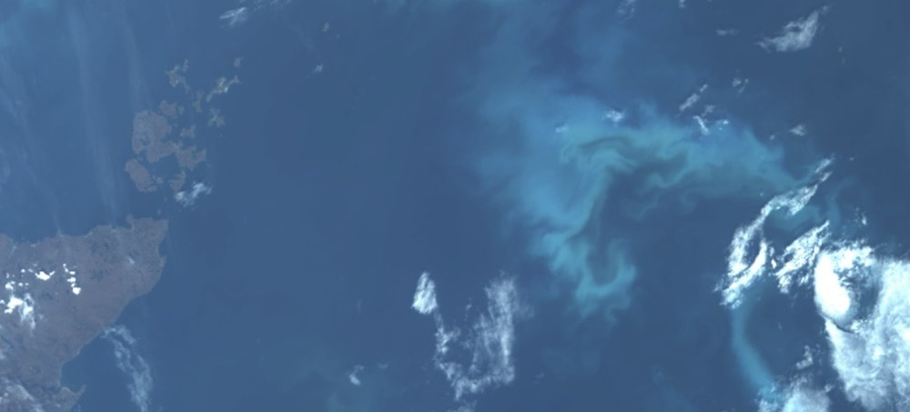
<div class="absolute left-2 top-1 text-white text-[.7rem] font-semibold">RGB</div>
<div class="absolute left-2 bottom-1 text-white text-[.66rem]">Scotland</div>
</div>
<div class="relative">

<div class="absolute left-2 top-1 text-white text-[.7rem] font-semibold">CHL-a index</div>
<div class="absolute left-2 bottom-1 text-white text-[.66rem]">Scotland</div>
<div class="absolute right-2 bottom-1 text-white text-[.66rem]">Sentinel-3 OLCI, 2013-06-14</div>
</div>
</div>

</div>

<!--
Short exercise: which band combination highlights chlorophyll-a? Hint: compare a band inside a chlorophyll absorption peak with a band where chlorophyll absorbs little.
The solution script computes a normalised difference of two OLCI bands and shows the bloom off Scotland.
Take-away of the block: indices are interpretable and cheap, but each one needs expert knowledge of the target (vegetation, chlorophyll, phycocyanin, ...). The same idea works for radar (next two slides).
-->

---
section: better-features
hide: true
---

# Radar Features: Sentinel-1 Polarizations

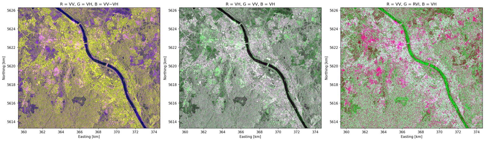

<div class="grid grid-cols-3 gap-6 mt-2 text-[.7rem]">

<div>

**VV** (co-polarized): surface and double-bounce scattering &rarr; bright in **built-up** areas

</div>

<div>

**VH** (cross-polarized): volume scattering &rarr; sensitive to **vegetation** structure

</div>

<div>

**designed features:** $\text{VV} - \text{VH}$ (a ratio in dB), radar vegetation index $\text{RVI} = \frac{4\,\text{VH}}{\text{VV} + \text{VH}}$

</div>

</div>

<div class="text-[.62rem] text-gray-500 mt-2">Sentinel-1 subset around Bonn &middot; figures: Lab 2 (Geodata Scavenger Hunt), Group 2</div>

<!--
Domain knowledge is not limited to optical spectra. For SAR, we know the scattering mechanisms behind each polarization and combine them into features.
Smooth water reflects the radar pulse away from the sensor (specular reflection): it is dark in VV and VH and stands out in every composite.
RVI uses linear (not dB) backscatter values.
-->

---
section: better-features
hide: true
---

# Radar: From Speckle Filter to Water Mask

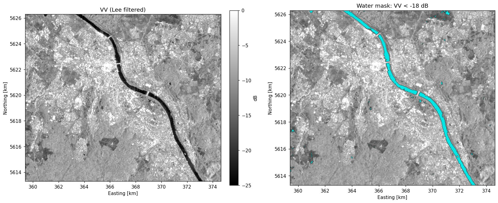

<div class="grid grid-cols-3 gap-6 mt-2 text-[.7rem]">

<div>

**1 &middot; Lee filter:** removes the grainy **speckle** of SAR images by local averaging, adapted to the local variance &rarr; smooths homogeneous areas, keeps edges

</div>

<div>

**2 &middot; Threshold:** calm water reflects the signal away from the sensor &rarr; very low backscatter: $\text{VV} < -18\,\text{dB}$ &rArr; water

</div>

<div>

**Result:** one designed feature plus one rule gives a **water mask** &ndash; no training data needed

</div>

</div>

<div class="text-[.62rem] text-gray-500 mt-2">Figures: Lab 2 (Geodata Scavenger Hunt), Group 2</div>

<!--
Speckle is interference noise inherent to coherent radar imaging; without filtering, a threshold produces salt-and-pepper noise.
The Lee filter estimates the local mean and variance: in homogeneous regions it outputs the local mean, near edges (high local variance) it keeps the original value.
The threshold (here -18 dB) comes from domain knowledge / the histogram of the scene. Limitations: wind-roughened water, radar shadow and very smooth surfaces such as runways can be misclassified.
-->

---
section: better-features
---

<script setup>
import LectureOverview from './components/LectureOverview.vue'
</script>

# Lecture Overview

<div class="mt-6">
<LectureOverview :next="4" />
</div>

<!--
Block 3 done: domain knowledge gives informative features such as NDVI. Next: a model that learns from them.
-->

---
section: better-features
---

# Machine Learning Pipeline

<div class="mt-1 text-gray-700 text-[.82rem] text-center">
Good, hand-selected features combined with a suitable model determine the quality of the result.
</div>

<div class="relative mt-8">


<div class="absolute" style="left: 36.2%; top: 100%; transform: translate(0, 10px);">
<div class="flex items-center gap-1.5 text-[.68rem] font-semibold whitespace-nowrap" style="color: var(--bonn-blue);">
<span class="w-2 h-2 rounded-full flex-shrink-0" style="background: var(--bonn-blue);"></span>
This lecture &middot; More Data, PCA &amp; Better Features
</div>
</div>

<div class="absolute" style="left: 73%; top: 100%; transform: translate(0, 10px);">
<div class="flex items-center gap-1.5 text-[.68rem] font-semibold whitespace-nowrap" style="color: var(--grl-data-orange);">
<span class="w-2 h-2 rounded-full flex-shrink-0" style="background: var(--grl-data-orange);"></span>
This lecture &middot; Decision Trees &amp; Random Forests
</div>
</div>

</div>

<!--
Back to the pipeline: we have covered the feature side (blue) - more data, PCA and better features. Now the model (orange): decision trees and random forests.
-->

---
layout: bonn-section
sectionColor: "#ff7900"
section: decision-trees-and-random-forests
sectionTitle: "Better (Non-linear) Models"
---

# Non-linear models: Decision Trees & Random Forests

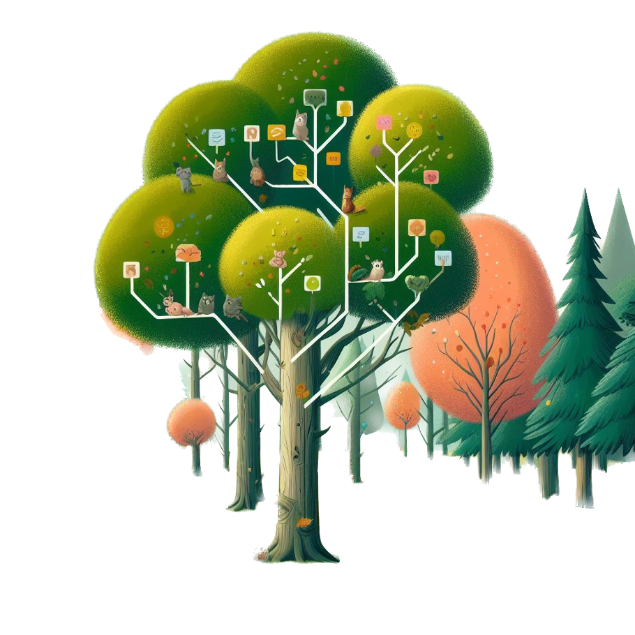

<div class="bonn-section-citation">
Image by Bing Image Generator
</div>

<!--
From features to a model: decision trees and random forests learn non-linear decisions from the feature vectors we built in this lecture.
Random forests also cope well with many, correlated features (random feature subsets), the situation the More Data block ended with.
This section will end with random forests as robust predictors on fixed representations.
-->

---

# Decision Trees: The Core Idea

<div class="grid grid-cols-3 gap-8 mt-4 items-center">

<div class="col-span-2">

We categorize data through a <strong>chain of simple decisions</strong>.

<ul>
<li v-click>each decision is a simple test on a single feature (e.g., <em>is the temperature below 10 °C?</em>)</li>
<li v-click>implemented in computer science as a <strong>binary tree</strong>: a graph data structure in which each node has at most two children</li>
<li v-click>a universal tool for <strong>classification and regression</strong> of non-linear relationships</li>
</ul>

</div>

<div>

<div class="figure-copyright">Image by Bing Image Generator</div>
</div>

</div>

<!--
Part 1 of the section. Trees are the first non-linear model of the course.
Keep the "chain of simple decisions" picture in mind for everything that follows.
-->

---
clicks: 2
---

# Linear Models Fail in Non-linear Situations

<div class="grid grid-cols-5 gap-6 mt-1 items-center">

<div class="col-span-3">
<SunflowerRegions :clicks="$clicks" />
</div>

<div class="col-span-2">

<div v-if="$clicks === 0">

$$f(X) = \beta_0 + \sum_{j=1}^{p} X_j \beta_j$$

<blockquote class="blockquote2">
Linear models are well-suited for <strong>linear</strong> relationships with data from <strong>uni-modal</strong> distributions.
</blockquote>

</div>

<div v-else-if="$clicks === 1">

$$f(X) = \beta_0 + \sum_{j=1}^{p} X_j \beta_j$$

<blockquote class="blockquote4">
Most relationships in the real world are <strong>non-linear</strong>, and data distributions are <strong>not uni-modal</strong>: no line separates cold, warm and hot.
</blockquote>

</div>

<div v-else>

We need a different model: a <strong>piecewise constant</strong> function over regions $R_m$

$$f(X) = \sum_{m=1}^{M} c_m \cdot \mathbb{1}_{(X \in R_m)}$$

with one value $c_m$ per region.

</div>

</div>

</div>

<!--
Click 1: add the hot, unhappy sunflowers — the best line becomes flat and useless.
Click 2: split the temperature axis into three regions with one constant value each.
-->

---
layout: bonn-two-cols-header
columns: "minmax(0, 1.25fr) minmax(0, 1fr)"
---

# Decision Trees: Regions from Binary Decisions

$f(X) = \sum_{m=1}^{M} c_m \cdot \mathbb{1}_{(X \in R_m)}$ &mdash; regions defined by intervals: $R_1 = \{X \le 10\,°\text{C}\}$, $R_2 = \{10\,°\text{C} < X \le 30\,°\text{C}\}$, $R_3 = \{X > 30\,°\text{C}\}$

::left::

<SunflowerRegions :stage="3" />

::right::

<div class="text-center text-sm font-semibold text-blue-800 mb-1">A simple decision tree</div>

<TreeDiagram
  :width="320" :height="230"
  :nodes="[
    { id: 'in', x: 150, y: 14, label: 'X', type: 'input' },
    { id: 'n1', x: 150, y: 66, label: 'X < 10 °C' },
    { id: 'l1', x: 70, y: 136, icon: 'unhappy' },
    { id: 'n2', x: 225, y: 136, label: 'X > 30 °C' },
    { id: 'l2', x: 170, y: 206, icon: 'unhappy' },
    { id: 'l3', x: 280, y: 206, icon: 'happy' },
  ]"
  :edges="[
    { from: 'in', to: 'n1' },
    { from: 'n1', to: 'l1', label: 'yes' },
    { from: 'n1', to: 'n2', label: 'no' },
    { from: 'n2', to: 'l2', label: 'yes' },
    { from: 'n2', to: 'l3', label: 'no' },
  ]"
/>

<div class="text-center text-xs text-gray-500 mt-1">(drawn upside down: the root is at the top)</div>

<!--
Each region corresponds to a path from the root to a leaf.
The tree is just a compact way to write the interval definitions as a sequence of yes/no questions.
-->

---
clicks: 4
---

# A Classification Decision Tree: Terminology

<div class="grid grid-cols-2 gap-8 mt-2 items-center">

<TreeDiagram
  :width="320" :height="240"
  :nodes="[
    { id: 'in', x: 150, y: 14, label: 'X', type: 'input' },
    { id: 'n1', x: 150, y: 66, label: 'X < 10 °C' },
    { id: 'l1', x: 70, y: 140, icon: 'unhappy' },
    { id: 'n2', x: 225, y: 140, label: 'X > 30 °C' },
    { id: 'l2', x: 170, y: 214, icon: 'unhappy' },
    { id: 'l3', x: 280, y: 214, icon: 'happy' },
  ]"
  :edges="[
    { from: 'in', to: 'n1' },
    { from: 'n1', to: 'l1', label: 'yes' },
    { from: 'n1', to: 'n2', label: 'no' },
    { from: 'n2', to: 'l2', label: 'yes' },
    { from: 'n2', to: 'l3', label: 'no' },
  ]"
  :highlight="[[], ['in'], ['n1'], ['n1', 'n2'], ['l1', 'l2', 'l3']][Math.min($clicks, 4)]"
/>

<div>
<ul>
<li v-click="1"><strong>input features</strong>: the data to be classified</li>
<li v-click="2">the <strong>root node</strong> starts the decision process</li>
<li v-click="3"><strong>decision nodes</strong> (split nodes) implement a <strong>test function with discrete outcomes</strong>; each test splits the input space into regions</li>
<li v-click="4"><strong>leaf nodes</strong> mark the end of a sequence of decisions; a single (output) class is associated with each leaf</li>
</ul>
</div>

</div>

---
hide: true
clicks: 3
---

# A Simple Algorithm to Classify a Test Sample

<div class="grid grid-cols-2 gap-8 mt-2 items-center">

<div>
<TreeDiagram
  :width="320" :height="240"
  :nodes="[
    { id: 'in', x: 150, y: 14, label: 'X = 15 °C', type: 'input' },
    { id: 'n1', x: 150, y: 66, label: 'X < 10 °C' },
    { id: 'l1', x: 70, y: 140, icon: 'unhappy' },
    { id: 'n2', x: 225, y: 140, label: 'X > 30 °C' },
    { id: 'l2', x: 170, y: 214, icon: 'unhappy' },
    { id: 'l3', x: 280, y: 214, icon: 'happy' },
  ]"
  :edges="[
    { from: 'in', to: 'n1' },
    { from: 'n1', to: 'l1', label: 'yes' },
    { from: 'n1', to: 'n2', label: 'no' },
    { from: 'n2', to: 'l2', label: 'yes' },
    { from: 'n2', to: 'l3', label: 'no' },
  ]"
  :highlight="[['n1'], ['n1', 'n1-n2', 'n2'], ['n1', 'n1-n2', 'n2', 'n2-l3', 'l3'], ['n1', 'n1-n2', 'n2', 'n2-l3', 'l3']][Math.min($clicks, 3)]"
/>
</div>

<div>

<ol>
<li>start at the root node</li>
<li>if the current node is a leaf node, return its class label</li>
<li>perform the test of the current decision node and follow the corresponding branch</li>
<li>go to 2</li>
</ol>

<blockquote v-click="3" class="blockquote2 mt-4">

$15\,°\text{C}$: not below $10\,°\text{C}$, not above $30\,°\text{C}$ &rarr; <strong>happy</strong>.

</blockquote>

</div>

</div>

<!--
Walk through the example with the class: each click follows one branch.
Ask what happens for 5 °C (yes at the root → unhappy after one test).
-->

---

# Multivariate Data Example: Land Cover Classification

<div class="grid grid-cols-2 gap-8 mt-2 items-center">

<div>
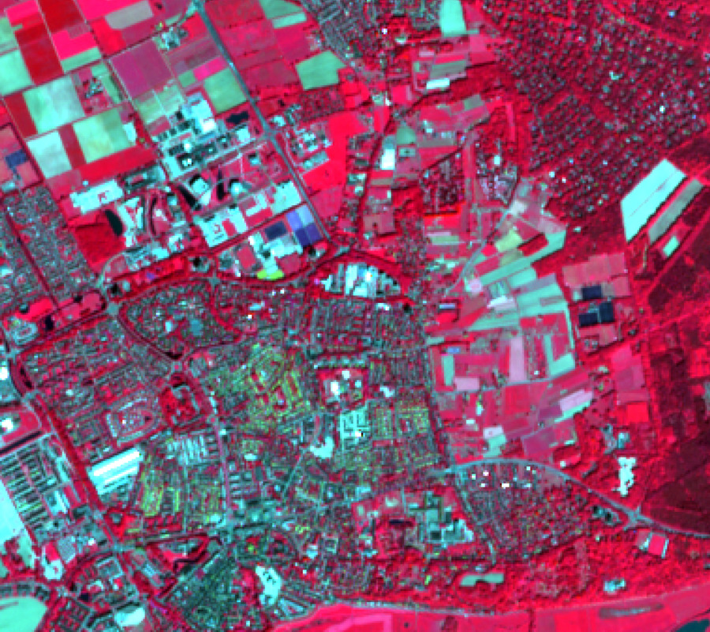
<div class="figure-copyright">Sentinel-2, false-colour composite (Wageningen, NL). Contains modified Copernicus Sentinel data.</div>
</div>

<div v-click>
<LandCoverSplits :clicks="0" />
<div class="text-sm text-gray-700 mt-2">Each pixel is a point in feature space: its <strong>red</strong> and <strong>near-infrared</strong> reflectance.</div>
</div>

</div>

---
clicks: 4
---

# Decision Tree for Multivariate Data

<div class="grid grid-cols-2 gap-8 mt-2 items-center">

<LandCoverSplits :clicks="$clicks" />

<TreeDiagram
  :width="340" :height="200"
  :nodes="[
    { id: 'r', x: 170, y: 20, label: 'red > t₁' },
    { id: 'a', x: 85, y: 92, label: 'nir > t₃' },
    { id: 'b', x: 255, y: 92, label: 'nir > t₂' },
    { id: 'u', x: 35, y: 168, label: 'urban', type: 'leaf' },
    { id: 'g', x: 135, y: 168, label: 'bare ground', type: 'leaf' },
    { id: 'w', x: 210, y: 168, label: 'water', type: 'leaf' },
    { id: 'v', x: 300, y: 168, label: 'vegetation', type: 'leaf' },
  ]"
  :edges="[
    { from: 'r', to: 'a', label: 'yes' },
    { from: 'r', to: 'b', label: 'no' },
    { from: 'a', to: 'u', label: 'no' },
    { from: 'a', to: 'g', label: 'yes' },
    { from: 'b', to: 'w', label: 'no' },
    { from: 'b', to: 'v', label: 'yes' },
  ]"
  :show="[[], ['r'], ['r', 'a', 'u', 'g'], ['r', 'a', 'u', 'g', 'b', 'w', 'v'], ['r', 'a', 'u', 'g', 'b', 'w', 'v']][Math.min($clicks, 4)]"
/>

</div>

<div v-click="4" class="mt-2 text-gray-700">
Every split is <strong>axis-aligned</strong>: each decision tests one feature against one threshold, so the regions are rectangles.
</div>

---
clicks: 2
---

# Increasing Node Purity: Split &amp; Repeat

<div class="grid grid-cols-5 gap-4 mt-1 items-start">

<div class="col-span-2">
<LandCoverSplits :clicks="$clicks === 0 ? 0 : ($clicks === 1 ? 1 : 2)" />
<blockquote class="blockquote2 mt-3">
Idea: every decision should <strong>increase the node purity</strong>.
</blockquote>
</div>

<div class="col-span-3 flex flex-col items-center">
<div class="w-[128px]"><PurityBars :counts="[20, 20, 20, 20]" :max="20" title="all samples" /></div>

<div v-click="1" class="w-full">
<div class="text-center text-sm text-blue-800 italic">red &gt; t₁</div>
<div class="grid grid-cols-2 gap-6 justify-items-center">
<div class="w-[128px]"><PurityBars :counts="[20, 20, 1, 2]" :max="20" title="yes" /></div>
<div class="w-[128px]"><PurityBars :counts="[0, 0, 19, 18]" :max="20" title="no" /></div>
</div>
</div>

<div v-click="2" class="w-full">
<div class="grid grid-cols-2 gap-6">
<div class="flex flex-col items-center">
<div class="text-center text-sm text-blue-800 italic">nir &gt; t₃</div>
<div class="grid grid-cols-2 gap-1">
<div class="w-[104px]"><PurityBars :counts="[20, 1, 0, 1]" :max="20" title="no" /></div>
<div class="w-[104px]"><PurityBars :counts="[0, 19, 1, 1]" :max="20" title="yes" /></div>
</div>
</div>
<div class="flex items-center justify-center text-sm text-gray-500">&hellip; and so on</div>
</div>
</div>

</div>

</div>

<!--
After each split the class histograms of the children are more peaked than the parent: the children are purer.
Next: how do we put a number on purity?
-->

---

# Quantifying Node Purity: Entropy

$$H(\mathbf{p}) = -\sum_i p_i \log(p_i) \qquad \text{(here with } \log_{10}\text{)}$$

<div class="grid grid-cols-2 gap-10 mt-2">

<div>
<div class="text-center text-sm font-semibold text-blue-800">lower entropy: more pure</div>
<div class="w-[190px] mx-auto"><PurityBars :counts="[90, 90, 10, 10]" :max="90" /></div>

<div class="compact-math text-sm" v-click>

$p_1 = p_2 = \tfrac{90}{200} = 0.45, \quad p_3 = p_4 = \tfrac{10}{200} = 0.05$

$H = -(2 \cdot 0.45 \log 0.45 + 2 \cdot 0.05 \log 0.05) \approx \mathbf{0.44}$

</div>
</div>

<div>
<div class="text-center text-sm font-semibold text-blue-800">higher entropy: less pure</div>
<div class="w-[190px] mx-auto"><PurityBars :counts="[50, 50, 50, 50]" :max="90" /></div>

<div class="compact-math text-sm" v-click>

$p_{1,2,3,4} = \tfrac{50}{200} = 0.25$

$H = -4 \cdot 0.25 \log 0.25 \approx \mathbf{0.60}$

</div>
</div>

</div>

---

# Pen &amp; Paper Exercise: Gini Index

$$G(\mathbf{p}) = \sum_i p_i (1 - p_i)$$

<div class="grid grid-cols-2 gap-10 mt-2">

<div>
<div class="text-center text-sm font-semibold text-blue-800">higher Gini index: less pure</div>
<div class="w-[190px] mx-auto"><PurityBars :counts="[50, 50, 50, 50]" :max="90" /></div>
<div class="compact-math text-sm" v-click="2">

$G = 4 \cdot 0.25 \cdot 0.75 = \mathbf{0.75}$

</div>
</div>

<div>
<div class="text-center text-sm font-semibold text-blue-800">lower Gini index: more pure</div>
<div class="w-[190px] mx-auto"><PurityBars :counts="[90, 90, 10, 10]" :max="90" /></div>
<div class="compact-math text-sm" v-click="2">

$G = 2 \cdot 0.45 \cdot 0.55 + 2 \cdot 0.05 \cdot 0.95 = \mathbf{0.59}$

</div>
</div>

</div>

<blockquote v-click="1" class="blockquote2 mt-3">
Exercise: calculate the Gini index for both distributions.
</blockquote>

<!--
Give the students two minutes. The Gini index is the default criterion in scikit-learn (criterion='gini').
-->

---

# Classification versus Regression Trees

So far, we only considered <strong>classification trees</strong>: each leaf represents one class (the majority of the training samples in the leaf).

<ul>
<li v-click>in <strong>classification</strong> problems, the target variable is <strong>categorical</strong> (e.g., happy / not happy sunflower)</li>
<li v-click>in <strong>regression</strong> problems, the target variable is <strong>continuous</strong> (e.g., a happiness score between 0 and 1)</li>
</ul>

<div v-click class="mt-4">

<strong class="text-blue-800">Regression trees</strong> follow exactly the same principles, but use

<ul>
<li>a different metric for node purity: the <strong>sample variance</strong></li>
<li>a different interpretation of the leaves: the <strong>sample mean</strong></li>
</ul>

</div>

---
clicks: 1
---

# Regression Trees: Leaves Return the Average

<div class="grid grid-cols-2 gap-8 mt-2 items-center">

<RegressionTreeDemo :variant="$clicks < 1 ? 'points' : 'leaf-means'" />

<div v-click="1">
<TreeDiagram
  :width="300" :height="200"
  :nodes="[
    { id: 'in', x: 140, y: 12, label: 'X', type: 'input' },
    { id: 'n1', x: 140, y: 62, label: 'X < 10 °C' },
    { id: 'l1', x: 60, y: 130, label: 'μ₁', type: 'leaf', w: 46 },
    { id: 'n2', x: 210, y: 130, label: 'X > 30 °C' },
    { id: 'l3', x: 160, y: 188, label: 'μ₃', type: 'leaf', w: 46 },
    { id: 'l2', x: 260, y: 188, label: 'μ₂', type: 'leaf', w: 46 },
  ]"
  :edges="[
    { from: 'in', to: 'n1' },
    { from: 'n1', to: 'l1', label: 'yes' },
    { from: 'n1', to: 'n2', label: 'no' },
    { from: 'n2', to: 'l3', label: 'yes' },
    { from: 'n2', to: 'l2', label: 'no' },
  ]"
/>

$$\mu_m = \frac{1}{N_m} \sum_{i:\, x_i \in R_m} y_i$$

</div>

</div>

---
clicks: 2
---

# Sample Variance as Node Purity

<div class="grid grid-cols-2 gap-8 mt-2 items-center">

<RegressionTreeDemo variant="variance" :clicks="$clicks" />

<div>

$$\sigma^2 = \frac{1}{N} \sum_{i=1}^{N} (y_i - \mu)^2$$

<blockquote v-if="$clicks === 0" class="blockquote2">

<strong>Before splitting</strong> the node $X \le 30\,°\text{C}$: cold and warm sunflowers are mixed &mdash; the variance is <strong>high</strong>. Interpret variance as the <strong>average squared distance to the mean</strong>.

</blockquote>

<blockquote v-else-if="$clicks === 1" class="blockquote3">
<strong>Geometric interpretation:</strong> each squared distance is the area of a square. A large average square area = high variance, i.e., a <strong>low node purity</strong>.
</blockquote>

<blockquote v-else class="blockquote2">

<strong>After splitting</strong> at $10\,°\text{C}$: smaller average squares = lower variance = <strong>higher node purity</strong>.

</blockquote>

</div>

</div>

<!--
Same picture as the MSE squares of linear regression: the tree now minimizes the squares around each region mean instead of around a line.
-->

---

# How to Find the Threshold $\tau$?

<div class="grid grid-cols-2 gap-8 mt-2 items-center">

<RegressionTreeDemo variant="threshold" :tau="20" />

<div>

Formal definition of the regions by the threshold

$$R_1 = \{X \mid X < \tau\}, \qquad R_2 = \{X \mid X \ge \tau\}$$

<div v-click>

Minimization objective

$$
t^* = \arg\min_\tau \underbrace{\sum_{i:\, x_i \in R_1} (y_i - \mu_{R_1})^2}_{\text{left variance}} + \underbrace{\sum_{i:\, x_i \in R_2} (y_i - \mu_{R_2})^2}_{\text{right variance}}
$$

</div>

<div v-click class="text-gray-700">

The impurity is a function of $\tau$ &mdash; we look for its minimum $t^*$.

</div>

</div>

</div>

---

# Naïve Approach: Try Different Thresholds

<div class="w-[86%] mx-auto"><ThresholdScan /></div>

<blockquote class="blockquote3 mt-3">

Easy to implement &mdash; but we need to choose which thresholds to test. Drag the slider to scan the thresholds; the best recorded threshold is $t^*$.

</blockquote>

<div class="slide-citation">
Original Colab notebook: <a href="https://colab.research.google.com/drive/1-9FmziUq53R44xehKnzm3v4Pcvs43TXl?usp=sharing" target="_blank" rel="noopener noreferrer">threshold search</a>
</div>

<!--
Interactive: drag τ from left to right. The impurity curve has a clear minimum where the two groups separate.
Question to the class: how fine should the grid of thresholds be?
-->

---
clicks: 6
---

# Binary Splitting

<div class="w-[88%] mx-auto"><BinarySplitting :clicks="$clicks" /></div>

<blockquote v-click="6" class="blockquote1 mt-1">
Only thresholds between neighbouring points change the split &mdash; we test as many thresholds as we have points.
</blockquote>

<!--
Click through the five candidate thresholds. The plot on the bottom right records the impurity of each split; the last click marks the optimum.
-->

---
clicks: 4
---

# Growing a Tree: Recursive Binary Splitting

<div class="grid grid-cols-5 gap-6 mt-2 items-center">

<div class="col-span-2">

Growing a decision tree:

<ul>
<li>perform binary splitting</li>
<li>recursively for each decision node</li>
<li>to maximize node purity</li>
</ul>

<blockquote v-click="2" class="blockquote3 mt-4">
When to stop splitting?
</blockquote>

<blockquote v-click="4" class="blockquote4 mt-3">
Without a stopping rule we end up with <strong>one sample per leaf</strong> = a 1-nearest-neighbour regressor / classifier.
</blockquote>

</div>

<div class="col-span-3">
<TreeGrowth :clicks="$clicks" :depth="4" />
</div>

</div>

---

# Overfitting of Decision Trees

<div class="grid grid-cols-5 gap-6 mt-1 items-center">

<div class="col-span-2">
<ul>
<li>the tree fits the training data perfectly (zero variance in every leaf)</li>
<li v-click>the tree is extremely large and uninterpretable</li>
<li v-click>test MSE: <strong>0.092</strong> happiness</li>
</ul>
</div>

<div class="col-span-3">
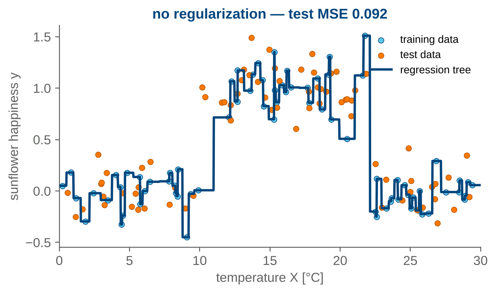
</div>

</div>

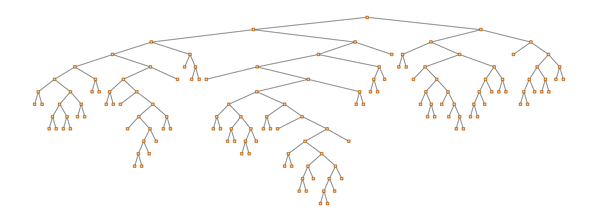

<!--
Synthetic sunflower data (75 training and 75 test samples). Figure script: figures-source/lecture-3/make_dt_figures.py
-->

---

# Regularization: Restricting the Depth

<div class="grid grid-cols-5 gap-6 mt-1 items-center">

<div class="col-span-2">
<ul>
<li>we can manually restrict the depth</li>
<li v-click>the tree remains interpretable</li>
<li v-click>test MSE lower: <strong>0.077</strong> happiness</li>
</ul>
</div>

<div class="col-span-3">
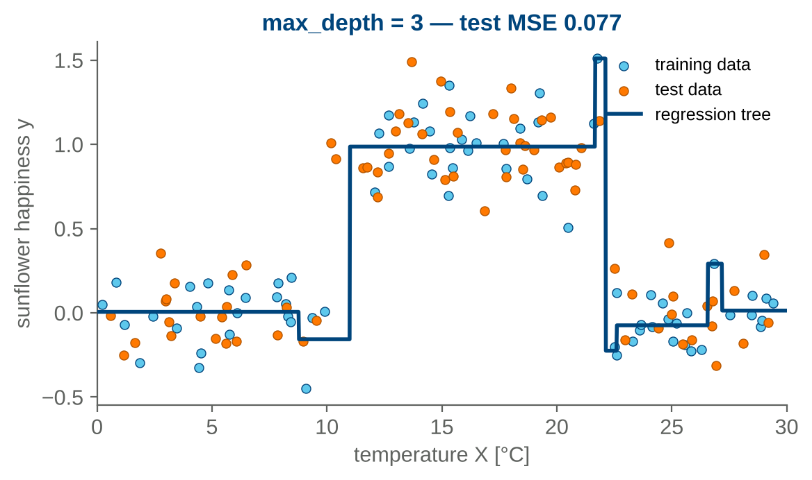
</div>

</div>

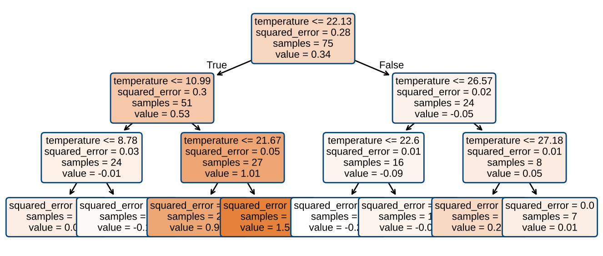

<div class="slide-citation">
Original Colab notebook: <a href="https://colab.research.google.com/drive/1vP8XTPmVpnN3OdROYYkauT9y2XZlqf2r?usp=sharing" target="_blank" rel="noopener noreferrer">regularization of decision trees</a>
</div>

---
layout: bonn-two-cols-header
---

# Regularization: Tree Pruning

Two families of algorithms restrict the tree complexity and counteract overfitting.

::left::

<div class="border rounded-xl p-4 h-full">
<h3>Slow growers (pre-pruning)</h3>

<strong>Strategy:</strong> grow the tree slowly, with additional checks during growing.

<ul>
<li>simple checks: <strong>maximum depth</strong>, <strong>maximum number of leaf nodes</strong></li>
<li>add a decision node only if the <strong>increase in node purity</strong> is above a threshold</li>
</ul>
</div>

::right::

<div v-click class="border rounded-xl p-4 h-full">
<h3>Fast cutters (post-pruning)</h3>

<strong>Strategy:</strong> grow the full tree, then remove unimportant nodes.

<ul>
<li><strong>cost complexity pruning</strong>: we identify the weakest link in the tree and remove it</li>
</ul>
</div>

---
hide: true
---

# Cost Complexity Pruning

<div class="grid grid-cols-2 gap-8 mt-1 items-center">

<div>

$$C_\alpha(T) = \underbrace{C(T)}_{\substack{\text{cost} \\ \text{(training error)}}} + \alpha \underbrace{|T|}_{\substack{\text{complexity} \\ \text{(number of leaves)}}}$$

<strong class="text-blue-800">Idea:</strong> remove leaves to <strong>reduce the complexity</strong> while keeping a <strong>low training error</strong> (cost). The hyperparameter $\alpha$ balances both objectives.

<div v-click>

<strong class="text-blue-800">Algorithm:</strong>

<ul>
<li>

iteratively remove sub-trees and record the decrease in the cost-complexity function $C_\alpha(T)$

</li>
<li>

sub-trees can be ordered by importance, each with an associated $\alpha$

</li>
</ul>

</div>

</div>

<TreeDiagram
  :width="300" :height="230"
  :nodes="[
    { id: 'x', x: 150, y: 12, label: 'X', type: 'input' },
    { id: 'r', x: 150, y: 58, label: ' ', w: 30 },
    { id: 'a', x: 100, y: 112, label: ' ', w: 30 },
    { id: 'b', x: 200, y: 112, label: ' ', w: 30 },
    { id: 'a1', x: 60, y: 166, label: ' ', w: 30 },
    { id: 'a2', x: 130, y: 166, label: ' ', w: 30 },
    { id: 'm1', x: 40, y: 214, label: 'μ₁', type: 'leaf', w: 34 },
    { id: 'm2', x: 85, y: 214, label: 'μ₂', type: 'leaf', w: 34 },
    { id: 'm3', x: 175, y: 166, label: 'μ₃', type: 'leaf', w: 34 },
    { id: 'm4', x: 240, y: 166, label: 'μ₄', type: 'leaf', w: 34 },
  ]"
  :edges="[
    { from: 'x', to: 'r' },
    { from: 'r', to: 'a' }, { from: 'r', to: 'b' },
    { from: 'a', to: 'a1' }, { from: 'a', to: 'a2' },
    { from: 'a1', to: 'm1' }, { from: 'a1', to: 'm2' },
    { from: 'b', to: 'm3' }, { from: 'b', to: 'm4' },
  ]"
  :dim="$clicks >= 1 ? ['a1', 'm1', 'm2'] : []"
/>

</div>

---
hide: true
---

# Cost Complexity Pruning: The Effect of $\alpha$

<div class="grid grid-cols-2 gap-8 items-center">

<div>

$$C_\alpha(T) = C(T) + \alpha |T|$$

</div>

<div>

A higher $\alpha$

- produces a **shallower tree** with fewer nodes (reduces complexity)
- increases the impurity, i.e., the **training error** (increases cost)

</div>

</div>

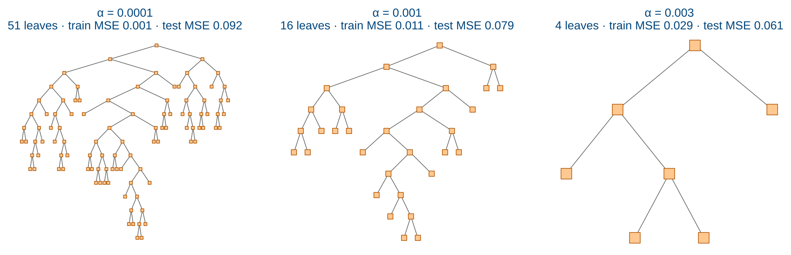

<!--
With increasing α the training error goes up but the test error goes down: we trade fit for generalization.
-->

---
hide: true
---

# Building a Tree with Cost Complexity Pruning

<div class="grid grid-cols-4 gap-6 mt-2 items-center">

<div class="col-span-3">

1. use ***recursive binary splitting*** to grow a large tree on the training data
2. apply **cost complexity pruning** to the large tree to obtain a sequence of best sub-trees as a function of $\alpha$
3. use **K-fold cross-validation to choose $\alpha$**:
   1. repeat steps 1 and 2 on all but the $k$-th fold of the training data
   2. evaluate the error on the left-out $k$-th fold as a function of $\alpha$; average the results for each $\alpha$ and pick $\alpha$ to minimize the average error
4. return the sub-tree from step 2 that corresponds to the chosen value of $\alpha$

</div>

<div>

<div class="figure-copyright text-center">Image by Bing Image Generator</div>
</div>

</div>

<div class="slide-citation">
Algorithm after James, Witten, Hastie &amp; Tibshirani, <a href="https://www.statlearning.com/" target="_blank" rel="noopener noreferrer"><em>An Introduction to Statistical Learning</em></a>, Algorithm 8.1.
</div>

---
hide: true
---

# Decision Trees in scikit-learn: Hyperparameters

```python {2,3,4|all}
from sklearn.tree import DecisionTreeClassifier, DecisionTreeRegressor

clf = DecisionTreeClassifier(criterion="gini",          # or "entropy" — node purity
                             max_depth=None, max_leaf_nodes=None,      # pre-pruning
                             min_samples_split=2, min_samples_leaf=1,
                             min_impurity_decrease=0.0,
                             ccp_alpha=0.0)                            # post-pruning

reg = DecisionTreeRegressor(criterion="squared_error",  # variance as node purity
                            max_depth=3, ccp_alpha=0.0)
```

<div class="mt-3 text-gray-700">
All hyperparameters in the snippet were covered in this part: the <strong>purity criterion</strong>, <strong>pre-pruning</strong> limits and <strong>cost complexity pruning</strong> via <code>ccp_alpha</code>.
</div>

<div class="slide-citation">
Documentation: <a href="https://scikit-learn.org/stable/modules/generated/sklearn.tree.DecisionTreeClassifier.html" target="_blank" rel="noopener noreferrer">DecisionTreeClassifier</a> · <a href="https://scikit-learn.org/stable/modules/generated/sklearn.tree.DecisionTreeRegressor.html" target="_blank" rel="noopener noreferrer">DecisionTreeRegressor</a>
</div>

---
layout: bonn-two-cols-header
---

# Recap: Decision Trees

::left::

<h3>Advantages</h3>

<ul>
<li><strong>inexpensive</strong> to construct</li>
<li>extremely <strong>fast at prediction</strong> time</li>
<li><strong>easy to interpret</strong> for small trees</li>
<li><strong>robust to noise</strong> (when regularized)</li>
<li>can easily handle <strong>redundant or irrelevant attributes</strong> (unless the attributes are interacting)</li>
</ul>

::right::

<div v-click>
<h3>Disadvantages</h3>

<ul>
<li>decision trees are prone to <strong>overfitting</strong> and need regularization</li>
<li><strong>greedy</strong> approaches often fail to find the best tree (restricting growth is too short-sighted)</li>
<li>do <strong>not take interactions between features</strong> into account: each decision boundary involves only a single attribute</li>
</ul>
</div>

---

# Bagging &amp; Random Forests

## Increasing robustness by redundancy

<div class="grid grid-cols-2 gap-16 mt-6 text-center w-[70%] mx-auto">

<div>

<div class="text-blue-800 font-semibold mt-2">Bagging</div>
</div>

<div>
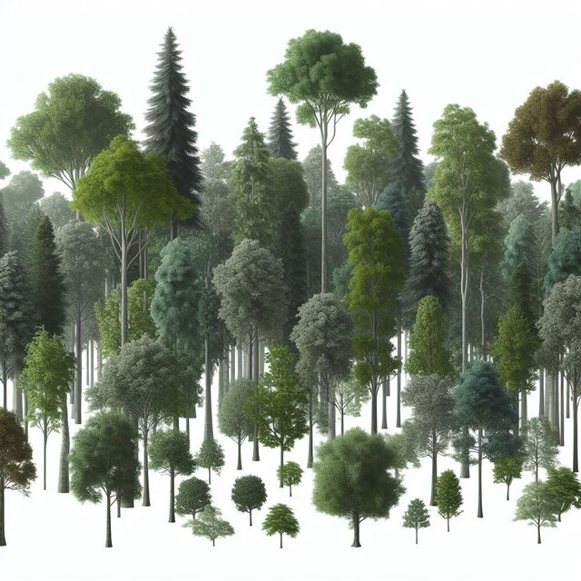
<div class="text-blue-800 font-semibold mt-2">Random Forests</div>
</div>

</div>

<div class="slide-citation">
Images by Bing Image Generator (DALL·E 3): "a stylized image of a bag of green trees", "… of a random forest", white background.
</div>

<!--
Part 2: single trees have high variance. We fix this by combining many trees.
-->

---

# An Artificial Classification Dataset

<div class="grid grid-cols-2 gap-8 mt-2 items-center">

<div>
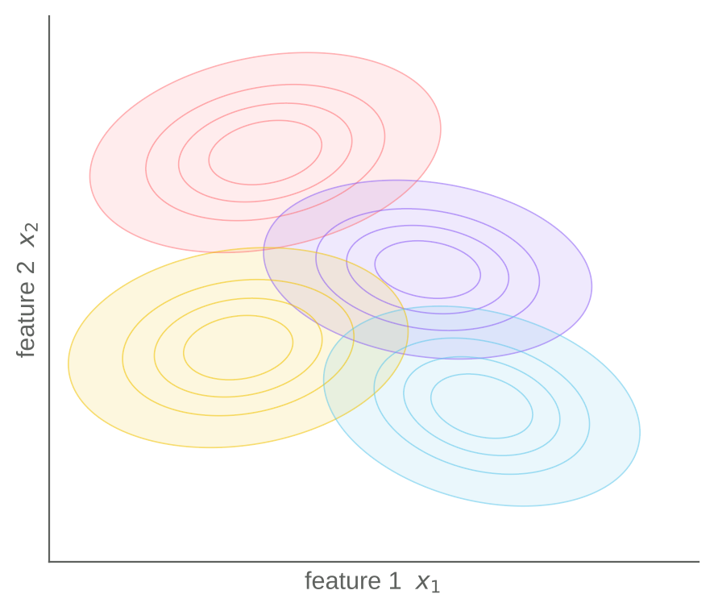
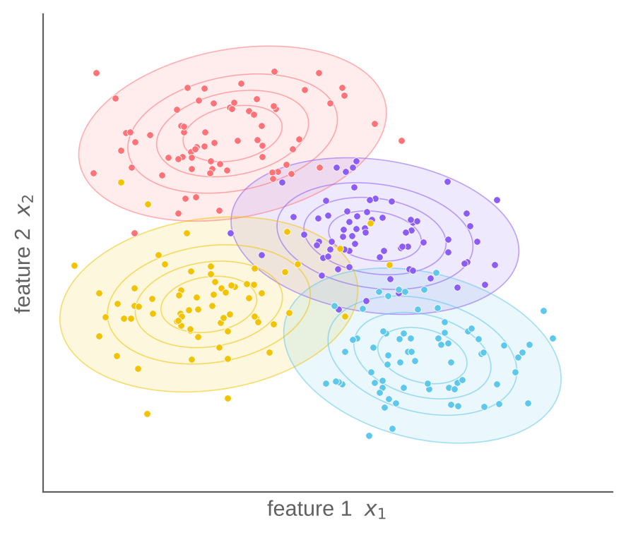
</div>

<div>

Assume four distributions, one per class, over a random feature vector $\mathbf{X} = (x_1, x_2)$:

<ul>
<li>

<span style="color:#ff7378">■</span> class 1: $p(x_1, x_2 \mid y = 1)$

</li>
<li>

<span style="color:#8b5cf6">■</span> class 2: $p(x_1, x_2 \mid y = 2)$

</li>
<li>

<span style="color:#f2c300">■</span> class 3: $p(x_1, x_2 \mid y = 3)$

</li>
<li>

<span style="color:#5ec8ec">■</span> class 4: $p(x_1, x_2 \mid y = 4)$

</li>
</ul>

<div v-click="1">

We <strong>sample a dataset</strong> from the distribution

$$\mathcal{D} = \{(\mathbf{x}_i, y_i)\}_{i=1}^{N} \sim p(\mathbf{X}, Y)$$

</div>

<blockquote class="blockquote1 mt-3">
Remember: we are always working with distributions.
</blockquote>

</div>

</div>

---
clicks: 2
---

# Let's Fit a Decision Tree to the Data

<div class="grid grid-cols-2 gap-8 mt-2 items-center">

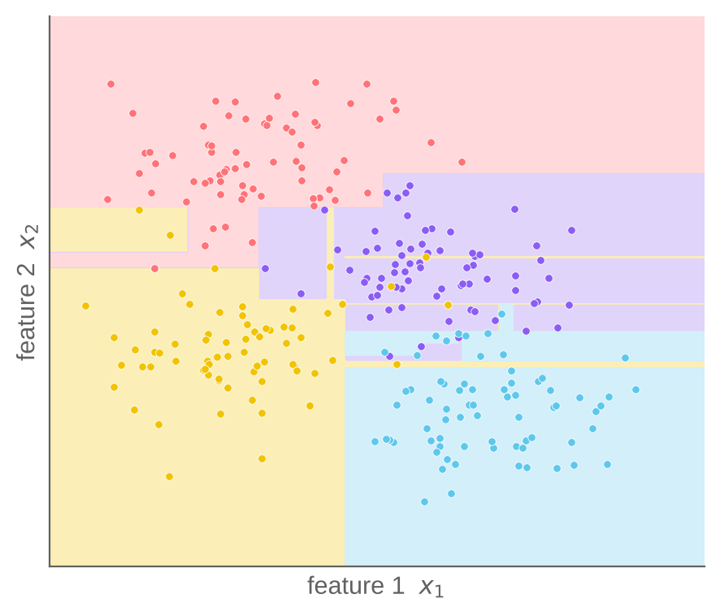

<div>

Again, we split the feature space into <strong>regions</strong>.

<blockquote v-click="1" class="blockquote2 mt-4">
The <strong>modes</strong> (i.e., centers) of the data distributions are well assigned to the correct classes.
</blockquote>

<blockquote v-click="2" class="blockquote4 mt-4">
But the uncertain, <strong>overlapping region</strong> is not well defined: thin slivers and islands follow individual training points.
</blockquote>

</div>

</div>

---

# Different Samples Lead to Very Different Trees

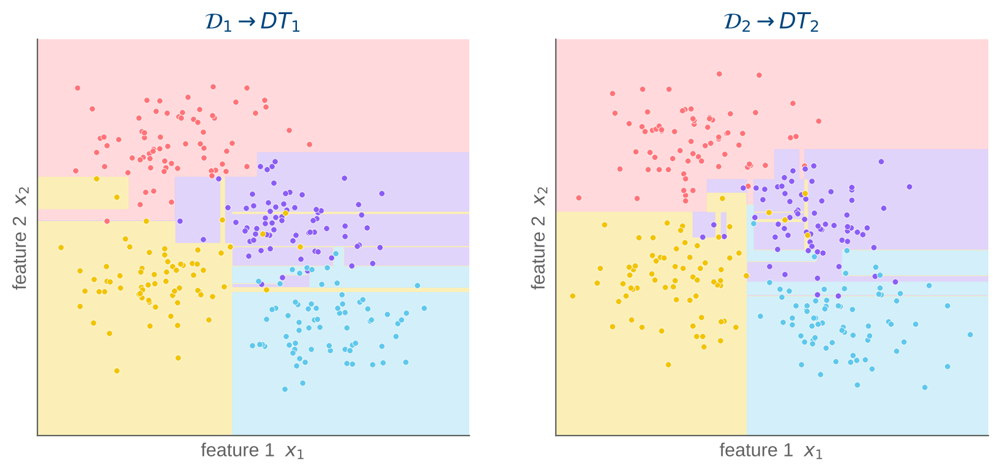

<div class="grid grid-cols-2 gap-8 mt-2">

<blockquote v-click class="blockquote2">
<strong>Low bias:</strong> each tree fits its own training data perfectly.
</blockquote>

<blockquote v-click class="blockquote3">

<strong>High variance:</strong> the trees are very different on different dataset samples $\mathcal{D}_1, \mathcal{D}_2 \sim p(\mathbf{X}, Y)$.

</blockquote>

</div>

---
layout: bonn-two-cols-header
---

# Bias–Variance Trade-off

Finding a good balance between fitting and overfitting is the fundamental challenge in machine learning. For tree-like classifiers:

::left::

<div class="grid grid-cols-4 gap-3 items-center">
<div class="col-span-3">
<h3>Strategy 1: reduce tree complexity</h3>
<span class="text-gray-500 text-sm">(recap: seen in Part 1)</span>
<ul>
<li>greedy: restrict the tree complexity while growing</li>
<li>non-greedy: post-hoc pruning of the tree</li>
</ul>
</div>
<div class="text-center">

<div class="text-sm italic text-blue-800">"cut the tree"</div>
</div>
</div>

::right::

<div v-click class="grid grid-cols-4 gap-3 items-center">
<div class="col-span-3">
<h3>Strategy 2: ensemble many trees</h3>
<ul>
<li>bagging</li>
<li>random forests</li>
</ul>
</div>
<div class="text-center">

<div class="text-sm italic text-blue-800">"grow a forest"</div>
</div>
</div>

---

# Let's Grow a Forest — Step 1: Bagging

<div class="grid grid-cols-5 gap-6 mt-1 items-center">

<div class="col-span-2">

<div class="text-center text-sm">

$\mathcal{D}_\text{train} = \{(\mathbf{x}_i, y_i)\}_{i=1}^{N} \sim p(\mathbf{X}, Y)$

<div class="text-gray-500 text-xs my-1">&darr; randomly sampled subsets (with replacement), i.e., a <strong>"bootstrap"</strong> &darr;</div>

</div>

<div class="border-2 rounded-xl p-2 mt-1" style="border-color: var(--bonn-blue)">
<div class="text-center text-sm font-semibold text-blue-800">Bag of decision trees</div>
<div class="flex justify-around">
<MiniTree label="𝒟₁ → DT₁" size="70px" />
<MiniTree label="𝒟₂ → DT₂" size="70px" />
<MiniTree label="𝒟₃ → DT₃" size="70px" />
</div>
<div class="text-center text-xs text-gray-500">each tree is deep and not pruned</div>
</div>

<div v-click="1" class="mt-3 text-sm">
<strong class="text-blue-800">Ensemble prediction:</strong>
<ul>
<li><strong>majority voting</strong> for classification</li>
<li><strong>output averaging</strong> for regression</li>
</ul>
</div>

</div>

<div class="col-span-3" v-click="2">
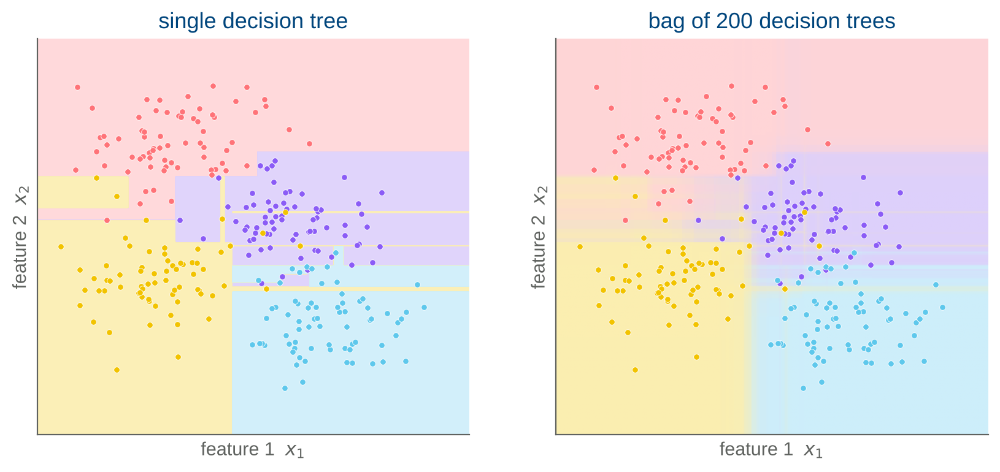
<blockquote class="blockquote2 mt-1">
Effect: trees agree in the modes and disagree in the overlap &mdash; decision boundaries become <strong>blurry</strong>, a more realistic result.
</blockquote>
</div>

</div>

<!--
Right plot: colours are blended by the fraction of trees voting for each class; uncertain regions appear as mixed colours.
-->

---
hide: true
---

# Bagging: Out-of-Bag Error

<div class="grid grid-cols-2 gap-10 mt-4 items-center">

<div class="text-center">

$\mathcal{D}_\text{train}$

<div class="flex justify-center gap-6 mt-3 text-sm">
<div class="border-2 rounded-xl px-3 py-2" style="border-color: var(--bonn-blue)">

bootstrap 𝒟ᵢ<br><span class="text-gray-500 text-xs">1. fit DTᵢ</span>

</div>
<div class="border-2 rounded-xl px-3 py-2" style="border-color: var(--grl-data-orange)">

remaining samples 𝒟<sub>OOB</sub><br><span class="text-gray-500 text-xs">2. estimate the OOB error of DTᵢ</span>

</div>
</div>

</div>

<div>

<strong class="text-blue-800">Out-of-bag (OOB) error estimation</strong>

<ol>
<li>

fit decision tree $DT_i$ on $\mathcal{D}_i$

</li>
<li>

test its performance on the out-of-bag set $\mathcal{D}_\text{OOB}$

</li>
<li>repeat for each tree in the bag</li>
<li>average the individual OOB errors across trees</li>
</ol>

<blockquote v-click class="blockquote2 mt-3">
The OOB error <strong>approximates the test error</strong> without using test data &mdash; a similar idea to cross-validation.
</blockquote>

</div>

</div>

---

# Bagging Trees: Re-gaining Interpretability

<div class="grid grid-cols-5 gap-6 mt-1 items-center">

<div class="col-span-3">
<ul>
<li>bagging <strong>improves accuracy</strong> over a single tree through increasing diversity in the decisions</li>
<li>but we <strong>lose interpretability</strong>: each tree has different decision rules, and interpreting many rules in parallel is difficult</li>
</ul>

<div v-click="1" class="mt-3">
<strong class="text-blue-800">Variable importance</strong> &mdash; across all trees in the bag:
<ol>
<li>look at all decision nodes that involve the feature of interest <span style="color: var(--grl-data-orange)">●</span> (for instance, temperature)</li>
<li>measure the <strong>increase in node purity</strong> at each of these nodes and average it</li>
</ol>
</div>
</div>

<div class="col-span-2">
<div class="flex justify-around">
<MiniTree root="a" label="DT₁" size="64px" />
<MiniTree left="a" right="a" label="DT₂" size="64px" />
<MiniTree left="a" label="DT₃" size="64px" />
</div>
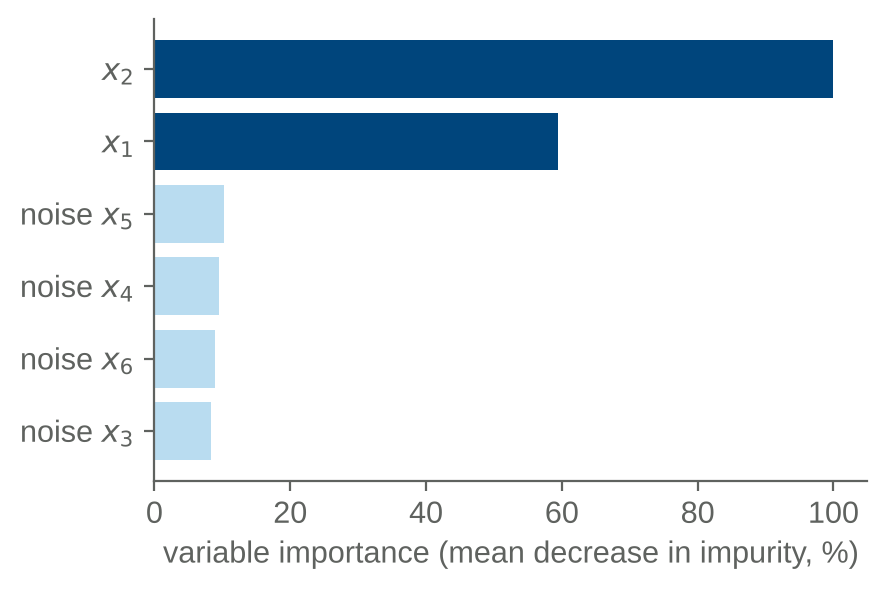
</div>

</div>

<!--
The importance plot is computed on the four-class dataset with four extra pure-noise features: the informative features x1 and x2 clearly stand out.
-->

---

# Bagging Limitation: Correlated Trees

<div class="grid grid-cols-5 gap-6 mt-2 items-center">

<div class="col-span-3">
<ul>
<li>bagging improves accuracy through increasing <strong>diversity</strong> in the decisions</li>
<li v-click>but bagged trees are still <strong>highly correlated</strong>: an important feature <span style="color: var(--grl-data-orange)">●</span> is split first, followed by the second most important feature <span style="color: var(--grl-data-green)">●</span>, and so on&hellip;</li>
<li v-click>all trees in a bag look similar &rarr; this <strong>correlates the trees</strong>, reduces diversity &amp; test accuracy</li>
</ul>

<blockquote v-click class="blockquote3 mt-4">
Idea: increase diversity by <strong>removing features</strong> from individual trees.
</blockquote>
</div>

<div class="col-span-2 border-2 rounded-xl p-3" style="border-color: var(--bonn-blue)">
<div class="text-center text-sm font-semibold text-blue-800 mb-1">Bag of decision trees</div>
<div class="flex justify-around">
<MiniTree root="a" left="b" right="b" label="𝒟₁ → DT₁" size="72px" />
<MiniTree root="a" left="b" right="b" label="𝒟₂ → DT₂" size="72px" />
<MiniTree root="a" left="b" label="𝒟₃ → DT₃" size="72px" />
</div>
</div>

</div>

---

# Random Forest — Step 2: Remove Features

<blockquote class="blockquote3">
Idea: increase diversity by removing features from individual trees.
</blockquote>

<div class="grid grid-cols-2 gap-8 mt-3 items-center">

<div>

<strong class="text-blue-800">Implementation:</strong> we take a random sample of predictors for each tree (usually $\sqrt{F}$ of $F$ features, e.g., 4 out of 15).

In a random forest, each decision tree is

<ol>
<li>

trained with a bootstrapped dataset $\mathcal{D}_i$

</li>
<li>

using a subset of features $\mathcal{F}_i$

</li>
</ol>

</div>

<div v-click class="border-2 rounded-xl p-3" style="border-color: var(--bonn-blue)">
<div class="text-center text-sm font-semibold text-blue-800 mb-1">Random forest</div>
<div class="flex justify-around">
<MiniTree root="a" left="o" right="o" label="𝒟₁ → DT₁" sub="using ℱ₁" :without="['b']" size="80px" />
<MiniTree root="b" left="o" right="b" label="𝒟₂ → DT₂" sub="using ℱ₂" :without="['a']" size="80px" />
<MiniTree root="o" left="o" right="o" label="𝒟₃ → DT₃" sub="using ℱ₃" :without="['a', 'b']" size="80px" />
</div>
</div>

</div>

<!--
In scikit-learn the feature subset is drawn per split (max_features), not once per tree — the effect on diversity is the same.
-->

---
layout: bonn-two-cols-header
---

# Summary: Bagging and Random Forests

::left::

<h3>Bags &amp; random forests</h3>
<ul>
<li>each tree is trained on a different <strong>bootstrapped</strong> set of training data</li>
<li>trees are trained separately from each other, <strong>in parallel</strong></li>
</ul>

<div class="flex justify-around mt-4">
<MiniTree root="a" left="b" right="b" label="DT₁" size="62px" />
<MiniTree root="a" left="b" right="b" label="DT₂" size="62px" />
<MiniTree root="a" left="b" label="DT₃" size="62px" />
</div>
<div class="text-center text-sm text-blue-800 font-semibold">bag of decision trees</div>

::right::

<h3>Random forests</h3>
<ul>
<li>additionally, each tree is trained with a <strong>different subset of features</strong></li>
</ul>

<div class="flex justify-around mt-4">
<MiniTree root="a" label="DT₁" :without="['b']" size="62px" />
<MiniTree root="b" right="b" label="DT₂" :without="['a']" size="62px" />
<MiniTree label="DT₃" :without="['a', 'b']" size="62px" />
</div>
<div class="text-center text-sm text-blue-800 font-semibold">random forest</div>

---
hide: true
---

# Bagging &amp; Random Forests in scikit-learn

```python {3-5|7-9|all}
from sklearn.ensemble import BaggingClassifier, RandomForestClassifier

bag = BaggingClassifier(estimator=DecisionTreeClassifier(),  # any base model
                        n_estimators=10, max_samples=1.0,     # number & size of bootstraps
                        bootstrap=True, oob_score=False, n_jobs=None)

rf = RandomForestClassifier(n_estimators=100, criterion="gini", max_depth=None,
                            max_features="sqrt",              # feature subset → diversity
                            bootstrap=True, oob_score=False, n_jobs=None)
```

<div class="mt-3 text-gray-700">
Pass a <code>DecisionTreeClassifier</code> as <code>estimator</code> into the bagging classifier. <code>oob_score=True</code> computes the out-of-bag error; <code>n_jobs</code> trains trees in parallel.
</div>

<div class="slide-citation">
Documentation: <a href="https://scikit-learn.org/stable/modules/generated/sklearn.ensemble.BaggingClassifier.html" target="_blank" rel="noopener noreferrer">BaggingClassifier</a> · <a href="https://scikit-learn.org/stable/modules/generated/sklearn.ensemble.RandomForestClassifier.html" target="_blank" rel="noopener noreferrer">RandomForestClassifier</a>
</div>

---
layout: bonn-two-cols-header
---

# Recap: Decision Trees &amp; Ensembles

::left::

<h3>Decision trees</h3>
<ul>
<li>a simple chain of decisions</li>
<li>well interpretable, but inaccurate on the test set (<strong>low bias, high variance</strong>)</li>
</ul>

<h3 class="mt-3">Bag of trees</h3>
<ul>
<li>an ensemble "bag" of trees, each trained on a different data subset ("bootstrap")</li>
<li>better test accuracy through tree consensus; all trees learned <strong>simultaneously</strong></li>
</ul>

::right::

<h3>Random forest</h3>
<ul>
<li>like a bag, but each tree also uses a different <strong>feature subset</strong></li>
<li>trees are as <strong>diverse</strong> as possible; learned simultaneously</li>
</ul>

---
section: closing
sectionTitle: Closing
---

<script setup>
import LectureOverview from './components/LectureOverview.vue'
</script>

# Lecture Overview

<div class="mt-6">
<LectureOverview :next="5" />
</div>

<!--
Recap: four ways we improved machine learning today - more data (and its curse of dimensionality), less redundant data (decorrelation through PCA), more descriptive data (domain knowledge), and better non-linear models (random forests).
-->

---
section: closing
---

# Machine Learning Pipeline

<div class="mt-1 text-gray-700 text-[.82rem] text-center">
Good, hand-selected features combined with a suitable model determine the quality of the result.
</div>

<div class="relative mt-8">


<div class="absolute" style="left: 36.2%; top: 100%; transform: translate(0, 10px);">
<div class="flex items-center gap-1.5 text-[.68rem] font-semibold whitespace-nowrap" style="color: var(--bonn-blue);">
<span class="w-2 h-2 rounded-full flex-shrink-0" style="background: var(--bonn-blue);"></span>
This lecture &middot; More Data, PCA &amp; Better Features
</div>
</div>

<div class="absolute" style="left: 73%; top: 100%; transform: translate(0, 10px);">
<div class="flex items-center gap-1.5 text-[.68rem] font-semibold whitespace-nowrap" style="color: var(--grl-data-orange);">
<span class="w-2 h-2 rounded-full flex-shrink-0" style="background: var(--grl-data-orange);"></span>
This lecture &middot; Decision Trees &amp; Random Forests
</div>
</div>

</div>

<!--
Recap of the whole lecture in one picture. Feature side (blue): more data, less redundant data (PCA) and more descriptive data (domain knowledge). Model side (orange): decision trees and random forests.
-->

---
layout: learning-outcomes
mode: after
meeting: lecture-03
section: closing
sectionTitle: Closing
---

# Revisit the learning outcomes
