# Data Representations


---
section: representations
---

# Recap: Geospatial Data

<div class="grid grid-cols-5 gap-8 mt-4 items-start">

<div class="col-span-2">

- satellite imagery
- thematic rasters such as land cover
- vector geometries and attributes
- model and reanalysis fields
- observations collected at different times and scales

</div>

<div class="col-span-3">

<blockquote class="blockquote3">
Each source describes locations on its own spatial and temporal support.
</blockquote>

</div>

</div>

<div class="grid grid-cols-4 gap-4 mt-8">

<div class="text-center">

<div class="text-[.62rem] text-gray-500 mt-1">Satellite imagery (Bonn, Sentinel-2)</div>
</div>

<div class="text-center">

<div class="text-[.62rem] text-gray-500 mt-1">Thematic raster (land cover, Amsterdam)</div>
</div>

<div class="text-center">

<div class="text-[.62rem] text-gray-500 mt-1">Vector geometries (OpenStreetMap)</div>
</div>

<div class="text-center">

<div class="text-[.62rem] text-gray-500 mt-1">Model / reanalysis field (population density)</div>
</div>

</div>

<!--
Presenter note: Activate prior knowledge from Lecture 2 without repeating its details. Ask students what spatial and temporal support each source uses.
-->

---
section: representations
---

# A Place as a Feature Vector

<div class="grid grid-cols-5 gap-8 mt-4 items-center">

<div class="col-span-2">
  
</div>

<div class="col-span-3 text-[.78rem] leading-snug">

Sampling all $p$ variables at location $i$ produces a fixed feature vector:

$$
\mathbf{x}_i = [x_{i1}, x_{i2}, \ldots, x_{ip}]
$$

For example:

$$
\begin{aligned}
\mathbf{x}_i = [&\text{elevation},\ \text{slope},\ \text{spectral bands},\\
                 &\text{temperature},\ \text{building density}]
\end{aligned}
$$

Repeating the extraction at $n$ locations creates a feature matrix:

$$
\mathbf{X} \in \mathbb{R}^{n \times p}
$$

<div class="mt-4 flex items-center justify-center gap-3 font-semibold text-blue-800">
  <span>features xᵢ</span>
  <span aria-hidden="true">&rarr;</span>
  <span>machine-learning model</span>
  <span aria-hidden="true">&rarr;</span>
  <span>prediction ŷᵢ</span>
</div>

<div class="mt-3 border-l-4 border-yellow-400 pl-3 text-[.66rem] text-gray-600">
Training target yᵢ: kept separate from the input features.
</div>

</div>

</div>

<!--
Presenter note: A time-dependent cube yields fixed-length vectors only after selecting a time, a fixed window, or temporal summary statistics.
TODO: Replace the placeholder with a cube-to-vector illustration and add a provisional prediction task.
-->

---
section: representations
---

# Good Data Representations for Effective ML

<div class="mt-1 text-gray-700 text-[.82rem] text-center">
Good, hand-selected features combined with a suitable model determine the quality of the result.
</div>

<div class="relative mt-8">


<div class="absolute" style="left: 36.2%; top: 100%; transform: translate(0, 10px);">
<div class="flex items-center gap-1.5 text-[.68rem] font-semibold whitespace-nowrap" style="color: var(--grl-data-orange);">
<span class="w-2 h-2 rounded-full flex-shrink-0" style="background: var(--grl-data-orange);"></span>
This lecture &middot; Data Cubes &amp; PCA
</div>
</div>

<div class="absolute" style="left: 73%; top: 100%; transform: translate(0, 10px);">
<div class="flex items-center gap-1.5 text-[.68rem] font-semibold whitespace-nowrap text-red-600">
<span class="w-2 h-2 rounded-full flex-shrink-0 bg-red-600"></span>
Next lecture &middot; Linear Models &amp; Random Forests
</div>
</div>

</div>

<!--
Presenter note: Outlook. Feature design (orange) is what we did today: data cubes, hand-designed features such as NDVI, and PCA. The model (red) is the topic of the next lecture: linear models, decision trees and random forests.
-->

---
section: representations
---

<script setup>
import PlotlyHistogram from './components/PlotlyHistogram.vue'
</script>

# Dataset

<div class="relative mt-1">

<div v-click-hide="2" class="grid grid-cols-2 gap-8">

<div>
<div class="text-sm font-semibold text-blue-800 mb-1 text-center">Input X <span class="font-normal text-gray-500">(e.g., Sentinel-2 pixel reflectances)</span></div>

<div class="relative" style="height: 195px;">
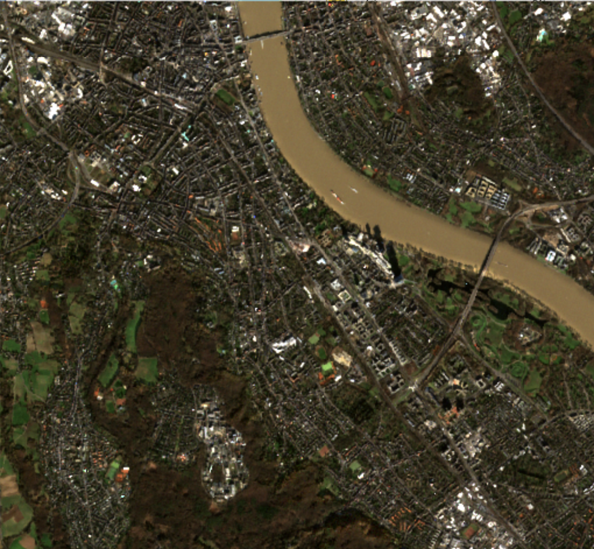
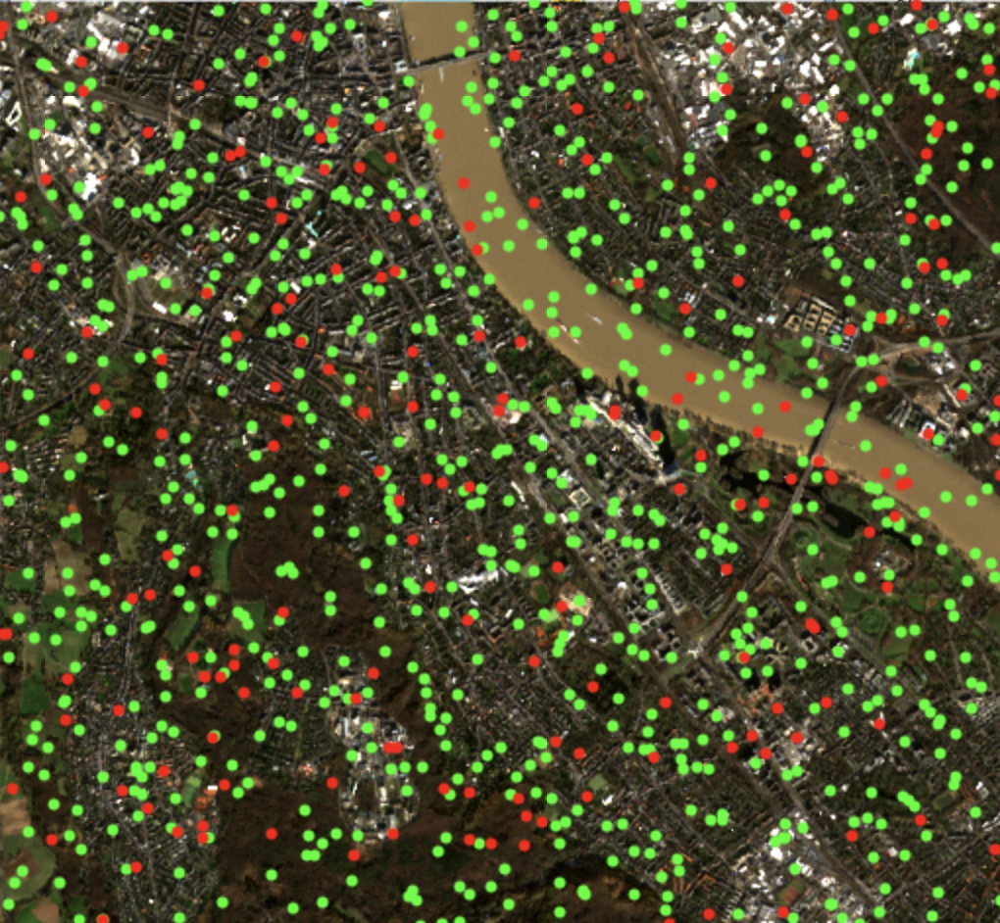
</div>

<div v-click="1" class="compact-table mt-2">

| Pt | Red | Green | Blue | NIR |
|---|---|---|---|---|
| Pt1 | 0.08 | 0.11 | 0.09 | 0.42 |
| Pt2 | 0.21 | 0.19 | 0.15 | 0.05 |
| &vellip; | &vellip; | &vellip; | &vellip; | &vellip; |

</div>
</div>

<div>
<div class="text-sm font-semibold text-blue-800 mb-1 text-center">Target y <span class="font-normal text-gray-500">(e.g., land cover labels)</span></div>

<div class="relative" style="height: 195px;">
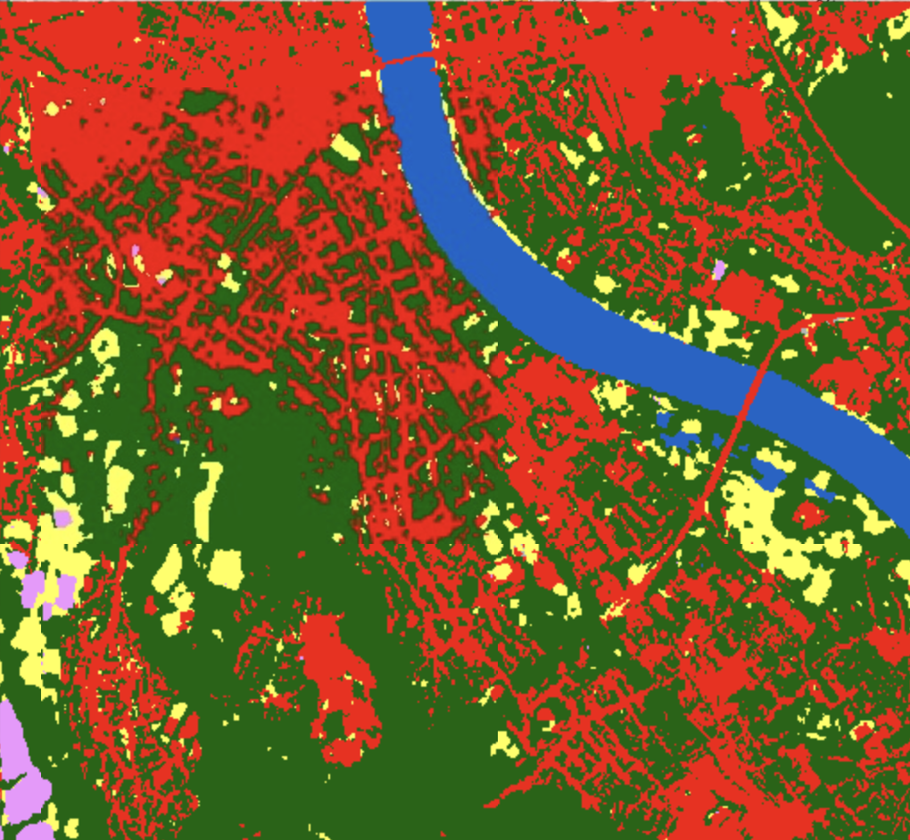

</div>

<div v-click="1" class="compact-table mt-2">

| Pt | Land Cover |
|---|---|
| Pt1 | Vegetation |
| Pt2 | Built-up |
| &vellip; | &vellip; |

</div>
</div>

</div>

<div v-click="2" class="absolute inset-0 top-0">

<div class="grid grid-cols-3 gap-3 items-center">

<div class="col-span-2">
<div class="text-[.66rem] font-semibold text-gray-500 mb-1">Raw bands</div>

<div class="compact-table">

| Pt | Red | Green | Blue | NIR | Land Cover |
|---|---|---|---|---|---|
| Pt1 | 0.08 | 0.11 | 0.09 | 0.42 | **Vegetation** |
| Pt2 | 0.21 | 0.19 | 0.15 | 0.05 | **Built-up** |
| &vellip; | &vellip; | &vellip; | &vellip; | &vellip; | &vellip; |

</div>
</div>

<div style="height: 145px;">
<PlotlyHistogram dataset="green" x-label="Green reflectance" :height="145" />
</div>

</div>

</div>

</div>

<!--
Presenter note: This slide is the bridge from geospatial images to tabular ML data.
Click 1: sample points on both the input image and the target map.
Click 2: collapse both into one tabular dataset, X columns plus y column, one row per point &mdash; the format every classic ML model consumes.
-->

---
layout: bonn-section
sectionColor: "#00457c"
section: geospatial-data-cubes
sectionTitle: Geospatial Data Cubes
---

# Geospatial Data Cubes - Integrating Multi-Modal Data


<div class="bonn-section-citation">
Image by <a href="https://www.researchgate.net/profile/Miguel-Mahecha-2?_tp=eyJjb250ZXh0Ijp7ImZpcnN0UGFnZSI6Il9kaXJlY3QiLCJwYWdlIjoicHVibGljYXRpb24ifX0" target="_blank" rel="noopener noreferrer">Miguel D. Mahecha</a>
</div>

<!--
Begin with the heterogeneous layers from Lecture 2.
This section will establish common coordinate support, stacking, and fixed feature extraction.
-->

---
section: geospatial-data-cubes
---

# Datacubes align Data Spatially and Temporally


<div class="figure-copyright">
Source: Kopp et al. (2019), <a href="https://www.mdpi.com/2306-5729/4/3/94" target="_blank" rel="noopener noreferrer"><em>Achieving the Full Vision of Earth Observation Data Cubes</em></a>, <em>Data</em> 4(3), 94.
</div>

---
section: geospatial-data-cubes
---

# Rasterization and Interpolation

<div class="grid grid-cols-2 gap-10 mt-3">

<div>
<div class="text-sm font-semibold text-blue-800 mb-1 text-center">Rasterization</div>
<RasterizationDiagram />
<div class="mt-3 text-[.64rem] leading-relaxed text-gray-600 text-left">
Open-source tools:<br>
<code class="font-mono text-[.6rem] bg-gray-100 text-gray-700 rounded px-1">gdal_rasterize</code> (CLI)<br>
<code class="font-mono text-[.6rem] bg-gray-100 text-gray-700 rounded px-1">rasterio.features.rasterize</code> (Python)
</div>
</div>

<div>
<div class="text-sm font-semibold text-blue-800 mb-1 text-center">Interpolation</div>

<div class="flex items-center justify-center gap-8 mt-1">
<InterpolationDiagram />

<div class="text-[.75rem]">

<div class="text-[.66rem] font-semibold text-blue-800">Bilinear</div>
<div class="text-[.58rem] text-gray-500 -mt-0.5">2&times;2 neighborhood</div>

$$
\hat{z} = \frac{\sum_{i=1}^{4} z_i / d_i}{\sum_{i=1}^{4} 1 / d_i}
$$

<div class="text-[.66rem] font-semibold text-blue-800 mt-3">Cubic</div>
<div class="text-[.58rem] text-gray-500 -mt-0.5">4&times;4 neighborhood</div>

$$
\hat{z} = \frac{\sum_{i=1}^{16} z_i / d_i^{3}}{\sum_{i=1}^{16} 1 / d_i^{3}}
$$

</div>

</div>

<div class="mt-2 text-[.64rem] leading-relaxed text-gray-600 text-left">
Open-source tools:<br>
<code class="font-mono text-[.6rem] bg-gray-100 text-gray-700 rounded px-1">gdalwarp</code> /
<code class="font-mono text-[.6rem] bg-gray-100 text-gray-700 rounded px-1">gdal_translate</code> (CLI)<br>
<code class="font-mono text-[.6rem] bg-gray-100 text-gray-700 rounded px-1">rasterio.warp.reproject</code> (Python)
</div>
</div>


</div>

<!--
Presenter note: Rasterization converts vector geometries to grid cells using a majority-area rule.
Interpolation resamples values between misaligned grids using distance-weighted (linear) interpolation.
-->

---
layout: bonn-section
sectionColor: "#c4581c"
section: dimensionality
sectionTitle: Dimensionality
---

# Dimensionality

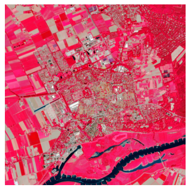

<div class="bonn-section-citation">
Sentinel-2 scene around Wageningen (NL), false-colour composite.
</div>

<!--
Block 3: stacking layers creates very high-dimensional vector spaces. That is a blessing and a curse, and the dimensions are often highly correlated.
-->

---
section: dimensionality
clicks: 3
---

<script setup>
import DimensionsAddUp from './components/DimensionsAddUp.vue'
</script>

# Dimensions Add Up Quickly

<div class="mt-2">
<DimensionsAddUp :clicks="$clicks" />
</div>

<!--
Stacking geospatial layers multiplies the number of variables per location.
Click 1: a monthly time series. Click 2: the 5 × 5 neighbourhood as local context. Click 3: auxiliary layers.
A few innocent design choices already give thousands of dimensions per data point.
-->

---
section: dimensionality
clicks: 2
---

<script setup>
import ImageAsVectors from './components/ImageAsVectors.vue'
</script>

# Example: An Image as a Dataset of Pixels

<div class="mt-3">
<ImageAsVectors variant="pixels" :clicks="$clicks" />
</div>

<div v-click="2" class="mx-auto w-fit mt-1 px-4 py-1 rounded-lg border-2 border-[#00457c] text-[.76rem] text-[#00457c]">
We have <strong>N = HW</strong> pixel data points in 3 dimensions &rarr; no information about the pixel neighbourhood.
</div>

---
section: dimensionality
clicks: 2
---

<script setup>
import ImageAsVectors from './components/ImageAsVectors.vue'
</script>

# Example: An Image as One Data Point

<div class="mt-3">
<ImageAsVectors variant="image" :clicks="$clicks" />
</div>

<div v-click="2" class="mx-auto w-fit mt-1 px-4 py-1 rounded-lg border-2 border-[#00457c] text-[.76rem] text-[#00457c]">
We have <strong>one</strong> image data point in 48 dimensions &rarr; fewer data points, but the neighbourhood is preserved.
</div>

---
section: dimensionality
clicks: 2
---

<script setup>
import VectorSpaceChoice from './components/VectorSpaceChoice.vue'
</script>

# You Design the Vector Space

<div class="mt-2">
<VectorSpaceChoice :clicks="$clicks" />
</div>

<div v-click="2" class="mx-auto w-fit mt-2 px-4 py-1 rounded-lg border-2 border-[#00457c] text-[.78rem] text-[#00457c] font-semibold">
The same data can easily be represented in few or in many dimensions.
</div>

<!--
Takeaway of the two examples: we choose how to turn data into vectors.
Click 1: each pixel is one data point in a 3-D colour space. Many data points, but no information about the neighbourhood.
Click 2: the whole image is one data point in a 48-D space (flatten / vectorize). Few data points, but the neighbourhood is preserved.
Ask: is high dimensionality a blessing or a curse?
-->

---
section: dimensionality
clicks: 2
---

<script setup>
import SeparabilityPlot from './components/SeparabilityPlot.vue'
</script>

# Blessing of Dimensionality: More Information

<div class="grid grid-cols-5 gap-8 mt-4 items-center">

<div class="col-span-3 w-full">
<SeparabilityPlot :clicks="$clicks" />
</div>

<div class="col-span-2 text-[.8rem]">

**More dimensions can make data separable** &ndash; good for classification.

<div v-click="1">

Urban and water pixels overlap in the near-infrared band alone.

</div>

<blockquote v-click="2" class="blockquote2">
Data is not separable in nir alone &ndash; adding red makes it separable.
</blockquote>


</div>

</div>

<!--
Click 1: lift the points into 2-D by adding the red band.
Click 2: a single linear boundary now separates the two classes.
-->

---
section: dimensionality
clicks: 1
---

<script setup>
import PixelPatternBlessing from './components/PixelPatternBlessing.vue'
</script>

# Blessing of Dimensionality: Complex Patterns

<div class="grid grid-cols-4 gap-6 mt-3 items-center">

<div class="col-span-3">
<PixelPatternBlessing :clicks="$clicks" />
</div>

<div class="text-[.8rem]">

Some **complex patterns** and relationships are missed in a low-dimensional colour space.

<div v-click="1">

Pixel **neighbourhoods** reveal spatial patterns that only emerge in the **high-dimensional** representation.

</div>

</div>

</div>

<!--
Click 0: 30 pixels as a dataset of 3-D colour vectors: we see dark and bright, green and grey pixels, but no structure.
Click 1: the same 30 pixels as one 90-dimensional image: the face appears.
-->

---
section: dimensionality
---

# Curse of Dimensionality: Redundancy

<div class="grid grid-cols-2 gap-10 mt-4">

<div class="text-center">

**Remote sensing bands are highly correlated**


<div class="text-[.7rem] text-gray-600 mt-2">Pixels are often bright or dark overall: a very green pixel is usually also very red.</div>

</div>

<div class="text-center">

**Image pixels are spatially correlated**

<div class="relative w-[230px] h-[230px] mx-auto mt-3 overflow-hidden rounded border border-gray-300">
  
  <div class="absolute inset-0" style="background-image: linear-gradient(to right, rgba(255,255,255,.75) 1px, transparent 1px), linear-gradient(to bottom, rgba(255,255,255,.75) 1px, transparent 1px); background-size: 25.6px 25.6px;"></div>
</div>

<div class="text-[.7rem] text-gray-600 mt-2">Neighbouring pixels most likely have a very similar colour.</div>

</div>

</div>

<blockquote class="blockquote4">
Correlated dimensions add redundancy, not information.
</blockquote>

---
section: dimensionality
---

<script setup>
import EmptySpaceSketch from './components/EmptySpaceSketch.vue'
import CurseOfDimensionalityDemo from './components/CurseOfDimensionalityDemo.vue'
</script>

# Curse of Dimensionality: Empty Spaces

<div class="grid grid-cols-2 gap-8 mt-2">

<div class="text-[.78rem]">

A higher-dimensional space becomes **emptier** &ndash; we need **exponentially more data** to fill it evenly.

<EmptySpaceSketch class="mt-2" />

In high dimensions, all samples are **similarly far apart**: distances lose their meaning, and classifiers that rely on "closeness" (e.g. nearest neighbours) become less effective.

</div>

<div>
<CurseOfDimensionalityDemo />
</div>

</div>

<!--
Demo: move the slider from d = 1 to d = 1000. The histogram of pairwise distances narrows around its mean: the nearest and the farthest neighbour become almost equally far away. The relative contrast drops towards zero.
-->

---
section: dimensionality
---

<script setup>
import NearestNeighborCurse from './components/NearestNeighborCurse.vue'
</script>

# Curse of Dimensionality: Nearest Neighbours

<div class="grid grid-cols-5 gap-6 mt-2">

<div class="col-span-3">
<NearestNeighborCurse />
</div>

<div class="col-span-2 text-[.78rem]">

Example: **nearest-neighbour classification**: a test point gets the class of its closest training point.

In high dimensions, almost all points are **far away &mdash; and equally far**.

This weakens the meaning of **&ldquo;closeness&rdquo;**: uninformative dimensions drown the informative ones.

<blockquote class="blockquote4">
More dimensions are not automatically more information.
</blockquote>

</div>

</div>

<!--
Demo: both classes differ only in the first two dimensions. Every extra dimension is pure noise.
At d = 2 almost every test point finds a neighbour of its own class. Move the slider: the distance bars flatten, the orange (wrong) links appear, and the accuracy drops towards chance.
-->

---
section: dimensionality
---

# Blessing and Curse of Dimensionality

<div class="compact-table mt-6 text-[.8rem]">

| Blessing | Curse |
|---|---|
| Extra dimensions can provide new, independent information | Correlated (redundant) dimensions add no information |
| More dimensions help capture complex patterns | More data is needed to fill the emptier high-dimensional space |
| | Distances lose meaning; classifiers become less effective |

</div>

<div class="mx-auto w-fit mt-8 px-5 py-2 rounded-lg border-2 border-[#00457c] text-[.95rem] text-[#00457c] font-semibold">
Keep as many dimensions as necessary, but as few as possible.
</div>

---
section: dimensionality
---

<script setup>
import DataMatrixDiagram from './components/DataMatrixDiagram.vue'
</script>

# Bands as Variables: The Data Matrix

<div class="mt-4">
<DataMatrixDiagram />
</div>

<blockquote class="blockquote3">
Reflectance data has high covariance and correlation between bands.
</blockquote>

<!--
Every pixel is a row, every band is a column (the same X ∈ R^{N×D} as the feature matrix from the data cube). Plotting two band columns against each other shows the correlation.
-->

---
section: dimensionality
---

# Sentinel-2 Bands Are Highly Correlated

<div class="grid grid-cols-2 gap-8 mt-2 items-center">

<div class="text-center">
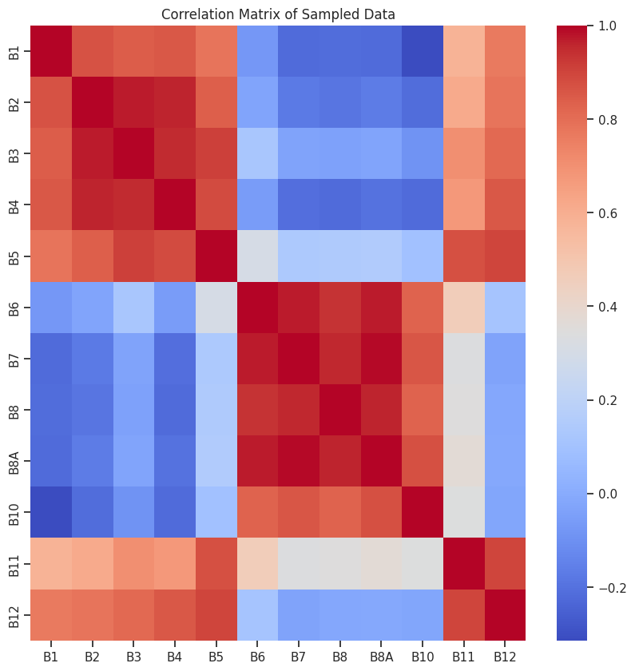
<div class="text-[.66rem] text-gray-600 mt-1">Correlation matrix of 12 Sentinel-2 bands (red = +1, blue = &minus;1)</div>
</div>

<div class="text-[.8rem]">

- **visible** bands (B1&ndash;B5) are highly correlated with each other
- visible bands are **not** correlated with **near-infrared** (B6&ndash;B9)
- visible bands are again correlated with **SWIR** (B11, B12)

<blockquote class="blockquote3">
Many of our dimensions carry (almost) the same information.
</blockquote>

</div>

</div>

<!--
Keep this intuitive: red means two bands rise and fall together. The formal definition of covariance and correlation follows in the PCA block, where we remove exactly this correlation.
-->

---
section: dimensionality
---

# Reducing Dimensions: Two Approaches

<div class="mx-auto w-fit mt-3 px-4 py-1.5 rounded-lg border-2 border-[#00457c] text-[.85rem] text-[#00457c] font-semibold">
Keep as many dimensions as necessary, but as few as possible.
</div>

<div class="grid grid-cols-2 gap-6 mt-4 text-[.72rem]">

<div class="rounded-xl border-2 border-[#00457c] px-4 py-2">

**1 &middot; Feature selection** <span class="text-gray-500">(domain knowledge)</span>

- design features that summarise correlated bands: spectral indices (NDVI, SAVI, EVI, &hellip;), radar ratios
- automatically select the most important features

</div>

<div class="rounded-xl border-2 border-[#0f7d5c] px-4 py-2">

**2 &middot; Dimensionality reduction** <span class="text-gray-500">(domain-agnostic)</span>

- project the data into fewer, less correlated, more informative dimensions
- algorithms: **Principal Component Analysis (PCA)**, Minimum Noise Fraction (MNF), &hellip;

</div>

</div>

<!--
Two ways to get rid of redundant, correlated dimensions:
1. with domain knowledge: we know which bands carry which physical signal and combine them into indices (next block);
2. algorithmically: PCA finds uncorrelated combinations from the data alone, without knowing what the bands mean (last block).
-->

---
layout: bonn-section
sectionColor: "#6a3d9a"
section: domain-knowledge
sectionTitle: Domain Knowledge
---

# Domain Knowledge: Feature Design


<div class="bonn-section-citation">
Chlorophyll-a index from Sentinel-3 OLCI, algal bloom off Scotland (2013-06-14).
</div>

<!--
Approach 1 to reduce correlated dimensions: use what we know about the physics of the signal. Knowing why vegetation and algae reflect light the way they do, we combine a few bands into one meaningful index (optical) or design features and simple rules (radar).
-->

---
section: domain-knowledge
clicks: 1
---

<script setup>
import RedEdgeProfile from './components/RedEdgeProfile.vue'
</script>

# Recap: Vegetation Spectra

<div class="grid grid-cols-2 gap-8 mt-2 items-center">

<div>


<div class="mt-3 rounded-xl bg-[#e7f5e7] border-2 border-[#2e8b3a] px-4 py-2 text-[.74rem]">

1. **absorption** of blue (&asymp;&thinsp;450 nm) and red (&asymp;&thinsp;670 nm) light by chlorophyll a/b
2. strong **reflectance** of near-infrared light (&gt;&thinsp;750 nm) due to scattering in the leaf structure

</div>
</div>

<div>
<RedEdgeProfile :clicks="$clicks" />
<div class="figure-copyright mt-1">
Curran, P. J., Dungan, J. L., &amp; Gholz, H. L. (1990). Exploring the relationship between reflectance red edge and chlorophyll content in slash pine. <em>Tree Physiology</em>, 7(1-4), 33&ndash;48.
</div>
</div>

</div>

<!--
Recap from remote sensing: why does vegetation look the way it does in a spectrum?
The palisade layer absorbs blue and red light for photosynthesis; the spongy layer scatters near-infrared light.
Click 1: the steep transition between red absorption and NIR reflectance is the red edge. Higher chlorophyll content shifts it to longer wavelengths.
This is the domain knowledge behind NDVI (next slide).
-->

---
section: domain-knowledge
clicks: 1
---

<script setup>
import PlotlyHistogram from './components/PlotlyHistogram.vue'
</script>

# Decorrelation by Domain Knowledge: NDVI

<div class="grid grid-cols-3 gap-3 items-center mt-2">

<div class="col-span-2">
<div class="text-[.66rem] font-semibold text-gray-500 mb-1">Raw bands</div>

<div class="compact-table">

| Pt | Red | Green | Blue | NIR | Land Cover |
|---|---|---|---|---|---|
| Pt1 | 0.08 | 0.11 | 0.09 | 0.42 | **Vegetation** |
| Pt2 | 0.21 | 0.19 | 0.15 | 0.05 | **Built-up** |
| &vellip; | &vellip; | &vellip; | &vellip; | &vellip; | &vellip; |

</div>
</div>

<div style="height: 145px;">
<PlotlyHistogram dataset="green" x-label="Green reflectance" :height="145" />
</div>

</div>

<div v-click="1" class="grid grid-cols-3 gap-3 items-center mt-4">

<div class="col-span-2">
<div class="text-[.66rem] font-semibold text-gray-500 mb-1">Engineered feature</div>

<div class="text-[.68rem] text-gray-600 mb-1">

$$
\text{NDVI} = \frac{\text{NIR} - \text{Red}}{\text{NIR} + \text{Red}}
$$

</div>

<div class="compact-table">

| Pt | NDVI | Land Cover |
|---|---|---|
| Pt1 | 0.68 | **Vegetation** |
| Pt2 | -0.62 | **Built-up** |
| &vellip; | &vellip; | &vellip; |

</div>
</div>

<div style="height: 120px;">
<PlotlyHistogram dataset="ndvi" x-label="NDVI" :show-legend="false" :height="120" />
</div>

</div>

<!--
Domain knowledge replaces several correlated bands by one descriptive variable. NDVI uses exactly the vegetation profile: strong red absorption (chlorophyll) and strong NIR reflectance (leaf structure).
Click 1: NDVI combines red and NIR into a single number that separates vegetation from built-up far better than any single raw band.
-->

---
section: domain-knowledge
---

# Photosynthetically Active Pigments

<div class="grid grid-cols-5 gap-8 mt-4 items-center">

<div class="col-span-2 text-[.8rem]">

- **chlorophylls** and other pigments capture the energy of light
- different organisms use **different pigments** for photosynthesis
- terrestrial plants use both **CHL-a and CHL-b**
- algae and cyanobacteria do not: e.g. **phycocyanin**, phycoerythrin, fucoxanthin

<blockquote class="blockquote2">
Each pigment leaves its own fingerprint in the spectrum.
</blockquote>

</div>

<div class="col-span-3">

<div class="figure-copyright mt-1">
Source: <a href="https://www.yorku.ca/planters/photosynthesis/2014_08_15_lab_manual_static_html/index.html" target="_blank" rel="noopener noreferrer">York University, Photosynthesis lab manual</a>
</div>
</div>

</div>

---
section: domain-knowledge
---

# The Red Edge Also Appears in Algae

<div class="grid grid-cols-5 gap-6 mt-2 items-start">

<div class="col-span-3">

<div class="figure-copyright mt-1">
Descloitres, J., Minghelli, A., Steinmetz, F., Chevalier, C., Chami, M., &amp; Berline, L. (2021). Revisited estimation of moderate resolution Sargassum fractional coverage using decametric satellite data (S2-MSI). <em>Remote Sensing</em>, 13(24), 5106.
</div>
</div>

<div class="col-span-2">
<div class="text-[.78rem] font-semibold text-[#00457c] mb-1"><em>Sargassum</em> (macroalgae)</div>
<div class="grid grid-cols-2 gap-2">


</div>
<div class="text-[.72rem] mt-2">The same <strong>red edge</strong> as land vegetation: the vegetation signal is not limited to land.</div>
</div>

</div>

---
section: domain-knowledge
clicks: 2
---

<script setup>
import PigmentIndicators from './components/PigmentIndicators.vue'
</script>

# Indicators for CHL-a and Phycocyanin (PC)

<div class="grid gap-5 mt-1 items-start" style="grid-template-columns: 2.5fr 1fr">

<div>
<PigmentIndicators :clicks="$clicks" />
<div class="figure-copyright mt-1">
Modified from: Legleiter, C. J., et al. (2022). Spectral mixture analysis for surveillance of harmful algal blooms (SMASH). <em>Remote Sensing of Environment</em>, 279, 113089.
</div>
</div>

<div>

<div class="text-[.6rem] text-[#00457c] mt-1"><em>Eucapsis</em>, image: Jason Oyadomari, Michigan Technological University, USA</div>
<div class="text-[.72rem] mt-3" v-click="1">The <strong>shape</strong> of the spectrum around 620&ndash;700 nm distinguishes pigments.</div>
</div>

</div>

<!--
Spectra of two cyanobacteria genera and clear water.
Click 1: the phycocyanin (PC) indicator: the small peak near 630 nm above the line between its neighbours.
Click 2: the chlorophyll-a indicator: the absorption dip near 665 nm.
Band ratios or differences around these features become dedicated indices for harmful algal blooms.
-->

---
section: domain-knowledge
---

<script setup>
import OlciChlBands from './components/OlciChlBands.vue'
</script>

# Exercise: Design a CHL-a Index

<div class="grid gap-6 mt-1 items-start" style="grid-template-columns: 1.25fr 1fr">

<div>
<div class="text-[.76rem] font-semibold text-[#00457c]">Sentinel-3 OLCI bands overlaid with chlorophyll absorbance</div>
<OlciChlBands />

<div class="text-[.74rem] mt-3">

Pick two OLCI bands and combine them like NDVI, as a <strong>normalized difference</strong>:

$$
\text{index} = \frac{b_i - b_j}{b_i + b_j}
$$

</div>

<div class="text-[.64rem] mt-1">
<a href="https://code.earthengine.google.com/5ff8835611e6206a2a659414e781bfa2" target="_blank" rel="noopener noreferrer">Exercise script (Google Earth Engine)</a> &middot;
<a href="https://code.earthengine.google.com/72d18f833aa00e3c38fd1ebb8af2c51b" target="_blank" rel="noopener noreferrer">Solution</a>
</div>
</div>

<div>
<div class="relative">

<div class="absolute left-2 top-1 text-white text-[.7rem] font-semibold">RGB</div>
<div class="absolute left-2 bottom-1 text-white text-[.66rem]">Scotland</div>
</div>
<div class="relative">

<div class="absolute left-2 top-1 text-white text-[.7rem] font-semibold">CHL-a index</div>
<div class="absolute left-2 bottom-1 text-white text-[.66rem]">Scotland</div>
<div class="absolute right-2 bottom-1 text-white text-[.66rem]">Sentinel-3 OLCI, 2013-06-14</div>
</div>
</div>

</div>

<!--
Short exercise: which band combination highlights chlorophyll-a? Hint: compare a band inside a chlorophyll absorption peak with a band where chlorophyll absorbs little.
The solution script computes a normalised difference of two OLCI bands and shows the bloom off Scotland.
Take-away of the block: indices are interpretable and cheap, but each one needs expert knowledge of the target (vegetation, chlorophyll, phycocyanin, ...). The same idea works for radar (next two slides).
-->

---
section: domain-knowledge
---

# Radar Features: Sentinel-1 Polarizations


<div class="grid grid-cols-3 gap-6 mt-2 text-[.7rem]">

<div>

**VV** (co-polarized): surface and double-bounce scattering &rarr; bright in **built-up** areas

</div>

<div>

**VH** (cross-polarized): volume scattering &rarr; sensitive to **vegetation** structure

</div>

<div>

**designed features:** $\text{VV} - \text{VH}$ (a ratio in dB), radar vegetation index $\text{RVI} = \frac{4\,\text{VH}}{\text{VV} + \text{VH}}$

</div>

</div>

<div class="text-[.62rem] text-gray-500 mt-2">Sentinel-1 subset around Bonn &middot; figures: Lab 2 (Geodata Scavenger Hunt), Group 2</div>

<!--
Domain knowledge is not limited to optical spectra. For SAR, we know the scattering mechanisms behind each polarization and combine them into features.
Smooth water reflects the radar pulse away from the sensor (specular reflection): it is dark in VV and VH and stands out in every composite.
RVI uses linear (not dB) backscatter values.
-->

---
section: domain-knowledge
---

# Radar: From Speckle Filter to Water Mask


<div class="grid grid-cols-3 gap-6 mt-2 text-[.7rem]">

<div>

**1 &middot; Lee filter:** removes the grainy **speckle** of SAR images by local averaging, adapted to the local variance &rarr; smooths homogeneous areas, keeps edges

</div>

<div>

**2 &middot; Threshold:** calm water reflects the signal away from the sensor &rarr; very low backscatter: $\text{VV} < -18\,\text{dB}$ &rArr; water

</div>

<div>

**Result:** one designed feature plus one rule gives a **water mask** &ndash; no training data needed

</div>

</div>

<div class="text-[.62rem] text-gray-500 mt-2">Figures: Lab 2 (Geodata Scavenger Hunt), Group 2</div>

<!--
Speckle is interference noise inherent to coherent radar imaging; without filtering, a threshold produces salt-and-pepper noise.
The Lee filter estimates the local mean and variance: in homogeneous regions it outputs the local mean, near edges (high local variance) it keeps the original value.
The threshold (here -18 dB) comes from domain knowledge / the histogram of the scene. Limitations: wind-roughened water, radar shadow and very smooth surfaces such as runways can be misclassified.
-->

---
layout: bonn-section
sectionColor: "#0f7d5c"
section: pca
sectionTitle: PCA
---

# PCA: Decorrelating Data Algorithmically

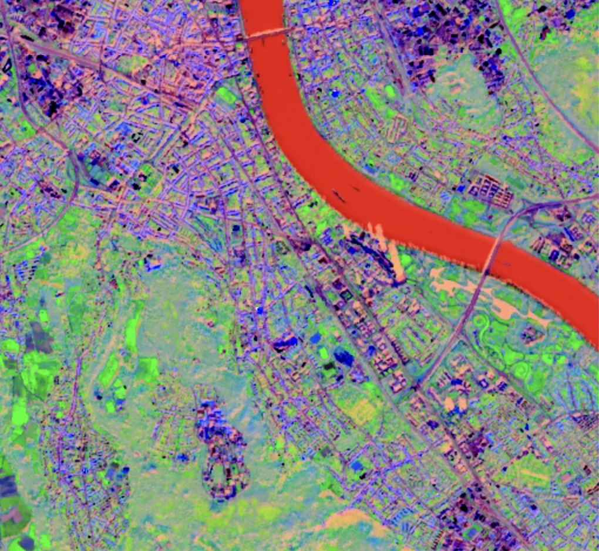

<div class="bonn-section-citation">
Sentinel-2 scene of Bonn, first three principal components as RGB.
</div>

<!--
Approach 2 to reduce correlated dimensions: instead of expert knowledge, let an algorithm find new, uncorrelated combinations of the bands.
Path through the block: measure redundancy (variance, covariance) -> remove it by translating and rotating the data -> how to compute the rotation (eigendecomposition) -> how many components to keep -> what PCA gives us in practice.
Material adapted from the Wageningen Remote Sensing course (GRS-20306).
-->

---
section: pca
---

<script setup>
import StatsDataMatrix from './components/StatsDataMatrix.vue'
import NormalCurve from './components/NormalCurve.vue'
</script>

# (Image) Statistics 1: A Single Variable

<div class="grid grid-cols-2 gap-8 mt-2">

<div class="text-[.84rem] compact-math stats-boxes">

<div class="font-semibold text-[#00457c] mb-1">Statistical moments of one band <em>d</em></div>

<div class="rounded-lg border-2 border-[#00457c] px-3 py-1 mb-2">

**1st moment: mean**

$$
\mu_d = \frac{1}{N} \sum_{n=1}^{N} x_{n,d}
$$

</div>

<div class="rounded-lg border-2 border-[#00457c] px-3 py-1 mb-2">

**2nd moment: variance**

$$
\sigma_d^2 = \frac{1}{N-1} \sum_{n=1}^{N} (x_{n,d} - \mu_d)^2
$$

</div>

<div class="rounded-lg border-2 border-[#00457c] px-3 py-1 mb-2 text-gray-500">

**3rd moment: skewness** &nbsp;&middot;&nbsp; **4th moment: kurtosis**

</div>

</div>

<div>

<div class="w-[62%] mx-auto">
<StatsDataMatrix :dims="1" />
</div>

<div class="w-full mt-2">
<NormalCurve />
</div>

</div>

</div>

<!--
Start with one band (one column of the data matrix): iterate through all N pixels.
The mean is the centre, the variance the spread. For a normal distribution, 68 % of the pixels lie within one standard deviation.
Skewness and kurtosis exist, but PCA only needs the first two moments.
-->

---
section: pca
---

<script setup>
import StatsDataMatrix from './components/StatsDataMatrix.vue'
import CovarianceSketch from './components/CovarianceSketch.vue'
</script>

# (Image) Statistics 2: Two Variables

<div class="grid gap-6 mt-2" style="grid-template-columns: 1fr 1.15fr">

<div class="text-[.84rem] compact-math stats-boxes">

<div class="font-semibold text-[#00457c] mb-1">Statistical moments of two bands <em>d</em><sub>1</sub>, <em>d</em><sub>2</sub></div>

<div class="rounded-lg border-2 border-[#00457c] px-3 py-1 mb-2">

**1st moment: mean vector**

$$
\boldsymbol{\mu} = \begin{pmatrix} \mu_{d_1} \\ \mu_{d_2} \end{pmatrix}, \quad \mu_d = \frac{1}{N} \sum_{n=1}^{N} x_{n,d}
$$

</div>

<div class="rounded-lg border-2 border-[#00457c] px-3 py-1 mb-2">

**2nd moment: covariance matrix**

$$
\mathbf{C} = \begin{pmatrix} \sigma_{d_1}^2 & \sigma_{d_1 d_2} \\ \sigma_{d_2 d_1} & \sigma_{d_2}^2 \end{pmatrix}
$$

with the **covariance**

$$
\sigma_{d_1 d_2} = \sigma_{d_2 d_1} = \frac{1}{N-1} \sum_{n=1}^{N} (x_{n,d_1} - \mu_{d_1})(x_{n,d_2} - \mu_{d_2})
$$

</div>

</div>

<div class="grid grid-cols-2 gap-3 items-center">

<div>
<StatsDataMatrix :dims="2" />
</div>

<div>
<CovarianceSketch />
</div>

</div>

</div>

<!--
Two bands at once: the mean becomes a vector, the variance a 2 × 2 covariance matrix.
The diagonal holds the variances (spread along each axis); the off-diagonal holds the covariance, the diagonal spread of the cloud. It is symmetric.
Positive covariance: both bands rise together (e.g. green and red).
-->

---
section: pca
---

<script setup>
import StatsDataMatrix from './components/StatsDataMatrix.vue'
import CovarianceSketch from './components/CovarianceSketch.vue'
</script>

# (Image) Statistics 3: Many Variables

<div class="grid gap-6 mt-2" style="grid-template-columns: 1fr 1.15fr">

<div class="text-[.84rem] compact-math stats-boxes">

<div class="font-semibold text-[#00457c] mb-1">Statistical moments of all <em>D</em> bands</div>

<div class="rounded-lg border-2 border-[#00457c] px-3 py-1 mb-2">

**1st moment: mean vector**

$$
\boldsymbol{\mu} = (\mu_1, \mu_2, \ldots, \mu_D)
$$

</div>

<div class="rounded-lg border-2 border-[#00457c] px-3 py-1 mb-2">

It is advised to **center** the data matrix:

$$
\tilde{\mathbf{X}} = \mathbf{X} - \boldsymbol{\mu}
$$

</div>

<div class="rounded-lg border-2 border-[#00457c] px-3 py-1 mb-2">

**2nd moment: covariance matrix** ($D \times D$)

$$
\mathbf{C} =
\begin{pmatrix}
\sigma_{1}^2 & \cdots & \sigma_{1 D} \\
\vdots & \ddots & \vdots \\
\sigma_{D 1} & \cdots & \sigma_{D}^2
\end{pmatrix}
= \frac{1}{N-1} \tilde{\mathbf{X}}^\top \tilde{\mathbf{X}}
$$

</div>

</div>

<div class="grid grid-cols-2 gap-3 items-center">

<div>
<StatsDataMatrix dims="D" />
</div>

<div>
<CovarianceSketch />
<div class="text-[.62rem] text-gray-600 text-center mt-1">every pair of bands has such a covariance</div>
</div>

</div>

</div>

<!--
Generalise to D bands: one mean per band, and a D × D covariance matrix with all pairwise covariances.
After centering, the whole matrix is one matrix product: C = X̃ᵀX̃ / (N − 1). This is also why PCA is fast to compute.
-->

---
section: pca
---

# Covariance vs. Correlation Matrix

<div class="grid grid-cols-[1fr_1fr_.9fr] gap-5 mt-2 items-start">

<div class="text-center">
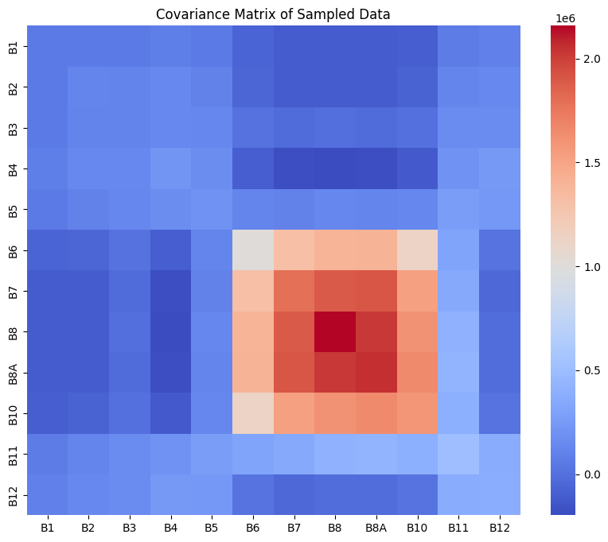
<div class="text-[.66rem] text-gray-600 mt-1">Covariances are dominated by bands with large variance (NIR).</div>
</div>

<div class="text-center">

<div class="text-[.66rem] text-gray-600 mt-1">Correlation = normalised covariance</div>
</div>

<div class="text-[.72rem]">

$$
\rho_{d_1 d_2} = \frac{\sigma_{d_1 d_2}}{\sigma_{d_1}\, \sigma_{d_2}} \in [-1, 1]
$$

Correlation is the **normalised** covariance: it removes the effect of the band variances and makes bands comparable.

</div>

</div>

---
section: pca
---

<script setup>
import CovariancePcaDemo from './components/CovariancePcaDemo.vue'
</script>

# Which Covariance Do We Want?

<div class="mt-1">
<CovariancePcaDemo />
</div>

<div class="text-[.74rem] mt-2 text-gray-700">
For a high <strong>information density</strong>, we want <strong>small covariances</strong>. We can <strong>translate</strong> (center) and <strong>rotate</strong> the data so that the covariances vanish: this is <strong>Principal Component Analysis</strong>.
</div>

<!--
Ask first: what covariance would we like our data to have? Then demo:
- vary the correlation: positive / negative / no covariance
- step 1 centres the data (translation by -μ)
- step 2 rotates onto the principal axes: the off-diagonal entries become 0, the diagonal entries are the eigenvalues
PC 1 is the direction of highest "explained" variance.
-->

---
section: pca
---

<script setup>
import PcaGeometry from './components/PcaGeometry.vue'
</script>

# PCA: A Linear Orthogonal Transformation

<div class="grid grid-cols-2 gap-8 mt-3 items-center">

<div class="text-[.8rem]">

1. **translation**: $\tilde{\mathbf{X}} = \mathbf{X} - \boldsymbol{\mu}$
2. **rotation** by angle $\alpha$

$D$ original **correlated** variables $x_1, \ldots, x_D$

<div class="pl-8 text-[#00457c] font-semibold">&darr; PCA</div>

$D$ new **uncorrelated** variables $p_1, \ldots, p_D$

<blockquote class="blockquote3">
Translation and rotation do not lose information: with all <em>D</em> components, the data can be fully reconstructed.
</blockquote>

</div>

<div>
<PcaGeometry />
</div>

</div>

---
section: pca
---

# PCs Are Uncorrelated &ldquo;Synthetic Bands&rdquo;

<div class="grid grid-cols-[1fr_auto_1fr] gap-6 items-center mt-4">

<div class="text-center">
<div class="text-[.74rem] font-semibold text-[#00457c] mb-1">12 correlated Sentinel-2 bands</div>

</div>

<div class="flex flex-col items-center gap-1 text-[.7rem] text-[#00457c] font-semibold">
  <div class="px-5 py-3 bg-[#00457c] text-white rounded" style="clip-path: polygon(0 0, 100% 25%, 100% 75%, 0 100%);">PCT</div>
  principal component<br>transformation
</div>

<div class="text-center">
<div class="text-[.74rem] font-semibold text-[#0f7d5c] mb-1">(fewer) uncorrelated principal components</div>

</div>

</div>

<div class="text-[.76rem] text-center mt-3">
Same goal as a spectral index &ndash; remove redundancy &ndash; but found <strong>from the data alone</strong>, without knowing what the bands mean.
</div>

<!--
This is the result we are after: the correlation matrix of the principal components is the identity. Every PC carries information that no other PC carries.
Compare with the domain-knowledge block: NDVI also merges correlated bands, but we had to know the physics. PCA only needs the covariance matrix. How to compute the rotation: next slides.
-->

---
section: pca
---

<script setup>
import EigenTransformDemo from './components/EigenTransformDemo.vue'
</script>

# Covariance as a Linear Transformation

<div class="mt-1">
<EigenTransformDemo />
</div>

<div class="mt-1 text-[.68rem] flex items-center gap-6">
<div>

Applied to a unit circle, $\mathbf{C}$ describes the **spread of the data**: $\mathbf{x} = \mathbf{C}\mathbf{a}$.

</div>
<div class="rounded-lg border-2 border-[#00457c] px-3 py-1">

**Eigenvectors** $\mathbf{v}$ and **eigenvalues** $\lambda$ of $\mathbf{C}$: $\;\mathbf{C}\mathbf{v} = \lambda \mathbf{v}$

</div>
</div>

<!--
How do we find the rotation that removes the covariances? The covariance matrix itself tells us.
Rotate the probe vector a. In most directions, Ca points somewhere else. Only along the eigenvectors is Ca a scaled copy of a; the scaling factor is the eigenvalue.
For a symmetric (covariance) matrix, the eigenvectors are orthogonal.
In practice: eigvals, eigvecs = np.linalg.eig(C)
-->

---
section: pca
---

<script setup>
import EvdDiagram from './components/EvdDiagram.vue'
</script>

# Eigendecomposition: Rotation and Scaling

<div class="mt-2">
<EvdDiagram geometry />
</div>

<div class="text-[.74rem] -mt-1">

$\mathbf{C} = \mathbf{V}\mathbf{L}\mathbf{V}^\top$: the rotation $\mathbf{V}^\top \tilde{\mathbf{x}}$ **decorrelates** the data, and the **eigenvalues are the variances** in the rotated space.

</div>

<!--
Any symmetric D×D matrix can be decomposed: eigvals, eigvecs = np.linalg.eig(C).
Read the bottom row from left to right: rotate into the eigenvector frame, scale each axis by its eigenvalue, rotate back.
-->

---
section: pca
---

<script setup>
import EvdDiagram from './components/EvdDiagram.vue'
</script>

# Few Large Eigenvalues: Principal Components

<div class="mt-1">
<EvdDiagram variant="truncated" />
</div>

<div class="grid grid-cols-4 gap-4 mt-1 items-center text-[.64rem] text-center text-gray-600">
<div>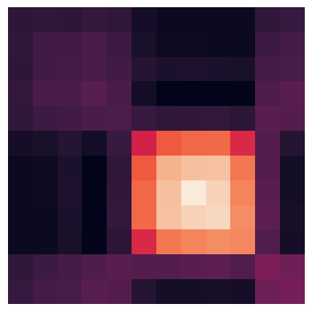covariance of 12 bands</div>
<div>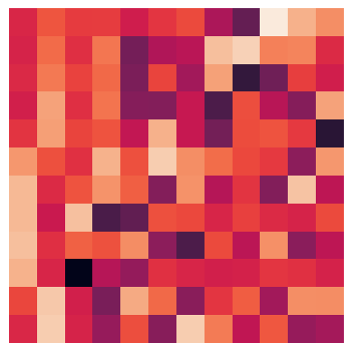eigenvectors</div>
<div>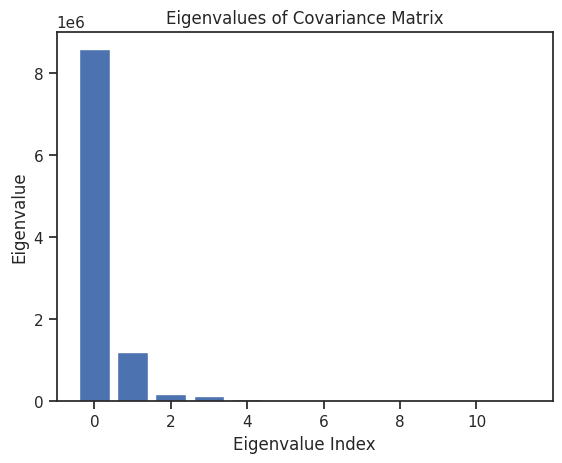eigenvalues: only few are large</div>
<div class="text-left text-[.7rem] text-gray-800">

If bands are strongly correlated, **most eigenvalues are close to 0**: keep only the $P \ll D$ eigenvectors with the largest eigenvalues, the **principal components**.

</div>
</div>

<!--
Terminology: the truncated eigenvector matrix is the PCA or loading matrix P; projecting data onto it gives the scores.
Note: it is common to scale eigenvectors to loading vectors p = v·sqrt(λ).
-->

---
section: pca
---

<script setup>
import PctPipeline from './components/PctPipeline.vue'
</script>

# Principal Component Transformation (PCT)

<div class="mt-3">
<PctPipeline />
</div>

<div class="mx-auto w-fit mt-1 px-4 py-1 rounded-lg border-2 border-[#00457c] text-[.78rem] text-[#00457c]">
Once the eigenvectors are known: <strong>one matrix multiplication</strong> per pixel.
</div>

---
section: pca
---

<script setup>
import ScreePlotDemo from './components/ScreePlotDemo.vue'
</script>

# How Many Principal Components to Choose?

<div class="grid grid-cols-5 gap-8 mt-2 items-start">

<div class="col-span-3">
<ScreePlotDemo />
</div>

<div class="col-span-2 text-[.78rem]">

It depends on the **correlation** in the data: the stronger the correlation, the fewer components are needed.

1. sort the eigenvalues $\lambda_1 \geq \lambda_2 \geq \ldots$
2. compute the **explained variance ratio** $\lambda_i / \sum_j \lambda_j$
3. choose $P$ so that the cumulative ratio exceeds e.g. **90 %, 95 % or 99 %**

<div class="text-[.7rem] text-gray-600 mt-3">
Exercise: eigenvalues (0.4, 0.3, 0.2, 0.1, 0.0). How many PCs for 90 %?
</div>

</div>

</div>

<!--
Solution of the exercise: 3, since 0.4 + 0.3 + 0.2 = 0.9.
Demo: compare the Sentinel-2 spectrum (2 PCs for 90 %) with weakly correlated features (many more PCs needed).
-->

---
section: pca
clicks: 2
---

<script setup>
import PctReconstruction from './components/PctReconstruction.vue'
</script>

# Principal Components &ldquo;Densify&rdquo; Information

<div class="text-[.74rem] text-gray-600 -mt-2">by removing the correlation between bands</div>

<div class="mt-2">
<PctReconstruction :clicks="$clicks" />
</div>

<!--
The inverse transformation reconstructs all 13 bands from only a few principal components.
Click through: 2 PCs explain 93 %, 3 PCs 96 %, 6 PCs 99 % of the variance.
-->

---
section: pca
---

<script setup>
import PcaGeometry from './components/PcaGeometry.vue'
</script>

# Summary: Calculating Principal Components

<div class="grid grid-cols-2 gap-8 mt-3 items-center">

<div class="text-[.76rem]">

The **principal components** $\mathbf{p}_1, \mathbf{p}_2, \ldots$ are the **eigenvectors** with the largest **eigenvalues** of the **covariance matrix** $\mathbf{C}$.

1. center the data matrix: $\tilde{\mathbf{X}} = \mathbf{X} - \boldsymbol{\mu}$ &nbsp;<span class="text-gray-500">($N$ pixels &times; $D$ bands)</span>
2. calculate the $D \times D$ covariance matrix $\mathbf{C}$
3. calculate eigenvectors $\mathbf{v}_1, \ldots, \mathbf{v}_D$ and eigenvalues $\lambda_1, \ldots, \lambda_D$
4. sort by eigenvalue and keep the $P \ll D$ eigenvectors with the largest $\lambda$
5. project $\tilde{\mathbf{X}}$ onto the principal components to obtain the reduced dataset

</div>

<div>
<PcaGeometry />
</div>

</div>

---
section: pca
---

# What Do We Get? Visualization and Analysis

<div class="grid grid-cols-[1fr_auto_1.35fr] gap-6 items-center mt-3">

<div class="relative h-[300px]">
  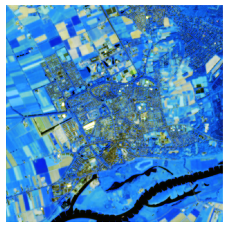
  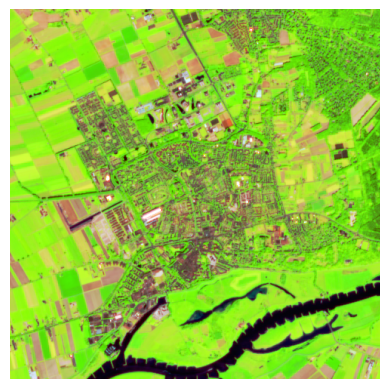
  
  
  <div class="absolute left-0 bottom-0 text-[.68rem] text-gray-600">13 Sentinel-2 bands</div>
</div>

<div class="flex flex-col items-center gap-1 text-[.7rem] text-[#00457c] font-semibold">
  <div class="px-4 py-3 bg-[#00457c] text-white rounded" style="clip-path: polygon(0 0, 100% 25%, 100% 75%, 0 100%);">PCT</div>
  <span class="w-10 h-4 rounded bg-[#e8706f] text-white text-[.55rem] grid place-items-center">PC1</span>
  <span class="w-10 h-4 rounded bg-[#5fbf6a] text-white text-[.55rem] grid place-items-center">PC2</span>
  <span class="w-10 h-4 rounded bg-[#7fb0de] text-white text-[.55rem] grid place-items-center">PC3</span>
</div>

<div class="flex flex-col gap-3">

<div class="rounded-xl border-2 border-[#00457c] p-2 flex gap-3 items-center">
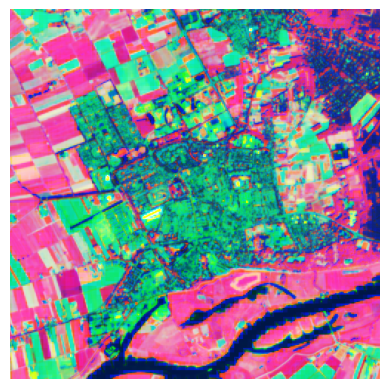
<div class="text-[.72rem]"><strong>Purpose 1: Visualization</strong><br>the 3 most informative principal components shown as red, green and blue</div>
</div>

<div class="rounded-xl border-2 border-[#00457c] p-2">
<div class="text-[.72rem] mb-1"><strong>Purpose 2: Analysis</strong></div>
<div class="grid grid-cols-3 gap-2 text-[.6rem] text-center text-gray-600">
<div>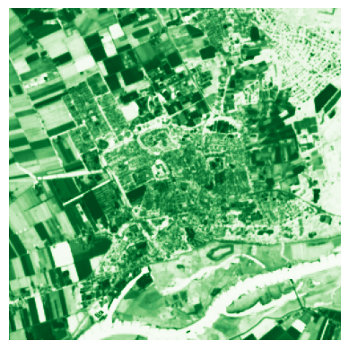PC1 &ndash; &ldquo;vegetation&rdquo;</div>
<div>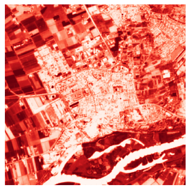PC2 &ndash; &ldquo;built-up &amp; veg.&rdquo;</div>
<div>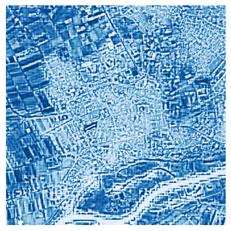PC3 &ndash; &ldquo;built-up&rdquo;</div>
</div>
</div>

</div>

</div>

<!--
The principal component transformation (PCT) maps 13 correlated bands to a few synthetic bands. We use them for visualization (any 3 PCs fit into RGB) and for analysis (each PC highlights a different surface type).
-->

---
section: pca
---

# Purpose 1: Visualization

<div class="grid grid-cols-3 gap-5 mt-2">

<div class="text-center">
<div class="text-[.72rem] font-semibold text-[#00457c] mb-1">True colour: 3 of 12 bands</div>
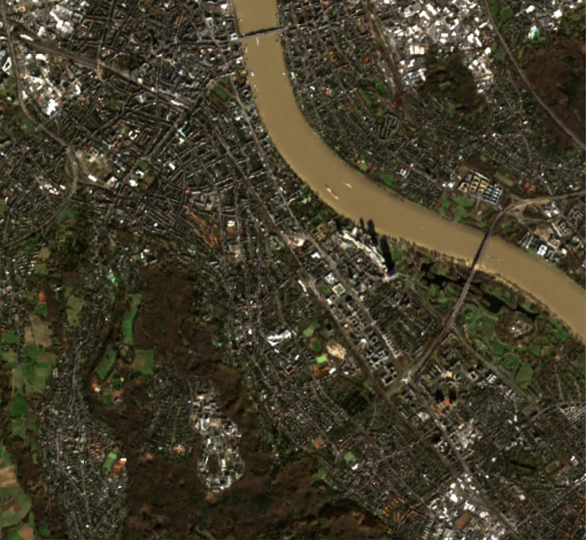
</div>

<div class="text-center">
<div class="text-[.72rem] font-semibold text-[#6a3d9a] mb-1">NDVI: one <em>designed</em> feature</div>
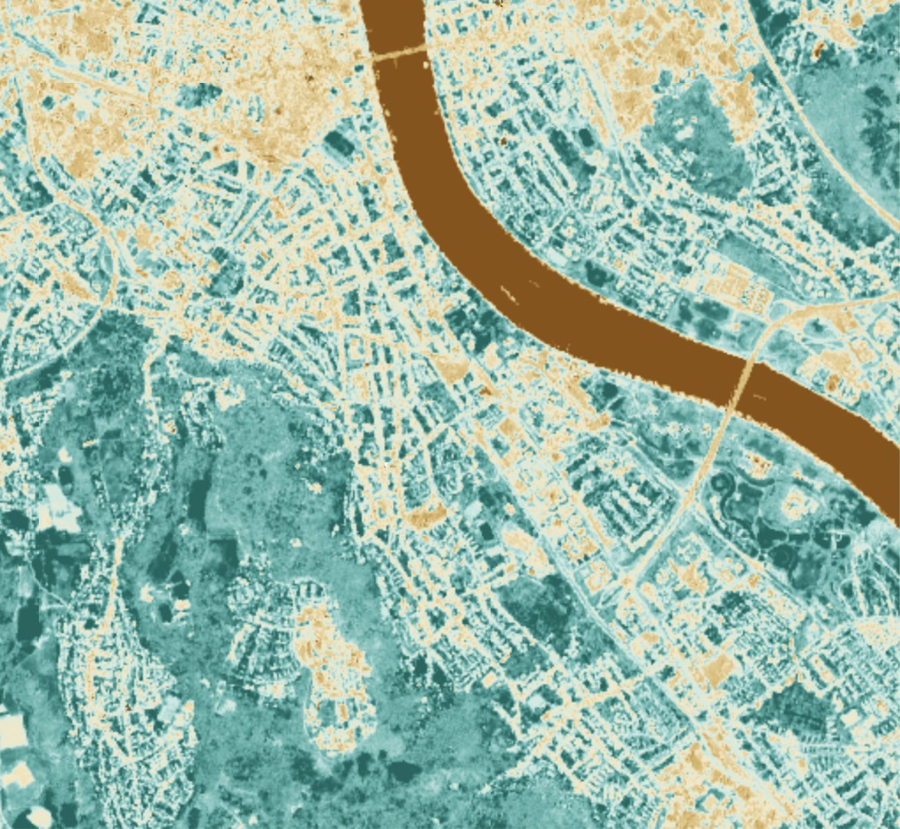
</div>

<div class="text-center">
<div class="text-[.72rem] font-semibold text-[#0f7d5c] mb-1">PC 1&ndash;3 as RGB: <em>learned</em> features</div>

</div>

</div>

<div class="grid grid-cols-3 gap-5 mt-2 text-[.68rem] text-gray-700">
<div>Leaf-off forest and dense city both look dark.</div>
<div>Vegetation (teal) vs. built-up (beige) vs. water (brown) &ndash; one dimension, interpretable.</div>
<div>Water, grassland, forest and built-up separate at once &ndash; no expert knowledge needed, but no physical unit.</div>
</div>

<!--
Same Sentinel-2 scene of Bonn as in the Dataset slide at the beginning of the lecture.
Left: in true colour, the leaf-off forest on the Venusberg and the dense city centre are both dark and hard to tell apart.
Middle: NDVI, the designed feature from the domain-knowledge block, compresses red and NIR into one number.
Right: three principal components computed from all bands show water (red), grassland and sports fields (bright green), forest (pale green) and built-up areas (purple/blue) in one image.
-->

---
section: pca
---

# Purpose 2: Analysis

<div class="grid grid-cols-[1fr_1fr_1.1fr] gap-6 mt-4 items-center">

<div class="text-center">
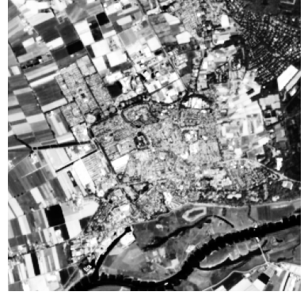
<div class="text-[.7rem] mt-1">PC1 &ndash; &ldquo;grass/crop &amp; healthy vegetation&rdquo;</div>
</div>

<div class="text-center">
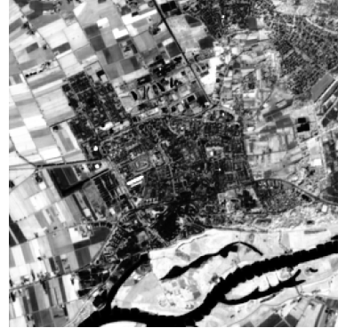
<div class="text-[.7rem] mt-1">PC2 &ndash; &ldquo;built-up / bare soil&rdquo;</div>
</div>

<div class="text-[.78rem]">

Just **2 principal components** already yield a basic land-cover map.

<blockquote class="blockquote2">
Curse of dimensionality: with few labelled data points, classification and regression work much better on fewer dimensions.
</blockquote>

</div>

</div>

---
section: pca
---

# PCA in Practice

<div class="grid grid-cols-5 gap-8 mt-4 items-center">

<div class="col-span-3">

```python
import numpy as np
from sklearn.decomposition import PCA

# demo data: 100 samples, 5 features
X = np.random.rand(100, 5)

# initialize the PCA transform object
pca = PCA(n_components=2)

# fit (eigendecomposition) and apply the transformation
pc_features = pca.fit_transform(X)

pc_features.shape              # (100, 2)
pca.explained_variance_ratio_  # per component
```

</div>

<div class="col-span-2 text-[.8rem]">

Fitting PCA on thousands of pixels with a dozen bands takes **milliseconds**.

Once fitted, transforming new data is **a single matrix multiplication**.

<blockquote class="blockquote3">
The tedious part is computing by hand &ndash; not for the computer.
</blockquote>

<div class="mt-3 text-[.66rem] text-gray-600 rounded-lg border border-gray-300 px-3 py-1.5">
<strong>FYI</strong> &ndash; PCA on whole images in Google Earth Engine:
<a href="https://developers.google.com/earth-engine/guides/arrays_eigen_analysis" target="_blank" rel="noopener noreferrer">eigen-analysis guide</a> &middot;
<a href="https://code.earthengine.google.com/23846e4ae9ab6ee37f9618563d24afbc" target="_blank" rel="noopener noreferrer">example script</a>
</div>

</div>

</div>

<!--
Exam experience from Wageningen: students thought PCA is computationally expensive because the hand calculation is tedious. Emphasize that it is a few lines of code and very fast.
The GEE links are for reference only; there is no exercise on them. The GEE example implements exactly the steps from "Summary: Calculating Principal Components" (center, covariance, eigen-decomposition, projection).
-->

---
section: pca
---

# PCA: Advantages and Limitations

<div class="grid grid-cols-2 gap-8 mt-3 text-[.72rem]">

<div>

<div class="text-[.82rem] font-bold text-[#0f7d5c] mb-1">Advantages</div>

- **dimensionality reduction:** fewer features that keep most of the variance
- **noise reduction:** dropping small components filters noise
- **efficiency:** less memory, faster training
- **uncorrelated features:** can improve model performance
- **visualization:** 2&ndash;3 components fit into a plot or an RGB image

</div>

<div>

<div class="text-[.82rem] font-bold text-[#b02b37] mb-1">Limitations</div>

- **loss of interpretability:** components have no unit and mix all bands
- **assumes linearity:** captures only linear correlations
- **sensitive to scaling:** features with large values dominate &rarr; normalize (less critical for reflectances in the same unit)
- **sensitive to outliers:** outliers pull the principal axes
- **loss of information:** fine-grained information in small components is lost

</div>

</div>

<blockquote class="blockquote3">
PCA is one of the most widely used data analysis tools: remote sensing, image compression, genomics, social sciences, recommender systems.
</blockquote>

<!--
Exam experience: students struggled to name the limitations of PCA. Spend time on the right column.
-->

---
section: pca
---

# Summary and Core Concepts

<div class="flex flex-col gap-2 mt-2 text-[.72rem]">

<div class="grid grid-cols-[13rem_1fr_auto] gap-4 items-center">
<div class="rounded-lg border-2 border-[#5f625f] bg-[#ececec] px-3 py-1.5 text-center">Statistics<br><strong>covariances &amp; correlations</strong></div>
<div>Correlated bands are <strong>redundant</strong>; PCA translates and rotates the data so that the components are <strong>uncorrelated</strong>.</div>
<div class="flex gap-1 items-center">&rarr;</div>
</div>

<div class="grid grid-cols-[13rem_1fr_auto] gap-4 items-center">
<div class="rounded-lg border-2 border-[#c4581c] bg-[#fbd9c8] px-3 py-1.5 text-center">Linear algebra<br><strong>eigenvalue decomposition</strong></div>
<div>The principal components are the <strong>eigenvectors</strong> of the covariance matrix; the eigenvalues are their variances. Applying PCA is <strong>one matrix multiplication</strong>.</div>
<div class="font-mono text-[.7rem] text-[#00457c]">p = P(x &minus; &mu;)</div>
</div>

<div class="grid grid-cols-[13rem_1fr_auto] gap-4 items-center">
<div class="rounded-lg border-2 border-[#00457c] bg-[#dbe9f6] px-3 py-1.5 text-center">Machine learning<br><strong>dimensionality reduction</strong></div>
<div>Few principal components keep most of the variance and serve as compact <strong>features</strong>, e.g. for land-cover classification.</div>
<div class="flex gap-1"></div>
</div>

<div class="grid grid-cols-[13rem_1fr_auto] gap-4 items-center">
<div class="rounded-lg border-2 border-[#2e8b3a] bg-[#d9efd9] px-3 py-1.5 text-center">Remote sensing<br><strong>multi-spectral visualization</strong></div>
<div>Three PCs show high-dimensional Sentinel-2 data in <strong>one RGB image</strong>.</div>

</div>

</div>

<div class="text-[.72rem] mt-3 text-center">
Domain knowledge (indices) and PCA both reduce correlated dimensions: <strong>indices are interpretable</strong>, <strong>PCA needs no expert knowledge</strong>.
</div>

<!--
Wrap-up of the representation story: data cubes give many, correlated dimensions; we reduce them with domain knowledge or algorithmically with PCA.
-->
