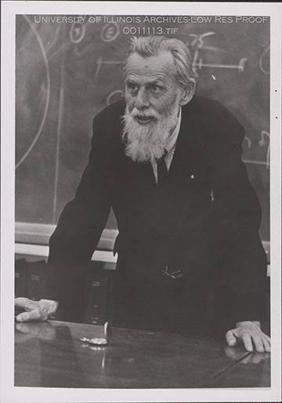

# Learning Feature Representations

## From Linear Regression to Multi-Layer Perceptron

<!--
Connect the heterogeneous data collected in Lecture 2 to classical machine learning.
Frame the lecture question: how can many data sources become one representation for prediction?
-->

---

# Recap Lecture 3 - Feature Design

## By Data, Decorrelation, and Domain Knowledge


<div class="grid grid-cols-2 gap-3 mt-1 justify-center">
  <div>
    <div class="text-[.6rem] font-semibold text-gray-500 mb-1">Raw Band: Green</div>
    <div style="height: 140px; width: 300px;">
      <PlotlyHistogram dataset="green" x-label="Green reflectance" :show-legend="false" />
    </div>
  </div>
  <div class="mx-auto w-[280px]">
    <div class="text-[.6rem] font-semibold text-gray-500 mb-1">Engineered Feature: NDVI</div>
    <div style="height: 140px; width: 300px;">
      <PlotlyHistogram dataset="ndvi" x-label="NDVI" :show-legend="false" />
    </div>
  </div>
</div>

<div class="flex items-center gap-3 text-[.5rem] text-gray-500" style="position: absolute; left: 72px; bottom: 22px;">
  <div class="flex items-center gap-1"><span class="inline-block w-2 h-2 rounded-full" style="background:#2ca02c"></span>Vegetation</div>
  <div class="flex items-center gap-1"><span class="inline-block w-2 h-2 rounded-full" style="background:#d62728"></span>Urban/Built-up</div>
</div>

---

# Today's Lecture - Feature Learning

## From Linear Models to Multi-Layer Perceptrons

<PartTag part="model" />


<div class="grid grid-cols-3 gap-3 mt-4 text-center">
  <div class="rounded-lg px-3 py-3 text-white" style="background: #ed1c24">
    <div class="text-[.6rem] font-semibold uppercase tracking-wide">Block 1</div>
    <div class="mt-1 text-[.82rem] font-semibold">Linear Regression</div>
  </div>
  <div class="rounded-lg px-3 py-3 text-white" style="background: #ed1c24">
    <div class="text-[.6rem] font-semibold uppercase tracking-wide">Block 2</div>
    <div class="mt-1 text-[.82rem] font-semibold">Logistic Regression</div>
  </div>
  <div class="rounded-lg px-3 py-3 text-white" style="background: #ff7900">
    <div class="text-[.6rem] font-semibold uppercase tracking-wide">Block 3</div>
    <div class="mt-1 text-[.82rem] font-semibold">Multilayer Perceptrons</div>
  </div>
</div>

<!--
Brief recap of Lecture 3.
In classic ML, features are hand-designed by domain experts; the model operates on those fixed representations.
Deep learning replaces hand-crafted features with learned representations — this lecture is about how and why that works.
-->

---

# Each Block: Model -> Loss -> Optimization

<div class="grid grid-cols-3 gap-4 mt-7">
  <div class="overflow-hidden rounded-xl border-2" style="border-color: #ed1c24">
    <div class="px-4 py-4 text-white" style="background: #ed1c24">
      <div class="text-[.65rem] font-semibold uppercase tracking-wide">Block 1</div>
      <div class="text-[1rem] font-bold">Linear Regression</div>
    </div>
    <div class="divide-y divide-gray-200">
      <div class="min-h-[88px] p-4">
        <div class="text-[.7rem] font-bold uppercase text-red-700">Model</div>
        <div class="mt-1 text-[.82rem]">ŷ = xw + b</div>
      </div>
      <div class="min-h-[88px] p-4">
        <div class="text-[.7rem] font-bold uppercase text-red-700">Loss</div>
        <div class="mt-1 text-[.82rem]">MAE or MSE</div>
      </div>
      <div class="min-h-[88px] p-4">
        <div class="text-[.7rem] font-bold uppercase text-red-700">Optimization</div>
        <div class="mt-1 text-[.82rem]">Closed-form solution (MSE)</div>
      </div>
    </div>
  </div>

  <div class="overflow-hidden rounded-xl border-2" style="border-color: #ed1c24">
    <div class="px-4 py-4 text-white" style="background: #ed1c24">
      <div class="text-[.65rem] font-semibold uppercase tracking-wide">Block 2</div>
      <div class="text-[1rem] font-bold">Logistic Regression</div>
    </div>
    <div class="divide-y divide-gray-200">
      <div class="min-h-[88px] p-4">
        <div class="text-[.7rem] font-bold uppercase text-red-700">Model</div>
        <div class="mt-1 text-[.82rem]">σ(xw + b) or softmax(Wx + b)</div>
      </div>
      <div class="min-h-[88px] p-4">
        <div class="text-[.7rem] font-bold uppercase text-red-700">Loss</div>
        <div class="mt-1 text-[.82rem]">BCE or CE</div>
      </div>
      <div class="min-h-[88px] p-4">
        <div class="text-[.7rem] font-bold uppercase text-red-700">Optimization</div>
        <div class="mt-1 text-[.82rem]">Gradient descent</div>
      </div>
    </div>
  </div>

  <div class="overflow-hidden rounded-xl border-2" style="border-color: #ff7900">
    <div class="px-4 py-4 text-white" style="background: #ff7900">
      <div class="text-[.65rem] font-semibold uppercase tracking-wide">Block 3</div>
      <div class="text-[1rem] font-bold">Multilayer Perceptrons</div>
    </div>
    <div class="divide-y divide-gray-200">
      <div class="min-h-[88px] p-4">
        <div class="text-[.7rem] font-bold uppercase text-orange-700">Model</div>
        <div class="mt-1 text-[.82rem]">Linear layers + activations</div>
      </div>
      <div class="min-h-[88px] p-4">
        <div class="text-[.7rem] font-bold uppercase text-orange-700">Loss</div>
        <div class="mt-1 text-[.82rem]">MAE / MSE or BCE / CE</div>
      </div>
      <div class="min-h-[88px] p-4">
        <div class="text-[.7rem] font-bold uppercase text-orange-700">Optimization</div>
        <div class="mt-1 text-[.82rem]">Backpropagation + gradient descent</div>
      </div>
    </div>
  </div>
</div>


---
layout: learning-outcomes
mode: before
meeting: lecture-04
section: opening
sectionTitle: Opening
---

# Learning outcomes

<LearningOutcome id="linear-regression-mse">
<strong>Explain</strong> linear regression, from one to many inputs and outputs, and how minimizing MSE fits its parameters.
</LearningOutcome>

<LearningOutcome id="class-probabilities">
<strong>Explain</strong> how sigmoid and softmax turn linear outputs into class probabilities.
</LearningOutcome>

<LearningOutcome id="loss-gradient-descent">
<strong>Explain</strong> how MSE and cross-entropy losses and gradient descent guide parameter learning.
</LearningOutcome>

<LearningOutcome id="neurons-layers">
<strong>Describe</strong> artificial neurons and layers as affine maps followed by nonlinear activations.
</LearningOutcome>

<LearningOutcome id="mlp-representations">
<strong>Explain</strong> how MLPs learn intermediate representations.
</LearningOutcome>

<LearningOutcome id="backpropagation">
<strong>Explain</strong> how backpropagation computes the gradient of the loss for every weight.
</LearningOutcome>

<!--
One outcome for linear regression, two for logistic regression and optimization, three for multilayer perceptrons (incl. backpropagation).
Students rate their understanding now and again at the end of the lecture.
-->

---
layout: bonn-section
sectionColor: "#00457c"
section: linear-regression
sectionTitle: "Linear Regression"
---

# Linear Regression

<div class="bonn-section-image flex items-center justify-center">
  
</div>

<div class="bonn-section-citation">
  Photo: Luca Galuzzi / <a href="https://commons.wikimedia.org/wiki/File:Everest_North_Face_toward_Base_Camp_Tibet_Luca_Galuzzi_2006.jpg" target="_blank" rel="noopener noreferrer">Wikimedia Commons</a>, <a href="https://creativecommons.org/licenses/by-sa/2.5/" target="_blank" rel="noopener noreferrer">CC BY-SA 2.5</a>.
</div>

<!--
Block 1 - How can we learn a transformation from inputs to outputs?
Frame: Model (line -> plane -> y = Xw + b), Loss (residuals, MSE, loss surface), Fitting (guess, gradient descent, closed form, R2). Single output only; K outputs come in block 2, M -> N geometry in block 3.
-->

---

# How much does the temperature change when you hike a mountain?

<PartTag part="model" />

<div class="grid grid-cols-[250px_239px_1fr] gap-7 mt-2 items-center">


<div v-click="1" class="relative mx-auto h-[250px] w-[239px]">
  
  
  <div class="absolute text-[.7rem] font-semibold text-gray-600" style="left: 13%; top: -4%;">temperature <em class="font-serif">y</em></div>
  <div class="absolute text-[.7rem] font-semibold text-gray-600" style="right: 0; top: 92%;">elevation <em class="font-serif">x</em></div>
</div>

<div v-click="2" class="text-[.8rem]">

A simple linear model

$$
\hat{y} = w\,x + b
$$

maps an elevation $x$ to an estimated temperature $\hat{y}$, with the **weight** $w$ (slope) and the **bias** $b$ (y-intercept).

</div>

</div>

<div class="figure-copyright">
Photo: Luca Galuzzi / <a href="https://commons.wikimedia.org/wiki/File:Everest_North_Face_toward_Base_Camp_Tibet_Luca_Galuzzi_2006.jpg" target="_blank" rel="noopener noreferrer">Wikimedia Commons</a>, <a href="https://creativecommons.org/licenses/by-sa/2.5/" target="_blank" rel="noopener noreferrer">CC BY-SA 2.5</a>. Figure: M. Rußwurm &amp; D. Tuia, <em>Linear Regression</em>, ENV-408 course materials, EPFL, 2023.
</div>

<!--
Hiker going up the mountain: every few hundred metres we note elevation and temperature.
Ask: what do you expect? Temperature drops roughly linearly with elevation (~6.5 °C per km).
Click 1: the measurements, temperature y against elevation x.
Click 2: a straight line summarises the trend — the model y-hat = w x + b. Slope w: temperature change per metre of ascent (negative); bias b: temperature at sea level.
-->

---
layout: bonn-two-cols-header
---

# Univariate Linear Regression

<PartTag part="model" />

::left::

<div class="text-[1rem]">

$$
\hat y = w\,x + b
\;=\;
\begin{pmatrix} x & 1 \end{pmatrix}
\begin{pmatrix} w \\ b \end{pmatrix}
$$

</div>

<svg viewBox="0 0 360 220" class="w-full h-[230px] mt-2" role="img" aria-label="Graphical model: input nodes x and 1 connect to the output node y-hat with weights w and b">
  <line x1="78" y1="60" x2="272" y2="110" stroke="#00457c" stroke-width="2.5" />
  <line x1="78" y1="160" x2="272" y2="110" stroke="#9aa0a6" stroke-width="2.5" />
  <text style="font-size:20px;font-family:serif;font-style:italic;line-height:1" x="172" y="72" text-anchor="middle" fill="#00457c">w</text>
  <text style="font-size:20px;font-family:serif;font-style:italic;line-height:1" x="172" y="125" text-anchor="middle" fill="#5f6368">b</text>
  <circle cx="55" cy="60" r="24" fill="#e8f0f8" stroke="#00457c" stroke-width="2.5" />
  <text style="font-size:21px;font-family:serif;font-style:italic;line-height:1" x="55" y="67" text-anchor="middle" fill="#00457c">x</text>
  <circle cx="55" cy="160" r="24" fill="#f1f3f4" stroke="#9aa0a6" stroke-width="2.5" />
  <text style="font-size:21px;font-family:serif;font-style:normal;line-height:1" x="55" y="167" text-anchor="middle" fill="#5f6368">1</text>
  <circle cx="295" cy="110" r="24" fill="#fff1e5" stroke="#ff7900" stroke-width="2.5" />
  <text style="font-size:21px;font-family:serif;font-style:italic;line-height:1" x="295" y="117" text-anchor="middle" fill="#b35500">ŷ</text>
  <text style="font-size:12px;font-family:inherit;font-style:normal;line-height:1" x="55" y="208" text-anchor="middle" fill="#5f6368">inputs</text>
  <text style="font-size:12px;font-family:inherit;font-style:normal;line-height:1" x="295" y="160" text-anchor="middle" fill="#5f6368">output</text>
</svg>

::right::

<div class="text-[.7rem]">

```python
import torch.nn as nn

# 1 input (elevation) -> 1 output (temperature)
model = nn.Linear(1, 1)

print(model.weight)  # w
print(model.bias)    # b

n = sum(p.numel() for p in model.parameters())
print(n)
```

</div>

---

# From Uni- to Multivariate Linear Regression

<PartTag part="model" />

<div class="grid grid-cols-[250px_1fr] gap-6 mt-1 items-start">

<div class="text-[.68rem]">


<div class="mt-2 font-semibold text-blue-800">Same elevation, different temperature</div>

<div class="mt-1 flex items-center gap-2"><span>☀️</span>sun-facing slope: warmer</div>
<div class="mt-0.5 flex items-center gap-2"><span>☁️</span>shaded slope: colder</div>

<div class="mt-2 text-gray-600 leading-snug">

**Slope** and **aspect** (the direction a slope faces) control how much sun a location gets &mdash; extra covariates beyond elevation.

</div>

</div>

<div class="text-[.78rem]">

**Univariate linear regression:** elevation only, two parameters

$$
y = w_1 \overbrace{x_1}^{\text{elevation}} + b
$$

**Multivariate linear regression**

- one input sample $\mathbf{x}_i = (x_1, x_2, x_3, \dots, x_p)$ of $p$ features
- corresponding target $y_i$
- one weight per feature $\mathbf w = (w_1, w_2, \dots, w_p)$, plus one bias $b$

$$
y_i = w_1\overbrace{x_1}^{\text{elevation}} + w_2\overbrace{x_2}^{\text{slope}} + w_3\overbrace{x_3}^{\text{aspect}} + \dots + b = \mathbf w^\top \mathbf{x}_i + b
$$

</div>

</div>

<div class="figure-copyright">
Photo: Luca Galuzzi / <a href="https://commons.wikimedia.org/wiki/File:Everest_North_Face_toward_Base_Camp_Tibet_Luca_Galuzzi_2006.jpg" target="_blank" rel="noopener noreferrer">Wikimedia Commons</a>, <a href="https://creativecommons.org/licenses/by-sa/2.5/" target="_blank" rel="noopener noreferrer">CC BY-SA 2.5</a>.
</div>

<!--
Back to the hiker: two spots at the same elevation can differ by several degrees. A south-facing slope (northern hemisphere) gets much more direct sun than a north-facing one; a steep slope facing the sun gets even more.
Elevation alone cannot explain this - the residuals of the univariate model contain the sun-exposure effect. Adding slope and aspect as features lets the model capture it: one weight per feature.
Note: aspect is an angle; in practice we encode it e.g. as northness = cos(aspect) to keep the relation (roughly) linear.
-->

---
layout: bonn-two-cols-header
---

# Multivariate Linear Regression

<PartTag part="model" />

::left::

<div class="text-[.85rem]">

$$
\begin{aligned}
\hat y &= w_1 x_1 + w_2 x_2 + w_3 x_3 + b \\
&= \begin{pmatrix} x_1 & x_2 & x_3 & 1 \end{pmatrix} \begin{pmatrix} w_1 & w_2 & w_3 & b \end{pmatrix}^{\!\top}
\end{aligned}
$$

</div>

<svg viewBox="0 0 360 250" class="w-full h-[215px] mt-1" role="img" aria-label="Graphical model: input nodes x1 (elevation), x2 (slope), x3 (aspect) and 1 connect to the output node y-hat with weights w1, w2, w3 and b">
  <line x1="130" y1="36" x2="288" y2="126" stroke="#00457c" stroke-width="2.5" />
  <line x1="130" y1="96" x2="288" y2="126" stroke="#00457c" stroke-width="2.5" />
  <line x1="130" y1="156" x2="288" y2="126" stroke="#00457c" stroke-width="2.5" />
  <line x1="130" y1="216" x2="288" y2="126" stroke="#9aa0a6" stroke-width="2.5" />
  <text style="font-size:17px;font-family:serif;font-style:italic;line-height:1;paint-order:stroke;stroke:white;stroke-width:4px" x="196" y="67" text-anchor="middle" fill="#00457c">w₁</text>
  <text style="font-size:17px;font-family:serif;font-style:italic;line-height:1;paint-order:stroke;stroke:white;stroke-width:4px" x="196" y="102" text-anchor="middle" fill="#00457c">w₂</text>
  <text style="font-size:17px;font-family:serif;font-style:italic;line-height:1;paint-order:stroke;stroke:white;stroke-width:4px" x="196" y="136" text-anchor="middle" fill="#00457c">w₃</text>
  <text style="font-size:17px;font-family:serif;font-style:italic;line-height:1;paint-order:stroke;stroke:white;stroke-width:4px" x="196" y="171" text-anchor="middle" fill="#5f6368">b</text>
  <circle cx="110" cy="36" r="21" fill="#e8f0f8" stroke="#00457c" stroke-width="2.5" />
  <text style="font-size:19px;font-family:serif;font-style:italic;line-height:1" x="110" y="42" text-anchor="middle" fill="#00457c">x₁</text>
  <text style="font-size:12px;font-family:inherit;font-style:normal;line-height:1" x="80" y="40" text-anchor="end" fill="#5f6368">elevation</text>
  <circle cx="110" cy="96" r="21" fill="#e8f0f8" stroke="#00457c" stroke-width="2.5" />
  <text style="font-size:19px;font-family:serif;font-style:italic;line-height:1" x="110" y="102" text-anchor="middle" fill="#00457c">x₂</text>
  <text style="font-size:12px;font-family:inherit;font-style:normal;line-height:1" x="80" y="100" text-anchor="end" fill="#5f6368">slope</text>
  <circle cx="110" cy="156" r="21" fill="#e8f0f8" stroke="#00457c" stroke-width="2.5" />
  <text style="font-size:19px;font-family:serif;font-style:italic;line-height:1" x="110" y="162" text-anchor="middle" fill="#00457c">x₃</text>
  <text style="font-size:12px;font-family:inherit;font-style:normal;line-height:1" x="80" y="160" text-anchor="end" fill="#5f6368">aspect</text>
  <circle cx="110" cy="216" r="21" fill="#f1f3f4" stroke="#9aa0a6" stroke-width="2.5" />
  <text style="font-size:19px;font-family:serif;font-style:normal;line-height:1" x="110" y="222" text-anchor="middle" fill="#5f6368">1</text>
  <circle cx="310" cy="126" r="22" fill="#fff1e5" stroke="#ff7900" stroke-width="2.5" />
  <text style="font-size:20px;font-family:serif;font-style:italic;line-height:1" x="310" y="133" text-anchor="middle" fill="#b35500">ŷ</text>
  <text style="font-size:12px;font-family:inherit;font-style:normal;line-height:1" x="310" y="166" text-anchor="middle" fill="#5f6368">temperature</text>
</svg>

::right::

<div class="text-[.7rem]">

```python
import torch.nn as nn

# elevation, slope, aspect -> temperature
model = nn.Linear(3, 1)

print(model.weight.shape)  # (1, 3): w1, w2, w3
print(model.bias.shape)    # (1,):   b

n = sum(p.numel() for p in model.parameters())
print(n)                   # 4
```

</div>

<blockquote class="blockquote2 mt-4 text-[.75rem]">

Same graph, more input nodes: one weight per feature, still one bias. Only <code>in_features</code> changes.

</blockquote>

<!--
Compare with the univariate slide: the constant input 1 still carries the bias; each new feature adds one node and one edge, i.e. one weight.
nn.Linear(3, 1) stores the weights as a 1 x 3 matrix (out_features x in_features) - this row-vector view is exactly the next topic.
Parameters: 3 weights + 1 bias = 4. In general p features -> p + 1 parameters.
-->

---

# Geometry: From a Line to a Plane

<PartTag part="model" />

<div class="mt-1">
<RegressionPlaneDemo :width="330" :height="250" />
</div>

<blockquote class="blockquote2 mt-3 text-[.75rem]">

$p$ features → a **hyperplane** in $p{+}1$ dimensions. The second feature (slope) explains much of the spread that elevation alone leaves in the residuals.

</blockquote>

<!--
Same synthetic data on both sides (temperature ~ elevation + slope). Left: univariate OLS, the grey residuals are large because slope is ignored. Right: bivariate OLS plane, drag to rotate; residuals shrink and R2 jumps.
With three features we cannot draw it any more, but the algebra is identical: a hyperplane in feature space x target.
-->

---
layout: bonn-two-cols-header
---

# Many Regressions in Parallel: $\mathbb{R}^N \to \mathbb{R}^M$

<PartTag part="model" />

::left::

<div class="text-[.78rem]">

$$
\underbrace{\begin{pmatrix} \hat y_1 \\ \hat y_2 \end{pmatrix}}_{\hat{\mathbf y} \in \mathbb{R}^M}
=
\underbrace{\begin{pmatrix}
\textcolor{#ff7900}{w_{11}} & \textcolor{#ff7900}{w_{12}} & \textcolor{#ff7900}{w_{13}} \\
\textcolor{#7b3fa0}{w_{21}} & \textcolor{#7b3fa0}{w_{22}} & \textcolor{#7b3fa0}{w_{23}}
\end{pmatrix}}_{\mathbf W \in \mathbb{R}^{M \times N}}
\underbrace{\begin{pmatrix} x_1 \\ x_2 \\ x_3 \end{pmatrix}}_{\mathbf x \in \mathbb{R}^N}
+
\underbrace{\begin{pmatrix} \textcolor{#ff7900}{b_1} \\ \textcolor{#7b3fa0}{b_2} \end{pmatrix}}_{\mathbf b \in \mathbb{R}^M}
$$

</div>

<svg viewBox="0 0 360 225" class="w-full h-[205px] mt-1" role="img" aria-label="Graphical model: inputs x1 (elevation), x2 (slope), x3 (aspect) and 1 are fully connected to two outputs, y-hat 1 (temperature, orange edges) and y-hat 2 (snow depth, purple edges)">
  <line x1="128" y1="30" x2="280" y2="72" stroke="#ff7900" stroke-width="2.2" stroke-opacity="0.8" />
  <line x1="128" y1="85" x2="280" y2="72" stroke="#ff7900" stroke-width="2.2" stroke-opacity="0.8" />
  <line x1="128" y1="140" x2="280" y2="72" stroke="#ff7900" stroke-width="2.2" stroke-opacity="0.8" />
  <line x1="128" y1="195" x2="280" y2="72" stroke="#ff7900" stroke-width="2.2" stroke-opacity="0.8" stroke-dasharray="5 4" />
  <line x1="128" y1="30" x2="280" y2="158" stroke="#7b3fa0" stroke-width="2.2" stroke-opacity="0.8" />
  <line x1="128" y1="85" x2="280" y2="158" stroke="#7b3fa0" stroke-width="2.2" stroke-opacity="0.8" />
  <line x1="128" y1="140" x2="280" y2="158" stroke="#7b3fa0" stroke-width="2.2" stroke-opacity="0.8" />
  <line x1="128" y1="195" x2="280" y2="158" stroke="#7b3fa0" stroke-width="2.2" stroke-opacity="0.8" stroke-dasharray="5 4" />
  <circle cx="110" cy="30" r="19" fill="#e8f0f8" stroke="#00457c" stroke-width="2.5" />
  <text style="font-size:18px;font-family:serif;font-style:italic;line-height:1" x="110" y="36" text-anchor="middle" fill="#00457c">x₁</text>
  <text style="font-size:12px;font-family:inherit;font-style:normal;line-height:1" x="82" y="34" text-anchor="end" fill="#5f6368">elevation</text>
  <circle cx="110" cy="85" r="19" fill="#e8f0f8" stroke="#00457c" stroke-width="2.5" />
  <text style="font-size:18px;font-family:serif;font-style:italic;line-height:1" x="110" y="91" text-anchor="middle" fill="#00457c">x₂</text>
  <text style="font-size:12px;font-family:inherit;font-style:normal;line-height:1" x="82" y="89" text-anchor="end" fill="#5f6368">slope</text>
  <circle cx="110" cy="140" r="19" fill="#e8f0f8" stroke="#00457c" stroke-width="2.5" />
  <text style="font-size:18px;font-family:serif;font-style:italic;line-height:1" x="110" y="146" text-anchor="middle" fill="#00457c">x₃</text>
  <text style="font-size:12px;font-family:inherit;font-style:normal;line-height:1" x="82" y="144" text-anchor="end" fill="#5f6368">aspect</text>
  <circle cx="110" cy="195" r="19" fill="#f1f3f4" stroke="#9aa0a6" stroke-width="2.5" />
  <text style="font-size:18px;font-family:serif;font-style:normal;line-height:1" x="110" y="201" text-anchor="middle" fill="#5f6368">1</text>
  <circle cx="300" cy="72" r="21" fill="#fff1e5" stroke="#ff7900" stroke-width="2.5" />
  <text style="font-size:19px;font-family:serif;font-style:italic;line-height:1" x="300" y="79" text-anchor="middle" fill="#ff7900">ŷ₁</text>
  <text style="font-size:12px;font-family:inherit;font-style:normal;line-height:1" x="300" y="110" text-anchor="middle" fill="#5f6368">temperature</text>
  <circle cx="300" cy="158" r="21" fill="#f3ecf8" stroke="#7b3fa0" stroke-width="2.5" />
  <text style="font-size:19px;font-family:serif;font-style:italic;line-height:1" x="300" y="165" text-anchor="middle" fill="#7b3fa0">ŷ₂</text>
  <text style="font-size:12px;font-family:inherit;font-style:normal;line-height:1" x="300" y="196" text-anchor="middle" fill="#5f6368">snow depth</text>
</svg>

::right::

<div class="text-[.7rem]">

```python
import torch.nn as nn

# 3 features -> 2 targets
model = nn.Linear(3, 2)

print(model.weight.shape)  # (2, 3) = (M, N)
print(model.bias.shape)    # (2,)

n = sum(p.numel() for p in model.parameters())
print(n)                   # 2*3 + 2 = 8
```

</div>

<blockquote class="blockquote2 mt-3 text-[.75rem]">

Each **row** of $\mathbf W$ is one multivariate regression; $M$ run **in parallel** on the same input. Together: a **linear transformation** with $M \cdot N + M$ parameters.

</blockquote>

<!--
Generalize step by step: 1 -> 1 (univariate), N -> 1 (multivariate), now N -> M.
Read the graph per color: the orange edges alone are the multivariate regression for temperature (row 1 of W), the purple edges the one for snow depth (row 2). Same inputs, independent weights.
nn.Linear(N, M) is exactly this: weight has shape (M, N) - out_features x in_features - and bias has M entries.
This is the building block for everything that follows: logistic regression adds a sigmoid / softmax on top (block 2), an MLP layer adds a non-linearity and stacks them (block 3).
-->

---

# Geometry: One Plane per Target

<PartTag part="model" />

<div class="-mt-2">
<TwoPlaneDemo :width="470" :height="320" />
</div>

<blockquote class="blockquote2 mt-1 text-[.75rem]">

Same inputs, two targets: each row of $\mathbf W$ fits **its own plane** &mdash; $M$ targets, $M$ hyperplanes.

</blockquote>

<!--
Mirror of the line -> plane slide, now with M = 2 outputs. Same 30 locations (elevation x1, slope x2) for both targets; targets standardized so they share the vertical axis.
Temperature drops with elevation and rises on sunny slopes; snow depth does the opposite. Two independent OLS fits = the two rows of W from the previous slide.
Both planes sit over the same floor (elevation x slope): same inputs, two sets of weights. Drag to rotate; the planes cross because the targets react oppositely to elevation and slope.
Buttons: "elevation view" looks along the slope axis (target vs. elevation, like the 1D plot); "top view" looks down on the floor - every orange dot sits inside a purple ring: both targets are measured at exactly the same inputs.
-->

---

# Linear Projection: From N to M Dim Spaces

<PartTag part="model" />

<div class="mt-1">
<LinearMapDemo :size="250" />
</div>

<blockquote class="blockquote2 mt-2 text-[.75rem]">

$\mathbf W\mathbf x + \mathbf b$ maps every location from the **input space** to a point in the **output space**; each input axis lands on a column of $\mathbf W$.

</blockquote>

<!--
Same model as the previous slides, now seen as one map between two spaces rather than as two separate regressions.
Left: 40 locations in feature space (rotate it). Right: their predictions. Colour = elevation, so you can follow points across; hover one to see x and its image y-hat.
The three arrows: moving one unit along an input axis moves the prediction by the corresponding column of W - elevation pushes toward colder (and a bit snowier), aspect mostly toward more snow, slope toward warmer.
3 -> 2 dimensions: the map compresses information (different inputs can land on the same output). This "transform the space" view is the language of block 3, where layers stack such maps with non-linearities in between.
-->
---

# Quiz: How Much Colder per 100 m?

<PartTag part="model" />

<div class="grid grid-cols-[220px_1fr] gap-6 mt-1 items-center">


<div class="text-[.85rem]">

Back to our hiker: $\hat y = w\,x + b$ with elevation $x$ and temperature $\hat y$.

The slope $w$ answers the question: **how many degrees does it get colder for every 100 m of ascent?**

<div v-click="1" class="mt-2 text-[#b02b37]">

On average about **0.65 °C per 100 m**, i.e. $w \approx -6.5\,^\circ\text{C}/\text{km}$ &mdash; the slope our regression should recover from data.

</div>

</div>

</div>

<div class="flex justify-center mt-1">
  <div class="relative" style="width: 640px;">
    <UnderstandingPulse
      full-width
      session-id="lecture-4"
      poll-id="lapse-rate-quiz"
      left-label="0 °C"
      right-label="2 °C"
      instruction="Click on the line: temperature drop per 100 m of ascent"
    />
    <div class="absolute text-[.6rem] text-gray-500 -translate-x-1/2" style="left:188.8px; top:73.8px;">0.5</div>
    <div class="absolute bg-gray-400" style="left:188.3px; top:93.8px; width:1px; height:12px;"></div>
    <div class="absolute text-[.6rem] text-gray-500 -translate-x-1/2" style="left:320.0px; top:73.8px;">1</div>
    <div class="absolute bg-gray-400" style="left:319.5px; top:93.8px; width:1px; height:12px;"></div>
    <div class="absolute text-[.6rem] text-gray-500 -translate-x-1/2" style="left:451.2px; top:73.8px;">1.5</div>
    <div class="absolute bg-gray-400" style="left:450.7px; top:93.8px; width:1px; height:12px;"></div>
    <div v-click class="absolute pointer-events-none" style="left:227.2px; top:53.8px; width:2px; height:58px; background:#b02b37;"></div>
    <div v-click="1" class="absolute pointer-events-none whitespace-nowrap -translate-x-1/2 text-[.68rem] font-bold" style="left:228.2px; top:35.8px; color:#b02b37;">≈ 0.65 °C</div>
  </div>
</div>

<div class="figure-copyright">
Photo: Luca Galuzzi / <a href="https://commons.wikimedia.org/wiki/File:Everest_North_Face_toward_Base_Camp_Tibet_Luca_Galuzzi_2006.jpg" target="_blank" rel="noopener noreferrer">Wikimedia Commons</a>, <a href="https://creativecommons.org/licenses/by-sa/2.5/" target="_blank" rel="noopener noreferrer">CC BY-SA 2.5</a>.
</div>

<!--
Separation slide before the loss part: let the class vote first (live pulse), then click to reveal.
Answer: the environmental lapse rate of the standard atmosphere is 6.5 °C per km = 0.65 °C per 100 m. Real values vary: dry air cools ~1 °C / 100 m (dry adiabatic), saturated air ~0.5 °C / 100 m; inversions can even flip the sign.
Transition: we know the answer from physics - but how would we estimate w (and b) from measured data alone? That is the next question.
-->

---

# How to estimate $w$ and $b$ from data?

<PartTag part="loss" />

<div class="grid grid-cols-2 gap-8 mt-6 items-center">

<div class="flex justify-center">
<RegressionScatterDemo variant="points" x-label="elevation x" y-label="temperature y" :clicks="$clicks" />
</div>

<div>

We have a dataset of data samples $(x_i, y_i)$.

<blockquote v-click class="blockquote3 mt-4">

<strong>Problem:</strong> how do we find good model parameters $w$,  $b$ for our linear model $f(x; w,  b) = w\,x +  b$?

</blockquote>

</div>

</div>

---

# Why Don't the Points Lie on the Line?

<PartTag part="loss" />

<div class="grid grid-cols-2 gap-8 mt-6 items-center">

<div class="flex justify-center">
<RegressionScatterDemo variant="error-band" x-label="elevation x" y-label="temperature y" />
</div>

<div class="flex items-center gap-5">

<div class="flex-1">

$$
y_i = w\,x_i + b \pm \overbrace{\varepsilon}^{\text{error}}
$$

with the error $\varepsilon$ as a random variable &mdash; the model never fits the data perfectly.

Measurement noise is one source: not every thermometer is precise.

</div>

<figure class="flex flex-col items-center m-0">
  
  <figcaption class="mt-1 w-[130px] text-center text-[.6rem] italic text-gray-500 leading-tight">The hiker took a bad thermometer</figcaption>
</figure>

</div>

</div>

<div class="figure-copyright">
Photo: Hustvedt / <a href="https://commons.wikimedia.org/wiki/File:Galileo_Thermometer_24_degrees.jpg" target="_blank" rel="noopener noreferrer">Wikimedia Commons</a>, <a href="https://creativecommons.org/licenses/by-sa/3.0/" target="_blank" rel="noopener noreferrer">CC BY-SA 3.0</a>.
</div>

---

# Residuals and Mean Absolute Error

<PartTag part="loss" />

<div class="grid grid-cols-2 gap-8 mt-6 items-center">

<div class="flex justify-center">
<RegressionScatterDemo variant="residual-segments" x-label="elevation x" y-label="temperature y" :clicks="$clicks" />
</div>

<div>

Concretely, the error &mdash; the "residual" $\varepsilon_i$ &mdash; for each sample $i$:

$$
\varepsilon_i = \hat{y}_i - y_i
$$

<div v-click>

We want small residuals over the whole dataset. Positive and negative residuals would cancel, so we average their absolute values: the **Mean Absolute Error**

$$
\text{MAE}(\mathcal{D}; w, b) = \frac{1}{N} \sum_{i=1}^N \vert \hat{y}_i - y_i \vert
$$

</div>

</div>

</div>

---

# Mean Squared Error (MSE)

<PartTag part="loss" />

<div class="grid grid-cols-2 gap-8 mt-6 items-center">

<div class="flex justify-center">
<RegressionScatterDemo variant="residual-squares" x-label="x" y-label="y" />
</div>

<div>

$$
\text{MSE}(\mathcal{D}; w, b) = \frac{1}{2N} \sum_{i=1}^N (\hat{y}_i - y_i)^2
$$

Punishes large errors with a square penalty.

<blockquote class="blockquote2 mt-3">
<strong>Geometric intuition:</strong> find a model that minimizes the total area of these squares.
</blockquote>

</div>

</div>

---

# The Loss $\mathcal{L}(w;\, \mathcal{D})$ as a Function of $w$

<PartTag part="loss" />

<div class="mt-1">
<SlopeLossDemo :b="1" :initial-w="0" loss="mae" single />
</div>

<div class="grid grid-cols-2 gap-4 mt-1 text-[.7rem]">

<blockquote v-click class="blockquote2 my-0">

**① Big errors matter most:** squared penalty &mdash; a little off is fine, very off is fatal.

</blockquote>

<blockquote v-click class="blockquote2 my-0">

**② Smooth gradients:** MAE has constant slopes and kinks; MSE is smooth &mdash; needed to find good parameters (later).

</blockquote>

</div>

<!--
Usage: bias b fixed. Change w by dragging the line or hovering the loss plot; in "one point" mode click a point to select it.
Start with MAE on one point: the loss is |w x_i + b - y_i|, a perfect V (triangle) with its tip where the line passes through the point.
Switch to all points: the MAE is the average of four such Vs -> piecewise linear, with a kink wherever the line passes through a point.
Switch to MSE: each point gives a parabola instead of a V; their average is again a smooth parabola. The squares on the left are the squared residuals.
MSE is smooth and has a unique minimum we can compute in closed form; MAE is more robust to outliers but has corners.
Takeaway 1 (click): an error of 2 costs 4x as much as an error of 1 under MSE, only 2x under MAE.
Takeaway 2 (click): the MAE gradient is +-const and flips abruptly at the kink, so it gives no hint how close the minimum is; the MSE gradient shrinks smoothly toward the minimum.
-->
---

# Searching over $b$ and $w$ spans a 2D Loss Surface

<PartTag part="loss" />

<div class="grid grid-cols-[1fr_2fr] gap-6 mt-2 items-center">

<div class="text-[.78rem]">

The loss $\mathcal{L}(\mathcal{D}; w, b)$ depends on

- the **model** $f(x) = w\,x + b$
- the **loss function**, e.g. MSE
- the **dataset** $\mathcal{D} = \{(x_i, y_i)\}_{i=1}^N$

For a fixed dataset, every parameter pair $(w, b)$ gets one loss value: a **surface over parameter space**.

<blockquote class="blockquote2 mt-3">
Each point on the right is one line on the left.
</blockquote>

</div>

<div>
<LossSurfaceExplorer mode="explore" loss="mse" />
</div>

</div>

<!--
Demo: hover the surface. Moving toward the yellow centre makes the orange line fit the data. Corners = lines with wrong slope and offset.
Data: standardized elevation vs. temperature (synthetic, 20 points), loss = MSE with the 1/(2N) convention from earlier.
-->

---

# How to find the optimal $w$ and $b$ parameters?

<PartTag part="fitting" />

<div class="flex justify-center mt-2">
  
</div>

<div class="figure-copyright">
Meme template: "bell curve / IQ distribution" via imgflip.com, labels modified.
</div>

<!--
Three ways to find good parameters. Brute force: just try many values. OLS: solve analytically &mdash; looks like the clever answer.
Gradient descent: looks naive again (guess, then improve) &mdash; but it is the one that scales to logistic regression and MLPs, where no closed form exists.
-->

---

# Brute Force: Guess the Parameters ¯\\\_(ツ)\_/¯

<PartTag part="fitting" />


<div class="grid grid-cols-[2.2fr_1fr] gap-6 mt-2 items-center">

<div>
<LossSurfaceExplorer mode="guess" loss="mse" show-truth />
</div>

<div class="text-[.74rem]">

<blockquote class="blockquote1">
Works for 2 parameters &mdash; but it is expensive and never exact.
</blockquote>

<blockquote v-click class="blockquote4 mt-4">
100 values per parameter: 2 parameters → 10⁴ evaluations; a small MLP with 10⁴ parameters → 100<sup>10 000</sup>. The curse of dimensionality again.
</blockquote>

</div>

</div>

<!--
Click "guess" a few times, then "100 guesses". Grey lines on the left are recent guesses, orange is the best so far; the red circle on the surface is the OLS optimum.
Replaces the old random-guessing video.
-->


---

# Smart Solution: Ordinary Least Square (OLS)

<PartTag part="fitting" />


<blockquote class="blockquote3 mt-6">

<strong>Task:</strong> find $\hat w, \hat b$ that minimize the Mean Squared Error

</blockquote>

$$
\hat w,\hat b = \operatorname*{arg\,min}_{w, b} \frac{1}{2N} \sum_{i=1}^N \left(\overbrace{w\,x_i + b}^{\hat{y}_i} - y_i \right)^2
$$

<div v-click class="mt-6">

**Question:** how do we minimize a function with respect to its parameters?

</div>

<div v-click>

- calculate the partial derivatives $\frac{\partial \text{MSE}}{\partial w}$ and $\frac{\partial \text{MSE}}{\partial b}$
- set the derivatives to zero: $\frac{\partial \text{MSE}}{\partial w} = 0$, $\frac{\partial \text{MSE}}{\partial b} = 0$
- solve for $w$ and $b$

</div>

---

# OLS Step by Step

<PartTag part="fitting" />


<div class="text-[.74rem]">

$$
\mathcal{L}(w, b) = \frac{1}{2N} \sum_{i=1}^N \left(w\,x_i + b - y_i\right)^2
\qquad \bar x = \frac{1}{N}\sum_i x_i,\;\; \bar y = \frac{1}{N}\sum_i y_i
$$

<div class="grid grid-cols-[2fr_3fr] gap-5 mt-1">

<div v-click="1" class="rounded-lg border border-blue-200 bg-blue-50 px-4 py-1">

**① derivative with respect to $b$**

$$
\begin{aligned}
& \frac{\partial \mathcal{L}}{\partial b} = \frac{1}{N}\sum_{i=1}^N \left(w\,x_i + b - y_i\right) \overset{!}{=} 0 \\[.4em]
\Leftrightarrow\;\; & w\,\bar x + b - \bar y = 0 \\[.4em]
\Leftrightarrow\;\; & b = \bar y - w\,\bar x
\end{aligned}
$$

</div>

<div v-click="2" class="rounded-lg border border-blue-200 bg-blue-50 px-4 py-1">

**② derivative with respect to $w$**

$$
\begin{aligned}
& \frac{\partial \mathcal{L}}{\partial w} = \frac{1}{N}\sum_{i=1}^N \left(w\,x_i + b - y_i\right) x_i \overset{!}{=} 0 \\[.4em]
\overset{\text{insert } b}{\Leftrightarrow}\;\; & \textstyle\sum_i \big(w\,(x_i - \bar x) - (y_i - \bar y)\big)\, x_i = 0 \\[.4em]
\Leftrightarrow\;\; & w \textstyle\sum_i (x_i - \bar x)\,x_i = \sum_i (y_i - \bar y)\,x_i \\[.4em]
\Leftrightarrow\;\; & w = \dfrac{\sum_i (x_i - \bar x)(y_i - \bar y)}{\sum_i (x_i - \bar x)^2}
\end{aligned}
$$

<div v-click="3" class="text-[.62rem] text-gray-600 -mt-1 mb-2">

last step: $\sum_i (x_i - \bar x) = \sum_i (y_i - \bar y) = 0$, so $x_i$ may be replaced by $(x_i - \bar x)$

</div>

</div>

</div>

</div>

<!--
Follow the recipe from the previous slide: derivative, set to zero, solve.
Step 1 (b): averaging the residuals must give zero, so the line passes through the mean point (x-bar, y-bar).
Step 2 (w): insert b = y-bar - w x-bar; everything becomes centred. Dividing numerator and denominator by N gives Cov[x,y] / Var[x] on the next slide.
Why x_i can be replaced by x_i - x-bar: we subtract x-bar * sum_i (x_i - x-bar) = 0 on the left and x-bar * sum_i (y_i - y-bar) = 0 on the right.
-->

---

# Ordinary Least Squares (OLS) &mdash; Solution

<PartTag part="fitting" />


Model $y = w\,x + b$ on a dataset $\mathcal{D} = \{x_i, y_i\}_{i=1}^N$

Ordinary Least Squares objective

$$
\hat w,\hat b = \operatorname*{arg\,min}_{w, b} \frac{1}{2N} \sum_{i=1}^N \left(\overbrace{w\,x_i + b}^{\hat{y}_i} - y_i \right)^2
$$

Closed-form solution

$$
\begin{aligned}
\hat w &= \frac{\text{Cov}[x,y]}{\text{Var}[x]} = \frac{\frac{1}{N}\sum_i (x_i - \bar{x})(y_i - \bar{y})}{\frac{1}{N}\sum_i (x_i - \bar{x})^2} \\[.3em]
\hat b &= \frac{1}{N}\sum_{i=1}^N y_i - \hat w \frac{1}{N}\sum_{i=1}^N x_i = \bar{y} - \hat w\, \bar{x}
\end{aligned}
$$

<div class="figure-copyright">
See <a href="https://en.wikipedia.org/wiki/Ordinary_least_squares" target="_blank" rel="noopener noreferrer">Ordinary Least Squares</a>, Wikipedia.
</div>

---

# Multivariate OLS &mdash; Closed-form Derivation

<PartTag part="fitting" />


<div class="grid grid-cols-[1fr_1.1fr] gap-6 mt-1 items-start text-[.74rem]">

<div>

**Data:** $n$ locations, $p = 3$ features, one target

$$
\mathbf{X} =
\begin{pmatrix}
1 & \overbrace{x_{11}}^{\text{elev.}} & \overbrace{x_{12}}^{\text{slope}} & \overbrace{x_{13}}^{\text{aspect}} \\
1 & x_{21} & x_{22} & x_{23} \\
\vdots & \vdots & \vdots & \vdots \\
1 & x_{n1} & x_{n2} & x_{n3}
\end{pmatrix}
\!,\;\;
\mathbf{y} = \begin{pmatrix} y_1 \\ y_2 \\ \vdots \\ y_n \end{pmatrix}
$$

<div class="text-center text-gray-600 -mt-2 mb-2">

one row per location: $\mathbf X \in \mathbb R^{n \times (p+1)}$, temperatures $\mathbf y \in \mathbb R^{n}$

</div>

**Model** for all $n$ locations at once:

$$
\hat{\mathbf y} = \mathbf X \mathbf w, \qquad \mathbf w = (b, w_1, w_2, w_3)^\top
$$

The column of ones absorbs the bias $b$ into $\mathbf w$.

</div>

<div>

**Loss:** squared error of all residuals

$$
\text{MSE}(\hat{\mathbf w}) = \left\Vert \mathbf{y} - \mathbf{X}\hat{\mathbf w} \right\Vert^2 = \mathbf{y}^\top\mathbf{y} - 2\hat{\mathbf w}^\top\mathbf{X}^\top\mathbf{y} + \hat{\mathbf w}^\top\mathbf{X}^\top\mathbf{X}\hat{\mathbf w}
$$

**Derivative** set to zero:

$$
\begin{aligned}
\frac{\partial \text{MSE}(\hat{\mathbf w})}{\partial \hat{\mathbf w}} &= -2\mathbf{X}^\top\mathbf{y} + 2\mathbf{X}^\top\mathbf{X}\hat{\mathbf w} = 0 \\
\mathbf{X}^\top\mathbf{X}\hat{\mathbf w} &= \mathbf{X}^\top\mathbf{y} \\[.4em]
\hat{\mathbf w} &= \left(\mathbf{X}^\top\mathbf{X}\right)^{-1} \mathbf{X}^\top\mathbf{y}
\end{aligned}
$$

<blockquote class="blockquote2 mt-2">
The <strong>normal equation</strong> &mdash; a closed-form solution, no iterative optimization required.
</blockquote>

</div>

</div>

<!--
Left: the dataset in matrix form for our example (one row per location: 1, elevation, slope, aspect; target = temperature). Same content as the "Multivariate Linear Model in Matrix Form" slide later in the deck.
Right: the derivation. The constant 1/N (or 1/2N) in front of the MSE is dropped here: it does not change where the minimum is.
-->

---

# Let's Appreciate the Elegance

<PartTag part="fitting" />


<div class="grid grid-cols-2 gap-8 mt-6 items-center">

<div class="text-center">


<div class="mt-2 text-sm text-gray-600">

$\mathbf w = (0,0,0,0,\dots)$

</div>

</div>

<div class="text-center">


<div class="mt-2 text-sm text-gray-600">

$\mathbf w = (-.1,.2,.5,-.5,\dots)$

</div>

</div>

</div>

<blockquote class="blockquote3 mt-6 text-center">

$\hat{\mathbf w} = \left(\mathbf{X}^\top\mathbf{X}\right)^{-1} \mathbf{X}^\top\mathbf{y}$ &mdash; a single line of code, and blazing fast.

</blockquote>

---

# Why Does OLS Work for Linear Regression?

<PartTag part="fitting" />


<div class="grid grid-cols-[1fr_2fr] gap-6 mt-2 items-center">

<div class="text-[.78rem]">

The MSE of a linear model is a **quadratic bowl** in $(w, b)$:

- it is **convex**: no local minima to get stuck in
- it has exactly **one global minimum**
- at that point, the slope is zero in every direction

<blockquote v-click class="blockquote2 mt-4">

So "derivatives $= 0$" has exactly one solution &mdash; and that solution **is** the global optimum.

</blockquote>

</div>

<div>
<LossSurfaceExplorer mode="explore" loss="mse" highlight-optimum show-closed-form />
</div>

</div>

<!--
Hover the surface: the closer you get to the red ring, the closer the orange line comes to the dashed optimal line. At the ring they coincide.
Press "closed form (OLS)": one formula jumps straight to the bottom of the bowl. Click the surface to explore again.
Every contour is a closed ellipse around the same centre: one bowl, one bottom.
Contrast for later: logistic regression (block 2) and MLPs (block 3) have no closed form and, for MLPs, no single bowl.
-->
---
hide: true
---

# Real Problems, Rugged Loss Landscapes

<PartTag part="fitting" />

<div class="grid grid-cols-2 gap-8 mt-2 items-end">

<div class="text-center">

<div class="text-[.65rem] text-gray-500 mt-1">ResNet-56 without skip connections</div>
</div>

<div class="text-center">

<div class="text-[.65rem] text-gray-500 mt-1">ResNet-110 without skip connections</div>
</div>

</div>

<blockquote class="blockquote4 mt-4 text-[.75rem]">

Linear regression gives a convex bowl with one global minimum. Deep networks give **rugged landscapes**: many local minima, saddle points and plateaus &mdash; no closed form, and no guarantee to reach the global optimum.

</blockquote>

<div class="figure-copyright">
Figures: H. Li, Z. Xu, G. Taylor, C. Studer, T. Goldstein, <a href="https://ar5iv.labs.arxiv.org/html/1712.09913" target="_blank" rel="noopener noreferrer"><em>Visualizing the Loss Landscape of Neural Nets</em></a>, NeurIPS 2018.
</div>

<!--
Contrast to the previous slide: the MSE bowl of linear regression is the exception, not the rule.
These are 2D slices (two random, filter-normalized directions) through the loss of real image classifiers with millions of parameters - the full landscape is far higher-dimensional.
Consequence: we cannot solve for the optimum, and we cannot even be sure we found it. We need an iterative method that only needs local information - gradient descent - and in practice a "good enough" minimum is what we get.
(In the paper, adding skip connections makes these surfaces much smoother - one reason ResNets train well.)
-->
---

# Gradient Descent &mdash; Guess Once, Then Improve

<PartTag part="fitting" />


<div class="grid grid-cols-[1fr_2fr] gap-6 mt-2 items-center">

<div class="text-[.78rem]">

<div class="rounded-lg bg-blue-800 text-white p-4">
<div class="font-semibold mb-2">Gradient descent</div>

1. initialize $w, b$ (e.g. randomly)
2. update $w \leftarrow w - \eta\, \frac{\partial\mathcal L}{\partial w}$ <br> and $\;b \leftarrow b - \eta\, \frac{\partial\mathcal L}{\partial b}$
3. repeat 2 until convergence

</div>

<div class="mt-3">

- the gradient $\nabla \mathcal{L}$ points **uphill**; we step the other way
- $\eta$ is the **step size** or **learning rate**

</div>

</div>

<div>
<LossSurfaceExplorer mode="gd" loss="mse" :lr="0.3" />
</div>

</div>

<!--
Press "step" a few times, then "run". Click anywhere on the surface to restart from a new initialization: on this convex surface every start ends at the same optimum.
Replaces the short (3 s) gradient-descent video.
-->

---

# The Gradient of the MSE

<PartTag part="fitting" />


<div class="grid grid-cols-2 gap-8 mt-4 items-start">

<div class="text-[.8rem]">

Loss for $\hat y_i = w\,x_i + b$:

$$
\mathcal{L}(w, b) = \frac{1}{2N}\sum_{i=1}^N (\hat y_i - y_i)^2
$$

Partial derivatives (chain rule, the $\tfrac12$ cancels):

$$
\frac{\partial \mathcal{L}}{\partial w} = \frac{1}{N}\sum_i (\hat y_i - y_i)\, x_i
\qquad
\frac{\partial \mathcal{L}}{\partial b} = \frac{1}{N}\sum_i (\hat y_i - y_i)
$$

<blockquote class="blockquote2 mt-3">
Each sample pushes the parameters by its residual &mdash; weighted by its input.
</blockquote>

</div>

<div>

```python {all|5-6|7-8}
import numpy as np

w, b, lr = 1.2, 1.2, 0.3    # init, step size
for it in range(100):
    y_hat = w * x + b        # prediction
    r = y_hat - y            # residuals
    w -= lr * (r * x).mean() # dL/dw
    b -= lr * r.mean()       # dL/db
```

<div class="text-[.7rem] text-gray-600 mt-2">
Setting both derivatives to zero and solving gives the OLS solution. Gradient descent only needs to <em>evaluate</em> them.
</div>

</div>

</div>

<!--
Points ahead to OLS: OLS = gradient set to zero and solved in closed form. GD = gradient evaluated and followed. Students implement this loop in the lab.
-->

---

# Gradient Descent: Role of the Learning Rate

<PartTag part="fitting" />


<div class="mt-1">
<LossSurfaceExplorer mode="gd" loss="mse" show-lr show-curve :lr="0.05" />
</div>

<div class="grid grid-cols-3 gap-4 text-[.72rem] mt-1">
<blockquote class="blockquote1">η = 0.05: safe, but slow &mdash; still not converged after 80 steps</blockquote>
<blockquote class="blockquote2">η ≈ 0.3&ndash;1: few steps to the optimum</blockquote>
<blockquote class="blockquote4">η ≥ 2: every step overshoots more &mdash; the loss <strong>diverges</strong></blockquote>
</div>

<!--
Drag the slider and press run each time. For this dataset the stability limit is eta ~ 2.0 (2 / largest curvature of the MSE bowl); at 1.9 the path zig-zags but still converges, at 2.1 it explodes.
In deep learning the curvature is unknown and changes over the surface, so the learning rate becomes the most important hyperparameter (block 3).
-->

---

# Recap: Linear Regression

<div class="grid grid-cols-[1.25fr_1fr] gap-8 mt-3 items-start">

<div class="text-[.78rem]">

<v-clicks>

- **Model:** from univariate $\hat y = w\,x + b$ (a line) to multivariate $\hat y = \mathbf w^\top\mathbf x + b$ (a plane), to $M$ regressions in parallel $\hat{\mathbf y} = \mathbf W\mathbf x + \mathbf b$: a **linear transformation** from input to output space
- **Loss:** residuals measured by MAE or MSE; we usually prefer **MSE**: large errors are penalized more, and its smooth, convex bowl has one global minimum
- **Fitting:** three ways to find the parameters &mdash; brute force (does not scale), OLS in closed form $\hat{\mathbf w} = (\mathbf X^\top\mathbf X)^{-1}\mathbf X^\top\mathbf y$ (special cases only), and gradient descent (steps downhill, works everywhere)

</v-clicks>

</div>

<div class="text-[.74rem]">

| | brute force | closed form | gradient descent |
|---|:-:|:-:|:-:|
| linear regression | ✓ | ✓ | ✓ |

<blockquote v-click class="blockquote4 mt-6">
<strong>Limitation:</strong> linear regression predicts <strong>continuous</strong> values (temperature, snow depth). What about <strong>categories</strong> &mdash; snow or no snow, forest or field?
</blockquote>

<blockquote v-click class="blockquote3 mt-3">
Next: <strong>classification</strong> with the <strong>same</strong> linear transformation &mdash; new output function, new loss, and the closed form disappears.
</blockquote>

</div>

</div>

<!--
Model: 1 -> 1 (a line), N -> 1 (a plane / hyperplane), N -> M (M regressions in parallel = a linear transformation W x + b between input and output space).
Loss: MAE vs. MSE; MSE because big errors matter most and because its smooth, convex bowl makes optimization easy.
Fitting: the three characters from the meme - brute force, the closed form (OLS) and gradient descent, which is the one that carries over to everything that follows.
Limitation: everything so far predicts continuous numbers. Next block: the same linear transformation for classes.
-->
---
layout: bonn-section
sectionColor: "#00457c"
section: logistic-regression
sectionTitle: "Logistic Regression"
---

# Logistic Regression

<div class="bonn-section-image flex justify-center" style="grid-row: 1; align-self: center; justify-self: center;">
<svg viewBox="0 0 520 350" style="width: 100%; max-width: 520px;" role="img" aria-label="The logistic function: an S-shaped curve from 0 to 1, crossing 0.5 at z = 0">
  <line x1="60" x2="480" y1="300" y2="300" stroke="#8b8f8d" stroke-width="1.5" />
  <line x1="270.0" x2="270.0" y1="30" y2="300" stroke="#8b8f8d" stroke-width="1.5" />
  <line x1="60" x2="480" y1="40" y2="40" stroke="#d0d4d8" stroke-width="1.2" stroke-dasharray="5 5" />
  <text x="260.0" y="46" text-anchor="end" style="font-size: 18px" fill="#5f625f">1</text>
  <text x="260.0" y="294" text-anchor="end" style="font-size: 18px" fill="#5f625f">0</text>
  <path d="M60.0,299.4 L63.5,299.3 L67.0,299.2 L70.5,299.1 L74.0,299.0 L77.5,298.9 L81.0,298.8 L84.5,298.7 L88.0,298.6 L91.5,298.4 L95.0,298.3 L98.5,298.1 L102.0,297.9 L105.5,297.7 L109.0,297.4 L112.5,297.1 L116.0,296.8 L119.5,296.5 L123.0,296.2 L126.5,295.8 L130.0,295.3 L133.5,294.8 L137.0,294.3 L140.5,293.7 L144.0,293.1 L147.5,292.4 L151.0,291.6 L154.5,290.8 L158.0,289.8 L161.5,288.8 L165.0,287.7 L168.5,286.4 L172.0,285.1 L175.5,283.6 L179.0,282.0 L182.5,280.3 L186.0,278.4 L189.5,276.3 L193.0,274.1 L196.5,271.6 L200.0,269.0 L203.5,266.2 L207.0,263.1 L210.5,259.8 L214.0,256.3 L217.5,252.6 L221.0,248.6 L224.5,244.3 L228.0,239.8 L231.5,235.1 L235.0,230.1 L238.5,224.8 L242.0,219.4 L245.5,213.7 L249.0,207.9 L252.5,201.8 L256.0,195.7 L259.5,189.4 L263.0,183.0 L266.5,176.5 L270.0,170.0 L273.5,163.5 L277.0,157.0 L280.5,150.6 L284.0,144.3 L287.5,138.2 L291.0,132.1 L294.5,126.3 L298.0,120.6 L301.5,115.2 L305.0,109.9 L308.5,104.9 L312.0,100.2 L315.5,95.7 L319.0,91.4 L322.5,87.4 L326.0,83.7 L329.5,80.2 L333.0,76.9 L336.5,73.8 L340.0,71.0 L343.5,68.4 L347.0,65.9 L350.5,63.7 L354.0,61.6 L357.5,59.7 L361.0,58.0 L364.5,56.4 L368.0,54.9 L371.5,53.6 L375.0,52.3 L378.5,51.2 L382.0,50.2 L385.5,49.2 L389.0,48.4 L392.5,47.6 L396.0,46.9 L399.5,46.3 L403.0,45.7 L406.5,45.2 L410.0,44.7 L413.5,44.2 L417.0,43.8 L420.5,43.5 L424.0,43.2 L427.5,42.9 L431.0,42.6 L434.5,42.3 L438.0,42.1 L441.5,41.9 L445.0,41.7 L448.5,41.6 L452.0,41.4 L455.5,41.3 L459.0,41.2 L462.5,41.1 L466.0,41.0 L469.5,40.9 L473.0,40.8 L476.5,40.7 L480.0,40.6" fill="none" stroke="#00457c" stroke-width="5" stroke-linecap="round" />
  <text x="480" y="330" text-anchor="end" style="font-size: 22px; font-family: serif; font-style: italic" fill="#5f625f">z</text>
</svg>
</div>

<!--
Block 2 - How can the same linear transformations solve classification problems, and how can we learn their parameters?
Key message: the linear transformation does not change. What changes is the interpretation of its output, the output function and the loss.
-->

---

# 1D Land Cover

<PartTag part="data" />

From the NDVI histograms of lecture 3 to a **regression problem** with 0/1 targets.

<div class="mt-4">
  <NdviHistToScatter :step="$clicks + 1" />
</div>

<div v-click class="hidden" />
<div v-click class="hidden" />
<div v-click class="hidden" />

<!--
Start: the NDVI histograms from the lecture-3 recap - vegetation has higher NDVI, classes overlap.
Click 1: take 24 pixels and turn the class into a number - vegetation = 1, urban = 0. The histogram becomes a scatter plot.
Click 2: now it is just block 1 - fit a line y_hat = w x + b with OLS through the 0/1 targets.
Click 3: a second line for "is it urban?" - in the binary case exactly 1 - y_hat_veg. Where the two lines cross (y_hat = 0.5) the predicted class flips: the decision boundary, here a single NDVI threshold.
Next slide: the same idea with two features - lines become planes, the threshold becomes a line.
-->

---

# The Logistic Function and the Logit

<PartTag part="model" />

<div class="flex items-center justify-center gap-6 -mt-4 mb-1 py-1 px-5 mx-auto w-fit rounded-md" style="background:#eef5fa; border-left: 5px solid #00457c;">
<div class="text-[.8rem] leading-tight"><strong style="color:#00457c">Logistic function</strong><br><span class="text-gray-500 text-[.65rem]">also called the <strong>sigmoid</strong>: S-shaped,<br>like the Greek letter sigma (ς)</span></div>
<div class="text-[1.1rem]">

$\displaystyle \sigma(z) = \frac{1}{1 + e^{-z}}$

</div>
</div>

<div>
  <LogitScale :step="$clicks + 1" />
</div>

<div v-click class="hidden" />
<div v-click class="hidden" />

<!--
Start: the logistic (sigmoid) function maps any real number z to a probability between 0 and 1.
Click 1: its inverse is the logit, ln(p / (1 - p)) - the log of the odds. The name comes from "logistic unit" (Berkson, 1944): z is a probability expressed in a different unit, on the log-odds scale.
Click 2: what does one logit mean? +1 logit always multiplies the odds by e = 2.72. The change in probability depends on where you start:
- 50%: odds 1:1 -> 2.72:1 -> 2.72 / (2.72 + 1) = 73%. (Not 0.5 x 2.72 - the factor applies to the odds, not to the probability.)
- one more logit: odds e:1 -> e^2:1 -> e^2 / (e^2 + 1) = 88%. Same +1 step, smaller gain in probability (+23 points, then +15).
With log10 the unit is different: +1 multiplies the odds by 10, 50% -> 10/11 = 91%; the step 50% -> 73% is +0.434 in base-10 log-odds.
-->

---

# From Linear to Logistic Regression

<PartTag part="model" />

<div class="mt-10">
  <LinearToLogistic1D :step="$clicks + 1" />
</div>

<div v-click class="hidden" />

<!--
Start: the linear regression line from the previous slide. Problem: the line predicts values above 1 and below 0 - what is "1.3 vegetation"? And far-away points pull the line (big residuals for confidently classified pixels).
Click 1: wrap the same linear model in the sigmoid sigma(z) = 1 / (1 + e^-z). The line bends into an S-curve that saturates at 0 and 1. The output is no longer "the target y" but p(vegetation) - how likely the pixel is vegetation. Fitted here on the 24 pixels (maximum likelihood - loss comes later).
Slider "steepness": scales w (and b) around the 0.5 crossing for both models. The size of |w| sets how sharp the curve is - this is what a "temperature" would do, so it is already learned via w. Double-click the slider to reset.
-->

---
layout: bonn-two-cols-header
---

# Logistic Regression with Multiple Inputs

<PartTag part="model" />

::left::

<div class="text-[.8rem]">

$$
\begin{aligned}
p(\text{vegetation}) &= \sigma(w_1 x_1 + w_2 x_2 + b) \\
p(\text{not vegetation}) &= 1 - p(\text{vegetation})
\end{aligned}
$$

</div>

<div class="h-[205px] mt-1">
  <LogisticGraph />
</div>

::right::

<div class="-mt-2">
  <LogisticPlanesDemo />
</div>

<!--
Compare with the multivariate linear regression slide: same graph, one weight per feature and one bias - now with NDVI and green reflectance as inputs.
New: the output of the linear node is not the prediction itself but a logit z, which the sigmoid turns into p(vegetation).
nn.Sigmoid adds no parameters: 2 weights + 1 bias = 3.
Binary case: the second class needs no extra parameters - p(not vegetation) = 1 - p(vegetation).
Right: click z in the graph to see the linear part - two planes z and -z (the "not vegetation" logit), crossing at z = 0. Click p to bend them through the sigmoid into p(vegetation) and 1 - p; the crossing stays at the same place (p = 0.5 <=> z = 0): the decision boundary is still a straight line.
"Look along boundary" shows the 1D picture from the previous slides.
-->

---
layout: bonn-two-cols-header
---

# From Binary Classification to Multi-Class

<PartTag part="model" />

::left::

<svg viewBox="0 0 450 260" class="w-full h-[255px] mt-2" role="img" aria-label="Graphical model: inputs x1 (NDVI), x2 (green) and 1 are fully connected with weights w11..w32 and biases b1..b3 to three linear nodes z_urban, z_water, z_vegetation; after a click, each passes through its own sigmoid to a class probability">
  <line x1="113" y1="50" x2="270" y2="50" stroke="#d62728" stroke-width="2" stroke-opacity="0.8" />
  <line x1="113" y1="130" x2="270" y2="50" stroke="#d62728" stroke-width="2" stroke-opacity="0.8" />
  <line x1="113" y1="210" x2="270" y2="50" stroke="#9aa0a6" stroke-width="2" stroke-opacity="0.6" />
  <line x1="113" y1="50" x2="270" y2="130" stroke="#1f77b4" stroke-width="2" stroke-opacity="0.8" />
  <line x1="113" y1="130" x2="270" y2="130" stroke="#1f77b4" stroke-width="2" stroke-opacity="0.8" />
  <line x1="113" y1="210" x2="270" y2="130" stroke="#9aa0a6" stroke-width="2" stroke-opacity="0.6" />
  <line x1="113" y1="50" x2="270" y2="210" stroke="#2ca02c" stroke-width="2" stroke-opacity="0.8" />
  <line x1="113" y1="130" x2="270" y2="210" stroke="#2ca02c" stroke-width="2" stroke-opacity="0.8" />
  <line x1="113" y1="210" x2="270" y2="210" stroke="#9aa0a6" stroke-width="2" stroke-opacity="0.6" />
  <text style="font-size:13px;font-family:serif;font-style:italic;line-height:1;paint-order:stroke;stroke:white;stroke-width:4px" x="229" y="54" text-anchor="middle" fill="#a51d1e">w₁₁</text>
  <text style="font-size:13px;font-family:serif;font-style:italic;line-height:1;paint-order:stroke;stroke:white;stroke-width:4px" x="229" y="75" text-anchor="middle" fill="#a51d1e">w₁₂</text>
  <text style="font-size:13px;font-family:serif;font-style:italic;line-height:1;paint-order:stroke;stroke:white;stroke-width:4px" x="229" y="96" text-anchor="middle" fill="#5f6368">b₁</text>
  <text style="font-size:13px;font-family:serif;font-style:italic;line-height:1;paint-order:stroke;stroke:white;stroke-width:4px" x="192" y="94" text-anchor="middle" fill="#185d8d">w₂₁</text>
  <text style="font-size:13px;font-family:serif;font-style:italic;line-height:1;paint-order:stroke;stroke:white;stroke-width:4px" x="192" y="134" text-anchor="middle" fill="#185d8d">w₂₂</text>
  <text style="font-size:13px;font-family:serif;font-style:italic;line-height:1;paint-order:stroke;stroke:white;stroke-width:4px" x="192" y="174" text-anchor="middle" fill="#5f6368">b₂</text>
  <text style="font-size:13px;font-family:serif;font-style:italic;line-height:1;paint-order:stroke;stroke:white;stroke-width:4px" x="229" y="172" text-anchor="middle" fill="#1e7a1e">w₃₁</text>
  <text style="font-size:13px;font-family:serif;font-style:italic;line-height:1;paint-order:stroke;stroke:white;stroke-width:4px" x="229" y="193" text-anchor="middle" fill="#1e7a1e">w₃₂</text>
  <text style="font-size:13px;font-family:serif;font-style:italic;line-height:1;paint-order:stroke;stroke:white;stroke-width:4px" x="229" y="214" text-anchor="middle" fill="#5f6368">b₃</text>
  <circle cx="92" cy="50" r="21" fill="#e8f0f8" stroke="#00457c" stroke-width="2.5" />
  <text style="font-size:19px;font-family:serif;font-style:italic;line-height:1" x="92" y="56" text-anchor="middle" fill="#00457c">x₁</text>
  <text style="font-size:12px;font-family:inherit;font-style:normal;line-height:1" x="64" y="54" text-anchor="end" fill="#5f6368">NDVI</text>
  <circle cx="92" cy="130" r="21" fill="#e8f0f8" stroke="#00457c" stroke-width="2.5" />
  <text style="font-size:19px;font-family:serif;font-style:italic;line-height:1" x="92" y="136" text-anchor="middle" fill="#00457c">x₂</text>
  <text style="font-size:12px;font-family:inherit;font-style:normal;line-height:1" x="64" y="134" text-anchor="end" fill="#5f6368">green</text>
  <circle cx="92" cy="210" r="21" fill="#f1f3f4" stroke="#9aa0a6" stroke-width="2.5" />
  <text style="font-size:19px;font-family:serif;line-height:1" x="92" y="216" text-anchor="middle" fill="#5f6368">1</text>
  <circle cx="292" cy="50" r="22" fill="#fdecec" stroke="#d62728" stroke-width="2.5" />
  <text style="font-size:19px;font-family:serif;font-style:italic;line-height:1" x="288" y="56" text-anchor="middle" fill="#a51d1e">z<tspan style="font-size:11px" dy="4">urb</tspan></text>
  <circle cx="292" cy="130" r="22" fill="#e8f1fa" stroke="#1f77b4" stroke-width="2.5" />
  <text style="font-size:19px;font-family:serif;font-style:italic;line-height:1" x="288" y="136" text-anchor="middle" fill="#185d8d">z<tspan style="font-size:11px" dy="4">wat</tspan></text>
  <circle cx="292" cy="210" r="22" fill="#e9f5e9" stroke="#2ca02c" stroke-width="2.5" />
  <text style="font-size:19px;font-family:serif;font-style:italic;line-height:1" x="288" y="216" text-anchor="middle" fill="#1e7a1e">z<tspan style="font-size:11px" dy="4">veg</tspan></text>
  <g v-click="1">
    <line x1="314" y1="50" x2="396" y2="50" stroke="#00457c" stroke-width="2" />
    <rect x="334" y="35" width="32" height="30" rx="6" fill="#ffffff" stroke="#00457c" stroke-width="2" />
    <path d="M338,60 C347,60 345,40 362,40" fill="none" stroke="#00457c" stroke-width="2" />
    <circle cx="418" cy="50" r="22" fill="#fdecec" stroke="#d62728" stroke-width="2.5" />
    <text style="font-size:16px;font-family:serif;font-style:italic;line-height:1" x="418" y="55" text-anchor="middle" fill="#a51d1e">p</text>
    <text style="font-size:11px;font-family:inherit;font-style:normal;line-height:1" x="418" y="86" text-anchor="middle" fill="#5f6368">urban</text>
    <line x1="314" y1="130" x2="396" y2="130" stroke="#00457c" stroke-width="2" />
    <rect x="334" y="115" width="32" height="30" rx="6" fill="#ffffff" stroke="#00457c" stroke-width="2" />
    <path d="M338,140 C347,140 345,120 362,120" fill="none" stroke="#00457c" stroke-width="2" />
    <circle cx="418" cy="130" r="22" fill="#e8f1fa" stroke="#1f77b4" stroke-width="2.5" />
    <text style="font-size:16px;font-family:serif;font-style:italic;line-height:1" x="418" y="135" text-anchor="middle" fill="#185d8d">p</text>
    <text style="font-size:11px;font-family:inherit;font-style:normal;line-height:1" x="418" y="166" text-anchor="middle" fill="#5f6368">water</text>
    <line x1="314" y1="210" x2="396" y2="210" stroke="#00457c" stroke-width="2" />
    <rect x="334" y="195" width="32" height="30" rx="6" fill="#ffffff" stroke="#00457c" stroke-width="2" />
    <path d="M338,220 C347,220 345,200 362,200" fill="none" stroke="#00457c" stroke-width="2" />
    <circle cx="418" cy="210" r="22" fill="#e9f5e9" stroke="#2ca02c" stroke-width="2.5" />
    <text style="font-size:16px;font-family:serif;font-style:italic;line-height:1" x="418" y="215" text-anchor="middle" fill="#1e7a1e">p</text>
    <text style="font-size:11px;font-family:inherit;font-style:normal;line-height:1" x="418" y="246" text-anchor="middle" fill="#5f6368">vegetation</text>
    <text style="font-size:14px;font-family:serif;font-style:italic;line-height:1" x="350" y="20" text-anchor="middle" fill="#00457c">σ</text>
  </g>
</svg>

::right::

<div class="text-[.85rem] mt-2">

One linear output **per class**, all from the same inputs:

$$
\underbrace{\begin{pmatrix} z_{\text{urb}} \\ z_{\text{wat}} \\ z_{\text{veg}} \end{pmatrix}}_{\mathbf z}
= \underbrace{\begin{pmatrix} w_{11} & w_{12} \\ w_{21} & w_{22} \\ w_{31} & w_{32} \end{pmatrix}}_{\mathbf W}
\begin{pmatrix} x_1 \\ x_2 \end{pmatrix} + \mathbf b
$$

</div>

<div v-click="1" class="text-[.8rem] mt-2">

**Three independent logistic regressions**, each one class vs. all others (*one-vs-rest*):

</div>


<!--
Binary case: one logit z was enough, p(not vegetation) = 1 - p(vegetation).
With three classes - urban, water, vegetation - we need one linear output per class: z = W x + b, exactly the "many regressions in parallel" (N -> M linear transformation) from block 1. Here N = 2 features, M = 3 classes: 6 weights + 3 biases.
Click: a sigmoid on each logit = three independent binary logistic regressions, "urban vs. rest", "water vs. rest", "vegetation vs. rest" (one-vs-rest). Each gives a number in (0, 1), but nothing couples them: the three do not sum to 1 (a pixel can be 80% urban and 60% water). Next slide: softmax couples them into one distribution.
-->

---
layout: bonn-two-cols-header
---

# Softmax Functions

<PartTag part="model" />

<div class="flex items-center justify-center gap-6 -mt-3 mb-1 mx-auto w-fit px-5 py-1 rounded-md" style="background:#eef5fa; border-left:5px solid #00457c;">
<div class="text-[.8rem] leading-tight"><strong style="color:#00457c">Softmax</strong><br><span class="text-gray-500 text-[.62rem]">K logits → K probabilities<br>that sum to 1</span></div>
<div class="text-[.95rem]">

$\displaystyle \operatorname{softmax}(\mathbf z)_k = \frac{e^{z_k}}{\sum_{j} e^{z_j}}$

</div>
<div class="text-[.7rem] text-gray-500">e.g.</div>
<div class="text-[.85rem]">

$\displaystyle {\color{#1e7a1e} p_{\text{veg}}} = \frac{e^{z_{\text{veg}}}}{e^{z_{\text{urb}}} + e^{z_{\text{wat}}} + e^{z_{\text{veg}}}}$

</div>
</div>

::left::

<svg viewBox="0 0 450 275" class="w-full h-[215px] mt-1" role="img" aria-label="Graphical model: inputs x1 (NDVI), x2 (green) and 1 connect to three logits z_urban, z_water, z_vegetation, which pass together through one softmax to three probabilities that sum to 1">
  <line x1="113" y1="50" x2="270" y2="50" stroke="#d62728" stroke-width="2" stroke-opacity="0.8" />
  <line x1="113" y1="130" x2="270" y2="50" stroke="#d62728" stroke-width="2" stroke-opacity="0.8" />
  <line x1="113" y1="210" x2="270" y2="50" stroke="#9aa0a6" stroke-width="2" stroke-opacity="0.6" />
  <line x1="113" y1="50" x2="270" y2="130" stroke="#1f77b4" stroke-width="2" stroke-opacity="0.8" />
  <line x1="113" y1="130" x2="270" y2="130" stroke="#1f77b4" stroke-width="2" stroke-opacity="0.8" />
  <line x1="113" y1="210" x2="270" y2="130" stroke="#9aa0a6" stroke-width="2" stroke-opacity="0.6" />
  <line x1="113" y1="50" x2="270" y2="210" stroke="#2ca02c" stroke-width="2" stroke-opacity="0.8" />
  <line x1="113" y1="130" x2="270" y2="210" stroke="#2ca02c" stroke-width="2" stroke-opacity="0.8" />
  <line x1="113" y1="210" x2="270" y2="210" stroke="#9aa0a6" stroke-width="2" stroke-opacity="0.6" />
  <circle cx="92" cy="50" r="21" fill="#e8f0f8" stroke="#00457c" stroke-width="2.5" />
  <text style="font-size:19px;font-family:serif;font-style:italic;line-height:1" x="92" y="56" text-anchor="middle" fill="#00457c">x₁</text>
  <text style="font-size:12px;font-family:inherit;font-style:normal;line-height:1" x="64" y="54" text-anchor="end" fill="#5f6368">NDVI</text>
  <circle cx="92" cy="130" r="21" fill="#e8f0f8" stroke="#00457c" stroke-width="2.5" />
  <text style="font-size:19px;font-family:serif;font-style:italic;line-height:1" x="92" y="136" text-anchor="middle" fill="#00457c">x₂</text>
  <text style="font-size:12px;font-family:inherit;font-style:normal;line-height:1" x="64" y="134" text-anchor="end" fill="#5f6368">green</text>
  <circle cx="92" cy="210" r="21" fill="#f1f3f4" stroke="#9aa0a6" stroke-width="2.5" />
  <text style="font-size:19px;font-family:serif;line-height:1" x="92" y="216" text-anchor="middle" fill="#5f6368">1</text>
  <line x1="314" y1="50" x2="396" y2="50" stroke="#00457c" stroke-width="2" />
  <circle cx="292" cy="50" r="22" fill="#fdecec" stroke="#d62728" stroke-width="2.5" />
  <text style="font-size:19px;font-family:serif;font-style:italic;line-height:1" x="288" y="56" text-anchor="middle" fill="#a51d1e">z<tspan style="font-size:11px" dy="4">urb</tspan></text>
  <circle cx="418" cy="50" r="22" fill="#fdecec" stroke="#d62728" stroke-width="2.5" />
  <text style="font-size:16px;font-family:serif;font-style:italic;line-height:1" x="418" y="55" text-anchor="middle" fill="#a51d1e">p</text>
  <text style="font-size:11px;font-family:inherit;font-style:normal;line-height:1" x="418" y="86" text-anchor="middle" fill="#5f6368">urban</text>
  <line x1="314" y1="130" x2="396" y2="130" stroke="#00457c" stroke-width="2" />
  <circle cx="292" cy="130" r="22" fill="#e8f1fa" stroke="#1f77b4" stroke-width="2.5" />
  <text style="font-size:19px;font-family:serif;font-style:italic;line-height:1" x="288" y="136" text-anchor="middle" fill="#185d8d">z<tspan style="font-size:11px" dy="4">wat</tspan></text>
  <circle cx="418" cy="130" r="22" fill="#e8f1fa" stroke="#1f77b4" stroke-width="2.5" />
  <text style="font-size:16px;font-family:serif;font-style:italic;line-height:1" x="418" y="135" text-anchor="middle" fill="#185d8d">p</text>
  <text style="font-size:11px;font-family:inherit;font-style:normal;line-height:1" x="418" y="166" text-anchor="middle" fill="#5f6368">water</text>
  <line x1="314" y1="210" x2="396" y2="210" stroke="#00457c" stroke-width="2" />
  <circle cx="292" cy="210" r="22" fill="#e9f5e9" stroke="#2ca02c" stroke-width="2.5" />
  <text style="font-size:19px;font-family:serif;font-style:italic;line-height:1" x="288" y="216" text-anchor="middle" fill="#1e7a1e">z<tspan style="font-size:11px" dy="4">veg</tspan></text>
  <circle cx="418" cy="210" r="22" fill="#e9f5e9" stroke="#2ca02c" stroke-width="2.5" />
  <text style="font-size:16px;font-family:serif;font-style:italic;line-height:1" x="418" y="215" text-anchor="middle" fill="#1e7a1e">p</text>
  <text style="font-size:11px;font-family:inherit;font-style:normal;line-height:1" x="418" y="246" text-anchor="middle" fill="#5f6368">vegetation</text>
  <rect x="332" y="24" width="46" height="212" rx="8" fill="#eef5fa" stroke="#00457c" stroke-width="2.2" />
  <text style="font-size:14px;font-family:inherit;font-style:normal;line-height:1;font-weight:700" x="355" y="130" text-anchor="middle" fill="#00457c" transform="rotate(-90 355 130)">softmax</text>
  <text style="font-size:12px;font-family:inherit;font-style:normal;line-height:1;font-weight:700" x="418" y="268" text-anchor="middle" fill="#00457c">Σ p = 1</text>
</svg>

<div class="text-[.65rem] text-gray-600 text-center mt-1">

$e^{z}$ makes every score **positive** · the shared denominator makes them **sum to 1**

</div>

::right::

<div class="text-[.62rem] -mt-1 mb-0 whitespace-nowrap">

<span style="border:1.5px dashed #666;padding:0 .5em;background:#f3f3f3">dashed</span> one sigmoid per class (one-vs-rest) &nbsp; <span style="background:#555;color:#fff;padding:0 .5em">solid</span> softmax

</div>

<SigmoidVsSoftmax />

<!--
Instead of three separate sigmoids, one softmax over all logits couples the classes:
1) exponentiate - every score becomes positive, larger logits get disproportionately more weight;
2) divide by the sum - the outputs sum to 1, so they form one probability distribution over urban, water, vegetation.
Demo starts at the example from the previous slide: sigmoids 0.8 / 0.6 / 0.3 (sum 1.7). Softmax of the same logits: 0.67 / 0.25 / 0.07 (sum 1).
Drag a slider: raising one logit pushes the other softmax probabilities down - the classes compete. The sigmoids do not react to each other.
Top: the sigmoid written as e^z / (e^z + 1) is exactly a softmax over two logits (z, 0) - same pattern: exponentiate, divide by the sum.
Only differences between logits matter: adding the same constant to all z leaves softmax unchanged. With K = 2, softmax reduces to the sigmoid of z1 - z2.
-->

---

# Log-Probabilities in Practice

<PartTag part="model" />

<div class="-mt-2 mb-4 mx-auto w-fit px-6 py-2 rounded-md text-[.95rem]" style="background:#eef5fa; border-left:5px solid #00457c;">

$$
\log p_k = \log \frac{e^{z_k}}{\sum_j e^{z_j}} = z_k \;{\color{#ff7900}-}\; \log \sum_j e^{z_j}
$$

<div class="text-center text-[.65rem] text-gray-500 -mt-2">the log turns the <strong>division</strong> into a <strong style="color:#ff7900">subtraction</strong>: logits minus one shared number</div>
</div>

<div class="grid grid-cols-2 gap-10 items-start">
<div class="text-[.75rem]">

**Example** (urban, water, vegetation):

$$
\begin{aligned}
\mathbf z &= (2,\; 1,\; -1), \qquad \log \textstyle\sum_j e^{z_j} = 2.35 \\
\log \mathbf p &= \mathbf z - 2.35 = (-0.35,\; -1.35,\; -3.35) \\
\mathbf p &= (0.71,\; 0.26,\; 0.04)
\end{aligned}
$$

</div>
<div class="text-[.75rem]">

**Why work with $\log p$?**

- **Numerically stable:** no overflow of $e^{z}$, no underflow of tiny products
- **The loss needs it:** we will minimize $-\log p$ of the true class

<div class="text-[.66rem] mt-2">

```python
log_p = torch.log_softmax(z, dim=1)
```

</div>
</div>
</div>

<!--
In practice we rarely compute probabilities directly - we work with logits and log-probabilities.
Log-softmax: log p_k = z_k - log sum_j exp(z_j). The log-probabilities are just the logits shifted by one shared number (the log-sum-exp).
Example: log-sum-exp of (2, 1, -1) is 2.35, so log p = z - 2.35. Shift all logits by the same amount (e.g. 1000, 999, 997) and the log-probabilities stay the same - but naive softmax overflows there: exp(1000) = inf, inf/inf = nan. torch.log_softmax uses the log-sum-exp trick (subtract the max logit first) and never overflows.
The log-sum-exp term is not optional: it is the normaliser (the log of the softmax denominator). Only the max-subtraction inside it is a numerical trick.
Underflow: the likelihood of a dataset is a product, e.g. 0.9^1000 ~ 1e-46 - in log space it is a sum (-105).
Bridge to the loss: the cross-entropy loss is -log p of the true class, so it is computed directly from log-softmax. PyTorch nn.CrossEntropyLoss takes raw logits and applies log_softmax internally.
Optional: log(p_veg / p_urb) = z_veg - z_urb - the log-sum-exp cancels: logits are log-odds between classes.
-->

---

# Binary Cross Entropy

<PartTag part="loss" />

<div class="grid grid-cols-2 gap-8 mt-3 items-center">

<div class="text-[.78rem]">

How wrong is $p_i = p(\text{vegetation})$ for label $y_i \in \{0, 1\}$?

$$
\mathcal{L}_{\text{BCE}} = -\frac{1}{N}\sum_{i=1}^N \Big[\, y_i \log p_i + (1 - y_i)\log(1 - p_i) \Big]
$$

- $-\log$ of the probability of the **true** class
- confident & right → 0, confident & wrong → ∞

</div>

<div>
<BceCurve />
</div>

</div>

<!--
Start of the LOSS part of block 2 (model done: sigmoid / softmax output; next: fitting).
Read the formula per pixel: if y = 1 (vegetation) only -log p remains, if y = 0 only -log(1 - p). Both are -log of the probability assigned to the true class - this is why we wanted log-probabilities on the previous slide.
BCE is the negative log-likelihood of a Bernoulli model.
With a sigmoid output, BCE gives a convex loss surface and a simple gradient: (1/N) sum_i (p_i - y_i) x_i.
Compare with the MSE gradient: (prediction - target) * input again. MSE on top of a sigmoid would make the surface non-convex and the gradient vanish for confident mistakes, hence BCE for classification.
Cross-entropy for many classes follows on the next slide.
-->

---

# Multi-Class Cross Entropy

<PartTag part="loss" />

<div class="grid grid-cols-[1.15fr_1fr] gap-8 mt-2 items-start">

<div class="text-[.78rem]">

**Binary:** two classes, vegetation and not vegetation

$$
\mathcal{L}_{\text{BCE}} = -\big[\, y \log p + (1 - y)\log(1 - p) \big]
$$

<div v-click="1">

**Same thing as a sum over the 2 classes**, one-hot $\mathbf y = (y,\, 1-y)$, $\;\mathbf p = (p,\, 1-p)$:

$$
\mathcal{L}_{\text{BCE}} = -\sum_{k=1}^{2} y_k \log p_k
$$

</div>

<div v-click="2">

**Multi-class:** just sum over all $K$ classes, $\mathbf p = \operatorname{softmax}(\mathbf z)$:

$$
\mathcal{L}_{\text{CE}} = -\sum_{k=1}^{K} y_k \log p_k = -\log p_{\text{true}}
$$

</div>

</div>

<div v-click="3" class="mt-2">

<div class="text-[.74rem] mb-1">

**Example:** a **vegetation** pixel, $\mathbf y = (0, 0, 1)$

</div>

<CrossEntropyViz />

</div>

</div>

<!--
Build on the BCE: (1) BCE for one pixel. (2) Write the two terms as a sum over the two classes with the one-hot label (y, 1 - y) and probabilities (p, 1 - p) - nothing changes. (3) Now the sum generalises directly to K classes with softmax probabilities; for K = 2 it is exactly the BCE.
Because y is one-hot, only one term survives: the loss is -log p of the true class, i.e. minus the log-softmax output from the previous slides. Average over all N pixels for the full loss.
Example (right): bars = predicted probabilities, dashed frame = one-hot target. Only the true-class bar is read off on the -log p curve (shared p axis). Buttons: A = softmax from the demo slide, confident in urban -> loss 2.66; unsure (1/3 each) -> 1.10; B = confident and right -> 0.11. Click a class name to change the true class.
In PyTorch, CrossEntropyLoss expects the raw scores (logits) and applies log-softmax internally - do not put a softmax layer in front of it.
-->

---

# Logistic Regression in Weight Space

<PartTag part="fitting" />

<div class="grid grid-cols-[1fr_1.45fr] gap-5 mt-2 items-center">

<div class="text-[.78rem]">

$$
p = \sigma(w_1 x_1 + w_2 x_2)
$$

- every model is a **point** $(w_1, w_2)$
- each point → one decision boundary
- which point has the lowest loss?

<div class="text-[.66rem] text-gray-500 mt-3 pl-2" style="border-left:3px solid #ff7900">

**Note:** no bias ($b = 0$), so every boundary $w_1 x_1 + w_2 x_2 = 0$ passes through the **origin** $(0, 0)$. A simplification: with only two weights, the whole loss surface fits in one 2D plot.

</div>

</div>

<div>
<LogisticLossExplorer :init="[2, -1.5]" />
</div>

</div>

<!--
Start of FITTING: two features, two weights, no bias - small enough to see the whole parameter space.
Hover the surface and watch the boundary rotate and the orange/blue shading sharpen: a larger weight norm = steeper sigmoid = more confident probabilities.
p = 0.5 where w1 x1 + w2 x2 = 0: the decision boundary is a line through the origin.
In PyTorch: nn.Sequential(nn.Linear(2, 1, bias=False), nn.Sigmoid()).
-->

---
layout: bonn-two-cols-header
---

# The Loss Surface of Logistic Regression

<PartTag part="fitting" />

::left::

<div class="text-[.8rem]">

<div class="flex gap-1 items-center mt-2 text-[.7rem] whitespace-nowrap">
<span class="rounded bg-blue-800 text-white px-2 py-1">no global minimum</span>
<span>→</span>
<span class="rounded bg-blue-800 text-white px-2 py-1">no closed form</span>
<span>→</span>
<span class="rounded bg-orange-500 text-white px-2 py-1">Gradient Descent still works</span>
</div>

- **convex**: no bad valleys
- **flat region**: larger weights keep lowering the loss a little
- in practice: stop early or use weight decay

</div>

::right::

<div class="flex justify-center">
<LossSurface3D surface="log-bce" :range="30" :mark-flat="0.02" :width="380" :height="310" :yaw="0.9" :pitch="0.45" :auto-rotate="false" />
</div>

<!--
Rotate so the flat plateau (orange, loss near zero) and the steep wall (confidently wrong models) are both visible.
On separable data the loss keeps shrinking as ||w|| -> infinity: the sigmoid becomes a step, so there is no single minimum and no closed form.
The surface is still convex - no bad valleys - so gradient descent works, but in the flat region the gradient is tiny and progress is slow.
In practice we stop early or add regularization (weight decay) to keep the weights finite.
-->

---

# Let's Try Gradient Descent

<PartTag part="fitting" />

<div class="text-[.76rem] -mt-1">

Start with a wrong boundary at $\mathbf w = (-7, 7)$ and press **run**.

</div>

<div class="mt-1">
<LogisticGDDemo :init="[-7, 7]" :lr="0.1" show-lr />
</div>

<blockquote class="blockquote1 mt-2 text-[.72rem]">
Steep wall → fast progress. Flat plateau → slow progress; the loss never reaches zero.
</blockquote>

<!--
Same setup as the course notebook (logistic_regression.py): 20 samples per class from N((-1,3), 0.5 I) and N((3,-2), 0.5 I), no bias, mean BCE, SGD lr 0.1, 150 epochs, start (-7, 7).
eta = 0.1: converged region after ~40 epochs. eta = 0.01: still far up the wall after 150 epochs. eta = 1: ten times faster, no instability here because the surface is so flat.
The dashed grey line in the training curve is the rest of the run.
Full-batch gradient descent on the BCE. Try other learning rates or click the surface to start elsewhere.
Confidently wrong samples give a constant gradient, so the loss first falls in a straight line; on the plateau progress crawls.
-->

---

# Momentum accelerates Gradient Descent

<PartTag part="fitting" />

<div class="text-[.78rem] mt-1">

Keep a running velocity $\mathbf v$ and let it carry the steps: $\;\mathbf v \leftarrow \mu\,\mathbf v - \eta\,\nabla\mathcal{L}, \quad \mathbf w \leftarrow \mathbf w + \mathbf v$

</div>

<div class="mt-1 max-w-[600px] mx-auto">
<LogisticGDRace :init="[-7, 7]" :configs="[
  { label: 'no momentum (μ = 0)', lr: 0.1, momentum: 0 },
  { label: 'μ = 0.8', lr: 0.1, momentum: 0.8 },
  { label: 'μ = 1 (no friction)', lr: 0.1, momentum: 1 },
]" />
</div>

<blockquote class="blockquote2 mt-2 text-[.75rem]">
Momentum crosses flat areas quickly; with μ = 1 nothing slows it down &mdash; it never stops.
</blockquote>

<!--
All three runs: start (-7, 7), eta = 0.1, same SGD as torch.optim.SGD(momentum=mu). Press run once; the runs advance in lockstep.
mu = 0: ~40 epochs to the plateau. mu = 0.8: there after ~10 epochs, then settles. mu = 1: the velocity is never damped - w keeps flying away from the origin (beyond (200, -260) after 150 epochs).
Momentum (and Adam) are the standard optimizers for the deep networks in block 3 and later lectures.
-->

---

# Regularization through Weight Decay

<PartTag part="fitting" />

<div class="-mt-3 mb-1 mx-auto w-fit px-5 py-1 rounded-md" style="background:#eef5fa; border-left:5px solid #00457c;">
<div class="text-[.95rem]">

$\displaystyle \mathcal L(\mathbf w) = \mathcal L_{\text{BCE}}(\mathbf w) + \lambda\, R(\mathbf w), \qquad R(\mathbf w) = \tfrac{1}{2}\lVert \mathbf w\rVert^2$

</div>
<div class="text-center text-[.65rem] text-gray-500 -mt-1">the penalty removes the flat plateau: there is exactly <strong>one</strong> optimum</div>
</div>

<RegularizedLoss3D :height="262" />

<div class="absolute right-[40px] top-[60px] w-[120px] text-center">
  
  <div class="text-[.6rem] leading-tight mt-1" style="color:#00457c"><strong>Occam's razor:</strong> prefer the simpler model, here: <strong>smaller weights</strong></div>
  <div class="figure-copyright" style="font-size:.4rem;line-height:1.1;margin-top:2px">William of Ockham, stained glass. Moscarlop, CC BY-SA 3.0, Wikimedia Commons</div>
</div>

<!--
The BCE surface from the previous slides has a flat plateau: on separable data, larger weights keep lowering the loss a little, so there is no single minimum and the weights would grow forever.
Weight decay adds a penalty lambda/2 ||w||^2 - a bowl centred at w = 0 (toggle "penalty"). Their sum (toggle "loss + penalty") bends the plateau up again: one clear minimum at moderate weights, here around w = (0.9, -1.0) for lambda = 0.05.
Slider: larger lambda = stronger pull towards zero = smaller weights = flatter sigmoid (less over-confident). lambda = 0 gives back the plain BCE.
"Run gradient descent": SGD with momentum 0.9 on the regularised objective, starting from the wrong boundary at (-15, 15). It slides down the wall and then settles in the minimum instead of creeping along the plateau.
In PyTorch the penalty is the weight_decay argument of the optimizer: the gradient gets + lambda * w.
Code: torch.optim.SGD(model.parameters(), lr=0.3, momentum=0.9, weight_decay=lam)
-->

---

# Recap: Logistic Regression

<div class="mt-2 text-[.8rem] compare-table">

| | Linear regression | Logistic regression |
|---|---|---|
| **Model** | $\mathbf W\mathbf x + \mathbf b$ | $\sigma(\mathbf W\mathbf x + \mathbf b)$ |
| **Output** | continuous value | class probability |
| **Typical loss** | MSE | cross-entropy |
| **Finding the weights** | closed-form solution in one step | gradient descent (+ regularization) |

</div>

<blockquote class="blockquote2 mt-4 text-[.78rem]">
The linear transformation has not changed. What changes is the <strong>interpretation</strong> of its output, the <strong>output function</strong> and the <strong>loss</strong> &mdash; and with them, how we must optimize.
</blockquote>

<blockquote v-click class="blockquote3 mt-3 text-[.74rem]">
Next: what if the features are not good enough for a linear boundary? Combine several transformations and let the model <strong>learn</strong> the features.
</blockquote>

---
layout: bonn-section
sectionColor: "#00457c"
section: multilayer-perceptrons
sectionTitle: "Multilayer Perceptrons"
---

# Multilayer Perceptrons

<div class="bonn-section-image" style="grid-row: 1; align-self: center; justify-self: center; position: relative; width: 420px; height: 360px;" role="img" aria-label="Biological neurons (top left) and a 2-3-2 multilayer perceptron graph (bottom right), separated by a diagonal line">
  <div style="position: absolute; left: 0; top: 0; width: 250px; height: 200px;"><BiologicalNeurons plain /></div>
  <svg style="position: absolute; inset: 0; width: 100%; height: 100%;" viewBox="0 0 420 360"><line x1="40" y1="350" x2="410" y2="40" stroke="#00457c" stroke-width="2" /></svg>
  <div style="position: absolute; right: 0; bottom: 0; width: 250px; height: 170px;"><LayerGraph plain :layers="[{ title: '', sym: 'x', n: 2 }, { title: '', sym: 'h', n: 3 }, { title: '', sym: 'y', n: 2 }]" /></div>
</div>

<!--
Block 3: learning the representation. From linear decisions on fixed features to learned feature-space transformations.
An MLP = stacked linear regressions with non-linear activations, ending in a linear (regression) or logistic/softmax (classification) head.
-->


---
layout: bonn-two-cols-header
---

# Biological Interpretation of Adding Signals

<PartTag part="model" />

::left::

<div class="h-[320px] mt-4">
  <BiologicalNeurons />
</div>

::right::

<div class="mt-10">

In **1943**, Warren McCulloch and Walter Pitts proposed the **binary artificial neuron** as a logical model of biological neural networks.

- **dendrites** collect the input signals $x_i$
- the **cell body** adds them up: $\sum_i w_i x_i$
- the neuron **fires** ($y = 1$) if the sum exceeds a threshold

Each output of $\mathbf y = \mathbf W\mathbf x$ is one such neuron, without the threshold.

</div>

<div class="figure-copyright">
Neuron drawings adapted from <a href="https://en.wikipedia.org/wiki/Neuron">Wikipedia</a> by Hariadhi, own work.<br>
W. S. McCulloch and W. Pitts (1943): A logical calculus of the ideas immanent in nervous activity. <i>Bulletin of Mathematical Biophysics</i> 5, 115–133.
</div>

---

# The McCulloch & Pitts Neuron (1943)

## Networks like neurons can **compute any logical function**.

<PartTag part="model" />

<div class="absolute right-[40px] top-[60px] flex gap-3 text-center">
  <div>
    
    <div class="text-[.55rem] leading-tight mt-1" style="color:#00457c"><strong>Warren McCulloch</strong><br>1898–1969</div>
  </div>
  <div>
    
    <div class="text-[.55rem] leading-tight mt-1" style="color:#00457c"><strong>Walter Pitts</strong><br>1923–1969</div>
  </div>
</div>

<div class="grid grid-cols-[1.15fr_1fr] gap-6 mt-3 items-center">

<div class="h-[300px]">
  <McCullochPittsNeuron />
</div>

<div class="text-[.78rem]">

**McCulloch & Pitts:** binary inputs, a weighted sum and a **threshold** θ

$$
y = \begin{cases} 1 & \text{if } \sum_i w_i x_i \ge \theta \\ 0 & \text{otherwise} \end{cases}
$$

- the threshold acts as a bias $b = -\theta$
- weights set **by hand** (e.g. AND / OR), no learning


</div>

</div>

<div class="figure-copyright">McCulloch: University of Illinois Archives. Pitts (1954): Francis Bello, public domain, Wikimedia Commons.</div>

<!--
Step 2 of block 3. Compare to the biological picture: inputs = dendrites, weighted sum = integration in the cell body, activation = firing rate.
-->

---
layout: bonn-two-cols-header
---

# Recap Logistic Regression

## Logistic regression is the same neuron with a smooth activation.

<PartTag part="model" />

::left::

<div class="h-[260px] mt-6">
  <LogisticGraph static />
</div>

::right::

<div class="text-[.78rem]">

**Logistic regression (block 2):** the same neuron, with a **sigmoid** instead of the step

$$
p = \sigma\left(\mathbf w^\top\mathbf x + b\right)
$$

- same weighted sum, the threshold is the bias $b$
- at $z = 0$: step jumps, sigmoid gives $p = 0.5$
- output: a **probability** instead of 0 or 1
- weights **learned** by gradient descent, not set by hand

<blockquote class="blockquote2 mt-3">
The sigmoid has a gradient, the step does not: that is what makes learning possible.
</blockquote>

</div>

<!--
Bridge from block 2: logistic regression is a McCulloch-Pitts neuron with the step replaced by a sigmoid.
The step is flat almost everywhere (gradient 0), so gradient descent cannot learn its weights - the sigmoid can.
-->

---
layout: bonn-two-cols-header
---

# Going Deeper with Logistic Regressions

## Stack logistic regressions: the outputs of one layer are the inputs of the next.

<PartTag part="model" />

::left::

<div class="h-[300px]">
  <StackedLogisticGraph />
</div>

::right::

<div class="text-[.78rem]">

**Hidden layer:** $\mathbf h = \sigma\left(\mathbf W_1\mathbf x\right)$, logistic regressions on $\mathbf x$

**Output layer:** $p = \sigma\left(\mathbf w_2^\top\mathbf h\right)$, a logistic regression on $\mathbf h$

<div class="mt-3">
  <MlpCodeEditor />
</div>

</div>

<!--
Extend the recap: put several logistic regressions side by side (hidden layer), then one more logistic regression on top of their outputs (output layer).
Each hidden neuron draws its own boundary in the input space; the output combines them - more complex decisions than one straight line.
This is a 2-layer neural network / multilayer perceptron; the next slides formalise layers as matrix operations.
-->

---
layout: bonn-two-cols-header
---

# Activation Functions beyond Sigmoid/Logistic

<PartTag part="model" />

::left::

<ActivationFunctions />

::right::

<div class="text-[.64rem]">

| | $f(z)$ | PyTorch | used in |
|---|---|---|---|
| **sigmoid** | $\frac{1}{1+e^{-z}}$ | `nn.Sigmoid()` | outputs |
| **tanh** | $\frac{e^{z}-e^{-z}}{e^{z}+e^{-z}}$ | `nn.Tanh()` | RNNs |
| **ReLU** | $\max(0, z)$ | `nn.ReLU()` | CNNs|
| **GELU** | $z\,\Phi(z)$ | `nn.GELU()` | Transformers |
| **Leaky ReLU** | $\max(0.1z, z)$ | `nn.LeakyReLU(0.1)` | GANs, CNNs |
| **sine** | $\sin(\omega_0 z)$ | `torch.sin(30*z)` | implicit neural repr. |

</div>

<!--
Sigmoid and tanh saturate: the sigmoid's gradient is at most 0.25 and vanishes for large |z|, so deep sigmoid networks learn slowly (vanishing gradients).
ReLU (Nair & Hinton 2010; AlexNet 2012): gradient 1 for z > 0, cheap to compute - the default for hidden layers.
GELU (Hendrycks & Gimpel 2016): smooth ReLU, z times the standard normal CDF; used in BERT and GPT.
Leaky ReLU keeps a small slope for z < 0 so neurons cannot "die". Sine (SIREN, Sitzmann et al. 2020): periodic activation for implicit neural representations (images, shapes, signals as continuous functions of coordinates); no built-in module - write a small Sine module with torch.sin(omega0 * x), omega0 = 30. The demos accept Sine(). Others: SiLU/Swish (z * sigmoid(z)), softplus, ELU.
Why non-linear at all: W2 (W1 x) = (W2 W1) x - without activation, depth adds nothing.
-->

---
layout: bonn-two-cols-header
---

# Why Non-Linear Activations?

## Without activations, stacked layers stay linear.

<PartTag part="model" />

::left::

<BendingFeatureSpace />

::right::

<div class="text-[.78rem] mt-8">

**Without activation:** layers collapse into one

$$
\mathbf W_2\mathbf W_1\mathbf x = \mathbf W\mathbf x
$$

**With activation:** the space **bends**

<blockquote class="blockquote2 mt-4">
Bending makes the classes linearly separable.
</blockquote>

</div>

<!--
Network 2 -> 6 -> 2 with the same weights in all three settings; only the activation changes. The "transform" slider only morphs the picture from input (0) to output (1).
Red disk inside a green ring: no straight line separates them in the input space.
No activation: W2 W1 collapses everything onto one line - red and green overlap, still not separable.
tanh: the grid bends, the disk is pulled below the ring - the dashed line separates them. ReLU: the space is folded, the whole disk lands on one point.
The six hidden units detect "outside the hexagon" in six directions; the second layer adds them up. Next slide: step through these layers in the trainable demo.
-->

---

# More layers → data becomes linearly separable

<PartTag part="model" />


---

# Demo: Multi-Layer Perceptron Feature Space

<PartTag part="model" />

<MlpFeatureSpaceDemo />

<div class="mt-1 text-xs text-gray-500">
Inspired by Andrej Karpathy's <a href="https://cs.stanford.edu/people/karpathy/convnetjs/demo/classify2d.html" target="_blank" rel="noopener noreferrer">ConvNetJS Classify2D</a> demo. Implemented with Claude and Codex.
</div>

---
layout: bonn-two-cols-header
hide: true
---

# Universal Function Approximators

## One hidden layer with enough neurons can approximate any continuous function.

<PartTag part="model" />

::left::

<UniversalApprox />

::right::

<div class="text-[.78rem] mt-4">

$$
f(x) \approx \sum_{j=1}^{N} v_j\,\text{act}\left(w_j x + b_j\right)
$$

- each ReLU neuron adds one **kink**
- more neurons: smaller error

**But:**

- says the weights **exist**, not how to **find** them
- may need very many neurons: depth is more efficient
- fitting the training data is not generalising

</div>

<div class="figure-copyright">
G. Cybenko (1989): Approximation by superpositions of a sigmoidal function. <i>Math. Control Signals Systems</i> 2. K. Hornik, M. Stinchcombe, H. White (1989): Multilayer feedforward networks are universal approximators. <i>Neural Networks</i> 2(5).
</div>

<!--
Universal approximation theorem (Cybenko 1989 for sigmoids; Hornik, Stinchcombe & White 1989 for any squashing function; Leshno et al. 1993 for any non-polynomial activation incl. ReLU).
Demo (regression): one hidden layer of ReLU neurons (1-256, default 16) + linear output, trained live with MSE (Adam). Starts with 8 random points; press train and watch the green curve bend through them - piecewise linear, one kink per neuron ("show neurons" marks the kinks). Click to add points anywhere (or "clear" and draw your own data): with enough neurons the network fits any shape. Try 1 or 2 neurons: too few kinks to follow the points.
Same idea with sigmoids: steep sigmoid = step, two steps = a bar, many bars = histogram of the function.
Caveats: existence only - gradient descent may not find these weights; the number of neurons can grow exponentially, deep networks are often far more parameter-efficient (Telgarsky 2016); approximating the training data is not the same as generalising (overfitting, regularisation from block 2).
-->

---
layout: bonn-two-cols-header
---

# More Parameters → Harder Optimization

<PartTag part="loss" />

## Deep networks have rugged loss landscapes: many local minima, saddle points and plateaus.

::left::

<div class="text-center">

<div class="text-[.65rem] text-gray-500 mt-1">ResNet-56 without skip connections</div>
</div>

::right::

<div class="text-center">

<div class="text-[.65rem] text-gray-500 mt-1">ResNet-110 without skip connections</div>
</div>

<div class="figure-copyright">
Figures: H. Li, Z. Xu, G. Taylor, C. Studer, T. Goldstein, <a href="https://ar5iv.labs.arxiv.org/html/1712.09913" target="_blank" rel="noopener noreferrer"><em>Visualizing the Loss Landscape of Neural Nets</em></a>, NeurIPS 2018.
</div>

<!--
Moved here from block 1 ("Real Problems, Rugged Loss Landscapes", now hidden there).
Every extra neuron adds parameters: the loss lives in a space with millions of dimensions. These are 2D slices (two random, filter-normalized directions) through the loss of real image classifiers.
Consequence: no closed form, and no certainty that we found the best minimum - gradient descent only uses local information and settles in a "good enough" minimum.
(In the paper, adding skip connections makes these surfaces much smoother - one reason ResNets train well.)
-->

---

# Backpropagation and Parameter Update

<PartTag part="fitting" />

## Backpropagation computes the gradients, gradient descent uses them.

<div class="grid grid-cols-[minmax(0,1.15fr)_minmax(0,0.85fr)] gap-4 mt-4 items-center">

<div class="text-[.64rem] bp-table">

| | | PyTorch |
|---|---|---|
| **1 · Forward pass** | $\hat y = f_{\mathbf W}(\mathbf x)$ | `y_pred = model(x)` |
| **2 · Loss** | $L(\hat y, y)$ | `loss = mse(y_pred, y)` |
| **3 · Backward pass** | $\partial L / \partial \mathbf W$ | `loss.backward()` |
| **4 · Update** | $\mathbf W \leftarrow \mathbf W - \eta\,\partial L / \partial \mathbf W$ | `optimizer.step()` |

</div>

<div>
  <BackpropSteps :step="0" />
</div>

</div>

<style>
.bp-table td, .bp-table th { white-space: nowrap; padding-left: .3rem; padding-right: .3rem; }
.bp-table td code { font-size: .58rem; }
</style>

<!--
Clarify the common confusion: optimization rule vs gradient-computation algorithm.
Big picture before the maths: one training step has four stages. Forward pass and loss are needed by both.
Backpropagation (step 3) is only the efficient way to get dL/dW for every weight - the chain rule applied from the output back to the input, reusing each layer's gradient.
Gradient descent (step 4) is the update rule; it does not care how the gradients were computed (momentum, Adam, ... only change this step).
Same colours as the next slide: red = gradients (backward), green = updated weights. The next slide walks through exactly these four stages with numbers.
-->

---

# Backpropagation: Step by Step

<PartTag part="fitting" />

<div class="grid grid-cols-[minmax(0,0.9fr)_minmax(0,1.1fr)] gap-8 mt-2 items-start">

<div class="text-[.7rem]">

<div v-if="$clicks > 0" class="opacity-50 font-semibold leading-snug">1 · Forward pass</div>

<div v-if="$clicks === 0" class="mt-2">

**1 · Forward pass**

$$
z_j = \textstyle\sum_i W_{ij}\,x_i, \qquad h_j = \text{ReLU}(z_j)
$$

$$
z_1 = 0.50\cdot 1.0 + 0.40\cdot 0.5 = 0.70 \;\Rightarrow\; h_1 = 0.70
$$

$$
\hat y = \textstyle\sum_j w_j h_j
$$

$$
= 0.80\cdot 0.70 - 0.40\cdot 0.10 + 0.30\cdot 0.65 = 0.715
$$

</div>

<div v-if="$clicks > 1" class="opacity-50 font-semibold leading-snug">2 · Loss</div>

<div v-if="$clicks === 1" class="mt-2">

**2 · Loss**

$$
L = (y - \hat y)^2 = (1 - 0.715)^2 = 0.081
$$

$$
\frac{\partial L}{\partial \hat y} = -2\,(y - \hat y) = -2 \cdot 0.285 = -0.57
$$

</div>

<div v-if="$clicks > 2" class="opacity-50 font-semibold leading-snug">3a · Backward: output weight <i>w</i><sub>1</sub></div>

<div v-if="$clicks === 2" class="mt-2">

**3a · Backward: output weight $w_1$**

$$
\frac{\partial L}{\partial w_1} = \frac{\partial L}{\partial \hat y}\cdot\frac{\partial \hat y}{\partial w_1}
$$

$$
\hat y = w_1 h_1 + w_2 h_2 + w_3 h_3 \;\Rightarrow\; \frac{\partial \hat y}{\partial w_1} = h_1
$$

$$
\frac{\partial L}{\partial w_1} = \underbrace{-0.57}_{\partial L/\partial \hat y} \cdot \underbrace{0.70}_{h_1} = -0.40
$$

</div>

<div v-if="$clicks > 3" class="opacity-50 font-semibold leading-snug">3b · Backward: to hidden neuron <i>h</i><sub>1</sub></div>

<div v-if="$clicks === 3" class="mt-2">

**3b · Backward: to hidden neuron $h_1$**

$$
\hat y = w_1 h_1 + w_2 h_2 + w_3 h_3 \;\Rightarrow\; \frac{\partial \hat y}{\partial h_1} = w_1
$$

$$
\frac{\partial L}{\partial h_1} = \frac{\partial L}{\partial \hat y}\cdot w_1 = \underbrace{-0.57}_{\partial L/\partial \hat y} \cdot \underbrace{0.80}_{w_1} = -0.46
$$

$$
\frac{\partial h_1}{\partial z_1} = \text{ReLU}'(z_1) = \begin{cases} 1 & z_1 > 0 \\ 0 & z_1 < 0 \end{cases} = 1 \quad (z_1 = 0.70)
$$

</div>

<div v-if="$clicks > 4" class="opacity-50 font-semibold leading-snug">3c · Backward: input weight <i>W</i><sub>11</sub></div>

<div v-if="$clicks === 4" class="mt-2">

**3c · Backward: input weight $W_{11}$**

$$
z_1 = W_{11} x_1 + W_{21} x_2 \;\Rightarrow\; \frac{\partial z_1}{\partial W_{11}} = x_1
$$

$$
\frac{\partial L}{\partial W_{11}} = \frac{\partial L}{\partial \hat y}\cdot\frac{\partial \hat y}{\partial h_1}\cdot\frac{\partial h_1}{\partial z_1}\cdot\frac{\partial z_1}{\partial W_{11}}
$$

$$
= \underbrace{-0.57 \cdot 0.80}_{\partial L/\partial h_1 \,=\, -0.46} \cdot \underbrace{1}_{\text{ReLU}'} \cdot \underbrace{1.0}_{x_1} = -0.46
$$

</div>

<div v-if="$clicks > 5" class="opacity-50 font-semibold leading-snug">3d · Backward: all weights</div>

<div v-if="$clicks === 5" class="mt-2">

**3d · Backward: all weights**

$$
\frac{\partial L}{\partial w_j} = \frac{\partial L}{\partial \hat y}\, h_j, \qquad \frac{\partial L}{\partial z_j} = \frac{\partial L}{\partial \hat y}\, w_j\, \text{ReLU}'(z_j)
$$

$$
\frac{\partial L}{\partial W_{ij}} = \frac{\partial L}{\partial z_j}\, x_i
$$

Each layer reuses the gradient of the layer above.

</div>

<div v-if="$clicks > 6" class="opacity-50 font-semibold leading-snug">4 · Update</div>

<div v-if="$clicks === 6" class="mt-2">

**4 · Update**

$$
w \leftarrow w - \eta\,\frac{\partial L}{\partial w}, \qquad \eta = 0.1
$$

$$
w_1: \; 0.80 - 0.1\cdot(-0.40) = 0.84
$$

$$
W_{11}: \; 0.50 - 0.1\cdot(-0.46) = 0.55
$$

Forward again: $L$: $0.081 \to 0.028$

</div>

</div>

<div class="h-[370px] flex items-center w-full">
  <BackpropSteps :step="$clicks + 1" />
</div>

</div>

<div v-click class="hidden" />
<div v-click class="hidden" />
<div v-click class="hidden" />
<div v-click class="hidden" />
<div v-click class="hidden" />
<div v-click class="hidden" />

---

# Tricks to Navigate Complex Loss Surfaces

<PartTag part="fitting" />

<div class="mt-2">
  <NonConvexLossDemo />
</div>

<!--
Rugged surface: one global minimum (yellow ring), several local minima, many saddle points. Over 200 random starts: GD reaches the global minimum ~27%, momentum ~53% (rolls over low saddles), Adam ~41%.
1) Initialisation: click different spots - GD rolls into the nearest valley. "20 random starts" shows the basins of attraction: where you start decides where you end.
2) Optimizers: GD stops in the first valley; momentum carries speed and can roll over small ridges (try beta 0.9 vs 0.5); RMSProp/Adam normalise the step per weight and move quickly over flat regions and saddles.
3) Learning rate: too small - very slow; too large - oscillates or jumps between valleys.
4) Gradient noise (mini-batch SGD): noisy gradients shake the ball out of shallow minima and away from saddles - one reason small batches can generalise well.
5) Dropout: the loss is a sum of parts (like a network is a sum over neurons); dropout drops random parts at each step and rescales the rest, so every step sees a slightly different surface - noise in the objective, not just in the gradient. Mini-batches do the same: each batch has its own loss surface.
Real networks: millions of dimensions, saddles are far more common than bad local minima.
-->

---

# Checklist: Getting a Network to Train

<PartTag part="fitting" />

<div class="text-[.62rem] ck-table mt-2">

| Do this | Why (loss surface) | PyTorch |
|---|---|---|
| **Normalise the inputs** (per band) | round bowl, not a narrow valley | `x = (x - mean) / std` |
| **Use Adam**, or SGD with momentum | rolls over bumps and saddles | `optim.Adam(model.parameters(), lr=1e-3)` |
| **Tune the learning rate first** | too high: oscillates, too low: stuck | try `lr` = 1e-2, 1e-3, 1e-4 |
| **Lower the learning rate later** | explore first, then settle | `lr_scheduler.ReduceLROnPlateau(opt)` |
| **Train on mini-batches** | noisy gradients escape saddles | `DataLoader(ds, batch_size=64, shuffle=True)` |
| **Several seeds** or **pretrained weights** | other or better starting points | `torch.manual_seed(1)` |
| **Regularise** | small weights, robust features | `AdamW(..., weight_decay=1e-4)`, `nn.Dropout(0.2)` |
| **Plot train and validation loss** | spot divergence and overfitting | stop when validation loss rises |
| **First overfit one small batch** | loss → 0, otherwise: a bug | train on 10 samples only |

</div>

<style>
.ck-table table { font-size: .66rem !important; }
.ck-table td, .ck-table th { padding-top: .2rem !important; padding-bottom: .2rem !important; line-height: 1.25; }
.ck-table td code { font-size: .55rem; white-space: nowrap; }
</style>

<!--
For learning at home: a practical order of things to check when training does not work.
Start at the bottom when debugging: can the model overfit one batch? Are the loss curves sensible? Then normalise, pick Adam, tune the learning rate.
Links: normalisation and learning rate - see the demo on the previous slide; weight decay - Occam slide in block 2; pretrained weights - start in a good valley (e.g. remote-sensing foundation models).
-->

---

# Takeaways - Multi-Layer Perceptrons

<div class="mt-2 text-[.74rem] compare-table">

| | Linear regression | Logistic regression | Multi-layer perceptron |
|---|---|---|---|
| **Model** | $\mathbf W\mathbf x + \mathbf b$ | $\sigma(\mathbf W\mathbf x + \mathbf b)$ | $\text{head}\big(\mathbf W_2\,\text{act}(\mathbf W_1\mathbf x + \mathbf b_1) + \mathbf b_2\big)$ |
| **Features** | hand-designed | hand-designed | **learned** in the hidden layers |
| **Typical loss** | MSE | cross-entropy | MSE or cross-entropy |
| **Finding the weights** | closed form | gradient descent | backpropagation + gradient descent |

</div>

<blockquote class="blockquote2 mt-3 text-[.76rem]">
An MLP stacks linear transformations with <strong>non-linear activations</strong>. The hidden layers <strong>bend the feature space</strong> until a simple linear or logistic head is enough &mdash; with enough neurons, any function can be approximated.
</blockquote>

<blockquote v-click class="blockquote4 mt-3 text-[.74rem]">
<strong>The price:</strong> a rugged, non-convex loss surface. Backpropagation gives all gradients in one sweep; the optimizer, learning rate, initialization and regularization decide where we end up.
</blockquote>

<!--
Same table as the logistic-regression recap, one column wider.
Model: the logistic regression from block 2 becomes the head; in front of it, hidden layers W1, act. Head = identity for regression, sigmoid / softmax for classification.
Features: the decisive change - blocks 1 and 2 worked on fixed, hand-designed features (NDVI, bands); the MLP learns its own representation h.
Loss: unchanged - MSE for regression, cross-entropy for classification.
Fitting: no closed form; backpropagation computes the gradients, gradient descent (SGD, Adam) uses them.
Key ideas of the block: McCulloch-Pitts -> logistic neuron -> stacking; activations bend the space (without them: one linear map); universal approximation; rugged loss surfaces and the training checklist.
-->


---

# Lecture 4 - Feature Learning

## From Linear Models to Multi-Layer Perceptrons

<PartTag part="model" />


<div class="grid grid-cols-3 gap-3 mt-4 text-center">
  <div class="rounded-lg px-3 py-3 text-white" style="background: #ed1c24">
    <div class="text-[.6rem] font-semibold uppercase tracking-wide">Block 1</div>
    <div class="mt-1 text-[.82rem] font-semibold">Linear Regression</div>
  </div>
  <div class="rounded-lg px-3 py-3 text-white" style="background: #ed1c24">
    <div class="text-[.6rem] font-semibold uppercase tracking-wide">Block 2</div>
    <div class="mt-1 text-[.82rem] font-semibold">Logistic Regression</div>
  </div>
  <div class="rounded-lg px-3 py-3 text-white" style="background: #ff7900">
    <div class="text-[.6rem] font-semibold uppercase tracking-wide">Block 3</div>
    <div class="mt-1 text-[.82rem] font-semibold">Multilayer Perceptrons</div>
  </div>
</div>

<!--
Brief recap of Lecture 3.
In classic ML, features are hand-designed by domain experts; the model operates on those fixed representations.
Deep learning replaces hand-crafted features with learned representations — this lecture is about how and why that works.
-->


---

# Takeaways - Lecture 4

<div class="grid grid-cols-[1.1fr_1fr] gap-8 mt-3 items-start">

<div class="text-[.78rem]">

<v-clicks>

- **Linear regression:** $\mathbf W\mathbf x + \mathbf b$ predicts values
- **Logistic regression:** add a sigmoid / softmax to predict classes
- **MLPs:** stack layers with activations to **learn the features**
- **Training:** backpropagation computes the gradients, gradient descent uses them

</v-clicks>

<blockquote v-click class="blockquote2 mt-6 text-[.76rem]">
No more hand-designed features: feed in the <strong>raw data</strong> and let the model learn the most <strong>discriminative features</strong> &mdash; trained <strong>end-to-end</strong>.
</blockquote>

</div>

<div class="text-[.74rem]">

| | brute force | closed form | gradient descent |
|---|:-:|:-:|:-:|
| linear regression | ✓ | ✓ | ✓ |
| logistic regression | ✓ | ✗ | ✓ |
| MLP | ✗ | ✗ | ✓ |


</div>

</div>

<!--
Lecture 5: why should what the network learns work beyond the training data? Learned representations and deep architectures.
-->

---
layout: learning-outcomes
mode: after
meeting: lecture-04
section: closing
sectionTitle: Closing
---

# Revisit the learning outcomes
