# Learning Feature Representations

## From Linear Regression to Multi-Layer Perceptron

<!--
Connect the heterogeneous data collected in Lecture 2 to classical machine learning.
Frame the lecture question: how can many data sources become one representation for prediction?
-->

---

# Recap Lecture 3 - Feature Design

## By Data, Decorrelation, and Domain Knowledge


<div class="grid grid-cols-2 gap-3 mt-1 justify-center">
  <div>
    <div class="text-[.6rem] font-semibold text-gray-500 mb-1">Raw Band: Green</div>
    <div style="height: 140px; width: 300px;">
      <PlotlyHistogram dataset="green" x-label="Green reflectance" :show-legend="false" />
    </div>
  </div>
  <div class="mx-auto w-[280px]">
    <div class="text-[.6rem] font-semibold text-gray-500 mb-1">Engineered Feature: NDVI</div>
    <div style="height: 140px; width: 300px;">
      <PlotlyHistogram dataset="ndvi" x-label="NDVI" :show-legend="false" />
    </div>
  </div>
</div>

<div class="flex items-center gap-3 text-[.5rem] text-gray-500" style="position: absolute; left: 72px; bottom: 22px;">
  <div class="flex items-center gap-1"><span class="inline-block w-2 h-2 rounded-full" style="background:#2ca02c"></span>Vegetation</div>
  <div class="flex items-center gap-1"><span class="inline-block w-2 h-2 rounded-full" style="background:#d62728"></span>Urban/Built-up</div>
</div>

---

# Today's Lecture - Feature Learning

## From Linear Models to Multi-Layer Perceptrons

<PartTag part="model" />


<div class="grid grid-cols-3 gap-3 mt-4 text-center">
  <div class="rounded-lg px-3 py-3 text-white" style="background: #ed1c24">
    <div class="text-[.6rem] font-semibold uppercase tracking-wide">Block 1</div>
    <div class="mt-1 text-[.82rem] font-semibold">Linear Regression</div>
  </div>
  <div class="rounded-lg px-3 py-3 text-white" style="background: #ed1c24">
    <div class="text-[.6rem] font-semibold uppercase tracking-wide">Block 2</div>
    <div class="mt-1 text-[.82rem] font-semibold">Logistic Regression</div>
  </div>
  <div class="rounded-lg px-3 py-3 text-white" style="background: #ff7900">
    <div class="text-[.6rem] font-semibold uppercase tracking-wide">Block 3</div>
    <div class="mt-1 text-[.82rem] font-semibold">Multilayer Perceptrons</div>
  </div>
</div>

<!--
Brief recap of Lecture 3.
In classic ML, features are hand-designed by domain experts; the model operates on those fixed representations.
Deep learning replaces hand-crafted features with learned representations — this lecture is about how and why that works.
-->

---

# Each Block: Model -> Loss -> Optimization

<div class="grid grid-cols-3 gap-4 mt-7">
  <div class="overflow-hidden rounded-xl border-2" style="border-color: #ed1c24">
    <div class="px-4 py-4 text-white" style="background: #ed1c24">
      <div class="text-[.65rem] font-semibold uppercase tracking-wide">Block 1</div>
      <div class="text-[1rem] font-bold">Linear Regression</div>
    </div>
    <div class="divide-y divide-gray-200">
      <div class="min-h-[88px] p-4">
        <div class="text-[.7rem] font-bold uppercase text-red-700">Model</div>
        <div class="mt-1 text-[.82rem]">ŷ = xw + b</div>
      </div>
      <div class="min-h-[88px] p-4">
        <div class="text-[.7rem] font-bold uppercase text-red-700">Loss</div>
        <div class="mt-1 text-[.82rem]">MAE or MSE</div>
      </div>
      <div class="min-h-[88px] p-4">
        <div class="text-[.7rem] font-bold uppercase text-red-700">Optimization</div>
        <div class="mt-1 text-[.82rem]">Closed-form solution (MSE)</div>
      </div>
    </div>
  </div>

  <div class="overflow-hidden rounded-xl border-2" style="border-color: #ed1c24">
    <div class="px-4 py-4 text-white" style="background: #ed1c24">
      <div class="text-[.65rem] font-semibold uppercase tracking-wide">Block 2</div>
      <div class="text-[1rem] font-bold">Logistic Regression</div>
    </div>
    <div class="divide-y divide-gray-200">
      <div class="min-h-[88px] p-4">
        <div class="text-[.7rem] font-bold uppercase text-red-700">Model</div>
        <div class="mt-1 text-[.82rem]">σ(xw + b) or softmax(Wx + b)</div>
      </div>
      <div class="min-h-[88px] p-4">
        <div class="text-[.7rem] font-bold uppercase text-red-700">Loss</div>
        <div class="mt-1 text-[.82rem]">BCE or CE</div>
      </div>
      <div class="min-h-[88px] p-4">
        <div class="text-[.7rem] font-bold uppercase text-red-700">Optimization</div>
        <div class="mt-1 text-[.82rem]">Gradient descent</div>
      </div>
    </div>
  </div>

  <div class="overflow-hidden rounded-xl border-2" style="border-color: #ff7900">
    <div class="px-4 py-4 text-white" style="background: #ff7900">
      <div class="text-[.65rem] font-semibold uppercase tracking-wide">Block 3</div>
      <div class="text-[1rem] font-bold">Multilayer Perceptrons</div>
    </div>
    <div class="divide-y divide-gray-200">
      <div class="min-h-[88px] p-4">
        <div class="text-[.7rem] font-bold uppercase text-orange-700">Model</div>
        <div class="mt-1 text-[.82rem]">Linear layers + activations</div>
      </div>
      <div class="min-h-[88px] p-4">
        <div class="text-[.7rem] font-bold uppercase text-orange-700">Loss</div>
        <div class="mt-1 text-[.82rem]">MAE / MSE or BCE / CE</div>
      </div>
      <div class="min-h-[88px] p-4">
        <div class="text-[.7rem] font-bold uppercase text-orange-700">Optimization</div>
        <div class="mt-1 text-[.82rem]">Backpropagation + gradient descent</div>
      </div>
    </div>
  </div>
</div>


---
layout: learning-outcomes
mode: before
meeting: lecture-04
section: opening
sectionTitle: Opening
---

# Learning outcomes

<LearningOutcome id="linear-regression-mse">
<strong>Explain</strong> linear regression and how minimizing MSE fits its parameters.
</LearningOutcome>

<LearningOutcome id="linear-regression-matrix">
<strong>Express</strong> linear regression as a matrix map between arbitrary input and output dimensions.
</LearningOutcome>

<LearningOutcome id="class-probabilities">
<strong>Explain</strong> how sigmoid and softmax turn linear outputs into class probabilities.
</LearningOutcome>

<LearningOutcome id="loss-gradient-descent">
<strong>Explain</strong> how losses and gradient descent guide parameter learning.
</LearningOutcome>

<LearningOutcome id="neurons-layers">
<strong>Describe</strong> artificial neurons and layers as affine maps followed by nonlinear activations.
</LearningOutcome>

<LearningOutcome id="mlp-representations">
<strong>Explain</strong> how MLPs learn intermediate representations.
</LearningOutcome>

<!--
Two outcomes per block: linear regression, logistic regression and optimization, then multilayer perceptrons.
Students rate their understanding now and again at the end of the lecture.
-->

---
layout: bonn-section
sectionColor: "#00457c"
section: linear-regression
sectionTitle: "Linear Regression"
---

# Linear Regression

<div class="bonn-section-image flex items-center justify-center">
  
</div>

<div class="bonn-section-citation">
  Photo: Luca Galuzzi / <a href="https://commons.wikimedia.org/wiki/File:Everest_North_Face_toward_Base_Camp_Tibet_Luca_Galuzzi_2006.jpg" target="_blank" rel="noopener noreferrer">Wikimedia Commons</a>, <a href="https://creativecommons.org/licenses/by-sa/2.5/" target="_blank" rel="noopener noreferrer">CC BY-SA 2.5</a>.
</div>

<!--
Block 1 - How can we learn a transformation from inputs to outputs?
Frame: Model (line -> plane -> y = Xw + b), Loss (residuals, MSE, loss surface), Fitting (guess, gradient descent, closed form, R2). Single output only; K outputs come in block 2, M -> N geometry in block 3.
-->

---

# How much does the temperature change when you hike a mountain?

<PartTag part="model" />

<div class="grid grid-cols-[250px_239px_1fr] gap-7 mt-2 items-center">


<div v-click="1" class="relative mx-auto h-[250px] w-[239px]">
  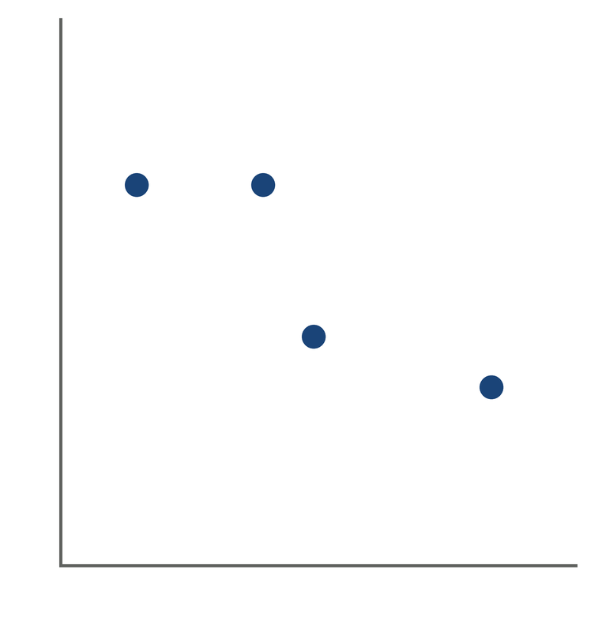
  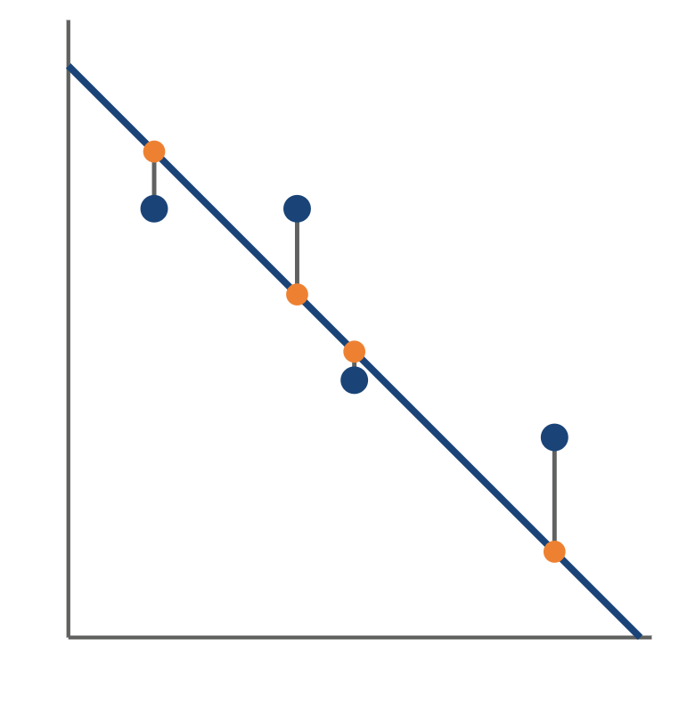
  <div class="absolute text-[.7rem] font-semibold text-gray-600" style="left: 13%; top: -4%;">temperature <em class="font-serif">y</em></div>
  <div class="absolute text-[.7rem] font-semibold text-gray-600" style="right: 0; top: 92%;">elevation <em class="font-serif">x</em></div>
</div>

<div v-click="2" class="text-[.8rem]">

A simple linear model

$$
\hat{y} = w\,x + b
$$

maps an elevation $x$ to an estimated temperature $\hat{y}$, with the **weight** $w$ (slope) and the **bias** $b$ (y-intercept).

</div>

</div>

<div class="figure-copyright">
Photo: Luca Galuzzi / <a href="https://commons.wikimedia.org/wiki/File:Everest_North_Face_toward_Base_Camp_Tibet_Luca_Galuzzi_2006.jpg" target="_blank" rel="noopener noreferrer">Wikimedia Commons</a>, <a href="https://creativecommons.org/licenses/by-sa/2.5/" target="_blank" rel="noopener noreferrer">CC BY-SA 2.5</a>. Figure: M. Rußwurm &amp; D. Tuia, <em>Linear Regression</em>, ENV-408 course materials, EPFL, 2023.
</div>

<!--
Hiker going up the mountain: every few hundred metres we note elevation and temperature.
Ask: what do you expect? Temperature drops roughly linearly with elevation (~6.5 °C per km).
Click 1: the measurements, temperature y against elevation x.
Click 2: a straight line summarises the trend — the model y-hat = w x + b. Slope w: temperature change per metre of ascent (negative); bias b: temperature at sea level.
-->

---
layout: bonn-two-cols-header
---

# Univariate Linear Regression

<PartTag part="model" />

::left::

<div class="text-[1rem]">

$$
\hat y = w\,x + b
\;=\;
\begin{pmatrix} x & 1 \end{pmatrix}
\begin{pmatrix} w \\ b \end{pmatrix}
$$

</div>

<svg viewBox="0 0 360 220" class="w-full h-[230px] mt-2" role="img" aria-label="Graphical model: input nodes x and 1 connect to the output node y-hat with weights w and b">
  <line x1="78" y1="60" x2="272" y2="110" stroke="#00457c" stroke-width="2.5" />
  <line x1="78" y1="160" x2="272" y2="110" stroke="#9aa0a6" stroke-width="2.5" />
  <text style="font-size:20px;font-family:serif;font-style:italic;line-height:1" x="172" y="72" text-anchor="middle" fill="#00457c">w</text>
  <text style="font-size:20px;font-family:serif;font-style:italic;line-height:1" x="172" y="125" text-anchor="middle" fill="#5f6368">b</text>
  <circle cx="55" cy="60" r="24" fill="#e8f0f8" stroke="#00457c" stroke-width="2.5" />
  <text style="font-size:21px;font-family:serif;font-style:italic;line-height:1" x="55" y="67" text-anchor="middle" fill="#00457c">x</text>
  <circle cx="55" cy="160" r="24" fill="#f1f3f4" stroke="#9aa0a6" stroke-width="2.5" />
  <text style="font-size:21px;font-family:serif;font-style:normal;line-height:1" x="55" y="167" text-anchor="middle" fill="#5f6368">1</text>
  <circle cx="295" cy="110" r="24" fill="#fff1e5" stroke="#ff7900" stroke-width="2.5" />
  <text style="font-size:21px;font-family:serif;font-style:italic;line-height:1" x="295" y="117" text-anchor="middle" fill="#b35500">ŷ</text>
  <text style="font-size:12px;font-family:inherit;font-style:normal;line-height:1" x="55" y="208" text-anchor="middle" fill="#5f6368">inputs</text>
  <text style="font-size:12px;font-family:inherit;font-style:normal;line-height:1" x="295" y="160" text-anchor="middle" fill="#5f6368">output</text>
</svg>

::right::

<div class="text-[.7rem]">

```python
import torch.nn as nn

# 1 input (elevation) -> 1 output (temperature)
model = nn.Linear(1, 1)

print(model.weight)  # w
print(model.bias)    # b

n = sum(p.numel() for p in model.parameters())
print(n)
```

</div>

---

# From Uni- to Multivariate Linear Regression

<PartTag part="model" />

<div class="grid grid-cols-[250px_1fr] gap-6 mt-1 items-start">

<div class="text-[.68rem]">


<div class="mt-2 font-semibold text-blue-800">Same elevation, different temperature</div>

<div class="mt-1 flex items-center gap-2"><span>☀️</span>sun-facing slope: warmer</div>
<div class="mt-0.5 flex items-center gap-2"><span>☁️</span>shaded slope: colder</div>

<div class="mt-2 text-gray-600 leading-snug">

**Slope** and **aspect** (the direction a slope faces) control how much sun a location gets &mdash; extra covariates beyond elevation.

</div>

</div>

<div class="text-[.78rem]">

**Univariate linear regression:** elevation only, two parameters

$$
y = w_1 \overbrace{x_1}^{\text{elevation}} + b
$$

**Multivariate linear regression**

- one input sample $\mathbf{x}_i = (x_1, x_2, x_3, \dots, x_p)$ of $p$ features
- corresponding target $y_i$
- one weight per feature $\mathbf w = (w_1, w_2, \dots, w_p)$, plus one bias $b$

$$
y_i = w_1\overbrace{x_1}^{\text{elevation}} + w_2\overbrace{x_2}^{\text{slope}} + w_3\overbrace{x_3}^{\text{aspect}} + \dots + b = \mathbf w^\top \mathbf{x}_i + b
$$

</div>

</div>

<div class="figure-copyright">
Photo: Luca Galuzzi / <a href="https://commons.wikimedia.org/wiki/File:Everest_North_Face_toward_Base_Camp_Tibet_Luca_Galuzzi_2006.jpg" target="_blank" rel="noopener noreferrer">Wikimedia Commons</a>, <a href="https://creativecommons.org/licenses/by-sa/2.5/" target="_blank" rel="noopener noreferrer">CC BY-SA 2.5</a>.
</div>

<!--
Back to the hiker: two spots at the same elevation can differ by several degrees. A south-facing slope (northern hemisphere) gets much more direct sun than a north-facing one; a steep slope facing the sun gets even more.
Elevation alone cannot explain this - the residuals of the univariate model contain the sun-exposure effect. Adding slope and aspect as features lets the model capture it: one weight per feature.
Note: aspect is an angle; in practice we encode it e.g. as northness = cos(aspect) to keep the relation (roughly) linear.
-->

---
layout: bonn-two-cols-header
---

# Multivariate Linear Regression

<PartTag part="model" />

::left::

<div class="text-[.85rem]">

$$
\begin{aligned}
\hat y &= w_1 x_1 + w_2 x_2 + w_3 x_3 + b \\
&= \begin{pmatrix} x_1 & x_2 & x_3 & 1 \end{pmatrix} \begin{pmatrix} w_1 & w_2 & w_3 & b \end{pmatrix}^{\!\top}
\end{aligned}
$$

</div>

<svg viewBox="0 0 360 250" class="w-full h-[215px] mt-1" role="img" aria-label="Graphical model: input nodes x1 (elevation), x2 (slope), x3 (aspect) and 1 connect to the output node y-hat with weights w1, w2, w3 and b">
  <line x1="130" y1="36" x2="288" y2="126" stroke="#00457c" stroke-width="2.5" />
  <line x1="130" y1="96" x2="288" y2="126" stroke="#00457c" stroke-width="2.5" />
  <line x1="130" y1="156" x2="288" y2="126" stroke="#00457c" stroke-width="2.5" />
  <line x1="130" y1="216" x2="288" y2="126" stroke="#9aa0a6" stroke-width="2.5" />
  <text style="font-size:17px;font-family:serif;font-style:italic;line-height:1;paint-order:stroke;stroke:white;stroke-width:4px" x="196" y="67" text-anchor="middle" fill="#00457c">w₁</text>
  <text style="font-size:17px;font-family:serif;font-style:italic;line-height:1;paint-order:stroke;stroke:white;stroke-width:4px" x="196" y="102" text-anchor="middle" fill="#00457c">w₂</text>
  <text style="font-size:17px;font-family:serif;font-style:italic;line-height:1;paint-order:stroke;stroke:white;stroke-width:4px" x="196" y="136" text-anchor="middle" fill="#00457c">w₃</text>
  <text style="font-size:17px;font-family:serif;font-style:italic;line-height:1;paint-order:stroke;stroke:white;stroke-width:4px" x="196" y="171" text-anchor="middle" fill="#5f6368">b</text>
  <circle cx="110" cy="36" r="21" fill="#e8f0f8" stroke="#00457c" stroke-width="2.5" />
  <text style="font-size:19px;font-family:serif;font-style:italic;line-height:1" x="110" y="42" text-anchor="middle" fill="#00457c">x₁</text>
  <text style="font-size:12px;font-family:inherit;font-style:normal;line-height:1" x="80" y="40" text-anchor="end" fill="#5f6368">elevation</text>
  <circle cx="110" cy="96" r="21" fill="#e8f0f8" stroke="#00457c" stroke-width="2.5" />
  <text style="font-size:19px;font-family:serif;font-style:italic;line-height:1" x="110" y="102" text-anchor="middle" fill="#00457c">x₂</text>
  <text style="font-size:12px;font-family:inherit;font-style:normal;line-height:1" x="80" y="100" text-anchor="end" fill="#5f6368">slope</text>
  <circle cx="110" cy="156" r="21" fill="#e8f0f8" stroke="#00457c" stroke-width="2.5" />
  <text style="font-size:19px;font-family:serif;font-style:italic;line-height:1" x="110" y="162" text-anchor="middle" fill="#00457c">x₃</text>
  <text style="font-size:12px;font-family:inherit;font-style:normal;line-height:1" x="80" y="160" text-anchor="end" fill="#5f6368">aspect</text>
  <circle cx="110" cy="216" r="21" fill="#f1f3f4" stroke="#9aa0a6" stroke-width="2.5" />
  <text style="font-size:19px;font-family:serif;font-style:normal;line-height:1" x="110" y="222" text-anchor="middle" fill="#5f6368">1</text>
  <circle cx="310" cy="126" r="22" fill="#fff1e5" stroke="#ff7900" stroke-width="2.5" />
  <text style="font-size:20px;font-family:serif;font-style:italic;line-height:1" x="310" y="133" text-anchor="middle" fill="#b35500">ŷ</text>
  <text style="font-size:12px;font-family:inherit;font-style:normal;line-height:1" x="310" y="166" text-anchor="middle" fill="#5f6368">temperature</text>
</svg>

::right::

<div class="text-[.7rem]">

```python
import torch.nn as nn

# elevation, slope, aspect -> temperature
model = nn.Linear(3, 1)

print(model.weight.shape)  # (1, 3): w1, w2, w3
print(model.bias.shape)    # (1,):   b

n = sum(p.numel() for p in model.parameters())
print(n)                   # 4
```

</div>

<blockquote class="blockquote2 mt-4 text-[.75rem]">

Same graph, more input nodes: one weight per feature, still one bias. Only <code>in_features</code> changes.

</blockquote>

<!--
Compare with the univariate slide: the constant input 1 still carries the bias; each new feature adds one node and one edge, i.e. one weight.
nn.Linear(3, 1) stores the weights as a 1 x 3 matrix (out_features x in_features) - this row-vector view is exactly the next topic.
Parameters: 3 weights + 1 bias = 4. In general p features -> p + 1 parameters.
-->

---

# Geometry: From a Line to a Plane

<PartTag part="model" />

<div class="mt-1">
<RegressionPlaneDemo :width="330" :height="250" />
</div>

<blockquote class="blockquote2 mt-3 text-[.75rem]">

$p$ features → a **hyperplane** in $p{+}1$ dimensions. The second feature (slope) explains much of the spread that elevation alone leaves in the residuals.

</blockquote>

<!--
Same synthetic data on both sides (temperature ~ elevation + slope). Left: univariate OLS, the grey residuals are large because slope is ignored. Right: bivariate OLS plane, drag to rotate; residuals shrink and R2 jumps.
With three features we cannot draw it any more, but the algebra is identical: a hyperplane in feature space x target.
-->

---
layout: bonn-two-cols-header
---

# Many Regressions in Parallel: $\mathbb{R}^N \to \mathbb{R}^M$

<PartTag part="model" />

::left::

<div class="text-[.78rem]">

$$
\underbrace{\begin{pmatrix} \hat y_1 \\ \hat y_2 \end{pmatrix}}_{\hat{\mathbf y} \in \mathbb{R}^M}
=
\underbrace{\begin{pmatrix}
\textcolor{#ff7900}{w_{11}} & \textcolor{#ff7900}{w_{12}} & \textcolor{#ff7900}{w_{13}} \\
\textcolor{#7b3fa0}{w_{21}} & \textcolor{#7b3fa0}{w_{22}} & \textcolor{#7b3fa0}{w_{23}}
\end{pmatrix}}_{\mathbf W \in \mathbb{R}^{M \times N}}
\underbrace{\begin{pmatrix} x_1 \\ x_2 \\ x_3 \end{pmatrix}}_{\mathbf x \in \mathbb{R}^N}
+
\underbrace{\begin{pmatrix} \textcolor{#ff7900}{b_1} \\ \textcolor{#7b3fa0}{b_2} \end{pmatrix}}_{\mathbf b \in \mathbb{R}^M}
$$

</div>

<svg viewBox="0 0 360 225" class="w-full h-[205px] mt-1" role="img" aria-label="Graphical model: inputs x1 (elevation), x2 (slope), x3 (aspect) and 1 are fully connected to two outputs, y-hat 1 (temperature, orange edges) and y-hat 2 (snow depth, purple edges)">
  <line x1="128" y1="30" x2="280" y2="72" stroke="#ff7900" stroke-width="2.2" stroke-opacity="0.8" />
  <line x1="128" y1="85" x2="280" y2="72" stroke="#ff7900" stroke-width="2.2" stroke-opacity="0.8" />
  <line x1="128" y1="140" x2="280" y2="72" stroke="#ff7900" stroke-width="2.2" stroke-opacity="0.8" />
  <line x1="128" y1="195" x2="280" y2="72" stroke="#ff7900" stroke-width="2.2" stroke-opacity="0.8" stroke-dasharray="5 4" />
  <line x1="128" y1="30" x2="280" y2="158" stroke="#7b3fa0" stroke-width="2.2" stroke-opacity="0.8" />
  <line x1="128" y1="85" x2="280" y2="158" stroke="#7b3fa0" stroke-width="2.2" stroke-opacity="0.8" />
  <line x1="128" y1="140" x2="280" y2="158" stroke="#7b3fa0" stroke-width="2.2" stroke-opacity="0.8" />
  <line x1="128" y1="195" x2="280" y2="158" stroke="#7b3fa0" stroke-width="2.2" stroke-opacity="0.8" stroke-dasharray="5 4" />
  <circle cx="110" cy="30" r="19" fill="#e8f0f8" stroke="#00457c" stroke-width="2.5" />
  <text style="font-size:18px;font-family:serif;font-style:italic;line-height:1" x="110" y="36" text-anchor="middle" fill="#00457c">x₁</text>
  <text style="font-size:12px;font-family:inherit;font-style:normal;line-height:1" x="82" y="34" text-anchor="end" fill="#5f6368">elevation</text>
  <circle cx="110" cy="85" r="19" fill="#e8f0f8" stroke="#00457c" stroke-width="2.5" />
  <text style="font-size:18px;font-family:serif;font-style:italic;line-height:1" x="110" y="91" text-anchor="middle" fill="#00457c">x₂</text>
  <text style="font-size:12px;font-family:inherit;font-style:normal;line-height:1" x="82" y="89" text-anchor="end" fill="#5f6368">slope</text>
  <circle cx="110" cy="140" r="19" fill="#e8f0f8" stroke="#00457c" stroke-width="2.5" />
  <text style="font-size:18px;font-family:serif;font-style:italic;line-height:1" x="110" y="146" text-anchor="middle" fill="#00457c">x₃</text>
  <text style="font-size:12px;font-family:inherit;font-style:normal;line-height:1" x="82" y="144" text-anchor="end" fill="#5f6368">aspect</text>
  <circle cx="110" cy="195" r="19" fill="#f1f3f4" stroke="#9aa0a6" stroke-width="2.5" />
  <text style="font-size:18px;font-family:serif;font-style:normal;line-height:1" x="110" y="201" text-anchor="middle" fill="#5f6368">1</text>
  <circle cx="300" cy="72" r="21" fill="#fff1e5" stroke="#ff7900" stroke-width="2.5" />
  <text style="font-size:19px;font-family:serif;font-style:italic;line-height:1" x="300" y="79" text-anchor="middle" fill="#ff7900">ŷ₁</text>
  <text style="font-size:12px;font-family:inherit;font-style:normal;line-height:1" x="300" y="110" text-anchor="middle" fill="#5f6368">temperature</text>
  <circle cx="300" cy="158" r="21" fill="#f3ecf8" stroke="#7b3fa0" stroke-width="2.5" />
  <text style="font-size:19px;font-family:serif;font-style:italic;line-height:1" x="300" y="165" text-anchor="middle" fill="#7b3fa0">ŷ₂</text>
  <text style="font-size:12px;font-family:inherit;font-style:normal;line-height:1" x="300" y="196" text-anchor="middle" fill="#5f6368">snow depth</text>
</svg>

::right::

<div class="text-[.7rem]">

```python
import torch.nn as nn

# 3 features -> 2 targets
model = nn.Linear(3, 2)

print(model.weight.shape)  # (2, 3) = (M, N)
print(model.bias.shape)    # (2,)

n = sum(p.numel() for p in model.parameters())
print(n)                   # 2*3 + 2 = 8
```

</div>

<blockquote class="blockquote2 mt-3 text-[.75rem]">

Each **row** of $\mathbf W$ is one multivariate regression; $M$ run **in parallel** on the same input. Together: a **linear transformation** with $M \cdot N + M$ parameters.

</blockquote>

<!--
Generalize step by step: 1 -> 1 (univariate), N -> 1 (multivariate), now N -> M.
Read the graph per color: the orange edges alone are the multivariate regression for temperature (row 1 of W), the purple edges the one for snow depth (row 2). Same inputs, independent weights.
nn.Linear(N, M) is exactly this: weight has shape (M, N) - out_features x in_features - and bias has M entries.
This is the building block for everything that follows: logistic regression adds a sigmoid / softmax on top (block 2), an MLP layer adds a non-linearity and stacks them (block 3).
-->

---

# Geometry: One Plane per Target

<PartTag part="model" />

<div class="-mt-2">
<TwoPlaneDemo :width="470" :height="320" />
</div>

<blockquote class="blockquote2 mt-1 text-[.75rem]">

Same inputs, two targets: each row of $\mathbf W$ fits **its own plane** &mdash; $M$ targets, $M$ hyperplanes.

</blockquote>

<!--
Mirror of the line -> plane slide, now with M = 2 outputs. Same 30 locations (elevation x1, slope x2) for both targets; targets standardized so they share the vertical axis.
Temperature drops with elevation and rises on sunny slopes; snow depth does the opposite. Two independent OLS fits = the two rows of W from the previous slide.
Both planes sit over the same floor (elevation x slope): same inputs, two sets of weights. Drag to rotate; the planes cross because the targets react oppositely to elevation and slope.
Buttons: "elevation view" looks along the slope axis (target vs. elevation, like the 1D plot); "top view" looks down on the floor - every orange dot sits inside a purple ring: both targets are measured at exactly the same inputs.
-->

---

# Linear Projection: From N to M Dim Spaces

<PartTag part="model" />

<div class="mt-1">
<LinearMapDemo :size="250" />
</div>

<blockquote class="blockquote2 mt-2 text-[.75rem]">

$\mathbf W\mathbf x + \mathbf b$ maps every location from the **input space** to a point in the **output space**; each input axis lands on a column of $\mathbf W$.

</blockquote>

<!--
Same model as the previous slides, now seen as one map between two spaces rather than as two separate regressions.
Left: 40 locations in feature space (rotate it). Right: their predictions. Colour = elevation, so you can follow points across; hover one to see x and its image y-hat.
The three arrows: moving one unit along an input axis moves the prediction by the corresponding column of W - elevation pushes toward colder (and a bit snowier), aspect mostly toward more snow, slope toward warmer.
3 -> 2 dimensions: the map compresses information (different inputs can land on the same output). This "transform the space" view is the language of block 3, where layers stack such maps with non-linearities in between.
-->
---

# Quiz: How Much Colder per 100 m?

<PartTag part="model" />

<div class="grid grid-cols-[220px_1fr] gap-6 mt-1 items-center">


<div class="text-[.85rem]">

Back to our hiker: $\hat y = w\,x + b$ with elevation $x$ and temperature $\hat y$.

The slope $w$ answers the question: **how many degrees does it get colder for every 100 m of ascent?**

<div v-click="1" class="mt-2 text-[#b02b37]">

On average about **0.65 °C per 100 m**, i.e. $w \approx -6.5\,^\circ\text{C}/\text{km}$ &mdash; the slope our regression should recover from data.

</div>

</div>

</div>

<div class="flex justify-center mt-1">
  <div class="relative" style="width: 640px;">
    <UnderstandingPulse
      full-width
      session-id="lecture-4"
      poll-id="lapse-rate-quiz"
      left-label="0 °C"
      right-label="2 °C"
      instruction="Click on the line: temperature drop per 100 m of ascent"
    />
    <div class="absolute text-[.6rem] text-gray-500 -translate-x-1/2" style="left:188.8px; top:73.8px;">0.5</div>
    <div class="absolute bg-gray-400" style="left:188.3px; top:93.8px; width:1px; height:12px;"></div>
    <div class="absolute text-[.6rem] text-gray-500 -translate-x-1/2" style="left:320.0px; top:73.8px;">1</div>
    <div class="absolute bg-gray-400" style="left:319.5px; top:93.8px; width:1px; height:12px;"></div>
    <div class="absolute text-[.6rem] text-gray-500 -translate-x-1/2" style="left:451.2px; top:73.8px;">1.5</div>
    <div class="absolute bg-gray-400" style="left:450.7px; top:93.8px; width:1px; height:12px;"></div>
    <div v-click class="absolute pointer-events-none" style="left:227.2px; top:53.8px; width:2px; height:58px; background:#b02b37;"></div>
    <div v-click="1" class="absolute pointer-events-none whitespace-nowrap -translate-x-1/2 text-[.68rem] font-bold" style="left:228.2px; top:35.8px; color:#b02b37;">≈ 0.65 °C</div>
  </div>
</div>

<div class="figure-copyright">
Photo: Luca Galuzzi / <a href="https://commons.wikimedia.org/wiki/File:Everest_North_Face_toward_Base_Camp_Tibet_Luca_Galuzzi_2006.jpg" target="_blank" rel="noopener noreferrer">Wikimedia Commons</a>, <a href="https://creativecommons.org/licenses/by-sa/2.5/" target="_blank" rel="noopener noreferrer">CC BY-SA 2.5</a>.
</div>

<!--
Separation slide before the loss part: let the class vote first (live pulse), then click to reveal.
Answer: the environmental lapse rate of the standard atmosphere is 6.5 °C per km = 0.65 °C per 100 m. Real values vary: dry air cools ~1 °C / 100 m (dry adiabatic), saturated air ~0.5 °C / 100 m; inversions can even flip the sign.
Transition: we know the answer from physics - but how would we estimate w (and b) from measured data alone? That is the next question.
-->

---

# How to estimate $w$ and $b$ from data?

<PartTag part="loss" />

<div class="grid grid-cols-2 gap-8 mt-6 items-center">

<div class="flex justify-center">
<RegressionScatterDemo variant="points" x-label="elevation x" y-label="temperature y" :clicks="$clicks" />
</div>

<div>

We have a dataset of data samples $(x_i, y_i)$.

<blockquote v-click class="blockquote3 mt-4">

<strong>Problem:</strong> how do we find good model parameters $w$,  $b$ for our linear model $f(x; w,  b) = w\,x +  b$?

</blockquote>

</div>

</div>

---

# Why Don't the Points Lie on the Line?

<PartTag part="loss" />

<div class="grid grid-cols-2 gap-8 mt-6 items-center">

<div class="flex justify-center">
<RegressionScatterDemo variant="error-band" x-label="elevation x" y-label="temperature y" />
</div>

<div class="flex items-center gap-5">

<div class="flex-1">

$$
y_i = w\,x_i + b \pm \overbrace{\varepsilon}^{\text{error}}
$$

with the error $\varepsilon$ as a random variable &mdash; the model never fits the data perfectly.

Measurement noise is one source: not every thermometer is precise.

</div>

<figure class="flex flex-col items-center m-0">
  
  <figcaption class="mt-1 w-[130px] text-center text-[.6rem] italic text-gray-500 leading-tight">The hiker took a bad thermometer</figcaption>
</figure>

</div>

</div>

<div class="figure-copyright">
Photo: Hustvedt / <a href="https://commons.wikimedia.org/wiki/File:Galileo_Thermometer_24_degrees.jpg" target="_blank" rel="noopener noreferrer">Wikimedia Commons</a>, <a href="https://creativecommons.org/licenses/by-sa/3.0/" target="_blank" rel="noopener noreferrer">CC BY-SA 3.0</a>.
</div>

---

# Residuals and Mean Absolute Error

<PartTag part="loss" />

<div class="grid grid-cols-2 gap-8 mt-6 items-center">

<div class="flex justify-center">
<RegressionScatterDemo variant="residual-segments" x-label="elevation x" y-label="temperature y" :clicks="$clicks" />
</div>

<div>

Concretely, the error &mdash; the "residual" $\varepsilon_i$ &mdash; for each sample $i$:

$$
\varepsilon_i = \hat{y}_i - y_i
$$

<div v-click>

We want small residuals over the whole dataset. Positive and negative residuals would cancel, so we average their absolute values: the **Mean Absolute Error**

$$
\text{MAE}(\mathcal{D}; w, b) = \frac{1}{N} \sum_{i=1}^N \vert \hat{y}_i - y_i \vert
$$

</div>

</div>

</div>

---

# Mean Squared Error (MSE)

<PartTag part="loss" />

<div class="grid grid-cols-2 gap-8 mt-6 items-center">

<div class="flex justify-center">
<RegressionScatterDemo variant="residual-squares" x-label="x" y-label="y" />
</div>

<div>

$$
\text{MSE}(\mathcal{D}; w, b) = \frac{1}{2N} \sum_{i=1}^N (\hat{y}_i - y_i)^2
$$

Punishes large errors with a square penalty.

<blockquote class="blockquote2 mt-3">
<strong>Geometric intuition:</strong> find a model that minimizes the total area of these squares.
</blockquote>

</div>

</div>

---

# The Loss $\mathcal{L}(w;\, \mathcal{D})$ as a Function of $w$

<PartTag part="loss" />

<div class="mt-1">
<SlopeLossDemo :b="1" :initial-w="0" loss="mae" single />
</div>

<div class="grid grid-cols-2 gap-4 mt-1 text-[.7rem]">

<blockquote v-click class="blockquote2 my-0">

**① Big errors matter most:** squared penalty &mdash; a little off is fine, very off is fatal.

</blockquote>

<blockquote v-click class="blockquote2 my-0">

**② Smooth gradients:** MAE has constant slopes and kinks; MSE is smooth &mdash; needed to find good parameters (later).

</blockquote>

</div>

<!--
Usage: bias b fixed. Change w by dragging the line or hovering the loss plot; in "one point" mode click a point to select it.
Start with MAE on one point: the loss is |w x_i + b - y_i|, a perfect V (triangle) with its tip where the line passes through the point.
Switch to all points: the MAE is the average of four such Vs -> piecewise linear, with a kink wherever the line passes through a point.
Switch to MSE: each point gives a parabola instead of a V; their average is again a smooth parabola. The squares on the left are the squared residuals.
MSE is smooth and has a unique minimum we can compute in closed form; MAE is more robust to outliers but has corners.
Takeaway 1 (click): an error of 2 costs 4x as much as an error of 1 under MSE, only 2x under MAE.
Takeaway 2 (click): the MAE gradient is +-const and flips abruptly at the kink, so it gives no hint how close the minimum is; the MSE gradient shrinks smoothly toward the minimum.
-->
---

# Searching over $b$ and $w$ spans a 2D Loss Surface

<PartTag part="loss" />

<div class="grid grid-cols-[1fr_2fr] gap-6 mt-2 items-center">

<div class="text-[.78rem]">

The loss $\mathcal{L}(\mathcal{D}; w, b)$ depends on

- the **model** $f(x) = w\,x + b$
- the **loss function**, e.g. MSE
- the **dataset** $\mathcal{D} = \{(x_i, y_i)\}_{i=1}^N$

For a fixed dataset, every parameter pair $(w, b)$ gets one loss value: a **surface over parameter space**.

<blockquote class="blockquote2 mt-3">
Each point on the right is one line on the left.
</blockquote>

</div>

<div>
<LossSurfaceExplorer mode="explore" loss="mse" />
</div>

</div>

<!--
Demo: hover the surface. Moving toward the yellow centre makes the orange line fit the data. Corners = lines with wrong slope and offset.
Data: standardized elevation vs. temperature (synthetic, 20 points), loss = MSE with the 1/(2N) convention from earlier.
-->

---

# How to find the optimal $w$ and $b$ parameters?

<PartTag part="fitting" />

<div class="flex justify-center mt-2">
  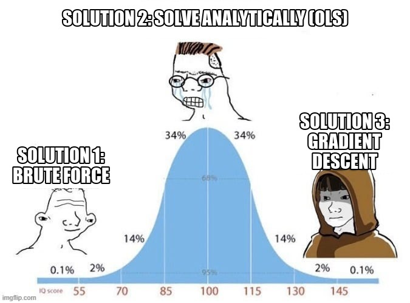
</div>

<div class="figure-copyright">
Meme template: "bell curve / IQ distribution" via imgflip.com, labels modified.
</div>

<!--
Three ways to find good parameters. Brute force: just try many values. OLS: solve analytically &mdash; looks like the clever answer.
Gradient descent: looks naive again (guess, then improve) &mdash; but it is the one that scales to logistic regression and MLPs, where no closed form exists.
-->

---

# Brute Force: Guess the Parameters ¯\\\_(ツ)\_/¯

<PartTag part="fitting" />

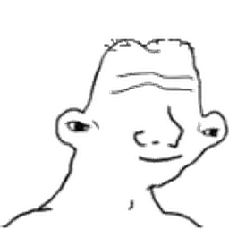

<div class="grid grid-cols-[2.2fr_1fr] gap-6 mt-2 items-center">

<div>
<LossSurfaceExplorer mode="guess" loss="mse" show-truth />
</div>

<div class="text-[.74rem]">

<blockquote class="blockquote1">
Works for 2 parameters &mdash; but it is expensive and never exact.
</blockquote>

<blockquote v-click class="blockquote4 mt-4">
100 values per parameter: 2 parameters → 10⁴ evaluations; a small MLP with 10⁴ parameters → 100<sup>10 000</sup>. The curse of dimensionality again.
</blockquote>

</div>

</div>

<!--
Click "guess" a few times, then "100 guesses". Grey lines on the left are recent guesses, orange is the best so far; the red circle on the surface is the OLS optimum.
Replaces the old random-guessing video.
-->


---

# Smart Solution: Ordinary Least Square (OLS)

<PartTag part="fitting" />


<blockquote class="blockquote3 mt-6">

<strong>Task:</strong> find $\hat w, \hat b$ that minimize the Mean Squared Error

</blockquote>

$$
\hat w,\hat b = \operatorname*{arg\,min}_{w, b} \frac{1}{2N} \sum_{i=1}^N \left(\overbrace{w\,x_i + b}^{\hat{y}_i} - y_i \right)^2
$$

<div v-click class="mt-6">

**Question:** how do we minimize a function with respect to its parameters?

</div>

<div v-click>

- calculate the partial derivatives $\frac{\partial \text{MSE}}{\partial w}$ and $\frac{\partial \text{MSE}}{\partial b}$
- set the derivatives to zero: $\frac{\partial \text{MSE}}{\partial w} = 0$, $\frac{\partial \text{MSE}}{\partial b} = 0$
- solve for $w$ and $b$

</div>

---

# OLS Step by Step

<PartTag part="fitting" />


<div class="text-[.74rem]">

$$
\mathcal{L}(w, b) = \frac{1}{2N} \sum_{i=1}^N \left(w\,x_i + b - y_i\right)^2
\qquad \bar x = \frac{1}{N}\sum_i x_i,\;\; \bar y = \frac{1}{N}\sum_i y_i
$$

<div class="grid grid-cols-[2fr_3fr] gap-5 mt-1">

<div v-click="1" class="rounded-lg border border-blue-200 bg-blue-50 px-4 py-1">

**① derivative with respect to $b$**

$$
\begin{aligned}
& \frac{\partial \mathcal{L}}{\partial b} = \frac{1}{N}\sum_{i=1}^N \left(w\,x_i + b - y_i\right) \overset{!}{=} 0 \\[.4em]
\Leftrightarrow\;\; & w\,\bar x + b - \bar y = 0 \\[.4em]
\Leftrightarrow\;\; & b = \bar y - w\,\bar x
\end{aligned}
$$

</div>

<div v-click="2" class="rounded-lg border border-blue-200 bg-blue-50 px-4 py-1">

**② derivative with respect to $w$**

$$
\begin{aligned}
& \frac{\partial \mathcal{L}}{\partial w} = \frac{1}{N}\sum_{i=1}^N \left(w\,x_i + b - y_i\right) x_i \overset{!}{=} 0 \\[.4em]
\overset{\text{insert } b}{\Leftrightarrow}\;\; & \textstyle\sum_i \big(w\,(x_i - \bar x) - (y_i - \bar y)\big)\, x_i = 0 \\[.4em]
\Leftrightarrow\;\; & w \textstyle\sum_i (x_i - \bar x)\,x_i = \sum_i (y_i - \bar y)\,x_i \\[.4em]
\Leftrightarrow\;\; & w = \dfrac{\sum_i (x_i - \bar x)(y_i - \bar y)}{\sum_i (x_i - \bar x)^2}
\end{aligned}
$$

<div v-click="3" class="text-[.62rem] text-gray-600 -mt-1 mb-2">

last step: $\sum_i (x_i - \bar x) = \sum_i (y_i - \bar y) = 0$, so $x_i$ may be replaced by $(x_i - \bar x)$

</div>

</div>

</div>

</div>

<!--
Follow the recipe from the previous slide: derivative, set to zero, solve.
Step 1 (b): averaging the residuals must give zero, so the line passes through the mean point (x-bar, y-bar).
Step 2 (w): insert b = y-bar - w x-bar; everything becomes centred. Dividing numerator and denominator by N gives Cov[x,y] / Var[x] on the next slide.
Why x_i can be replaced by x_i - x-bar: we subtract x-bar * sum_i (x_i - x-bar) = 0 on the left and x-bar * sum_i (y_i - y-bar) = 0 on the right.
-->

---

# Ordinary Least Squares (OLS) &mdash; Solution

<PartTag part="fitting" />


Model $y = w\,x + b$ on a dataset $\mathcal{D} = \{x_i, y_i\}_{i=1}^N$

Ordinary Least Squares objective

$$
\hat w,\hat b = \operatorname*{arg\,min}_{w, b} \frac{1}{2N} \sum_{i=1}^N \left(\overbrace{w\,x_i + b}^{\hat{y}_i} - y_i \right)^2
$$

Closed-form solution

$$
\begin{aligned}
\hat w &= \frac{\text{Cov}[x,y]}{\text{Var}[x]} = \frac{\frac{1}{N}\sum_i (x_i - \bar{x})(y_i - \bar{y})}{\frac{1}{N}\sum_i (x_i - \bar{x})^2} \\[.3em]
\hat b &= \frac{1}{N}\sum_{i=1}^N y_i - \hat w \frac{1}{N}\sum_{i=1}^N x_i = \bar{y} - \hat w\, \bar{x}
\end{aligned}
$$

<div class="figure-copyright">
See <a href="https://en.wikipedia.org/wiki/Ordinary_least_squares" target="_blank" rel="noopener noreferrer">Ordinary Least Squares</a>, Wikipedia.
</div>

---

# Multivariate OLS &mdash; Closed-form Derivation

<PartTag part="fitting" />


<div class="grid grid-cols-[1fr_1.1fr] gap-6 mt-1 items-start text-[.74rem]">

<div>

**Data:** $n$ locations, $p = 3$ features, one target

$$
\mathbf{X} =
\begin{pmatrix}
1 & \overbrace{x_{11}}^{\text{elev.}} & \overbrace{x_{12}}^{\text{slope}} & \overbrace{x_{13}}^{\text{aspect}} \\
1 & x_{21} & x_{22} & x_{23} \\
\vdots & \vdots & \vdots & \vdots \\
1 & x_{n1} & x_{n2} & x_{n3}
\end{pmatrix}
\!,\;\;
\mathbf{y} = \begin{pmatrix} y_1 \\ y_2 \\ \vdots \\ y_n \end{pmatrix}
$$

<div class="text-center text-gray-600 -mt-2 mb-2">

one row per location: $\mathbf X \in \mathbb R^{n \times (p+1)}$, temperatures $\mathbf y \in \mathbb R^{n}$

</div>

**Model** for all $n$ locations at once:

$$
\hat{\mathbf y} = \mathbf X \mathbf w, \qquad \mathbf w = (b, w_1, w_2, w_3)^\top
$$

The column of ones absorbs the bias $b$ into $\mathbf w$.

</div>

<div>

**Loss:** squared error of all residuals

$$
\text{MSE}(\hat{\mathbf w}) = \left\Vert \mathbf{y} - \mathbf{X}\hat{\mathbf w} \right\Vert^2 = \mathbf{y}^\top\mathbf{y} - 2\hat{\mathbf w}^\top\mathbf{X}^\top\mathbf{y} + \hat{\mathbf w}^\top\mathbf{X}^\top\mathbf{X}\hat{\mathbf w}
$$

**Derivative** set to zero:

$$
\begin{aligned}
\frac{\partial \text{MSE}(\hat{\mathbf w})}{\partial \hat{\mathbf w}} &= -2\mathbf{X}^\top\mathbf{y} + 2\mathbf{X}^\top\mathbf{X}\hat{\mathbf w} = 0 \\
\mathbf{X}^\top\mathbf{X}\hat{\mathbf w} &= \mathbf{X}^\top\mathbf{y} \\[.4em]
\hat{\mathbf w} &= \left(\mathbf{X}^\top\mathbf{X}\right)^{-1} \mathbf{X}^\top\mathbf{y}
\end{aligned}
$$

<blockquote class="blockquote2 mt-2">
The <strong>normal equation</strong> &mdash; a closed-form solution, no iterative optimization required.
</blockquote>

</div>

</div>

<!--
Left: the dataset in matrix form for our example (one row per location: 1, elevation, slope, aspect; target = temperature). Same content as the "Multivariate Linear Model in Matrix Form" slide later in the deck.
Right: the derivation. The constant 1/N (or 1/2N) in front of the MSE is dropped here: it does not change where the minimum is.
-->

---

# Let's Appreciate the Elegance

<PartTag part="fitting" />


<div class="grid grid-cols-2 gap-8 mt-6 items-center">

<div class="text-center">

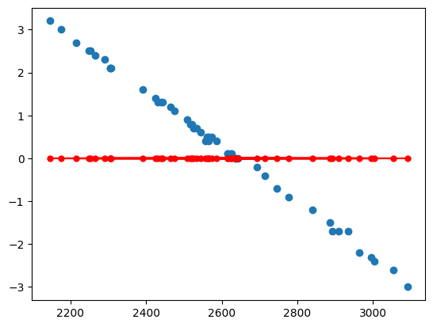

<div class="mt-2 text-sm text-gray-600">

$\mathbf w = (0,0,0,0,\dots)$

</div>

</div>

<div class="text-center">

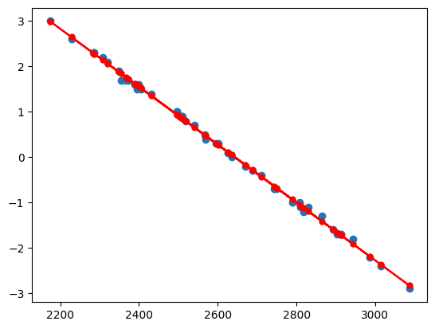

<div class="mt-2 text-sm text-gray-600">

$\mathbf w = (-.1,.2,.5,-.5,\dots)$

</div>

</div>

</div>

<blockquote class="blockquote3 mt-6 text-center">

$\hat{\mathbf w} = \left(\mathbf{X}^\top\mathbf{X}\right)^{-1} \mathbf{X}^\top\mathbf{y}$ &mdash; a single line of code, and blazing fast.

</blockquote>

---

# Why Does OLS Work for Linear Regression?

<PartTag part="fitting" />


<div class="grid grid-cols-[1fr_2fr] gap-6 mt-2 items-center">

<div class="text-[.78rem]">

The MSE of a linear model is a **quadratic bowl** in $(w, b)$:

- it is **convex**: no local minima to get stuck in
- it has exactly **one global minimum**
- at that point, the slope is zero in every direction

<blockquote v-click class="blockquote2 mt-4">

So "derivatives $= 0$" has exactly one solution &mdash; and that solution **is** the global optimum.

</blockquote>

</div>

<div>
<LossSurfaceExplorer mode="explore" loss="mse" highlight-optimum show-closed-form />
</div>

</div>

<!--
Hover the surface: the closer you get to the red ring, the closer the orange line comes to the dashed optimal line. At the ring they coincide.
Press "closed form (OLS)": one formula jumps straight to the bottom of the bowl. Click the surface to explore again.
Every contour is a closed ellipse around the same centre: one bowl, one bottom.
Contrast for later: logistic regression (block 2) and MLPs (block 3) have no closed form and, for MLPs, no single bowl.
-->
---

# Real Problems, Rugged Loss Landscapes

<PartTag part="fitting" />

<div class="grid grid-cols-2 gap-8 mt-2 items-end">

<div class="text-center">
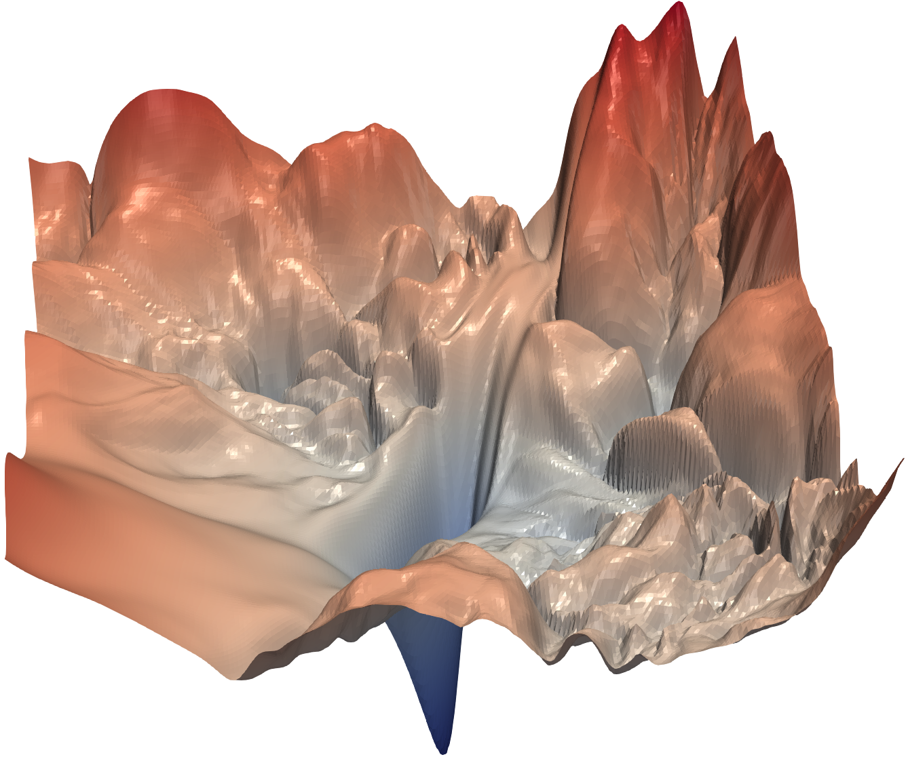
<div class="text-[.65rem] text-gray-500 mt-1">ResNet-56 without skip connections</div>
</div>

<div class="text-center">
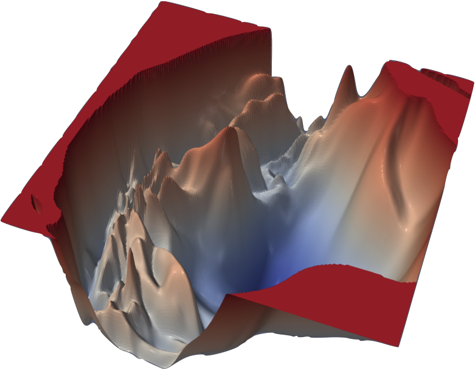
<div class="text-[.65rem] text-gray-500 mt-1">ResNet-110 without skip connections</div>
</div>

</div>

<blockquote class="blockquote4 mt-4 text-[.75rem]">

Linear regression gives a convex bowl with one global minimum. Deep networks give **rugged landscapes**: many local minima, saddle points and plateaus &mdash; no closed form, and no guarantee to reach the global optimum.

</blockquote>

<div class="figure-copyright">
Figures: H. Li, Z. Xu, G. Taylor, C. Studer, T. Goldstein, <a href="https://ar5iv.labs.arxiv.org/html/1712.09913" target="_blank" rel="noopener noreferrer"><em>Visualizing the Loss Landscape of Neural Nets</em></a>, NeurIPS 2018.
</div>

<!--
Contrast to the previous slide: the MSE bowl of linear regression is the exception, not the rule.
These are 2D slices (two random, filter-normalized directions) through the loss of real image classifiers with millions of parameters - the full landscape is far higher-dimensional.
Consequence: we cannot solve for the optimum, and we cannot even be sure we found it. We need an iterative method that only needs local information - gradient descent - and in practice a "good enough" minimum is what we get.
(In the paper, adding skip connections makes these surfaces much smoother - one reason ResNets train well.)
-->
---

# Gradient Descent &mdash; Guess Once, Then Improve

<PartTag part="fitting" />


<div class="grid grid-cols-[1fr_2fr] gap-6 mt-2 items-center">

<div class="text-[.78rem]">

<div class="rounded-lg bg-blue-800 text-white p-4">
<div class="font-semibold mb-2">Gradient descent</div>

1. initialize $w, b$ (e.g. randomly)
2. update $w \leftarrow w - \eta\, \frac{\partial\mathcal L}{\partial w}$ <br> and $\;b \leftarrow b - \eta\, \frac{\partial\mathcal L}{\partial b}$
3. repeat 2 until convergence

</div>

<div class="mt-3">

- the gradient $\nabla \mathcal{L}$ points **uphill**; we step the other way
- $\eta$ is the **step size** or **learning rate**

</div>

</div>

<div>
<LossSurfaceExplorer mode="gd" loss="mse" :lr="0.3" />
</div>

</div>

<!--
Press "step" a few times, then "run". Click anywhere on the surface to restart from a new initialization: on this convex surface every start ends at the same optimum.
Replaces the short (3 s) gradient-descent video.
-->

---

# The Gradient of the MSE

<PartTag part="fitting" />


<div class="grid grid-cols-2 gap-8 mt-4 items-start">

<div class="text-[.8rem]">

Loss for $\hat y_i = w\,x_i + b$:

$$
\mathcal{L}(w, b) = \frac{1}{2N}\sum_{i=1}^N (\hat y_i - y_i)^2
$$

Partial derivatives (chain rule, the $\tfrac12$ cancels):

$$
\frac{\partial \mathcal{L}}{\partial w} = \frac{1}{N}\sum_i (\hat y_i - y_i)\, x_i
\qquad
\frac{\partial \mathcal{L}}{\partial b} = \frac{1}{N}\sum_i (\hat y_i - y_i)
$$

<blockquote class="blockquote2 mt-3">
Each sample pushes the parameters by its residual &mdash; weighted by its input.
</blockquote>

</div>

<div>

```python {all|5-6|7-8}
import numpy as np

w, b, lr = 1.2, 1.2, 0.3    # init, step size
for it in range(100):
    y_hat = w * x + b        # prediction
    r = y_hat - y            # residuals
    w -= lr * (r * x).mean() # dL/dw
    b -= lr * r.mean()       # dL/db
```

<div class="text-[.7rem] text-gray-600 mt-2">
Setting both derivatives to zero and solving gives the OLS solution. Gradient descent only needs to <em>evaluate</em> them.
</div>

</div>

</div>

<!--
Points ahead to OLS: OLS = gradient set to zero and solved in closed form. GD = gradient evaluated and followed. Students implement this loop in the lab.
-->

---

# Gradient Descent: Role of the Learning Rate

<PartTag part="fitting" />


<div class="mt-1">
<LossSurfaceExplorer mode="gd" loss="mse" show-lr show-curve :lr="0.05" />
</div>

<div class="grid grid-cols-3 gap-4 text-[.72rem] mt-1">
<blockquote class="blockquote1">η = 0.05: safe, but slow &mdash; still not converged after 80 steps</blockquote>
<blockquote class="blockquote2">η ≈ 0.3&ndash;1: few steps to the optimum</blockquote>
<blockquote class="blockquote4">η ≥ 2: every step overshoots more &mdash; the loss <strong>diverges</strong></blockquote>
</div>

<!--
Drag the slider and press run each time. For this dataset the stability limit is eta ~ 2.0 (2 / largest curvature of the MSE bowl); at 1.9 the path zig-zags but still converges, at 2.1 it explodes.
In deep learning the curvature is unknown and changes over the surface, so the learning rate becomes the most important hyperparameter (block 3).
-->

---

# Recap: Linear Regression

<div class="grid grid-cols-[1.25fr_1fr] gap-8 mt-3 items-start">

<div class="text-[.78rem]">

<v-clicks>

- **Model:** from univariate $\hat y = w\,x + b$ (a line) to multivariate $\hat y = \mathbf w^\top\mathbf x + b$ (a plane), to $M$ regressions in parallel $\hat{\mathbf y} = \mathbf W\mathbf x + \mathbf b$: a **linear transformation** from input to output space
- **Loss:** residuals measured by MAE or MSE; we usually prefer **MSE**: large errors are penalized more, and its smooth, convex bowl has one global minimum
- **Fitting:** three ways to find the parameters &mdash; brute force (does not scale), OLS in closed form $\hat{\mathbf w} = (\mathbf X^\top\mathbf X)^{-1}\mathbf X^\top\mathbf y$ (special cases only), and gradient descent (steps downhill, works everywhere)

</v-clicks>

</div>

<div class="text-[.74rem]">

| | brute force | closed form | gradient descent |
|---|:-:|:-:|:-:|
| linear regression | ✓ | ✓ | ✓ |

<blockquote v-click class="blockquote4 mt-6">
<strong>Limitation:</strong> linear regression predicts <strong>continuous</strong> values (temperature, snow depth). What about <strong>categories</strong> &mdash; snow or no snow, forest or field?
</blockquote>

<blockquote v-click class="blockquote3 mt-3">
Next: <strong>classification</strong> with the <strong>same</strong> linear transformation &mdash; new output function, new loss, and the closed form disappears.
</blockquote>

</div>

</div>

<!--
Model: 1 -> 1 (a line), N -> 1 (a plane / hyperplane), N -> M (M regressions in parallel = a linear transformation W x + b between input and output space).
Loss: MAE vs. MSE; MSE because big errors matter most and because its smooth, convex bowl makes optimization easy.
Fitting: the three characters from the meme - brute force, the closed form (OLS) and gradient descent, which is the one that carries over to everything that follows.
Limitation: everything so far predicts continuous numbers. Next block: the same linear transformation for classes.
-->
---
layout: bonn-section
sectionColor: "#00457c"
section: logistic-regression
sectionTitle: "Logistic Regression"
---

# Logistic Regression


<div class="bonn-section-citation">
Image by Bing Image Generator (DALL·E 3): "a deep learning model snowboarding down a red loss surface to find a local minimum".
</div>

<!--
Block 2 - How can the same linear transformations solve classification problems, and how can we learn their parameters?
Key message: the linear transformation does not change. What changes is the interpretation of its output, the output function and the loss.
-->

---

# Same Transformation, Different Job

<div class="mt-3 text-[.82rem] compare-table">

| | Linear regression | Logistic regression |
|---|---|---|
| **Model core** | $\mathbf W\mathbf x + \mathbf b$ | $\mathbf W\mathbf x + \mathbf b$ |
| **Output** | continuous value | <span v-click="1">class probability</span> |
| **Output function** | identity | <span v-click="2">sigmoid or softmax</span> |
| **Typical loss** | MSE | <span v-click="3">cross-entropy</span> |
| **Optimization** | closed form possible | <span v-click="4">gradient-based optimization</span> |

</div>

<div class="mt-4 text-[.7rem] text-gray-600">
<strong>Model:</strong> why not linear regression · sigmoid · K outputs · softmax &nbsp;→&nbsp; <strong>Loss:</strong> binary &amp; multiclass cross-entropy &nbsp;→&nbsp; <strong>Fitting:</strong> gradient descent &nbsp;→&nbsp; back to real data
</div>

<!--
Central question of block 2: how can the same linear transformations solve classification problems, and how can we learn their parameters?
Reveal the logistic column row by row; the model core is identical. We return to this table at the end of the block.
-->

---

# Why Not Linear Regression for Classes?

<PartTag part="model" />

<div class="mt-1 max-w-[600px] mx-auto">
<LinearVsLogistic1D />
</div>

<div class="grid grid-cols-2 gap-4 mt-2 text-[.72rem]">
<blockquote class="blockquote4">a line predicts values below 0 and above 1 &mdash; not probabilities</blockquote>
<blockquote class="blockquote4">far-away samples pull the line: its 0.5 threshold moves into the other class</blockquote>
</div>

<!--
Start with the linear fit only. Then tick "add extreme class-1 samples": samples that are very clearly class 1 should not change the decision, but MSE punishes the line for not reaching y = 1 there and tilts it - the 0.5 crossing moves right and starts misclassifying class-1 samples. Then switch on the logistic fit: the sigmoid saturates, extreme samples are already "right", the threshold barely moves.
-->

---

# The Sigmoid: From Score to Probability

<PartTag part="model" />

<div class="grid grid-cols-[1fr_1.15fr] gap-6 mt-3 items-center">

<div class="text-[.78rem]">

Keep the linear transformation, squash its output:

$$
z = \mathbf w^\top\mathbf x + b, \qquad p = \sigma(z) = \frac{1}{1 + e^{-z}}
$$

- any score $z \in \mathbb R$ becomes a probability $p \in (0, 1)$
- $z = 0 \Leftrightarrow p = 0.5$: the **decision boundary** $\mathbf w^\top\mathbf x + b = 0$ is still a line / plane
- large $|z|$: confident; the output saturates instead of growing without bound

</div>

<div>
<LogisticSigmoid />
</div>

</div>

<!--
Step 2 of block 2. The linear part is exactly block 1; the sigmoid is the only new piece. Drag z to show saturation: this is why extreme samples did not pull the logistic fit on the previous slide.
-->

---

# Logistic Regression in Weight Space

<PartTag part="model" />

<div class="grid grid-cols-[1fr_1.45fr] gap-5 mt-2 items-center">

<div class="text-[.76rem]">

Two features, two weights, no bias &mdash; small enough to see the whole parameter space:

$$
p = \hat y = \sigma(w_1 x_1 + w_2 x_2)
$$

- $p \in (0, 1)$ is the probability of class 1
- $p = 0.5$ where $w_1 x_1 + w_2 x_2 = 0$: the **decision boundary** is a line
- no bias $b$ here, so every model is a point $(w_1, w_2)$

```python
nn.Sequential(nn.Linear(2, 1, bias=False),
              nn.Sigmoid())
```

</div>

<div>
<LogisticLossExplorer :init="[2, -1.5]" />
</div>

</div>

<!--
Hover the surface and watch the boundary rotate and the orange/blue shading sharpen: a larger weight norm = steeper sigmoid = more confident probabilities.
Logistic regression maps a fixed representation to categories with a linear decision boundary (learning outcome).
-->

---

# One Score per Class: $K$ Outputs

<PartTag part="model" />

<div class="text-[.78rem]">

For $K$ classes we need $K$ scores. Stack $K$ weight vectors $\mathbf w_k^\top$ as the rows of a matrix $\mathbf W \in \mathbb R^{K \times p}$: $\;\mathbf z = \mathbf W\mathbf x + \mathbf b$ &mdash; $K$ linear models side by side, one per class.

</div>

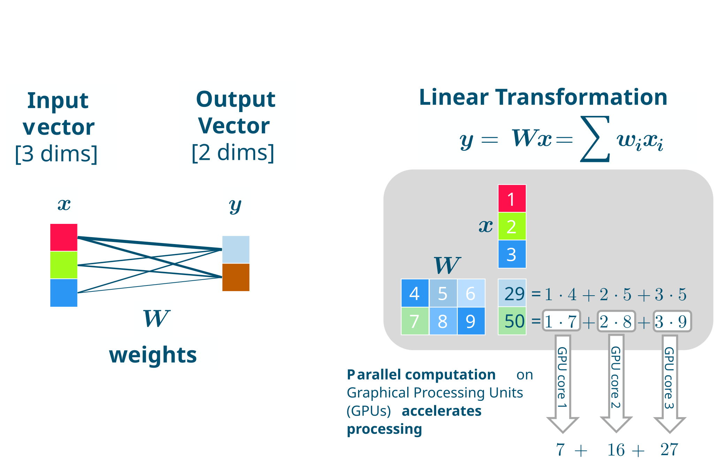

<!--
One row of W = one linear model = one class score. Bold capital W for a whole matrix of weights (K x p): the notation of neural networks. The same object becomes a layer in block 3.
-->

---

# More Than Two Classes: Softmax

<PartTag part="model" />

<div class="grid grid-cols-[1fr_1.1fr] gap-6 mt-2 items-center">

<div class="text-[.78rem]">

The $K$-output transformation from the previous slide gives one score per class:

$$
\mathbf z = \mathbf W\mathbf x + \mathbf b, \qquad \mathbf W \in \mathbb R^{K\times p}
$$

Softmax turns the scores into probabilities that sum to one:

$$
p_k = \text{softmax}(\mathbf z)_k = \frac{e^{z_k}}{\sum_{j=1}^K e^{z_j}}
$$

- the largest score gets the largest probability
- only score **differences** matter
- $K = 2$: softmax reduces to the sigmoid

</div>

<div>
<SoftmaxBars />
</div>

</div>

<!--
Step 3 of block 2. Move one slider up: its bar grows, all others shrink - probabilities compete. Shift all sliders by the same amount: nothing changes (only differences matter).
-->

---

# Binary Cross-Entropy Loss

<PartTag part="loss" />

<div class="grid grid-cols-2 gap-8 mt-3 items-center">

<div class="text-[.78rem]">

For labels $y_i \in \{0, 1\}$ and predicted probabilities $p_i$:

$$
\mathcal{L}_{\text{BCE}} = -\frac{1}{N}\sum_{i=1}^N \Big[\, y_i \log p_i + (1 - y_i)\log(1 - p_i) \Big]
$$

- confident and right → loss ≈ 0
- confident and wrong → loss grows without bound
- equals the negative log-likelihood of a Bernoulli model

<blockquote class="blockquote2 mt-3">

With a sigmoid output, BCE gives a convex loss surface and a simple gradient: $\nabla_{\mathbf w}\mathcal{L} = \frac{1}{N}\sum_i (p_i - y_i)\,\mathbf{x}_i$

</blockquote>

</div>

<div>
<BceCurve />
</div>

</div>

<!--
Compare with the MSE gradient: (prediction - target) * input again. MSE on top of a sigmoid would make the surface non-convex and the gradient vanish for confident mistakes, hence BCE for classification.
Cross-entropy for many classes follows on the next slide.
-->

---

# Multiclass Cross-Entropy

<PartTag part="loss" />

<div class="grid grid-cols-[1fr_1.1fr] gap-6 mt-2 items-center">

<div class="text-[.78rem]">

With one-hot labels $y_{ik}$ and softmax probabilities $p_{ik}$:

$$
\mathcal{L}_{\text{CE}} = -\frac{1}{N}\sum_{i=1}^N \sum_{k=1}^K y_{ik} \log p_{ik}
$$

- only the probability of the **true** class counts: $-\log p_{i,\text{true}}$
- $K = 2$: cross-entropy reduces to the BCE
- e.g. land cover: water, forest, cropland, urban, …

```python
model = nn.Linear(p, K)                        # one score per class
loss = nn.CrossEntropyLoss()(model(x), y)      # softmax inside
```

</div>

<div>
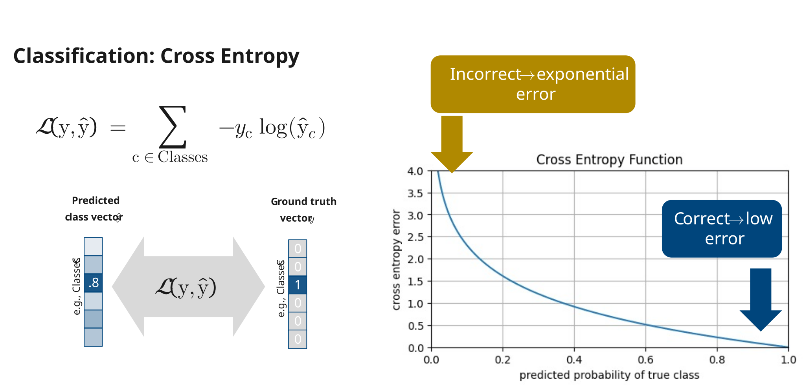
</div>

</div>

<!--
Step 4 of block 2. In PyTorch, CrossEntropyLoss expects the raw scores (logits) and applies log-softmax internally - do not put a softmax layer in front of it.
-->

---

# Same Recipe for Logistic Regression

<PartTag part="fitting" />

<div class="grid grid-cols-2 gap-6 mt-4 text-[.78rem]">

<div class="rounded-xl border border-blue-200 bg-blue-50 p-4">
<div class="font-semibold text-blue-800 mb-2">linear regression + MSE</div>

$$
\hat y = \mathbf w^\top\mathbf x + b
$$

$$
\nabla_{\mathbf w}\mathcal L = \frac{1}{N}\sum_i (\hat y_i - y_i)\,\mathbf x_i
$$

setting it to zero is **solvable** → closed form

</div>

<div class="rounded-xl border border-orange-200 bg-orange-50 p-4">
<div class="font-semibold text-orange-700 mb-2">logistic regression + BCE</div>

$$
p = \sigma(\mathbf w^\top\mathbf x + b)
$$

$$
\nabla_{\mathbf w}\mathcal L = \frac{1}{N}\sum_i (p_i - y_i)\,\mathbf x_i
$$

$p_i$ depends non-linearly on $\mathbf w$ → **no closed form**

</div>

</div>

<blockquote class="blockquote2 mt-5">
The gradient has the same form: (prediction − target) × input. Gradient descent does not care whether a closed form exists &mdash; it only needs to evaluate this gradient.
</blockquote>

<!--
Derivation of the BCE gradient follows with the chain rule in block 3 (backpropagation for logistic regression).
-->

---

# Testing All Possible Weights

<PartTag part="fitting" />

<div class="grid grid-cols-[2.2fr_1fr] gap-6 mt-2 items-center">

<div>
<LogisticLossExplorer :init="[-7.5, 7.5]" :pins="[[-7.5, 7.5], [1, 1], [5, -5]]" />
</div>

<div class="text-[.72rem]">
<blockquote class="blockquote4">model 1: boundary flipped, every sample confidently wrong → high loss</blockquote>
<blockquote class="blockquote1 mt-3">model 2: small weights, class 0 on the wrong side but not confident → loss ≈ 1.2</blockquote>
<blockquote class="blockquote2 mt-3">model 3: classes separated and confident → loss ≈ 0</blockquote>
</div>

</div>

<!--
Click the three model buttons, then hover freely. Note the large yellow plateau in the lower right: many weights are (almost) perfect.
-->

---
layout: bonn-two-cols-header
---

# The Loss Surface of Logistic Regression

<PartTag part="fitting" />

::left::

<div class="text-[.8rem]">

<div class="flex gap-1 items-center mt-2 text-[.7rem] whitespace-nowrap">
<span class="rounded bg-blue-800 text-white px-2 py-1">no global minimum</span>
<span>→</span>
<span class="rounded bg-blue-800 text-white px-2 py-1">no closed form</span>
<span>→</span>
<span class="rounded bg-orange-500 text-white px-2 py-1">GD still works</span>
</div>

- on separable data the loss keeps shrinking as $\lVert\mathbf w\rVert \to \infty$: the sigmoid becomes a step
- the surface is still **convex**: there are no bad valleys to get stuck in
- but it has **flat regions**, where the gradient is tiny and progress is slow

<blockquote class="blockquote1 mt-4">
In practice we stop early or add regularization (weight decay) to keep the weights finite.
</blockquote>

</div>

::right::

<div class="flex justify-center">
<LossSurface3D surface="log-bce" :width="360" :height="300" :yaw="0.9" :pitch="0.4" :auto-rotate="false" />
</div>

<!--
Replaces the rotating 3D video. Rotate so the plateau (yellow, near zero loss) and the steep wall (confidently wrong models) are both visible.
-->

---

# Let's Try Gradient Descent

<PartTag part="fitting" />

<div class="text-[.76rem] -mt-1">

Full-batch gradient descent on the BCE, starting with a flipped boundary at $\mathbf w = (-7, 7)$. Press **run**, then try other learning rates or click the surface to start elsewhere.

</div>

<div class="mt-1">
<LogisticGDDemo :init="[-7, 7]" :lr="0.1" show-lr />
</div>

<blockquote class="blockquote1 mt-2 text-[.72rem]">
Confidently wrong samples give a constant gradient: the loss falls in a straight line. On the yellow plateau progress crawls &mdash; the loss never quite reaches zero.
</blockquote>

<!--
Same setup as the course notebook (logistic_regression.py): 20 samples per class from N((-1,3), 0.5 I) and N((3,-2), 0.5 I), no bias, mean BCE, SGD lr 0.1, 150 epochs, start (-7, 7).
eta = 0.1: converged region after ~40 epochs. eta = 0.01: still far up the wall after 150 epochs. eta = 1: ten times faster, no instability here because the surface is so flat.
The dashed grey line in the training curve is the rest of the run.
-->

---

# Gradient Descent: Role of Momentum

<PartTag part="fitting" />

<div class="text-[.78rem] mt-1">

Keep a running velocity $\mathbf v$ and let it carry the steps: $\;\mathbf v \leftarrow \mu\,\mathbf v - \eta\,\nabla\mathcal{L}, \quad \mathbf w \leftarrow \mathbf w + \mathbf v$

</div>

<div class="mt-1 max-w-[600px] mx-auto">
<LogisticGDRace :init="[-7, 7]" :configs="[
  { label: 'no momentum (μ = 0)', lr: 0.1, momentum: 0 },
  { label: 'μ = 0.8', lr: 0.1, momentum: 0.8 },
  { label: 'μ = 1 (no friction)', lr: 0.1, momentum: 1 },
]" />
</div>

<blockquote class="blockquote2 mt-2 text-[.75rem]">
Momentum crosses flat areas quickly; with μ = 1 nothing slows it down &mdash; it never stops.
</blockquote>

<!--
All three runs: start (-7, 7), eta = 0.1, same SGD as torch.optim.SGD(momentum=mu). Press run once; the runs advance in lockstep.
mu = 0: ~40 epochs to the plateau. mu = 0.8: there after ~10 epochs, then settles. mu = 1: the velocity is never damped - w keeps flying away from the origin (beyond (200, -260) after 150 epochs).
Momentum (and Adam) are the standard optimizers for the deep networks in block 3 and later lectures.
-->

---

# Back to Real Data: Land Cover

<PartTag part="data" />

<div class="mt-4">
  <LinearDecisionBoundaryDemo />
</div>

<!--
Feature space recap: NDVI vs. Green reflectance for 759 land-cover samples.
Drag the two handles to reshape the line and watch w1, w2, b update live.
This is the linear score w^T x + b; the sigmoid (logistic regression) comes next.
-->

---

# Logistic Regression on Land Cover

<PartTag part="data" />

<div class="mt-4">
  <LogisticRegressionDemo />
</div>

<!--
Same feature space and boundary mechanic as the previous slide, but the linear score
z = w^T x + b is now passed through the sigmoid to become a probability P(y=1|x).
The boundary itself does not move: z = 0 is still exactly where P = 0.5.
-->

---

# Recap: Logistic Regression

<div class="mt-2 text-[.8rem] compare-table">

| | Linear regression | Logistic regression |
|---|---|---|
| **Model core** | $\mathbf W\mathbf x + \mathbf b$ | $\mathbf W\mathbf x + \mathbf b$ |
| **Output** | continuous value | class probability |
| **Output function** | identity | sigmoid or softmax |
| **Typical loss** | MSE | cross-entropy |
| **Optimization** | closed form possible | gradient-based optimization |

</div>

<blockquote class="blockquote2 mt-4 text-[.78rem]">
The linear transformation has not changed. What changes is the <strong>interpretation</strong> of its output, the <strong>output function</strong> and the <strong>loss</strong> &mdash; and with them, how we must optimize.
</blockquote>

<blockquote v-click class="blockquote3 mt-3 text-[.74rem]">
Next: what if the features are not good enough for a linear boundary? Combine several transformations and let the model <strong>learn</strong> the features.
</blockquote>

---
layout: bonn-section
sectionColor: "#00457c"
section: multilayer-perceptrons
sectionTitle: "Multilayer Perceptrons"
---

# Multilayer Perceptrons

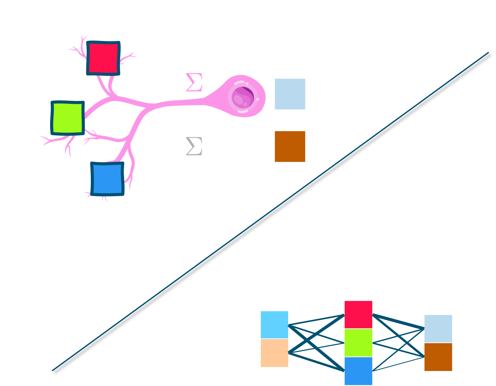

<!--
Block 3: learning the representation. From linear decisions on fixed features to learned feature-space transformations.
An MLP = stacked linear regressions with non-linear activations, ending in a linear (regression) or logistic/softmax (classification) head.
-->

---

# What happens when we combine multiple learned transformations?

<div class="mt-3 text-[.66rem] block-roadmap">

|  | Block 3 — Multilayer Perceptrons | Main idea |
|---|---|---|
| 1 | Biological neurons | conceptual inspiration |
| 2 | Artificial neuron | weighted sum + activation |
| 3 | Many neurons form a layer | an $M \to N$ map: matrix multiplication and its geometry |
| 4 | Many layers form a network | stacked transformations |
| 5 | Why non-linear activations? | stacked linear maps collapse |
| 6 | Hidden layers | learned intermediate representations |
| 7 | Depth | composition of increasingly abstract representations |
| 8 | Backpropagation | gradients flow layer by layer |

</div>

<div class="mt-2 text-[.66rem] text-gray-600"><strong>Model:</strong> steps 1–7 &nbsp;→&nbsp; <strong>Loss:</strong> as in block 2 &nbsp;→&nbsp; <strong>Fitting:</strong> step 8</div>

<!--
Central question of block 3. Key message: stacking linear layers alone does not make a model more expressive - the non-linear activations do.
-->

---

# Biological Interpretation of Adding Signals

<PartTag part="model" />

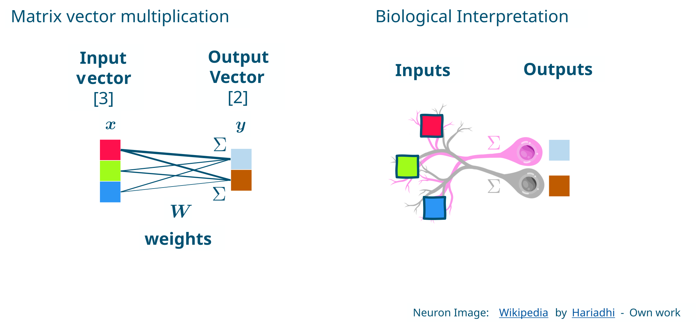

---

# Activation Functions – Biological Interpretation

<PartTag part="model" />

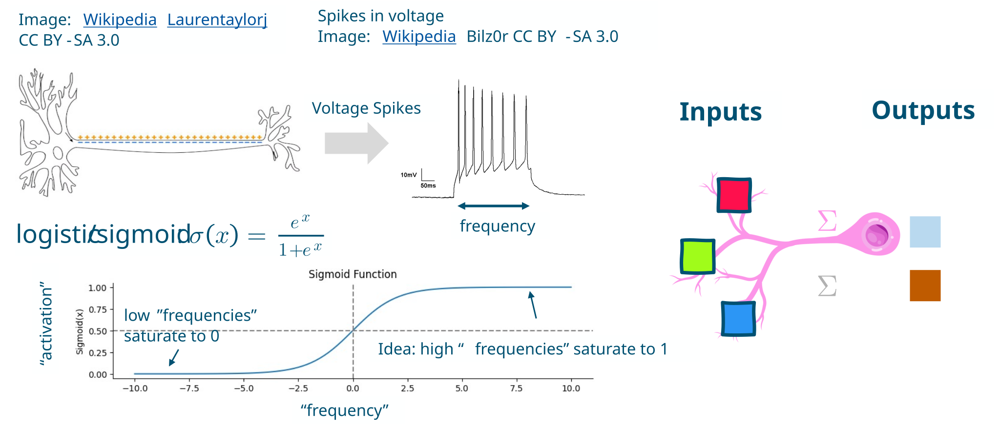


---

# An Artificial Neuron

<PartTag part="model" />

<div class="grid grid-cols-[1.25fr_1fr] gap-6 mt-3 items-center">

<div>
<NeuronDiagram />
</div>

<div class="text-[.78rem]">

$$
a = \text{act}\left(\mathbf w^\top\mathbf x + b\right)
$$

- the weighted sum is a **block 1** transformation $\mathbb R^p \to \mathbb R$
- the activation is the **block 2** idea: a non-linear output function

<blockquote class="blockquote2 mt-3">
With a sigmoid activation, one neuron <strong>is</strong> logistic regression.
</blockquote>

</div>

</div>

<!--
Step 2 of block 3. Compare to the biological picture: inputs = dendrites, weighted sum = integration in the cell body, activation = firing rate.
-->

---

# Many Neurons Form a Layer

<PartTag part="model" />

<div class="grid grid-cols-[1fr_1.1fr] gap-6 mt-3 items-center">

<div class="text-[.78rem]">

$K$ neurons that see the same input = $K$ rows of a weight matrix:

$$
\mathbf h = \text{act}\left(\mathbf W\mathbf x + \mathbf b\right), \qquad \mathbf W \in \mathbb R^{K\times p}
$$

- the $K$-output map from block 2 (one row per neuron), now feeding the next layer
- the activation is applied to every output separately
- the layer maps the input into a new $K$-dimensional representation $\mathbf h$

```python
layer = nn.Sequential(nn.Linear(p, K), nn.ReLU())
```

</div>

<div>
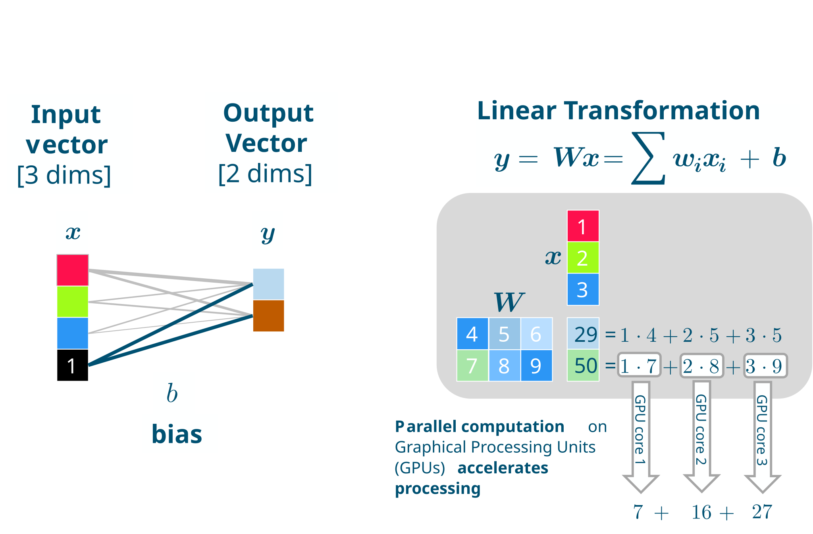
</div>

</div>

<!--
Step 3 of block 3: recall the K-output map from block 2 plus the per-output activation. The next slides show what such M -> N maps do geometrically.
-->

---

# One Sample or a Whole Dataset

<PartTag part="model" />

<div class="grid grid-cols-2 gap-6 mt-4 text-[.78rem]">

<div class="rounded-xl border border-blue-200 bg-blue-50 p-4">
<div class="font-semibold text-blue-800 mb-2">one sample: column vectors</div>

$$
\underbrace{\hat{\mathbf y}}_{K} = \underbrace{\mathbf W}_{K\times p}\,\underbrace{\mathbf x}_{p} + \underbrace{\mathbf b}_{K}
$$

the notation on the slides and in most textbooks

</div>

<div class="rounded-xl border border-gray-300 p-4">
<div class="font-semibold text-blue-800 mb-2"><em>n</em> samples: one row per sample</div>

$$
\underbrace{\hat{\mathbf Y}}_{n\times K} = \underbrace{\mathbf X}_{n\times p}\,\underbrace{\mathbf W^\top}_{p\times K} + \mathbf b^\top
$$

the bias row is added to every sample

</div>

</div>

```python
layer = nn.Linear(in_features=p, out_features=K)   # stores W (K x p) and b (K)
Y_hat = layer(X)                                   # X: (n, p) -> Y_hat: (n, K), computes X @ W.T + b
```

<!--
Same map, two bookkeeping conventions. For K = 1 the batch version is exactly y = Xw + b from block 1.
-->

---

# Linear Transformation from 3D to 2D

<PartTag part="model" />

<div class="grid grid-cols-2 gap-4 mt-2 items-center">

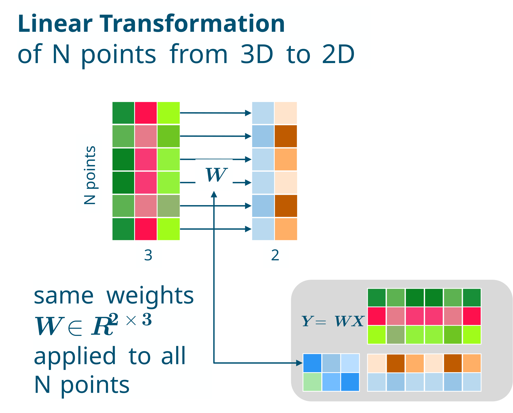

<video
  src="./figures/2d_plot.mov"
  class="w-full h-[360px] rounded-lg border border-gray-200 object-contain bg-black"
  autoplay loop muted playsinline controls
/>

</div>

<!--
The same W is applied to every data point: X W^T maps a whole point cloud from 3D to 2D. A layer with two neurons does exactly this (before its activation).
-->

---

# Linear Transformation from 2D to 3D

<PartTag part="model" />

<div class="grid grid-cols-2 gap-4 mt-2 items-center">

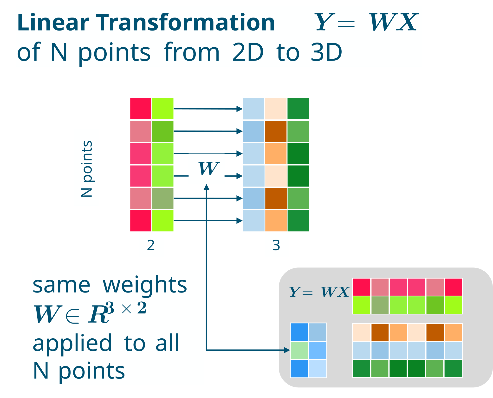

<video
  src="./figures/3d_plot.mov"
  class="w-full h-[360px] rounded-lg border border-gray-200 object-contain bg-black"
  autoplay loop muted playsinline controls
/>

</div>

<!--
Mapping to more dimensions than we started with: the points stay on a 2D plane inside 3D. This is what a wider hidden layer does - before the non-linearity bends that plane.
-->

---

# Linear Alebra: Stacking Layers

<PartTag part="model" />

## A 2D→3D Linear Projection moves data into 3D representation space

<div class="grid grid-cols-2 gap-4 mt-4 items-center">

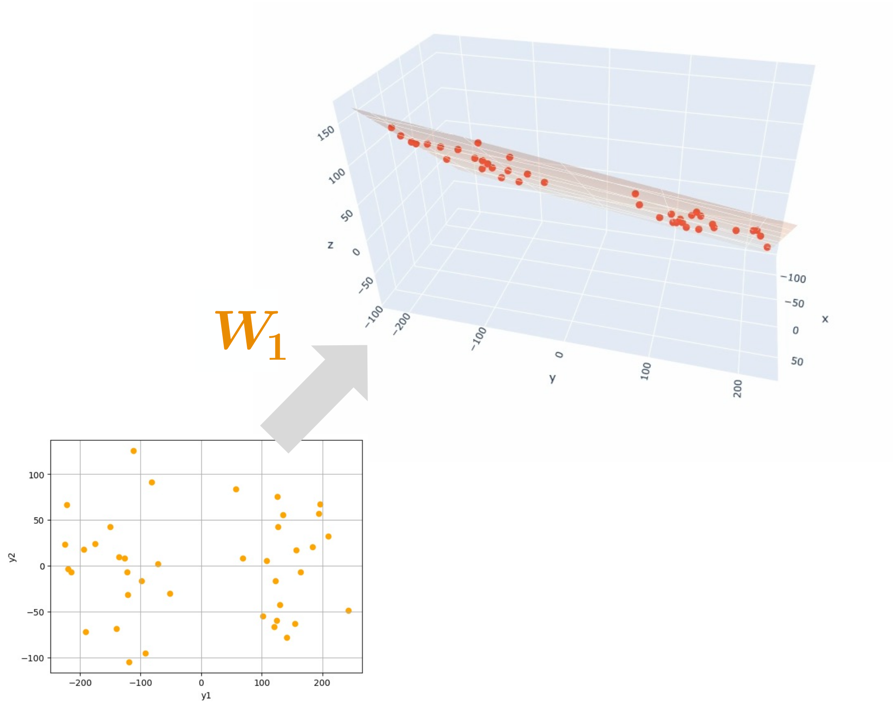

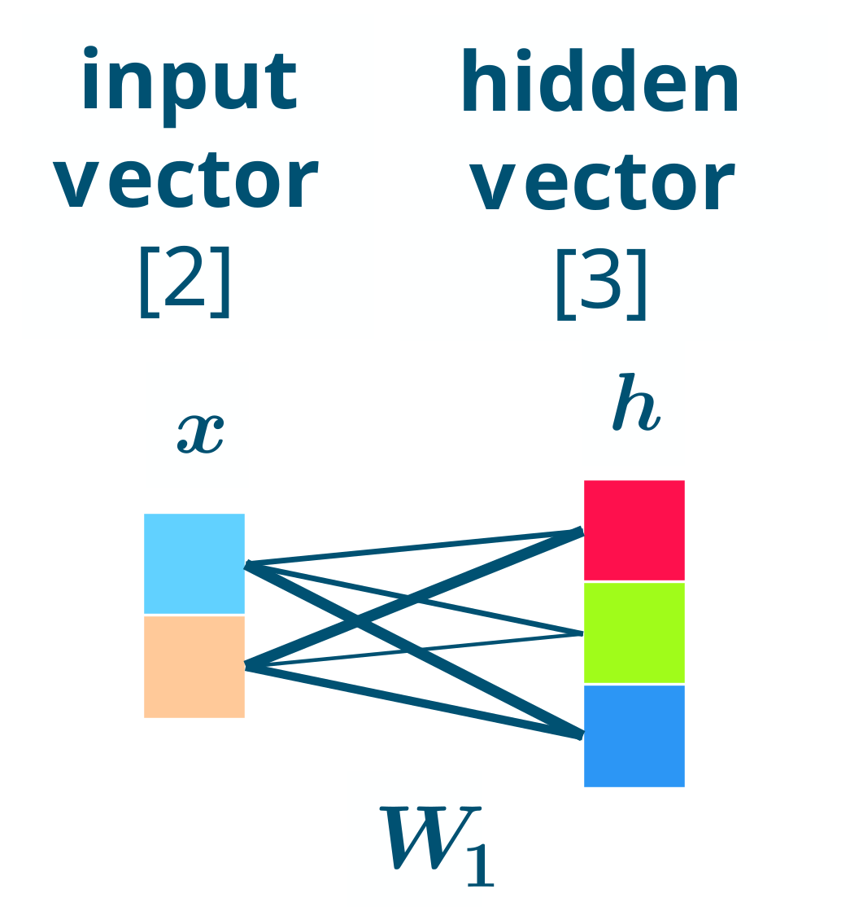

</div>

---

# Linear Alebra: Stacking Layers

<PartTag part="model" />

## Two Linear projections 2D→3D→2D in a 2-Layer network

<div class="grid grid-cols-2 gap-4 mt-4 items-center">

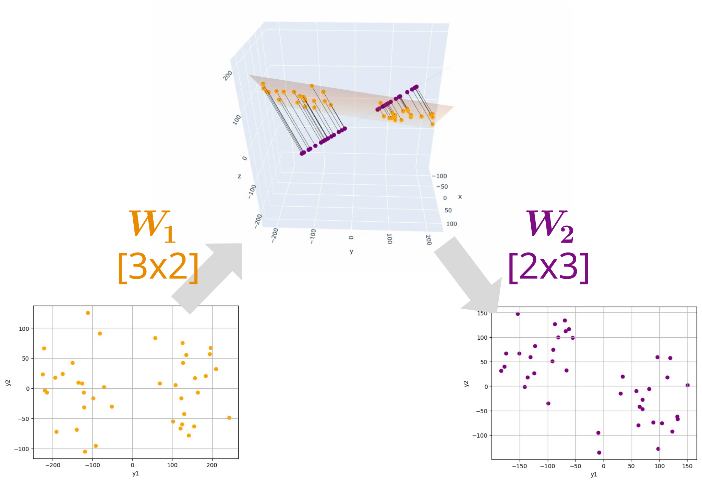

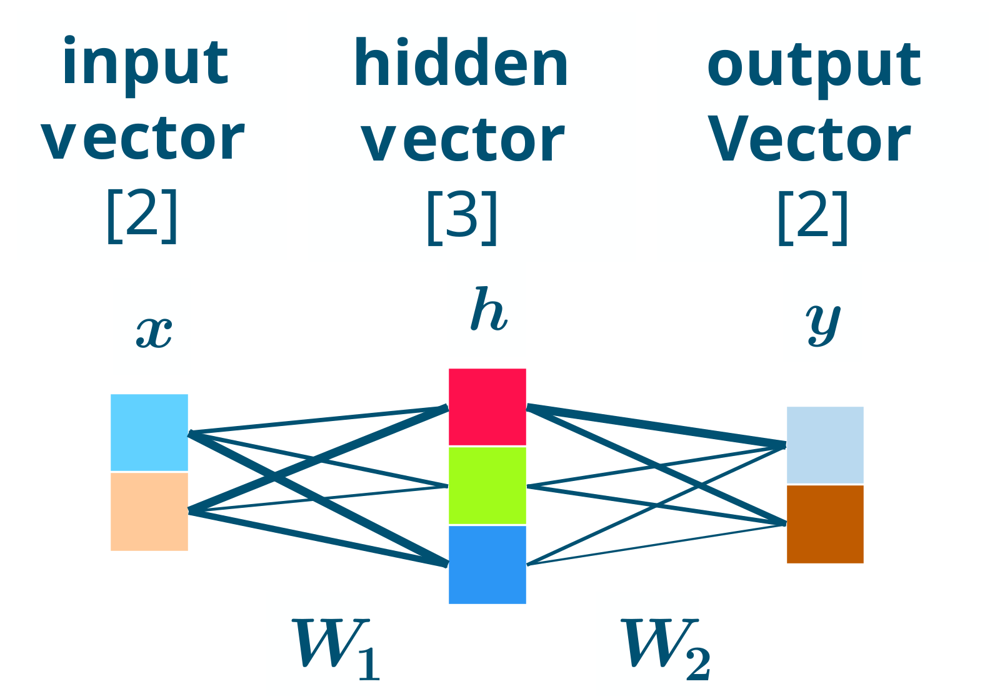

</div>


---

# Linear Alebra: Stacking Layers

<PartTag part="model" />

## Two Linear projections 2D→3D→2D without non-linearity is a single 2D → 2D projection

<div class="grid grid-cols-2 gap-4 mt-4 items-center">

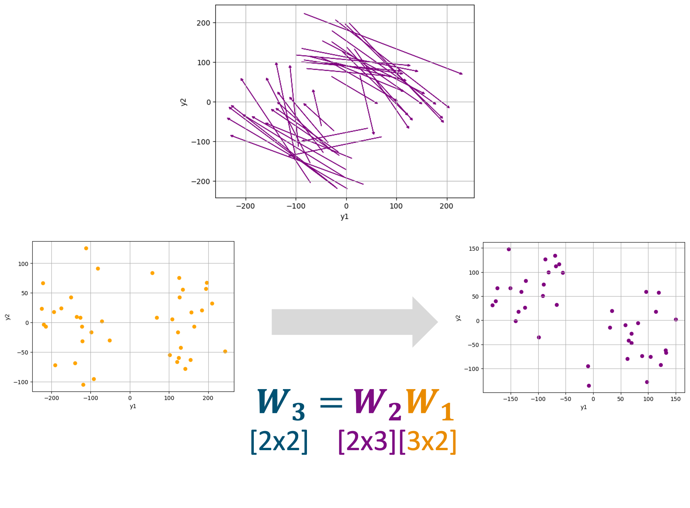


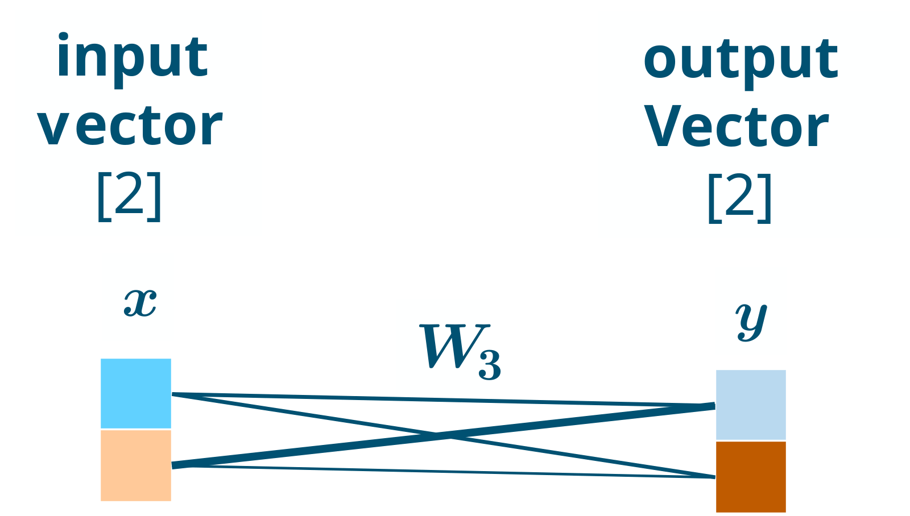

</div>

---

# Linear Alebra: Stacking Layers

<PartTag part="model" />
## Non-linear functions like ReLU are needed to transform feature space

<div class="grid grid-cols-2 gap-4 mt-4 items-center">

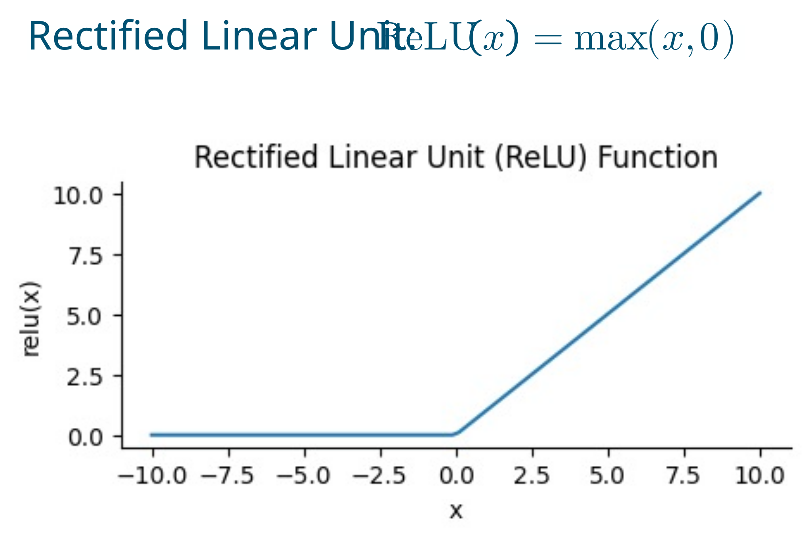


<video
  src="./figures/relu.mov"
  class="w-full h-[250px] rounded-lg border border-gray-200 object-contain bg-black"
  autoplay loop muted playsinline controls
/>

</div>

---

# From Fixed to Learned Features

<PartTag part="model" />

<div class="mt-2">
<ModelHeadDiagram :clicks="$clicks" />
</div>

<div v-click="1" class="text-[.75rem] mt-1">
<blockquote class="blockquote2">

An MLP for regression or classification ends in exactly these two heads. What changes now is **what the head sees**: a learned representation $\mathbf h$ instead of hand-built features $\mathbf x$. The loss surface gets far more complex, so gradient descent is the only option.

</blockquote>
</div>

<!--
Key bridge into block 3. Blocks 1-2: representation fixed (built from the data cube), only the head is learned. MLP: representation and head are learned jointly, end to end, with the same losses (MSE, BCE / cross-entropy) and the same optimizer (gradient descent).
-->

---

# More layers → more complex transformations

<PartTag part="model" />

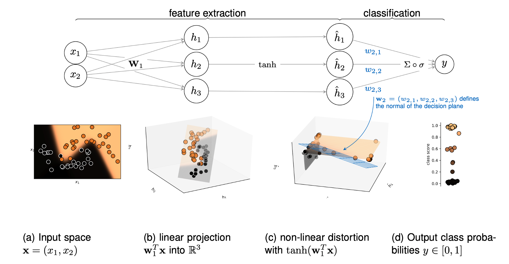

---

# Demo: Multi-Layer Perceptron Feature Space

<PartTag part="model" />

<MlpFeatureSpaceDemo />

<div class="mt-1 text-xs text-gray-500">
Inspired by Andrej Karpathy's <a href="https://cs.stanford.edu/people/karpathy/convnetjs/demo/classify2d.html" target="_blank" rel="noopener noreferrer">ConvNetJS Classify2D</a> demo. Implemented with Claude and Codex.
</div>

---

# Multi-Layer Perceptron - Implementation

<PartTag part="model" />

<div class="grid grid-cols-2 gap-4 mt-4 items-center">

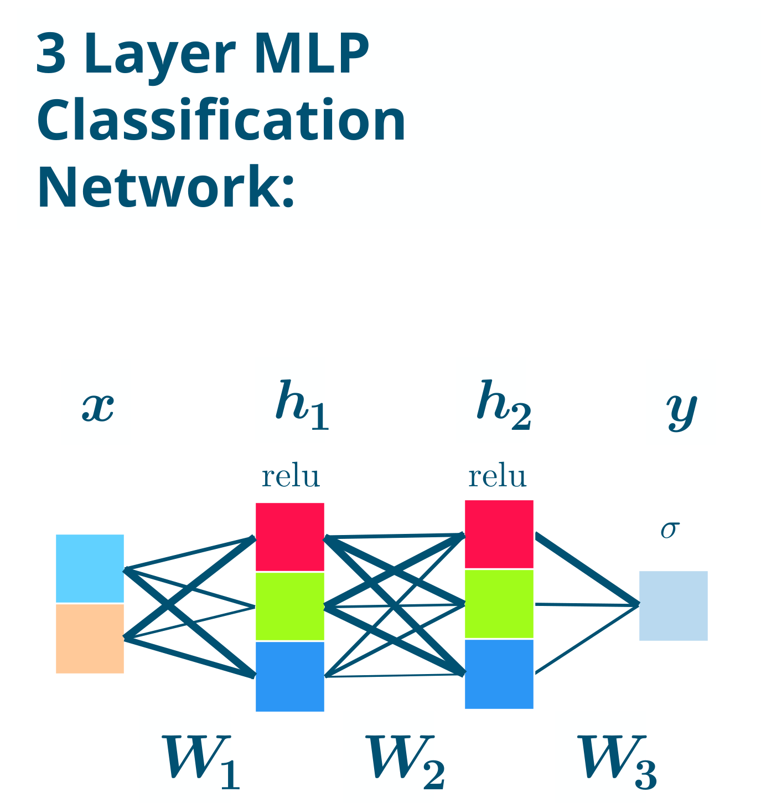

<style>
.mlp-impl-code pre { font-size: 9.5px !important; line-height: 1.4 !important; }
</style>

<div class="mlp-impl-code">

```python
import torch
import torch.nn as nn
import torch.nn.functional as F

class MLPClassifier(nn.Module):
    def __init__(
        self, input_dim, hidden_dim, num_classes
    ):
        super(MLPClassifier, self).__init__()
        self.fc1 = nn.Linear(input_dim, hidden_dim)
        self.fc2 = nn.Linear(hidden_dim, hidden_dim)
        self.fc3 = nn.Linear(hidden_dim, num_classes)

    def forward(self, x):
        x = F.relu(self.fc1(x))      # 1st layer ReLU
        x = F.relu(self.fc2(x))      # 2nd layer ReLU
        x = F.sigmoid(self.fc3(x))   # Output (probs)
        return x
```

</div>

</div>


---

# Depth: Composing Representations

<PartTag part="model" />

<div class="grid grid-cols-[1fr_1.15fr] gap-6 mt-3 items-center">

<div class="text-[.78rem]">

A deep network is a composition of layers:

$$
\hat{\mathbf y} = f_L\big(\cdots f_2\big(f_1(\mathbf x)\big)\big), \qquad f_\ell(\mathbf h) = \text{act}(\mathbf W_\ell \mathbf h + \mathbf b_\ell)
$$

- every layer re-represents the output of the previous one
- early layers: simple patterns in the raw input (e.g. edges, spectral contrasts)
- later layers: combinations of those patterns &mdash; increasingly **abstract** representations
- the last layer is still the linear / logistic head of blocks 1–2

</div>

<div>
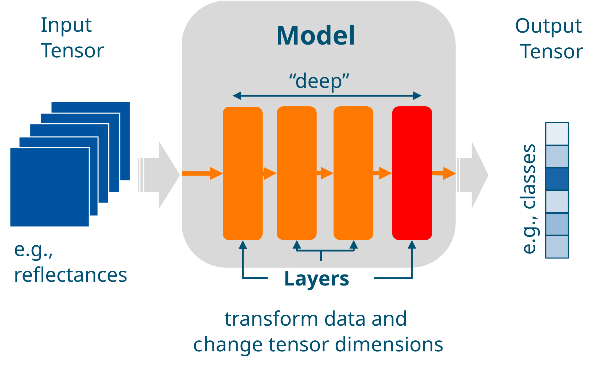
</div>

</div>

<!--
Step 7 of block 3 (borrowed from Lecture 5). Lecture 5 picks this up: why learned representations work and which architectures build them for images and time series.
-->

---

# Learning Feature Representations

<PartTag part="model" />


<!--
Step 7 of block 3 (from Lecture 5): feature learning and a simple classifier are trained together, end to end. The "simple classifier" is the logistic regression of block 2.
-->

---
layout: bonn-section
sectionColor: "#00457c"
section: multilayer-perceptrons
---

# Training an MLP: Gradient Descent &amp; Backpropagation

<!--
Learning the parameters of every layer: parameters -> prediction -> loss -> gradient -> update.
Same recipe as for logistic regression; backpropagation makes the gradients cheap to compute for many layers.
-->

---

# Training: Adjusting Weights to Minimize Loss

<PartTag part="loss" />

## Finding good parameters W

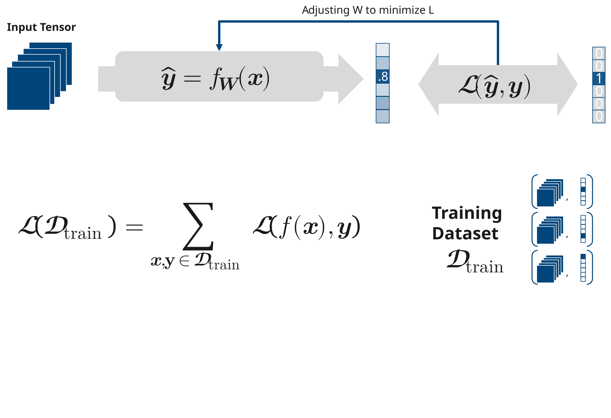

---

# Gradient Descent on Mini-Batches

<PartTag part="fitting" />

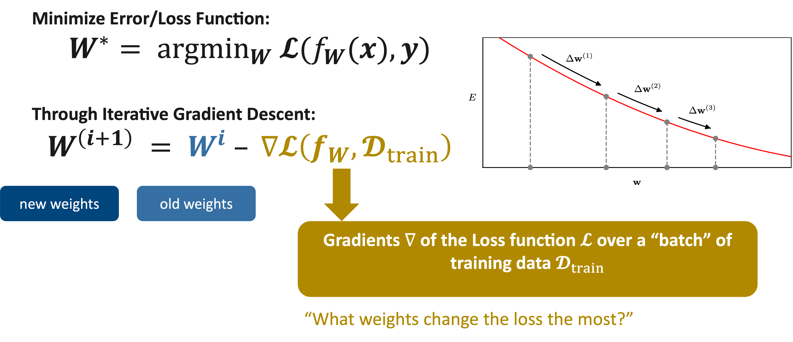

---

# More Complex Models, More Complex Loss Surfaces

<PartTag part="fitting" />

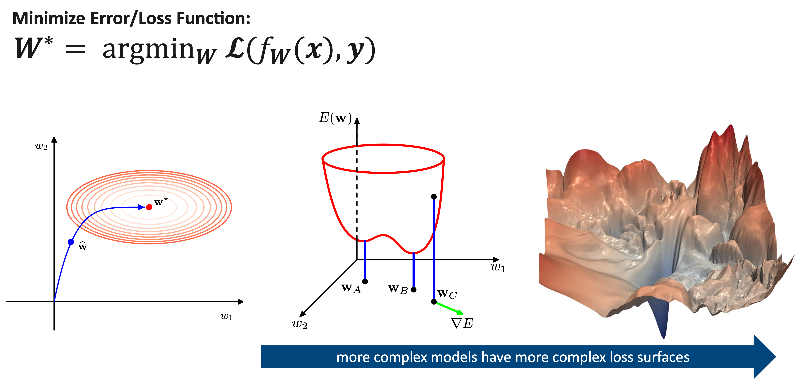


---

# Gradient Descent vs Backpropagation

<PartTag part="fitting" />

<div class="grid grid-cols-2 gap-5 mt-4 text-[.8rem]">
  <div class="rounded-xl border border-blue-200 bg-blue-50 p-4">
    <div class="font-semibold text-blue-900 mb-2">Gradient Descent</div>
    <div>How to update parameters once gradients are known.</div>
    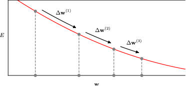
  </div>
  <div class="rounded-xl border border-emerald-200 bg-emerald-50 p-4">
    <div class="font-semibold text-emerald-900 mb-2">Backpropagation</div>
    <div>How to compute gradients efficiently through many layers.</div>
    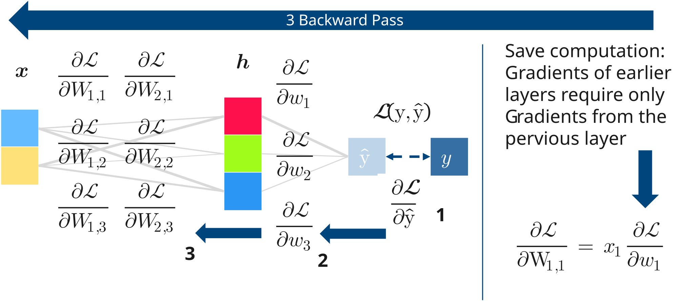
  </div>
</div>

<div class="mt-4 text-[.72rem] text-gray-600">Backprop gives the gradients; gradient descent uses them to step the parameters.</div>

<!--
Clarify the common confusion: optimization rule vs gradient-computation algorithm.
-->

---
clicks: 2
---

# Backpropagation for Logistic Regression

<PartTag part="fitting" />

<div class="mt-2">
<ChainRuleDiagram :clicks="$clicks" />
</div>

<div v-click="2" class="text-[.75rem] mt-2">
<blockquote class="blockquote1">
For deeper models, the same chain rule is applied layer by layer, from the loss back to the input: <strong>backpropagation</strong>. Gradient descent then uses these gradients to update all weights.
</blockquote>
</div>

<!--
Click 1: local derivatives of each step. Click 2: multiply them -> (p - y) x, the gradient from the BCE slide. Backprop = computing exactly this product efficiently for millions of parameters; frameworks like PyTorch do it automatically (autograd).
-->

---

# Backpropagation 1

<PartTag part="fitting" />

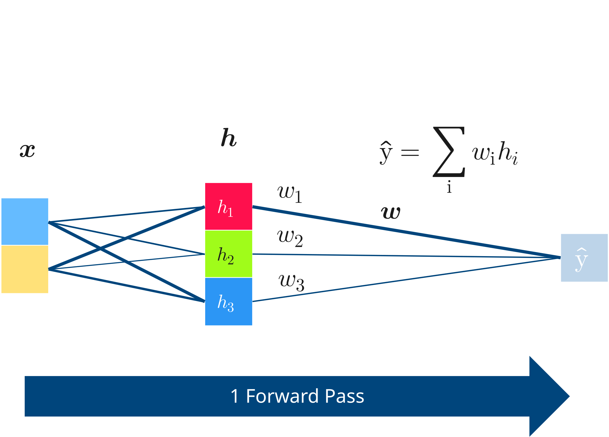

---

# Backpropagation 2

<PartTag part="fitting" />

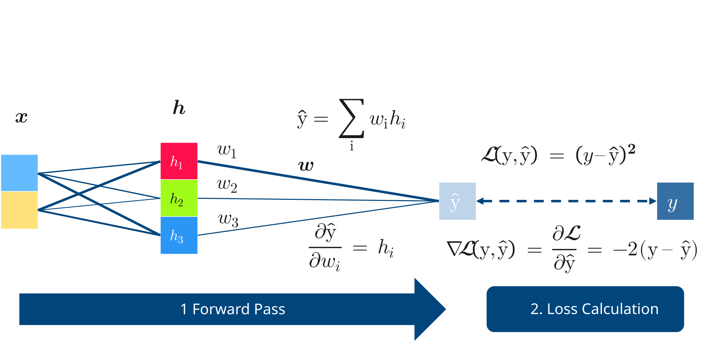

---

# Backpropagation 3

<PartTag part="fitting" />

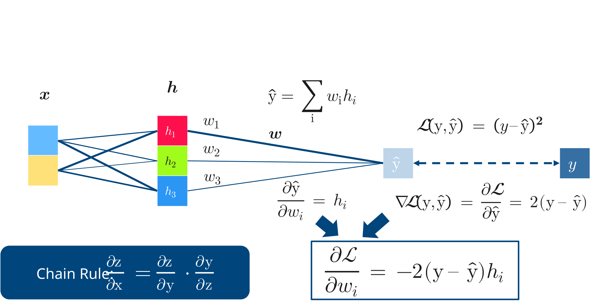

---

# Backpropagation 4

<PartTag part="fitting" />

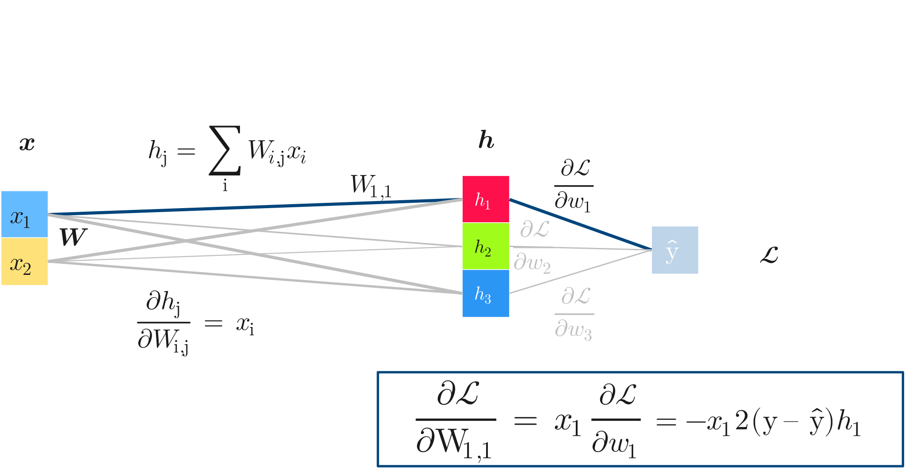

---

# Backpropagation 5

<PartTag part="fitting" />

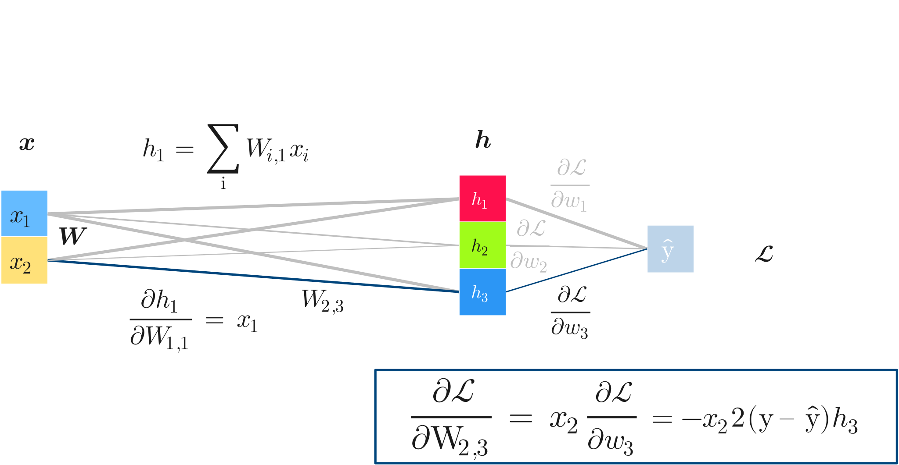

---

# Backpropagation 6

<PartTag part="fitting" />


---

# Backpropagation 7

<PartTag part="fitting" />

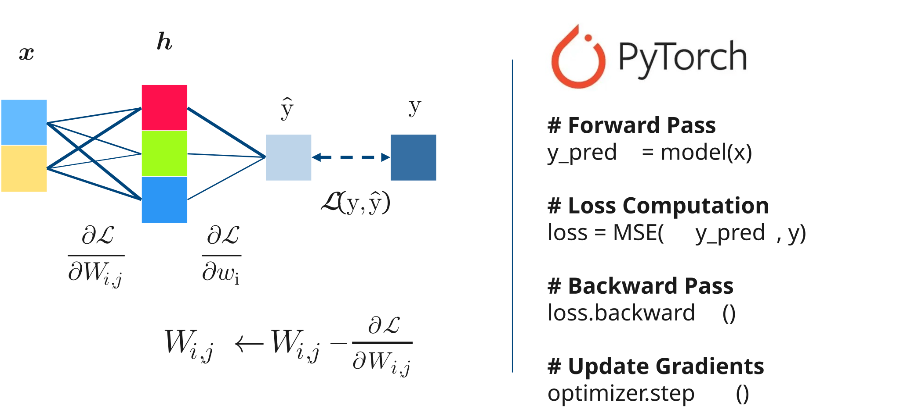

---

# Recap: Lecture 4

<div class="grid grid-cols-[1.1fr_1fr] gap-8 mt-3 items-start">

<div class="text-[.78rem]">

<v-clicks>

- **Block 1:** linear regression fits a line / plane, $\mathbf y = \mathbf X\mathbf w + b$; with MSE it has a closed-form solution
- **Block 2:** $K$ outputs $\mathbf W\mathbf x + \mathbf b$ + sigmoid / softmax + cross-entropy classify; no closed form, so we use gradient descent
- **Block 3:** neurons form layers ($M \to N$ maps), layers form networks; non-linear activations make stacking worthwhile and hidden layers learn representations
- **Backpropagation** computes the gradients layer by layer, **gradient descent** uses them &mdash; the same optimization as for logistic regression

</v-clicks>

</div>

<div class="text-[.74rem]">

| | guess | closed form | gradient descent |
|---|:-:|:-:|:-:|
| linear regression | ✓ | ✓ | ✓ |
| logistic regression | ✓ | ✗ | ✓ |
| MLP / deep networks | ✗ | ✗ | ✓ |

<div class="text-[.68rem] text-gray-600 mt-2">Which solving tools are applicable.</div>

</div>

</div>

<!--
Lecture 5: why should what the network learns work beyond the training data? Learned representations and deep architectures.
-->

---
layout: learning-outcomes
mode: after
meeting: lecture-04
section: closing
sectionTitle: Closing
---

# Revisit the learning outcomes

---
layout: bonn-section
sectionColor: "#00457c"
section: backup
sectionTitle: "Backup"
---

# Backup Slides

<div class="text-[.9rem] mt-4">Optional material: statistics and details not needed for the main storyline.</div>

<!--
Moved here in iteration 5 to unload the blocks: advertising data, limits of univariate models, MAE, interpretable coefficients, the argmin slide, linear transformation with bias.
-->

---

# A Closer Look at the Data

<div class="text-gray-700">

$\mathcal{D} = \{((x_{1,i}, x_{2,i}, x_{3,i}), y_i)\}_{i=1}^N$

</div>

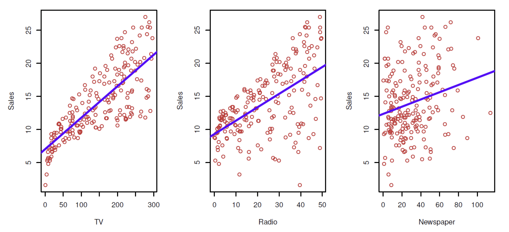

<div class="grid grid-cols-3 gap-4 mt-1 text-center text-gray-700 text-sm">

<div>

$x_1 \mapsto y$ (TV &rarr; sales)

</div>

<div>

$x_2 \mapsto y$ (radio &rarr; sales)

</div>

<div>

$x_3 \mapsto y$ (newspaper &rarr; sales)

</div>

</div>

<div class="figure-copyright">
Figure: James, Witten, Hastie &amp; Tibshirani, <a href="https://www.statlearning.com/" target="_blank" rel="noopener noreferrer"><em>An Introduction to Statistical Learning</em></a>, Advertising dataset.
</div>

---
layout: bonn-two-cols-header
---

# Limits of Univariate Models

Some relationships are well-described by a single variable &mdash; most are not.

::left::

<div class="text-center text-sm font-semibold text-blue-800 mb-2">Roughly linear</div>

<div class="flex items-center justify-center gap-2">
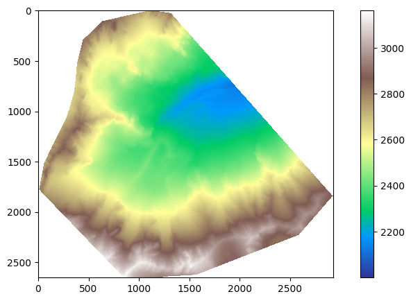
<div class="text-lg text-blue-800">&rarr;</div>
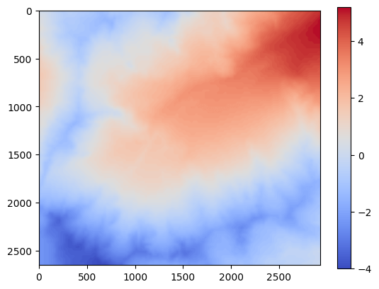
</div>

<div class="mt-3 text-center text-gray-700 text-sm">

elevation &rarr; average temperature, roughly $-0.006\frac{\text{°C}}{\text{m}}$

</div>

::right::

<div class="text-center text-sm font-semibold text-blue-800 mb-2">Clearly non-linear</div>

<div class="flex items-center justify-center gap-2">

<div class="text-lg text-blue-800">?</div>
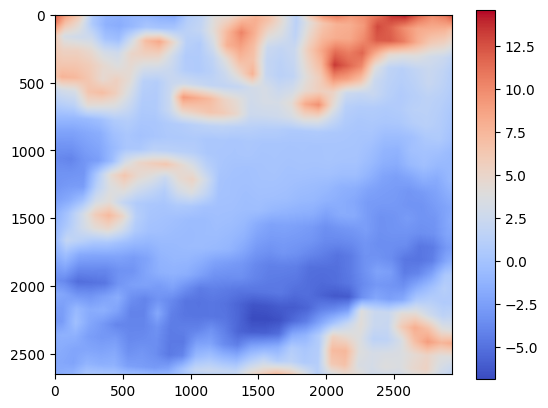
</div>

<div class="mt-3 text-center text-gray-700 text-sm">
elevation &rarr; surface temperature &mdash; shading, wind, and local terrain also matter
</div>

---

# Mean Absolute Error (MAE)

<div class="grid grid-cols-2 gap-8 mt-6 items-center">

<div class="flex justify-center">
<RegressionScatterDemo variant="residual-segments" x-label="x" y-label="y" />
</div>

<div>

$$
\text{MAE}(\mathcal{D}; w, b) = \frac{1}{N} \sum_{i=1}^N \vert \hat{y}_i - y_i \vert
$$

over model parameters $w, b$ with $\hat{y}_i = f(x_i; w, b)$ and dataset $\mathcal{D} = \{x_i, y_i\}_{i=1}^N$

<blockquote class="blockquote1 mt-3">
Very intuitive &mdash; but does not punish large errors.
</blockquote>

</div>

</div>

---

# Interpretable Coefficients

<div class="grid grid-cols-2 gap-8 mt-4 items-center">

<div class="flex justify-center">
<FeatureTargetDiagram
  :features="[
    { label: 'elevation', symbol: 'x₁', width: 5 },
    { label: 'slope', symbol: 'x₂', width: 4 },
    { label: 'aspect', symbol: 'x₃', width: 2.5 },
  ]"
  target="surface temperature"
  target-symbol="y"
/>
</div>

<div>
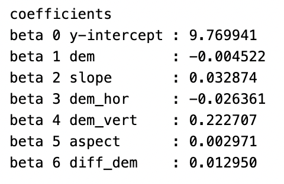

<div class="mt-3 text-gray-700 text-sm">

Each weight $\hat w_j$ tells us how $\hat{y}$ changes per unit of $x_j$, holding the other features fixed (the printout calls them beta; beta 0 is the bias $b$).

</div>

<blockquote class="blockquote1 mt-2">
Caveat: coefficients are only directly comparable across features when the features share units &mdash; or are normalized.
</blockquote>

</div>

</div>

<div class="figure-copyright">
Figure: M. Rußwurm &amp; D. Tuia, <em>Linear Regression</em>, ENV-408 course materials, EPFL, 2023.
</div>

---

# Linear Transformation with Bias

<div class="text-[.78rem]">

$\hat{\mathbf y} = \mathbf W \mathbf x + \mathbf b$: the bias is the extra constant input $1$ &mdash; the same trick as the column of ones in $\mathbf X$.

</div>


---

# The Learning Objective: argmin

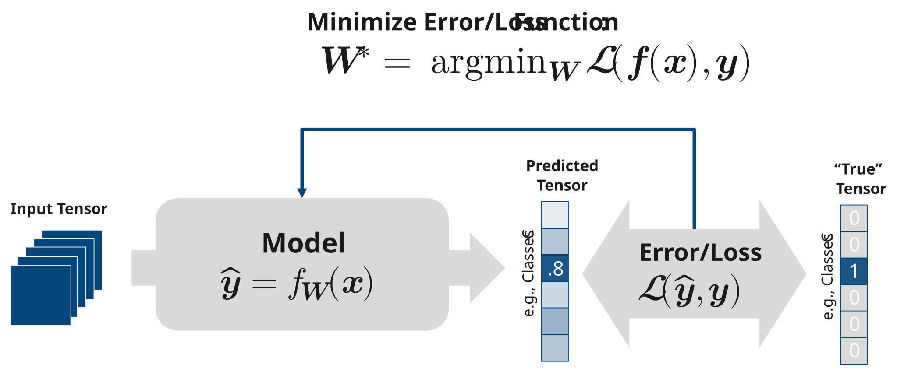
