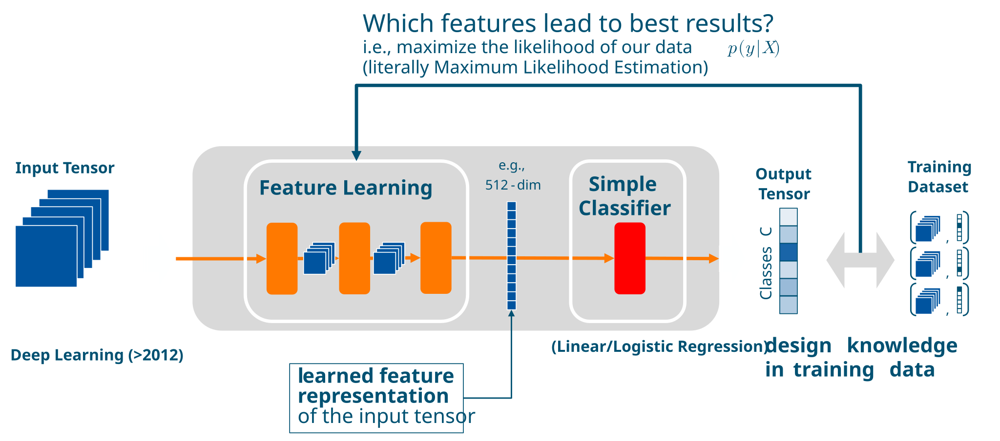
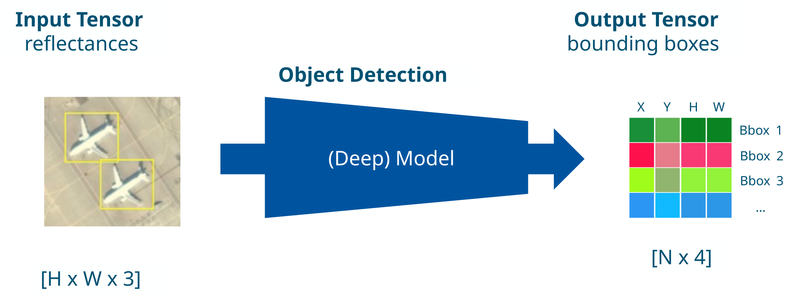
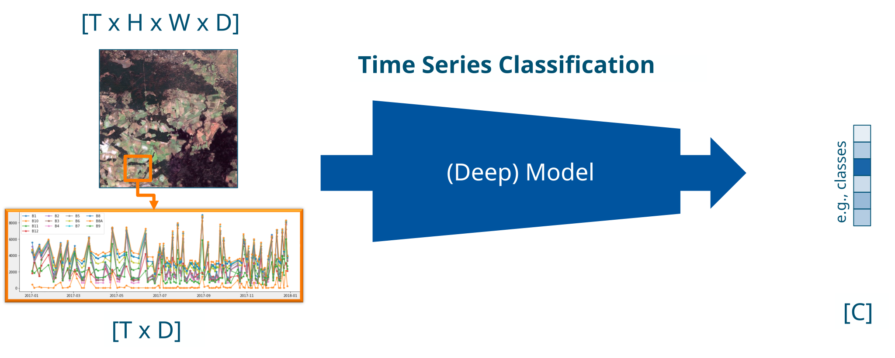
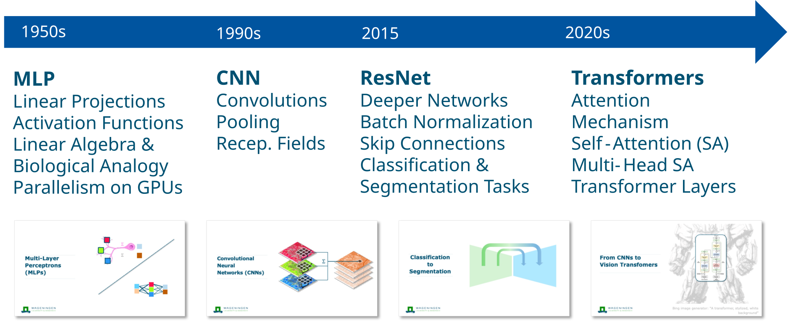
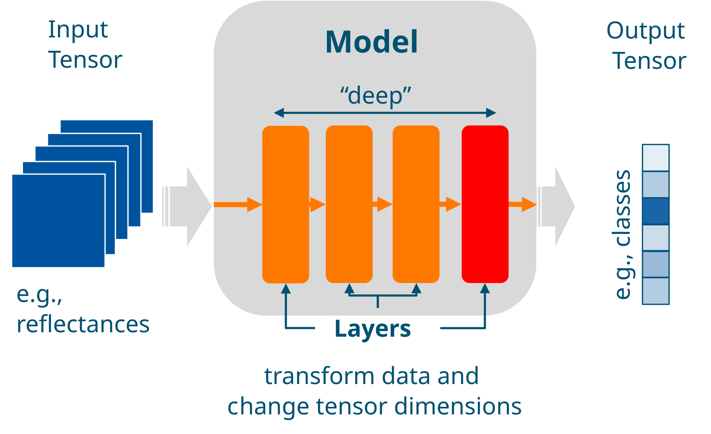

# Deep Representation Learning I

## What is Learning?

<!--
This lecture formalizes supervised learning on structured inputs before introducing deep learning on raw data.
-->

---

# Two Questions for Lectures 4–5

  

    
Lecture 4

    
How does a neural network learn?

  

  

    
Lecture 5

    
Why should what it learns work beyond the training data?

  

<!--
Set up the Lecture 4 → Lecture 5 bridge before technical detail.
Lecture 4 asks how learning works; Lecture 5 asks why learned structure can generalize.
-->

---

# Learning Outcomes Roadmap

| | Learning outcome | Block |
|---|---|---|
| ⬜ | Explain why representation choice determines task difficulty. | Why Learn Representations? |
| ⬜ | Distinguish representation learner vs final decision layer in a network. | Why Learn Representations? |

<!--
This table is the map for today's three blocks.
We will revisit it as a progress tracker while moving through the lecture.
The ⬜ markers can be swapped to ✅ as outcomes are reached.
-->

---

# Today: Lecture Structure

Builds on Lecture 4: linear and logistic regression, MLPs, gradient descent and backpropagation.

  

    
1

    
Why Learn Representations?

  

Start with representation quality and geometric separability.

<!--
MLPs, gradient descent and backpropagation moved to Lecture 4 (block 3). This lecture builds on them.
TODO: add the further blocks of this lecture.
-->

---
layout: bonn-section
sectionColor: "#00457c"
section: why-learn-representations
sectionTitle: Why Learn Representations?
---

# Why Learn Representations?

Good representations make hard problems easy.

From manual feature design to learned representations.

---
section: why-learn-representations
---

# A difficult task is easy in the right form.

## Recap Lecture 1

  

    
Chinese

    
我们的心智已经学会理解这个句子。

  

  

    
Arabic

    
لقد تعلّم عقلنا أن يفهم هذه الجملة.

  

  

    
Hebrew

    
המוח שלנו למד להבין את המשפט הזה.

  

  

    
Korean

    
우리의 마음은 이 문장을 이해하는 법을 배웠습니다.

  

  

    
Latin

    
Our mind has learned to understand this sentence.

  

  
  

    Photo by <a href="https://www.pexels.com/@silverkblack/" target="_blank" rel="noopener noreferrer">Vitaly Gariev</a> on <a href="https://www.pexels.com/@silverkblack/" target="_blank" rel="noopener noreferrer">Pexels</a>
  

---
section: why-learn-representations
---

# Choosing Suitable Data Representations

## Recap Lecture 1

  

    <h3>Images</h3>
    <Lecture1AppleMatrixRepresentation :click-index="1" />
  

  

    <h3>Math</h3>
    

      

        

          XLVII + LXXVIII = ?
        

        

          47 + 78 = 125
        

      

    

  

  

    <h3>Places</h3>
    

      

        Coordinates
      

      

        50°43′57.73″ N, 
        7°06′16.63″ E
      

      

        

          Place
        

        

          Hofgarten, Bonn, Germany
        

      

    

  

<!--
Let me show this with a few examples. A computer usually sees an image as a matrix of numbers, often between 0 and 255.
[click]
But when we represent those numbers as intensities of light, it becomes much easier for us to see structure in the raw data. Both are valid representations of the same underlying object.
[click]
What is the result of this addition in Roman numerals?
[click]
It is much easier to do math with Arabic numerals. And the shift from Roman numerals to Arabic numerals took roughly 300 to 600 years in the Western world. That gives us a sense of how hard it can be to move to a better but unfamiliar representation.
[click]
Similarly, coordinates are great for databases, but they are hard to read. Place descriptions are easier for people to understand, but they can be ambiguous.
-->

---
section: why-learn-representations
---

# Learning Feature Representations

---
section: why-learn-representations
---

# Timeline and Evolution of Deep Learning

  

    
&lt;2012

    
2015 onwards

    
&gt;2020 →

  

  <table class="w-full text-[.75rem] border-collapse">
    <thead>
      <tr>
        <th class="bg-[#00457c] !text-white text-left px-3 py-2 font-semibold w-1/3">Classic Machine Learning</th>
        <th class="bg-[#0f7d5c] !text-white text-left px-3 py-2 font-semibold w-1/3 border-l border-white/30">Supervised Deep Learning</th>
        <th class="bg-[#6f2d7f] !text-white text-left px-3 py-2 font-semibold w-1/3 border-l border-white/30">Self-Supervised Learning</th>
      </tr>
    </thead>
    <tbody>
      <tr class="border-b border-gray-200">
        <td class="px-3 py-2 align-top bg-[#00457c]/5"><strong>Feature Design:</strong> Which features extract the most information?</td>
        <td class="px-3 py-2 align-top border-l border-gray-200 bg-[#0f7d5c]/5"><strong>Model Design:</strong> Which architecture is best for my tensors?</td>
        <td class="px-3 py-2 align-top border-l border-gray-200 bg-[#6f2d7f]/5"><strong>Loss Design:</strong> Which loss function or training strategy?</td>
      </tr>
      <tr class="border-b border-gray-200">
        <td class="px-3 py-2 bg-[#00457c]/10"><strong>Data:</strong> small labelled</td>
        <td class="px-3 py-2 border-l border-gray-200 bg-[#0f7d5c]/10"><strong>Data:</strong> large labelled</td>
        <td class="px-3 py-2 border-l border-gray-200 bg-[#6f2d7f]/10"><strong>Data:</strong> large unlabelled</td>
      </tr>
      <tr class="border-b border-gray-200">
        <td class="px-3 py-2 bg-[#00457c]/5"><strong>Models:</strong> Random Forest, Boosting, Lin. Regression</td>
        <td class="px-3 py-2 border-l border-gray-200 bg-[#0f7d5c]/5"><strong>Models:</strong> MLPs, CNNs, RNNs</td>
        <td class="px-3 py-2 border-l border-gray-200 bg-[#6f2d7f]/5"><strong>Model:</strong> Transformers</td>
      </tr>
      <tr>
        <td class="px-3 py-2 text-[.68rem] italic font-semibold" style="color:#00457c">Covered in Lectures 3 &amp; 4</td>
        <td class="px-3 py-2 border-l border-gray-200 text-[.68rem] italic font-semibold" style="color:#0f7d5c">Covered in Lectures 5 &amp; 6</td>
        <td class="px-3 py-2 border-l border-gray-200 text-[.68rem] italic font-semibold" style="color:#6f2d7f">Covered from Lecture 7 onwards</td>
      </tr>
    </tbody>
  </table>

<!--
Historical framing: three eras of machine learning, defined by the central design question.
Classic ML: features are hand-designed. Supervised DL: architecture is the design choice. Self-supervised: the loss/training strategy is the key decision.
-->

---
section: why-learn-representations
---

# Image Classification

---
section: why-learn-representations
---

# Image Segmentation

---
section: why-learn-representations
---

# Object Detection

---
section: why-learn-representations
---

# Time Series Classification

---
section: why-learn-representations
---

# Overview: Deep Model Architectures

## Lab 4 Content

---
section: why-learn-representations
---

# Recap: Learned Representations

<ul class="flex flex-col gap-4 text-[.85rem] leading-snug">
  <li>Good representations make difficult problems easier.</li>
  <li>In classic machine learning, we manually select data and engineer features to be a good representation of the problem.</li>
  <li>Deep learning models learn a feature representation that is then well-suited for a final linear classification with logistic regression.</li>
</ul>

