# Earth Embeddings

## Toward AI-centric representations of our planet

<!--
This lecture closely follows the perspective paper
Klemmer, Rolf, Rußwurm, et al. (2026), "Earth Embeddings: Toward artificial intelligence-centric representations of our planet", IEEE Geoscience and Remote Sensing Magazine, doi:10.1109/MGRS.2026.3710416 (CC BY 4.0).
It is complemented by material from the ISPRS 2026 tutorial "Towards Geospatial Embeddings" (Klemmer, Fuller, Shelhamer, Rolf, Rußwurm).

Structure: four blocks, each answering one question.
1. What are Earth embeddings?  2. How do we learn them?  3. How do we use them?  4. How do we evaluate and improve them?
Running example throughout: mapping forest cover from a handful of field labels.
-->

---
layout: learning-outcomes
mode: before
meeting: lecture-06
section: opening
sectionTitle: Opening
---

# Learning outcomes

<LearningOutcome id="define-earth-embeddings">
<strong>Define</strong> Earth embeddings and <strong>distinguish</strong> them from the geospatial foundation models that produce them.
</LearningOutcome>

<LearningOutcome id="explicit-implicit">
<strong>Explain</strong> how explicit feature extraction and implicit neural representations put geographic information into a vector.
</LearningOutcome>

<LearningOutcome id="use-earth-embeddings">
<strong>Choose</strong> a suitable way to use Earth embeddings (prediction, conditioning, retrieval, synthesis) for a given task.
</LearningOutcome>

<LearningOutcome id="evaluate-earth-embeddings">
<strong>Assess</strong> the limits of an Earth embedding product: resolution, bias, interpretability, cost, and openness.
</LearningOutcome>

---
section: opening
---

# Today: Four Questions

| Block | Question | Content |
|---|---|---|
| **1 · Concept** | What are Earth embeddings? | Places as vectors, and why we want them |
| **2 · Methods** | How do we learn them? | Explicit vs. implicit, encodings, objectives, AlphaEarth, SatCLIP |
| **3 · Applications** | How do we use them? | Prediction, conditioning, retrieval, synthesis |
| **4 · Agenda** | How do we evaluate and improve them? | Generalization, bias, cost, openness |

<div class="blockquote2">

**Running example:** we want a **forest-cover map** of a whole country, but only have a few hundred labelled field plots. We return to this problem in every block.

</div>

<div class="slide-citation">
Based on K. Klemmer, E. Rolf, M. Rußwurm, et al., “Earth Embeddings: Toward artificial intelligence-centric representations of our planet,” <em>IEEE Geoscience and Remote Sensing Magazine</em>, 2026, and the ISPRS 2026 tutorial “Towards Geospatial Embeddings”.
</div>

<!--
Concept → methods → applications → research agenda: the same progression as the paper.
-->

---
layout: bonn-section
sectionColor: "#00457c"
section: what
sectionTitle: What are they?
---

# What are Earth embeddings?

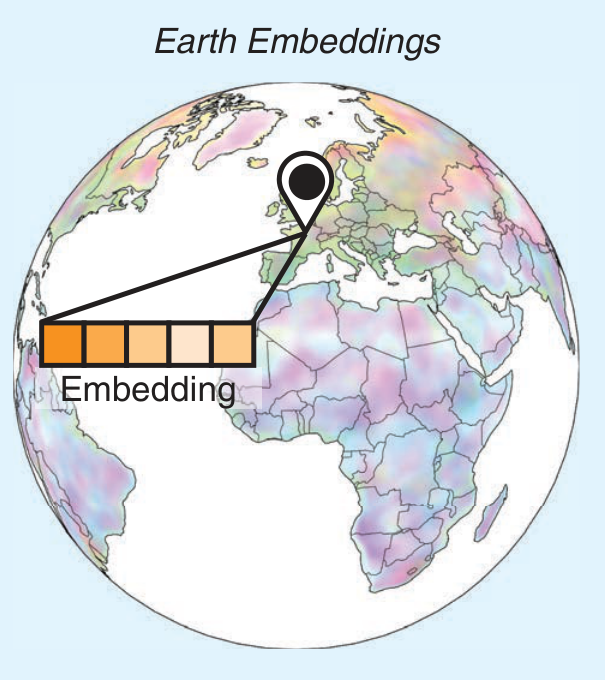

<div class="bonn-section-citation">
Figure 1 (detail) from Klemmer et al. (2026), CC BY 4.0
</div>

---
section: what
layout: bonn-two-cols-header
---

# We Are Drowning in Earth Data

::left::

| Volume | What |
|---|---|
| **~800 PB** | of Earth observation data exist today |
| **~4 TB** | of new Sentinel-2 imagery, every day |
| **100s** | of satellites continuously imaging the planet |

Almost none of it is **labelled**.

::right::

### How AI unlocks this data

| Challenge | AI answer |
|---|---|
| **Large-scale:** petabytes no single team can process | Neural networks scale to huge datasets |
| **Multimodal:** images, sensors, text, tables | Fuse and access everything by location and time |
| **Unlabelled:** almost no ground truth | Self-supervised learning needs no labels |

<div class="slide-citation">
Numbers and framing from the ISPRS 2026 tutorial “Towards Geospatial Embeddings” (A. Fuller).
</div>

<!--
Order-of-magnitude figures from the tutorial; check the latest archive statistics before quoting them precisely.
The tutorial compares this to LLM training corpora; I left that out because the training-data size of commercial LLMs is not public.
-->

---
section: what
layout: bonn-two-cols-header
---

# Running Example: Mapping Forest Cover

::left::

Task: produce a **wall-to-wall forest-cover map** of a country.

**What we have:**

- a few hundred **labelled field plots** (forest / no forest)
- petabytes of **optical, radar, and elevation** data
- maybe photos, text, and inventories tagged with coordinates

**The classical workflow:**

- download and preprocess each source (clouds, mosaics, co-registration)
- hand-craft features (NDVI, texture, slope …)
- train a model on a few hundred samples

::right::

<div class="blockquote4">

**The problem:** most of the effort goes into **data handling and expertise**, not into the forest question. And it is repeated for every new task.

</div>

<v-click>

> **The idea:** what if someone had already turned all of that data into **one vector per location**, and we only had to look it up?

</v-click>

<!--
The paper: Earth embeddings are "a powerful alternative to existing geospatial workflows that rely on heterogeneous data, hard-to-acquire expertise, and significant computation by the user."
-->

---
section: what
layout: bonn-two-cols-header
columns: "minmax(0, 1.3fr) minmax(0, 1fr)"
---

# All Geospatial Data Share One Index

::left::

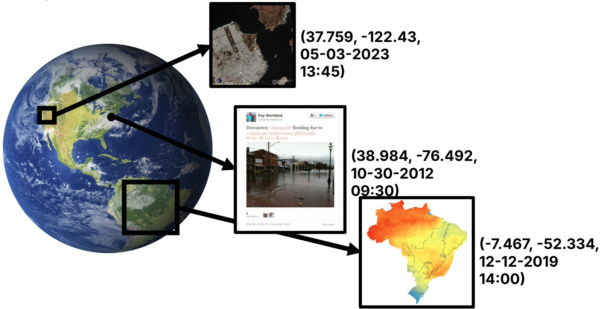

::right::

Satellite images, social-media posts, and climate maps look completely different…

> …but every observation is a **snapshot at a location and a time**: (latitude, longitude, time).

Geospatial data support disaster response, weather forecasting, transport, forest and wildfire management, water quality, and disease modelling.

<div class="slide-citation">
Figure from the ISPRS 2026 tutorial “Towards Geospatial Embeddings”.
</div>

<!--
The spatiotemporal index is the common key that lets us fuse heterogeneous data.
-->

---
section: what
---

# From Heterogeneous Data to One Reusable Representation

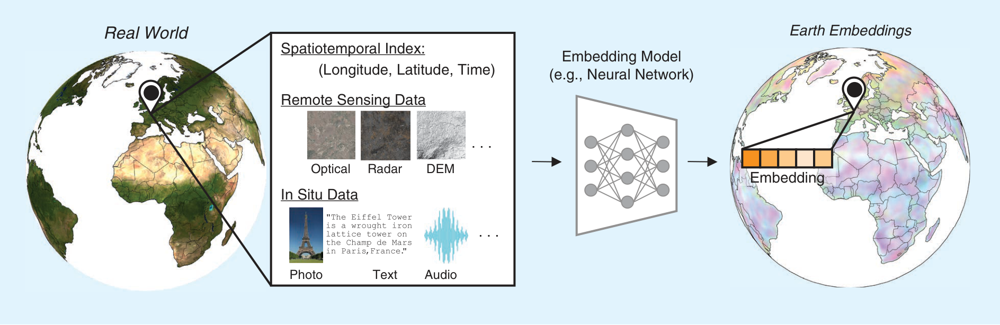

**Earth embeddings** are vector representations of geospatial data at specific locations in space and time. They capture similarities and differences among locations according to their local features, in a **lightweight, compact** format.

<div class="slide-citation">
Figure 1 from Klemmer et al. (2026), CC BY 4.0
</div>

<!--
Distinguish throughout: the embedding MODEL (left of the arrow) and the EMBEDDINGS (right).
-->

---
section: what
layout: bonn-two-cols-header
---

# Formal Definition

An Earth embedding model $E$ maps a continuous location input (longitude, latitude, optionally elevation, and time) to a $d$-dimensional vector:

$$
E : (\text{location}) \;\longrightarrow\; \mathbf{emb} \in \mathbb{R}^d
$$

::left::

### Explicit model

$$
\mathbf{emb} = E_{\text{explicit}}(\text{data}_{\text{location}})
$$

Extracts the embedding from **raw data** (e.g., a satellite image) associated with the location. Example: a vision model + a global image database.

::right::

### Implicit model

$$
\mathbf{emb} = E_{\text{implicit}}(\text{location})
$$

Takes **only the location** as input; the information is stored in the **weights** of a location encoder network.

<!--
This distinction is the backbone of Block 2.
-->

---
section: what
layout: bonn-two-cols-header
---

# Earth Embeddings Are Learned Measurements

::left::

### Sensed measurement

What an instrument physically records: reflectance in each spectral band.

`[0.07, 0.12, 0.31, …]` (bands)

Raw, large, **sensor-specific**.

::right::

### Learned measurement

What a model learns to represent: a vector that captures the **character of a place**.

$\mathbf{emb} \in \mathbb{R}^d$

Compact, comparable, **reusable** across many tasks.

::bottom::

> Same goal as remote sensing, describing a location, but the description is **learned**, not directly sensed. Embeddings form a new data layer: optical, SAR, weather, elevation, text → **Earth embedding** → land cover, crops, species, poverty, similarity search.

<div class="slide-citation">
Framing from the ISPRS 2026 tutorial “Towards Geospatial Embeddings”.
</div>

---
section: what
layout: bonn-two-cols-header
---

# From Words to Places

::left::

### Word embeddings

Word2Vec and GloVe showed that vectors capture **meaning, not spelling**:

$$
\mathbf{v}_{\text{king}} - \mathbf{v}_{\text{man}} + \mathbf{v}_{\text{woman}} \approx \mathbf{v}_{\text{queen}}
$$

Distance in embedding space ≈ difference in meaning. Large language models build on the same idea.

::right::

### Earth embeddings

The same arithmetic, applied to places:

<div class="grid grid-cols-3 gap-2 items-center">

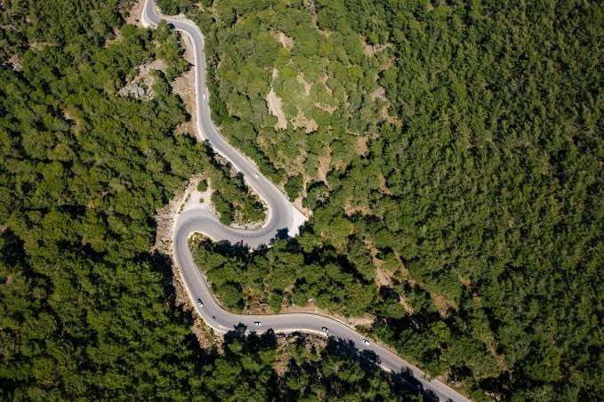

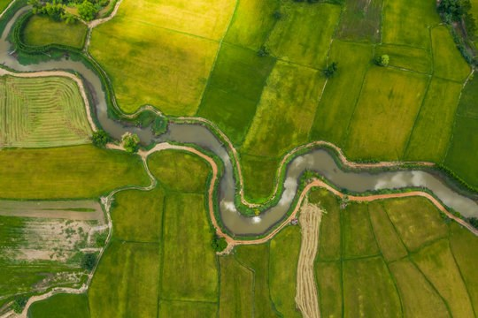


</div>

**road + river ≈ bridge**

<div class="slide-citation">
Images from the ISPRS 2026 tutorial “Towards Geospatial Embeddings”.
</div>

<!--
Paper box "The Origin of 'Embeddings' in NLP": Word2Vec and GloVe; distance between words is used in LLMs.
The road + river ≈ bridge analogy is illustrative: it shows what we would like the geometry of an embedding space to look like.
-->

---
section: what
layout: bonn-two-cols-header
---

# Places That Are Alike Are Close

::left::

### Similarity across space

An embedding of **urban New York City** may resemble that of **urban Delhi** more than that of **rural Arkansas**.

Functional, not geographic, similarity.

::right::

### Similarity across time

Summer and winter embeddings of **equatorial Costa Rica** may be nearly identical, while those of **seasonal Alaska** differ strongly.

A built-in signal of environmental change.

::bottom::

<div class="blockquote2">

**Forest example:** two forest plots 1000 km apart should be *closer* in embedding space than a forest plot and the field next to it. That is what makes a few labels go a long way.

</div>

---
section: what
layout: bonn-two-cols-header
---

# Earth Embeddings ≠ Geospatial Foundation Models

::left::

### Geospatial foundation models (GeoFMs)

Large multimodal deep networks trained on diverse geospatial data, meant to be **fine-tuned** for downstream tasks (e.g., segmentation). Architecture and objective decisions are made here.

Clay, Prithvi, Galileo, Smarties, DOFA, SkySense

::right::

### Earth embeddings

Interoperable, **location-indexed data outputs** that can be stored, shared, and queried independently of the model that created them.

AlphaEarth Foundations, Tessera, Major TOM (databases) · SatCLIP, GeoCLIP, SINR (location encoders)

::bottom::

> A GeoFM is the **factory**; Earth embeddings are the **product** you take home. Often a by-product of GeoFMs, but the part users actually touch.

<!--
Paper box "Earth Embeddings and Geospatial Foundation Models": GeoFMs are large-scale modeling and learning frameworks, whereas Earth embeddings constitute the interoperable location-indexed data outputs.
-->

---
section: what
---

# The Four Central Functions

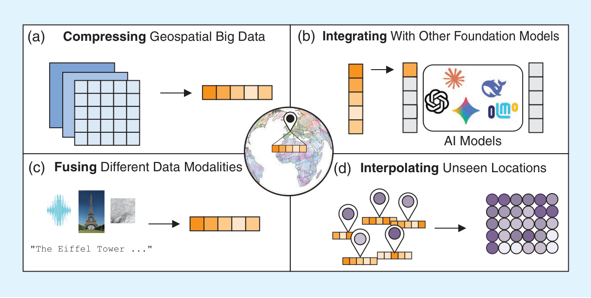

**Compression** · **Fusion** · **Interpolation** · **Interoperability**: current approaches serve one or more of these.

<div class="slide-citation">
Figure 2 from Klemmer et al. (2026), CC BY 4.0
</div>

---
section: what
layout: bonn-two-cols-header
---

# Compression and Fusion

::left::

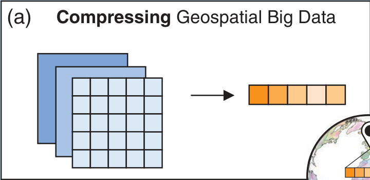

**Compression:** distil high-dimensional, multimodal data (images, text) into a small vector. Lossy, but geospatial data are highly redundant and spatiotemporally structured.

Current embeddings are correlated, with low intrinsic dimension → dedicated compression models are still needed.

::right::

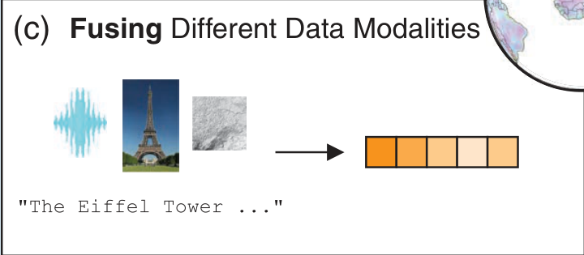

**Fusion:** combine modalities into a joint embedding space, using their shared location and time.

E.g., one embedding for the satellite image *and* the social-media posts at a place: MMEarth, DOFA, Galileo, Smarties, SkySense.

<div class="slide-citation">
Figure 2 (a, c) from Klemmer et al. (2026), CC BY 4.0
</div>

---
section: what
layout: bonn-two-cols-header
---

# Interpolation and Interoperability

::left::

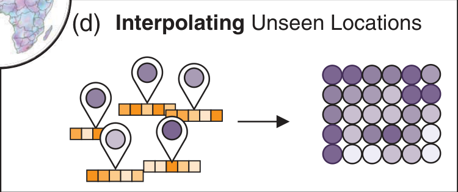

**Interpolation:** location encoders learn a smooth surface in embedding space, so **any** location (in continuous space and time) can be queried, even if it was not in the training data. SatCLIP, SINR, GeoCLIP.

::right::

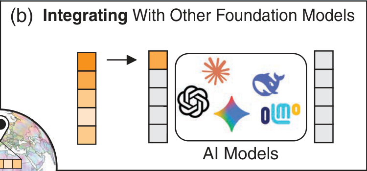

**Interoperability:** embeddings act as **“location tokens”** for other foundation models, e.g., LLMs: “What are similar locations to (lon, lat)?” Location encoders also plug into image synthesis and super-resolution.

<div class="slide-citation">
Figure 2 (b, d) from Klemmer et al. (2026), CC BY 4.0
</div>

---
section: what
---

# Forest Example: What Does an Embedding Buy Us?

| Function | For our forest map |
|---|---|
| **Compression** | A 64-D vector per pixel instead of years of multispectral time series |
| **Fusion** | Optical + radar (sees through clouds) + elevation, already combined |
| **Interpolation** | A value for every location, including where there is no plot |
| **Interoperability** | The same vectors serve the biodiversity team next door |

<v-click>

> Earth embeddings turn geospatial analytics from **fragmented, task-specific modelling** into a **reusable, general** framework. The paper posits they will become a dominant format of geospatial data in the AI age.

</v-click>

<!--
Next: how does geographic information actually get into that vector?
-->


---
layout: bonn-section
sectionColor: "#00457c"
section: learning
sectionTitle: How to learn?
---

# How do we learn Earth embeddings?

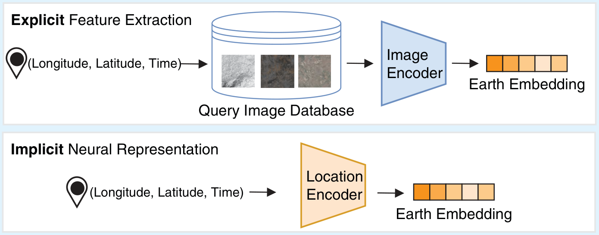

<div class="bonn-section-citation">
Figure 4(a) from Klemmer et al. (2026), CC BY 4.0
</div>

---
section: learning
layout: bonn-two-cols-header
---

# Two Routes into a Vector


::left::

**Explicit:** look up the data at (lon, lat, time) in a database, then encode the **data** with an image (or time-series) encoder.

::right::

**Implicit:** encode the **coordinates themselves**; the knowledge about that place lives in the encoder’s weights.

<div class="slide-citation">
Figure 4(a) from Klemmer et al. (2026), CC BY 4.0
</div>

---
section: learning
layout: bonn-two-cols-header
---

# Explicit Feature Extraction

::left::

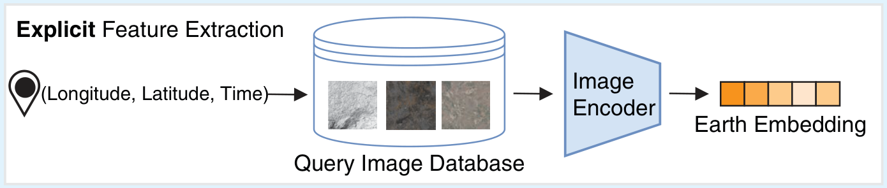

Embed geospatial data directly with architectures and objectives from computer vision or time-series analysis. Since the inputs are geolocated, so are the embeddings.

<div class="slide-citation">
Figure 4(a, top) from Klemmer et al. (2026), CC BY 4.0
</div>

::right::

Three families, from simple to large:

1. **Random features:** MOSAIKS
2. **Self-supervised encoders:** contrastive or masked models trained on BigEarthNet or SSL4EO Sentinel-2 imagery
3. **Multimodal GeoFMs:** DOFA, Smarties, MMEarth, Galileo, AlphaEarth

<!--
Recall the deep-learning lectures: any encoder that maps an image patch to a vector is an explicit Earth embedding model once the patch has coordinates.
-->

---
section: learning
---

# Simplest Explicit Embedding: MOSAIKS

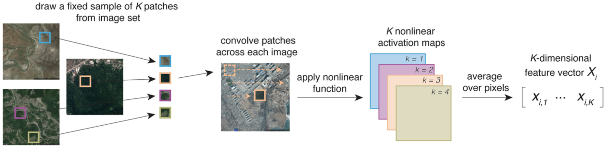

- Draw $K$ random patches from the image set and use them as **fixed convolution filters**: no training at all.
- Convolve, apply a nonlinearity, average over pixels → a $K$-dimensional vector per image.
- A **linear model** on top predicts forest cover, income, population, and more.

> Even **random** features turn imagery into useful vectors: a strong baseline for every learned embedding.

<div class="slide-citation">
Rolf et al. (2021), “A generalizable and accessible approach to machine learning with global satellite imagery,” <em>Nature Communications</em>. Figure via the ISPRS 2026 tutorial.
</div>

<!--
Demo 2 of the tutorial builds MOSAIKS random convolutional features from scratch and compares them with a pretrained SSL4EO-S12 ResNet-18.
-->

---
section: learning
layout: bonn-two-cols-header
---

# Learned Features: Self-Supervised Encoders

Instead of designing or sampling features, **learn** them on large unlabelled archives.

::left::

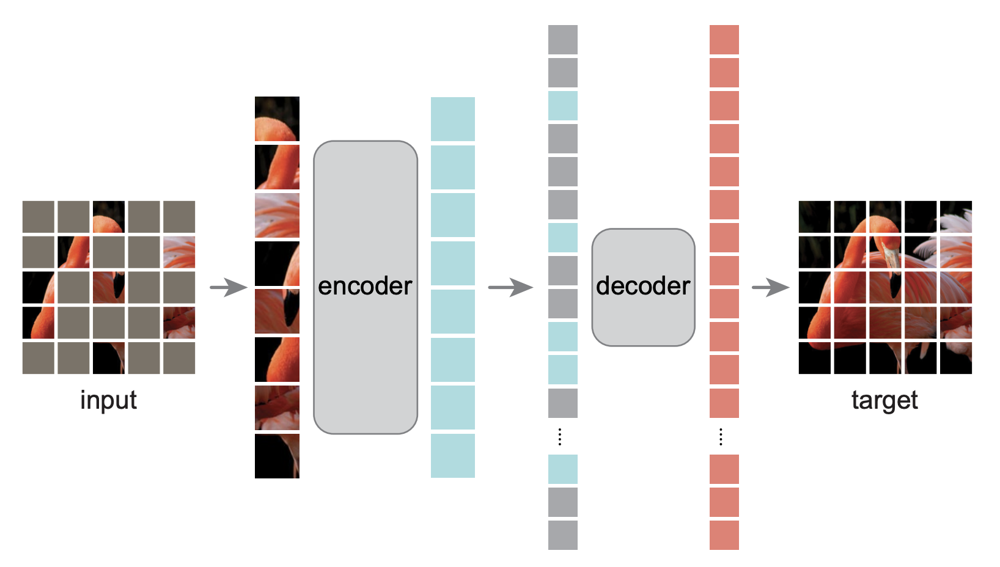

**Masked autoencoder (MAE):** hide most patches, reconstruct them; the encoder output is the embedding.

<div class="slide-citation">
He et al. (2022), “Masked autoencoders are scalable vision learners,” CVPR.
</div>

::right::

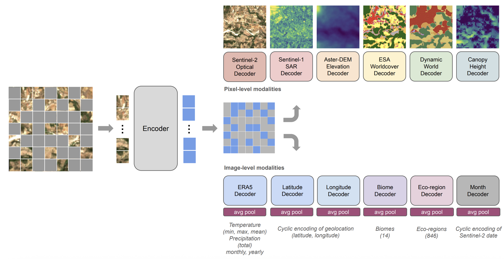

**Cross-modal autoencoding (MMEarth):** reconstruct *other* modalities (radar, elevation, land cover, climate) from one input → **fusion** built in.

<div class="slide-citation">
Nedungadi et al. (2024), “MMEarth: Exploring multi-modal pretext tasks for geospatial representation learning,” ECCV.
</div>

<!--
Self-supervised learning is covered in more depth in its own lecture; here we only need the idea that the pretext task produces a general-purpose encoder.
-->

---
section: learning
layout: bonn-two-cols-header
---

# Explicit Embeddings: Resolution and Modality

::left::

### Resolution

- **Patch level:** one vector per image or tile (Clay, MMEarth)
- **Pixel level:** one vector per pixel, e.g., 64-D every 10 m (AlphaEarth, Tessera)

The embedding inherits the **extent**, **ground sample distance**, and **acquisition time** of its input.

### Modality

Which sensors went in? Optical-only vs. multimodal (radar, climate, elevation) can decide a task such as crop mapping.

::right::

<div class="blockquote2">

✓ Well suited for geosemantic search and fine-grained prediction (land cover, land use)

</div>

<div class="blockquote4">

✗ Less suited for geographic conditioning and data synthesis

</div>

> **Match the embedding to the task:** field boundaries need high resolution and the right modalities; a broad climate gradient may only need coarse, optical embeddings.

---
section: learning
---

# Worked Example: AlphaEarth Foundations (1/2)

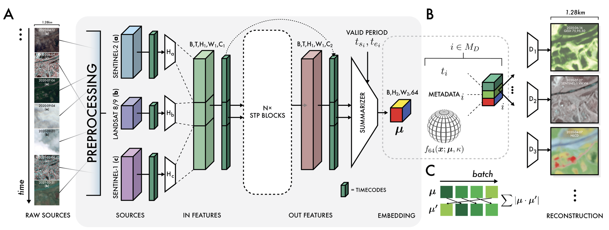

- An **embedding field model**: assimilates several sources (optical, radar, LiDAR, climate, …) over a time window into **one 64-D vector per 10 m pixel**.
- Trained, among other objectives, to **reconstruct** its input sources from the embedding, so the vector summarises what was observed at that place in that year.
- Designed for **sparse-label mapping**: a light classifier on top maps at scale.

<div class="slide-citation">
Brown et al. (2025), “AlphaEarth Foundations: An embedding field model for accurate and efficient global mapping from sparse label data,” arXiv:2507.22291.
</div>

<!--
The explicit counterpart to the SatCLIP worked example later in this block.
-->

---
section: learning
layout: bonn-two-cols-header
---

# Worked Example: AlphaEarth Foundations (2/2)

::left::

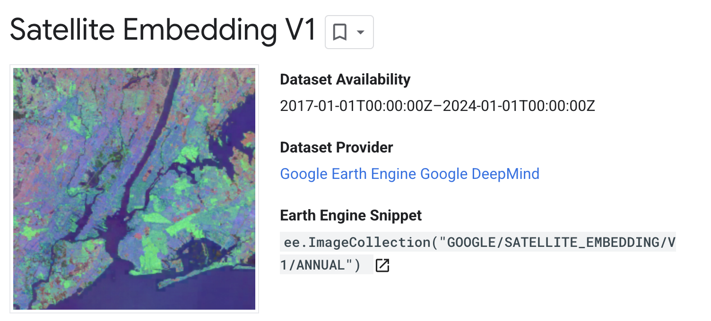

<div class="slide-citation">
Google Earth Engine data catalogue, via the ISPRS 2026 tutorial.
</div>

::right::

Released as a **precomputed dataset**, not as a model:

```js
ee.ImageCollection(
  "GOOGLE/SATELLITE_EMBEDDING/V1/ANNUAL")
```

- annual global layers, one 64-band image per year
- users only **look up** vectors; no GPU, no imagery pipeline
- the model weights are **not** released (more on openness in Block 4)

<div class="blockquote2">

**Forest example:** query the 64-D vector at each plot, train a classifier, apply it to every pixel.

</div>

---
section: learning
layout: bonn-two-cols-header
---

# Implicit Neural Representations

::left::

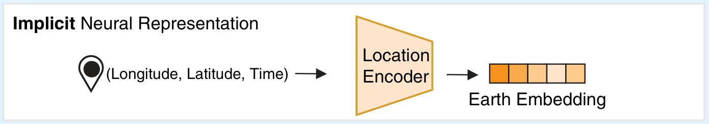

A **location encoder** takes coordinates (and possibly time) as input and outputs an embedding. Inspired by implicit neural representations in computer vision (SIREN, NeRF).

<div class="slide-citation">
Figure 4(a, bottom) from Klemmer et al. (2026), CC BY 4.0
</div>

::right::

Two parts:

1. **Positional encoding** $\mathrm{PE}(\lambda,\phi,t)$: a fixed function that expands coordinates into many features.
2. **Neural network** $\mathrm{NN}_\theta$: a small MLP or SIREN that maps those features to $\mathbf{emb}$.

$$
\mathbf{emb} = \mathrm{NN}_\theta\big(\mathrm{PE}(\lambda,\phi,t)\big)
$$

Lightweight, open source, queryable anywhere. Examples: SatCLIP, GeoCLIP, SINR, Climplicit.

---
section: learning
layout: bonn-two-cols-header
---

# Spatial Encodings: Respecting a Sphere

::left::

Raw (lon, lat) are a poor input: the network must learn that −180° and 180° are the same place, and a flat grid distorts the poles.

**Spherical harmonics** $Y_\ell^m$ are the Fourier basis on the sphere:

$$
\mathrm{PE}(\lambda,\phi) = \big[\,Y_\ell^m(\lambda,\phi)\,\big]_{\ell=0,\dots,L;\; m=-\ell,\dots,\ell}
$$

$(L+1)^2$ features, smooth everywhere on the globe.

::right::

> **The degree $L$ sets the scale.** Low $L$ → only continent-scale patterns. High $L$ → finer detail, but harder to train and prone to overfitting.

The encoding lets users **define the resolution** at which dynamics are modelled (metre vs. kilometre scale).

Alternatives: multi-scale sinusoidal (Space2Vec, Sphere2Vec), random Fourier features (GeoCLIP).

<div class="slide-citation">
Rußwurm et al. (2024), “Geographic location encoding with spherical harmonics and sinusoidal representation networks,” ICLR.
</div>

---
section: learning
layout: bonn-two-cols-header
---

# Temporal Encodings: Periodic Processes

::left::

Many Earth processes are **periodic**: seasons (annual scale), day vs. night (daily scale).

Encode time with Fourier functions of the relevant periods $P$:

$$
\mathrm{PE}(t) = \Big[\sin\tfrac{2\pi t}{P},\; \cos\tfrac{2\pi t}{P}\Big]_{P\,\in\,\{1\,\text{day},\,1\,\text{year},\,\dots\}}
$$

31 December and 1 January end up next to each other.

::right::

<svg viewBox="0 0 300 150" class="w-full h-[150px]">
<line x1="10" y1="75" x2="290" y2="75" stroke="#ccc"/>
<path d="M10.0,75.0 L12.8,71.5 L15.6,68.1 L18.4,64.7 L21.2,61.3 L24.0,58.0 L26.8,54.8 L29.6,51.6 L32.4,48.5 L35.2,45.5 L38.0,42.7 L40.8,39.9 L43.6,37.3 L46.4,34.9 L49.2,32.6 L52.0,30.5 L54.8,28.6 L57.6,26.8 L60.4,25.2 L63.2,23.9 L66.0,22.7 L68.8,21.7 L71.6,21.0 L74.4,20.4 L77.2,20.1 L80.0,20.0 L82.8,20.1 L85.6,20.4 L88.4,21.0 L91.2,21.7 L94.0,22.7 L96.8,23.9 L99.6,25.2 L102.4,26.8 L105.2,28.6 L108.0,30.5 L110.8,32.6 L113.6,34.9 L116.4,37.3 L119.2,39.9 L122.0,42.7 L124.8,45.5 L127.6,48.5 L130.4,51.6 L133.2,54.8 L136.0,58.0 L138.8,61.3 L141.6,64.7 L144.4,68.1 L147.2,71.5 L150.0,75.0 L152.8,78.5 L155.6,81.9 L158.4,85.3 L161.2,88.7 L164.0,92.0 L166.8,95.2 L169.6,98.4 L172.4,101.5 L175.2,104.5 L178.0,107.3 L180.8,110.1 L183.6,112.7 L186.4,115.1 L189.2,117.4 L192.0,119.5 L194.8,121.4 L197.6,123.2 L200.4,124.8 L203.2,126.1 L206.0,127.3 L208.8,128.3 L211.6,129.0 L214.4,129.6 L217.2,129.9 L220.0,130.0 L222.8,129.9 L225.6,129.6 L228.4,129.0 L231.2,128.3 L234.0,127.3 L236.8,126.1 L239.6,124.8 L242.4,123.2 L245.2,121.4 L248.0,119.5 L250.8,117.4 L253.6,115.1 L256.4,112.7 L259.2,110.1 L262.0,107.3 L264.8,104.5 L267.6,101.5 L270.4,98.4 L273.2,95.2 L276.0,92.0 L278.8,88.7 L281.6,85.3 L284.4,81.9 L287.2,78.5 L290.0,75.0" fill="none" stroke="#00457c" stroke-width="2.5"/>
<path d="M10.0,20.0 L12.8,20.1 L15.6,20.4 L18.4,21.0 L21.2,21.7 L24.0,22.7 L26.8,23.9 L29.6,25.2 L32.4,26.8 L35.2,28.6 L38.0,30.5 L40.8,32.6 L43.6,34.9 L46.4,37.3 L49.2,39.9 L52.0,42.7 L54.8,45.5 L57.6,48.5 L60.4,51.6 L63.2,54.8 L66.0,58.0 L68.8,61.3 L71.6,64.7 L74.4,68.1 L77.2,71.5 L80.0,75.0 L82.8,78.5 L85.6,81.9 L88.4,85.3 L91.2,88.7 L94.0,92.0 L96.8,95.2 L99.6,98.4 L102.4,101.5 L105.2,104.5 L108.0,107.3 L110.8,110.1 L113.6,112.7 L116.4,115.1 L119.2,117.4 L122.0,119.5 L124.8,121.4 L127.6,123.2 L130.4,124.8 L133.2,126.1 L136.0,127.3 L138.8,128.3 L141.6,129.0 L144.4,129.6 L147.2,129.9 L150.0,130.0 L152.8,129.9 L155.6,129.6 L158.4,129.0 L161.2,128.3 L164.0,127.3 L166.8,126.1 L169.6,124.8 L172.4,123.2 L175.2,121.4 L178.0,119.5 L180.8,117.4 L183.6,115.1 L186.4,112.7 L189.2,110.1 L192.0,107.3 L194.8,104.5 L197.6,101.5 L200.4,98.4 L203.2,95.2 L206.0,92.0 L208.8,88.7 L211.6,85.3 L214.4,81.9 L217.2,78.5 L220.0,75.0 L222.8,71.5 L225.6,68.1 L228.4,64.7 L231.2,61.3 L234.0,58.0 L236.8,54.8 L239.6,51.6 L242.4,48.5 L245.2,45.5 L248.0,42.7 L250.8,39.9 L253.6,37.3 L256.4,34.9 L259.2,32.6 L262.0,30.5 L264.8,28.6 L267.6,26.8 L270.4,25.2 L273.2,23.9 L276.0,22.7 L278.8,21.7 L281.6,21.0 L284.4,20.4 L287.2,20.1 L290.0,20.0" fill="none" stroke="#B08900" stroke-width="2.5" stroke-dasharray="5 4"/>
<text x="200" y="18" font-size="11" fill="#00457c">sin</text><text x="240" y="18" font-size="11" fill="#B08900">cos</text>
<text x="12" y="145" font-size="11" fill="#555">Jan</text><text x="265" y="145" font-size="11" fill="#555">Dec</text>
</svg>

*Day of year as (sin, cos): every date gets a unique, periodic code.*

<div class="blockquote2">

**Forest example:** deciduous vs. evergreen forest differ mainly in their *seasonal* signal → time matters.

</div>

---
section: learning
---

# Learning Objectives

What signal teaches the encoder what makes a place distinctive?

| | Supervised | Self-supervised (geolocalization) |
|---|---|---|
| **Idea** | Regress a location-specific value and interpolate between training points | Match a location to what is observed there: learn what makes a place **unique** |
| **Examples** | Sea-ice thickness, housing prices, species presence (**SINR**) | **GeoCLIP** (ground-level Flickr photos), **SatCLIP**, **CSP** (satellite imagery) |
| **Result** | Intermediate layers still encode general semantics (topography, biome boundaries) | General-purpose embeddings for many downstream tasks |

Explicit models mostly *borrow* objectives from computer vision and NLP (masked autoencoding, contrastive learning). Objectives that exploit spatial autocorrelation or temporal dynamics are largely unexplored (Block 4).

---
section: learning
---

# Worked Example: SatCLIP (1/3) — Setup

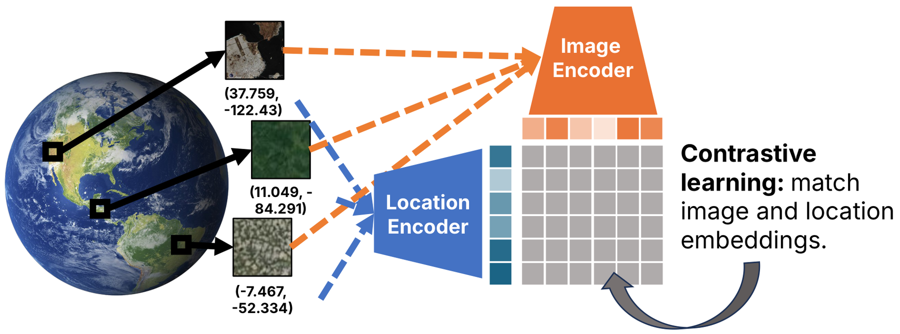

- **SatCLIP** (Klemmer et al., AAAI 2025): *Satellite Contrastive Location–Image Pretraining*. CLIP, with “caption” replaced by “coordinate”.
- **Data:** ~100k Sentinel-2 tiles sampled across the global landmass (S2-100K), each with its centre coordinate.
- **Encoders:** a pretrained image encoder $f$ (ResNet / ViT) and a location encoder $g$ (spherical harmonics + SIREN). After training, $f$ is discarded: **$g$ is the Earth embedding model**.

<div class="slide-citation">
Klemmer et al. (2025), “SatCLIP: Global, general-purpose location embeddings with satellite imagery,” AAAI. Figure from the ISPRS 2026 tutorial.
</div>

---
section: learning
layout: bonn-two-cols-header
---

# Worked Example: SatCLIP (2/3) — Contrastive Objective

::left::

For a batch of $B$ image–location pairs, with scaled cosine similarity $s_{ij} = \langle z^{\text{img}}_i, z^{\text{loc}}_j\rangle / \tau$:

$$
\mathcal{L} = -\frac{1}{B}\sum_{i=1}^{B}\log\frac{\exp(s_{ii})}{\sum_{j=1}^{B}\exp(s_{ij})}
$$

(symmetrised over images and locations, as in CLIP)

::right::

- **Positive pair:** an image and *its own* location.
- **Negatives:** all other locations in the batch.

> To pick its own image out of the batch, $g$ must learn **what the place looks like from space**: climate, vegetation, terrain, built-up area.

---
section: learning
layout: bonn-two-cols-header
---

# Worked Example: SatCLIP (3/3) — What You Get

::left::

- A **global, continuous embedding field**: query any (lon, lat), even unseen locations.
- Captures what large-scale overhead imagery shows: **climate zones, forest coverage**.
- Does **not** capture what the imagery cannot see, e.g., **ocean currents** (and it was trained on land tiles only).
- Low vs. high $L$ trades smoothness against detail.

::right::

<div class="blockquote2">

**Forest example:** SatCLIP knows “this region is boreal / temperate / tropical”: a good **prior**. It cannot delineate a single forest stand; its effective resolution is far too coarse.

</div>

**Counterpart:** GeoCLIP is trained on ground-level Flickr images and captures patterns visible from the *street*. Same recipe, different data → different embedding.

<!--
Key lesson from the paper: general-purpose embeddings are fundamentally constrained by the raw data they are based on.
-->

---
section: learning
---

# Explicit vs. Implicit: A Comparison

<div class="compact-table">

| | Explicit feature extraction | Implicit neural representation |
|---|---|---|
| **Input at inference** | Data at the location (image, time series) | Coordinates (+ time) only |
| **Where knowledge lives** | In the input data | In the network weights |
| **Resolution** | High, native resolution of the input | Low, smooth field |
| **Coverage** | Where and when data exist | Continuous in space and time |
| **Model size** | Large, compute-intensive | Small, lightweight |
| **Usual interface** | Database of precomputed vectors | Model |
| **Best for** | Retrieval, fine-grained prediction (land cover) | Conditioning, synthesis, large-scale prediction (air quality, disease) |
| **Examples** | MOSAIKS, Clay, MMEarth, AlphaEarth, Tessera | SatCLIP, GeoCLIP, SINR, CSP, Climplicit |

</div>

---
section: learning
layout: bonn-two-cols-header
---

# Hybrid Approaches

Combine high-resolution explicit features with low-resolution implicit context.

::left::

### Simple: concatenation

$[\,\mathbf{emb}_{\text{explicit}} \,\|\, \mathbf{emb}_{\text{implicit}}\,]$ won the NeuCo-Bench challenge at the 2025 CVPR EarthVision workshop.

### Advanced: retrieval augmentation

**RANGE** uses implicit embeddings as queries to retrieve suitable high-resolution image features.

::right::

> Good results in practice, at the cost of more methodological complexity.

<div class="blockquote2">

**Forest example:** pixel embeddings say “there are trees here”; the location embedding says “this is the boreal zone”. Together they help separate, e.g., plantations from natural forest.

</div>

---
section: learning
---

# Check: Which Embedding for Our Forest Map?

| Option | Embedding |
|---|---|
| **A** | SatCLIP embeddings at each plot |
| **B** | 10 m pixel embeddings from a precomputed explicit database (e.g., AlphaEarth) |
| **C** | Both, concatenated |

<v-click>

> **B** is the minimum: forest cover is a fine-grained, visual task → explicit, high-resolution features. **C** can help when the classes depend on regional context. **A** alone is too coarse to draw forest edges.

</v-click>

<!--
Next: what do we actually do with the vectors once we have them?
-->


---
layout: bonn-section
sectionColor: "#00457c"
section: using
sectionTitle: How to use?
---

# How do we use Earth embeddings?

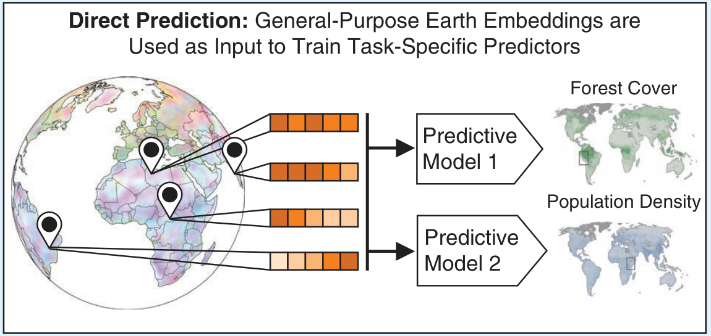

<div class="bonn-section-citation">
Figure 3(a) from Klemmer et al. (2026), CC BY 4.0
</div>

---
section: using
---

# Four Ways to Use Earth Embeddings

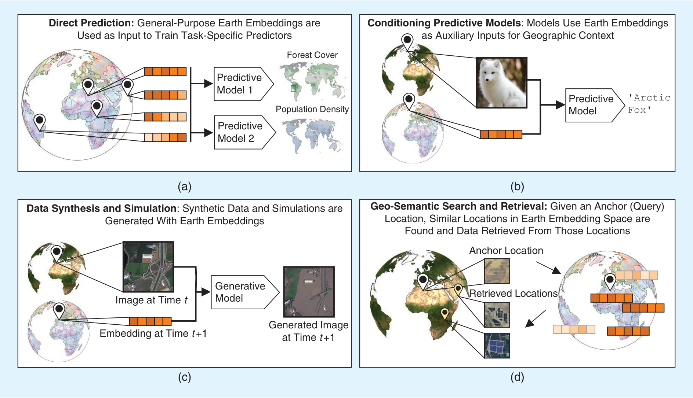

Because embeddings are lightweight, all of this works **without processing or analysing raw data**.

<div class="slide-citation">
Figure 3 from Klemmer et al. (2026), CC BY 4.0
</div>

---
section: using
layout: bonn-two-cols-header
---

# 1 · Direct Prediction

::left::


<div class="slide-citation">
Figure 3(a) from Klemmer et al. (2026), CC BY 4.0
</div>

::right::

Use embeddings as the **input features** of a model for a spatially distributed outcome:

$$
\hat{y}(\text{loc}) = h_\psi\big(E(\text{loc})\big)
$$

- temperature, species presence, population density, **forest cover**
- competitive with hand-crafted features (e.g., random forests for tree-species identification)
- **cheap:** preprocessing is already done, a linear model, $k$-NN or random forest often suffices, and no raw-data archive has to be queried

> One embedding product → many task-specific heads $h_\psi$.

<!--
Recall the generalization lecture: few parameters + a good representation → better generalization from few labels.
With a few hundred plots, a deep CNN on raw Sentinel-2 would overfit; a random forest on 64-D embeddings trains in seconds on a laptop.
-->

---
section: using
layout: bonn-two-cols-header
columns: "minmax(0, 1.1fr) minmax(0, 1fr)"
---

# Direct Prediction in Practice: Elevation from AlphaEarth

::left::

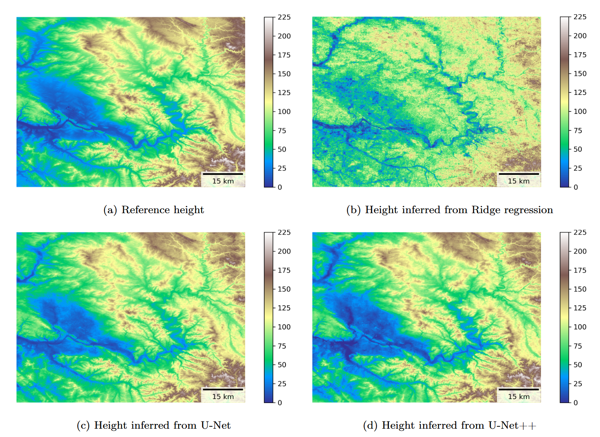

::right::

- Target: a **reference elevation model**
- Inputs: only the 64-D **AlphaEarth embeddings** per pixel
- Models: from **ridge regression** to U-Net / U-Net++

Even ridge regression recovers much of the terrain; deeper decoders mainly sharpen the details.

> Lesson: before training a deep model on raw data, try a **simple head on embeddings**.

<div class="slide-citation">
Hamoudzadeh et al. (2026), arXiv. Figure via the ISPRS 2026 tutorial.
</div>

<!--
Ask students: which panel is the reference, and which is the linear model? What does the linear model miss?
-->

---
section: using
layout: bonn-two-cols-header
---

# 2 · Geographic Conditioning

::left::

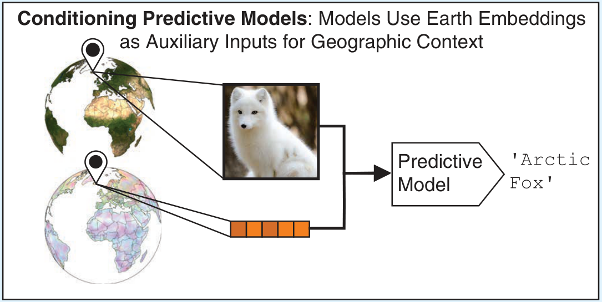

<div class="slide-citation">
Figure 3(b) from Klemmer et al. (2026), CC BY 4.0
</div>

::right::

Earth embeddings as **geographic priors**: an auxiliary input that gives a model context about *where* it is operating.

- **Fine-grained classification:** white fox in a snowy photo, arctic fox or pale red fox? Location disambiguates.
- **Domain transfer:** helps a segmentation model trained in the USA work in Somalia.
- **Limited labels and domain shift:** extra context boosts performance when data are scarce.

---
section: using
layout: bonn-two-cols-header
---

# How Conditioning Works

::left::

### As a prior (late fusion)

Combine an image classifier with a location model, assuming image and location are conditionally independent given the class:

$$
p(y \mid \text{img}, \text{loc}) \;\propto\; p(y \mid \text{img})\; p(y \mid \text{loc})
$$

Mac Aodha et al. (2019): presence-only geographical priors for fine-grained classification.

::right::

### As a feature (early fusion)

Concatenate or add the location embedding to intermediate image features:

$$
\hat{y} = h\big([\, f(\text{img}) \,\|\, E(\text{loc}) \,]\big)
$$

Location encoders are small and differentiable → they can be trained end-to-end with the main model.

::bottom::

<div class="blockquote2">

**Forest example:** condition the pixel classifier on SatCLIP → a dark-green patch in the Amazon and one in Scandinavia get different priors on forest type.

</div>

---
section: using
---

# Conditioning in Practice: Super-Resolution

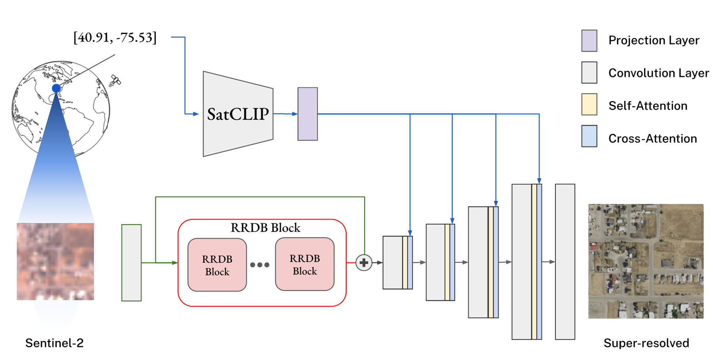

- A super-resolution network turns **Sentinel-2** into a sharper image.
- The **SatCLIP embedding** of the image’s coordinates is injected into the network as extra context.
- Knowing *where* the image is (desert town vs. temperate farmland) helps it hallucinate **plausible local detail**.

<div class="slide-citation">
Panangian &amp; Bittner (2025), “Can location embeddings enhance super-resolution of satellite imagery?” WACV. Figure via the ISPRS 2026 tutorial.
</div>

---
section: using
layout: bonn-two-cols-header
---

# 3 · Geosemantic Search and Retrieval

::left::

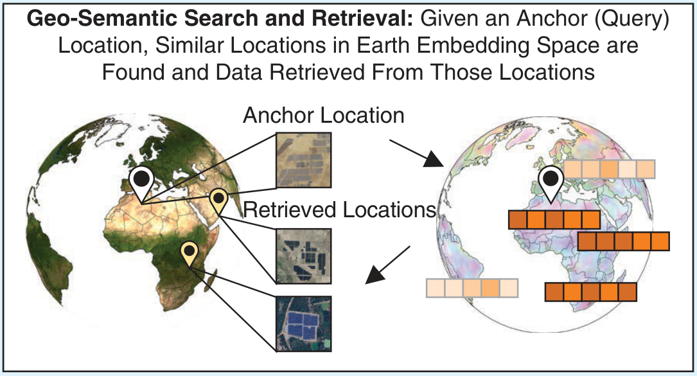

<div class="slide-citation">
Figure 3(d) from Klemmer et al. (2026), CC BY 4.0
</div>

::right::

A **“queryable Earth”**: embeddings as a lookup table for specific concepts.

1. Take the embedding of an image containing a **solar farm**.
2. Compute the similarity to all other embeddings.
3. Return the locations with the highest scores.

Embeddings aligned with text spaces allow **text queries**. Their small size makes **global search** feasible, which would be infeasible on raw imagery.

---
section: using
layout: bonn-two-cols-header
---

# Search in Practice: “Where Else Looks Like This?”

::left::

### Query by example or by concept

<div class="grid grid-cols-3 gap-2">

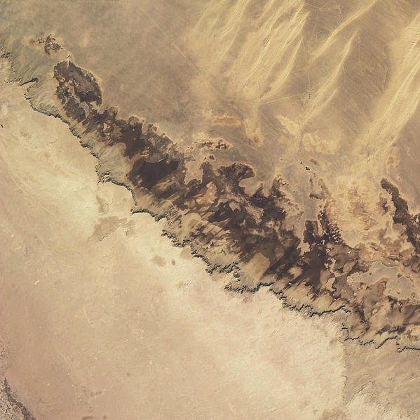

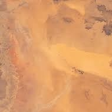

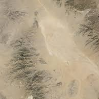

</div>

Arizona, Sahara, and Arabian desert land close together, and close to the text embedding of **“desert”**.

Matching is just vector similarity: **global results in seconds**, and a wall-to-wall similarity map from a single reference point.

::right::

<video src="./assets/tutorial/earth-search-demo.mp4" controls muted class="w-full rounded"></video>

Natural-language search over Earth embeddings: “Find new solar panels in Texas”.

<div class="slide-citation">
Images and demo video (LGND, lgnd.ai) from the ISPRS 2026 tutorial “Towards Geospatial Embeddings”.
</div>

---
section: using
layout: bonn-two-cols-header
---

# 4 · Data Synthesis and Simulation

::left::

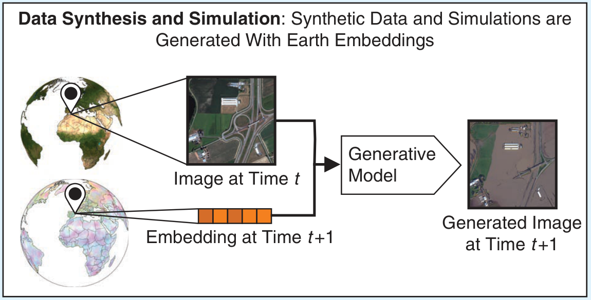

Earth embeddings as the **conditioning signal of generative models**: image synthesis reflecting ground conditions (e.g., flooding), geography-aware super-resolution, building blocks for **simulators**, forecasting, and scenario generation.

<div class="slide-citation">
Figure 3(c) from Klemmer et al. (2026), CC BY 4.0
</div>

::right::

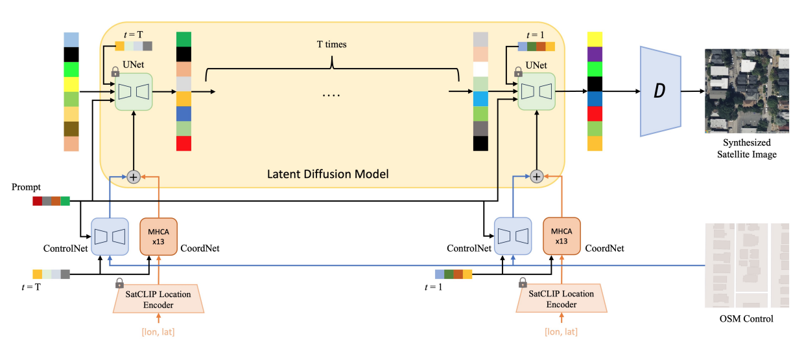

**GeoSynth:** a diffusion model conditioned on text, OpenStreetMap, and a **SatCLIP location embedding** generates context-aware satellite imagery.

> Embedding-conditioned simulators of physical processes **do not exist yet**: the goal is to integrate observations *and* scientific knowledge.

<div class="slide-citation">
Sastry et al. (2024), “GeoSynth: Contextually-aware high-resolution satellite image synthesis,” CVPR EarthVision Workshop.
</div>

---
section: using
---

# Embeddings as Data: Who Needs Which Expertise?

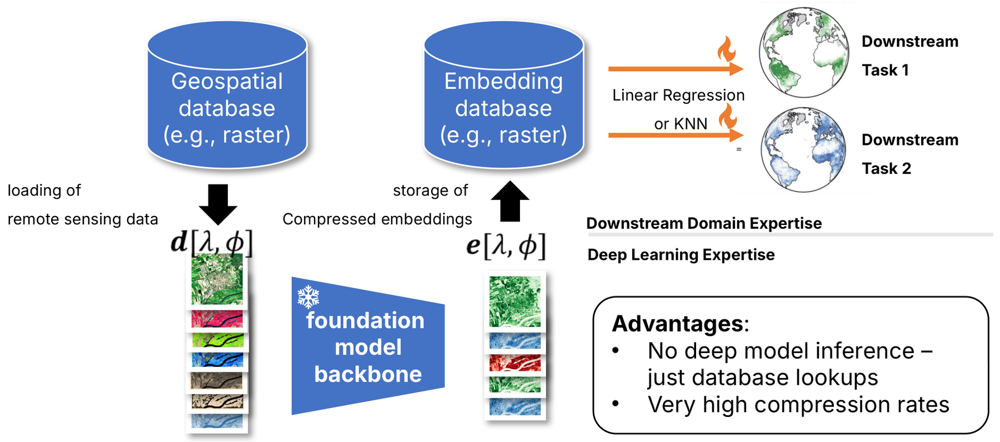

- **Once, by deep-learning experts:** load remote-sensing data, run a frozen foundation model, store compressed embeddings $e[\lambda,\phi]$.
- **Many times, by domain experts:** linear regression or $k$-NN on top of the embedding database.

<div class="slide-citation">
Figure from the ISPRS 2026 tutorial, inspired by Konrad Schindler’s talk on foundation models at the ESA Living Planet Symposium 2025.
</div>

---
section: using
layout: bonn-two-cols-header
---

# Interfaces: Embedding Models vs. Embedding Databases

::left::

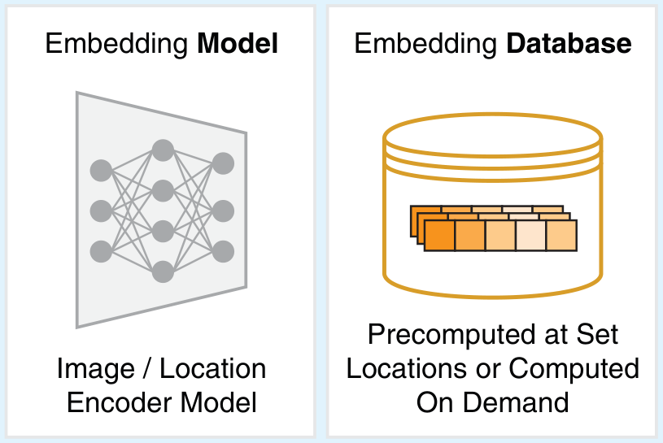

<div class="slide-citation">
Figure 4(b) from Klemmer et al. (2026), CC BY 4.0
</div>

::right::

### Embedding model

Ship code + weights. You run inference yourself (ideally on a GPU). SatCLIP, Climplicit, GeoCLIP, AnySat, MMEarth, Galileo, MOSAIKS.

### Embedding database

Ship precomputed vectors at set locations. You query by location, as files or via Google Earth Engine. AlphaEarth, Tessera, Major TOM, MOSAIKS.

> A location encoder is both: the model *is* the database.

---
section: using
---

# Model or Database? Trade-offs

| | Embedding model | Embedding database |
|---|---|---|
| **User needs** | Deep-learning know-how, data pipeline, GPU | Only a location query |
| **Flexibility** | Embed any self-compiled dataset; query any new point | Fixed locations, times, resolution |
| **Inspect / adapt** | Grad-CAM, fine-tuning → often higher accuracy | Cannot run, alter, or inspect the model |
| **Cost carried by** | The user (compute) | The producer (storage, bandwidth) |
| **Typical for** | Small implicit location encoders | Large explicit models, expensive to run |

> Databases open Earth embeddings to a **broad user base** beyond machine-learning experts, at the price of being static.

---
section: using
layout: bonn-two-cols-header
columns: "minmax(0, .8fr) minmax(0, 1.2fr)"
---

# Worked Workflow: From Sparse Labels to a Map

::left::

1. **Labels:** ~500 field plots (lon, lat, forest ∈ {0, 1}).
2. **Look up** the embedding at every plot.
3. **Train** a small classifier $h_\psi$ on (embedding, label).
4. **Validate** with *spatial* cross-validation (blocks, not random splits).
5. **Predict** on the embedding of every pixel → wall-to-wall map.
6. **Inspect** errors: where does the map fail, and why?

::right::

```python
from sklearn.ensemble import RandomForestClassifier
from sklearn.model_selection import GroupKFold, cross_val_score

X = lookup_embeddings(plots)          # (500, 64)
y = plots["forest"]
blocks = spatial_blocks(plots, size_km=50)

clf = RandomForestClassifier(n_estimators=300)
print(cross_val_score(clf, X, y, groups=blocks,
                      cv=GroupKFold(5)).mean())

clf.fit(X, y)
forest_map = clf.predict_proba(lookup_embeddings(grid))[:, 1]
```

`lookup_embeddings` and `spatial_blocks` are placeholders. **Demo 1** of the ISPRS 2026 tutorial runs this workflow end to end on free Colab: SatCLIP for biomes, AlphaEarth for crop types, leave-one-continent-out transfer.

<style>
.slidev-code { font-size: .58rem !important; line-height: 1.4 !important; }
</style>

---
section: using
---

# Which Embedding Should I Use?

| If you… | then… |
|---|---|
| want **a value per location** | direct prediction |
| want to **improve an existing model** | conditioning |
| want **a set of places** | retrieval |
| want **new data or scenarios** | synthesis |
| need **fine detail or search** | explicit (AlphaEarth, Clay): higher resolution localises features |
| need **any-point queries** | implicit (SatCLIP, SINR): interpolates to places without data |
| have **no GPU or ML pipeline** | an embeddings-as-data product you can download and query |
| depend on **specific sensors** | check the modalities: optical-only vs. multimodal |

> Always ask: **was the phenomenon I care about visible in the data the embedding was built from?**

---
section: using
---

# Exercise: Pick the Use Mode

In pairs (3 min): for each task, choose **prediction, conditioning, retrieval, or synthesis**, and **explicit or implicit** embeddings.

1. Find all open-pit mines in a continent, starting from one example.
2. Improve a bird-sound classifier that knows where each recording was made.
3. Map average air quality at 1 km for a country from 200 sensors.
4. Generate a plausible post-flood image of a town for an emergency drill.

<v-click>

| Task | Use mode | Embedding |
|---|---|---|
| 1 | Retrieval | Explicit (fine-grained, visual objects) |
| 2 | Conditioning | Implicit (location prior, e.g., SINR / SatCLIP) |
| 3 | Direct prediction | Implicit or hybrid (smooth, large-scale field) |
| 4 | Synthesis | Explicit image + implicit conditioning |

</v-click>

<!--
Answers follow the paper's guidance on which embedding families suit which tasks. Several answers are defensible; ask students to justify.
-->


---
layout: bonn-section
sectionColor: "#00457c"
section: evaluating
sectionTitle: Evaluate & improve
---

# How do we evaluate and improve them?


<div class="bonn-section-citation">
Figure 2(d) from Klemmer et al. (2026), CC BY 4.0
</div>

---
section: evaluating
layout: bonn-two-cols-header
---

# Constrained by the Raw Data

“General-purpose” Earth embeddings are not tailored to any task, yet they are **fundamentally constrained by the data they are based on**.

::left::

### SatCLIP · multispectral satellite imagery

- ✓ climate zones, forest coverage
- ✗ ocean currents

::right::

### GeoCLIP · ground-level Flickr photos

- ✓ patterns visible from the street
- ✗ places where nobody takes photos

::bottom::

<div class="blockquote2">

**Forest example:** understorey, forest age, or species mix under a closed canopy are hard to see from above. An embedding cannot encode what its inputs never observed.

</div>

---
section: evaluating
layout: bonn-two-cols-header
---

# Spatial and Temporal Generalization

::left::

Today’s GeoAI benchmarks are mostly **image** benchmarks. Earth embeddings need benchmarks where **location and time are the inputs**:

- spatial **interpolation vs. extrapolation**
- performance under different degrees of **spatial bias in the labels**
- performance across **spatiotemporal scales**
- interactions between processes (e.g., climate change ↔ migration)
- utility for search and retrieval

First steps: TorchSpatial, NeuCo-Bench, GeoT.

::right::

<svg viewBox="0 0 280 170" class="w-full h-[170px]">
<rect x="5" y="5" width="270" height="160" rx="8" fill="#f9fafb" stroke="#ddd"/>
<g fill="#00457c"><circle cx="40" cy="40" r="4"/><circle cx="60" cy="70" r="4"/><circle cx="80" cy="45" r="4"/><circle cx="55" cy="105" r="4"/><circle cx="95" cy="90" r="4"/><circle cx="110" cy="60" r="4"/></g>
<circle cx="75" cy="75" r="6" fill="none" stroke="#16a34a" stroke-width="2.5"/>
<text x="40" y="140" font-size="11" fill="#16a34a">interpolation</text>
<circle cx="225" cy="110" r="6" fill="none" stroke="#dc2626" stroke-width="2.5"/>
<text x="180" y="140" font-size="11" fill="#dc2626">extrapolation</text>
</svg>

*Random train/test splits measure only interpolation (generalization lecture).*

<div class="blockquote2">

**Forest example:** plots cluster near roads. Does the map hold in the roadless interior? Demo 1 of the tutorial tests exactly this with a leave-one-continent-out split.

</div>

---
section: evaluating
layout: bonn-two-cols-header
---

# Effective Resolution

::left::

SatCLIP can be queried at **infinitesimal** resolution, but its **effective** resolution is coarse, limited by

- the **capacity** of the location encoder,
- the **smoothness** enforced by the location–image matching objective.

> Query resolution ≠ information resolution.

::right::

- **Regional encoders:** train on an area of interest, e.g., a SatCLIP-style encoder for Spain only.
- **Explicit embeddings** are bound by input availability: NAIP + Clay for log-yard mapping works only in the US and for specific years.
- Expect more **use-case-specialised products** for specific areas, periods, and resolutions.

---
section: evaluating
layout: bonn-two-cols-header
---

# Modality and Sampling Biases

::left::

Current models use the **same number of parameters everywhere** in space and time. But information density is not uniform:

- a satellite tile over New York City carries far more information than one over the Pacific → global models **over-smooth heterogeneous regions**
- modalities matter differently by place and season: **radar** in cloudy areas or in arctic winter darkness

Ideas: adaptive coordinate networks (ACORN), varying capacity by location.

::right::

### Data curation and scaling

Does the spatial distribution of pretraining data matter? What is the marginal value of one more location, time step, or sensor? Should heterogeneous areas be **over-represented** or reweighted?

<div class="blockquote2">

**Forest example:** a tropical forest country under persistent clouds; optical-only embeddings are weakest exactly where deforestation is highest.

</div>

---
section: evaluating
layout: bonn-two-cols-header
---

# Interpretability

::left::

We usually do not know **which part of an embedding** represents a given ground condition (a tree, a building), or whether it captures that condition at all.

- limits use for understanding drivers of variation (seasonal vs. geographic distance)
- complicates **high-stakes decision making**
- which **input modality** contributed to which part of the embedding?

::right::

**Models** can be probed (Grad-CAM, ablations). **Databases** cannot: the vectors are all you get.

> Interpretability also needs **data provenance** and reporting standards.

<div class="blockquote2">

**Forest example:** a forest map from embeddings is accurate on test plots, but can we tell a ministry *why* a pixel is classified as forest?

</div>

---
section: evaluating
---

# The Hidden Cost Is Storage, Not Compute

| | Estimate |
|---|---|
| **Compute** | One V100 GPU, ~7 days: U-Net (EfficientNet-B7) over all land on Earth at 4.7 m (≈900,000 km²/h) → **~US$514** |
| **Data volume** | 108 TB uncompressed PlanetScope input → **432 TB** of 64-D embeddings (1 byte per dimension) |
| **Storage** | 432 TB in “hot” cloud storage: ~US$8,000/month → **~US$100,000/year** (Sept. 2025 prices) |
| **AlphaEarth-like** | Multiyear 100 m database: ~475 TB for five time steps → ~US$9,500/month |
| **Carbon** | ~50 kWh GPU / ~150 kWh facility → 10 kg (low-carbon grid) to 75 kg (world average) to >100 kg CO₂e, once; storage keeps drawing power |

> **Storage and delivery**, not inference, dominate cost and sustainability → compression, caching, dynamic delivery, or **compute as a substitute for storage** (on-demand generation).

<!--
Rough estimates from the paper, section "The Computational and Environmental Costs of Earth Embeddings". This explains why precomputed embeddings remain rare outside large corporations and space agencies.
-->

---
section: evaluating
layout: bonn-two-cols-header
---

# Openness: Weights, Code, Data, Process

::left::

The Marin foundation’s trichotomy of openness:

| Level | Released |
|---|---|
| **Open weight** | weights, but no code or data |
| **Open source** | weights, code, and data |
| **Open process** | + process details and participation |

::right::

- Most Earth embedding releases are **open weight** or **open source**.
- **Major TOM** is uniquely open process, with a public standard and path to contributing.
- MOSAIKS, Tessera, Clay, Presto release **both** model and embeddings.
- **AlphaEarth** is more restrictive: **open output** (embeddings) but no model.

> The authors’ position: sufficiently open sharing is a **prerequisite** for community-driven progress.

---
section: evaluating
layout: bonn-two-cols-header
---

# Earth Embedding Cards

::left::

A reporting standard drawing on **datasheets for datasets** and **model cards**, because embeddings are both data and model output.

> Releases should include exact recipes: code, configurations, hashes, container images, seeds, and evaluation suites.

See the “Earth Embedding Card Template” in the paper.

::right::

1. **Who** made them? Authors, maintainers, funders, citation.
2. **How accessed?** Model, dataset, or both public? Licence?
3. **How generated?** Spatiotemporal resolution; data modalities and licences; explicit or implicit?
4. **Intended use?** Designed-for tasks; tasks they should *not* be used for; tasks needing extra validation.
5. **Space and time:** how encoded; smoothness and other assumptions.
6. **Costs:** compute, storage, who pays, estimated carbon emissions.

---
section: evaluating
---

# The Research Agenda: Three Calls to Action

| | Call to action |
|---|---|
| **Applications** | Better **benchmarks**; **interpretability**; products for specific areas, resolutions, and periods; learning **planetary processes** (a step toward digital twins) |
| **Methods** | **Model capacity** (location encoders are small; borrow from transformers); **spatiotemporal encodings** that adapt to heterogeneity; data curation and **scaling**; geo-specific **objectives** (spatial autocorrelation, temporal dynamics) |
| **Community** | **Interdisciplinarity**; traceable, affordable **infrastructure**; shared **standards and interfaces**; **reporting** with embedding cards |

> Domain scientists (ecology, geology, oceanography, atmospheric science) and practitioners are needed to tell developers what the embeddings must deliver.

<!--
Merges the paper's three "Call to Action" boxes and the tutorial's "Challenges & opportunities ahead" slide.
-->

---
section: closing
sectionTitle: Closing
---

# The Forest Map, One More Time

| Block | Forest-cover map |
|---|---|
| **1 · Why** | One vector per location replaces pipelines of heterogeneous data and expertise |
| **2 · How learned** | Explicit pixel embeddings (AlphaEarth) for detail; implicit location encoders (SatCLIP) for context |
| **3 · How used** | Direct prediction from a few hundred plots with a small classifier → wall-to-wall map |
| **4 · Where it fails** | Unseen under-canopy properties, cloudy regions, clustered plots, black-box vectors |

> Earth embeddings are a new **data format** for geospatial information: compact, fused, queryable anywhere, and interoperable with other AI models, provided we know what is (and is not) inside them.

---
section: closing
---

# Discussion

1. Should Earth embeddings be **public infrastructure**, like a national mapping agency’s base map? Who should pay for the storage?
2. Would you trust a forest-cover map built on an embedding whose **model you cannot inspect** for an EU deforestation regulation decision?
3. If you could add **one modality** to a global embedding, which would add the most information, and where?

> You don’t need to be a machine-learning expert: if you can run a regression, you can use Earth embeddings.

---
layout: learning-outcomes
mode: after
meeting: lecture-06
section: closing
---

# Revisit the learning outcomes

---
section: closing
layout: bonn-two-cols-header
---

# Reading and Resources

::left::

### Core reading

K. Klemmer, E. Rolf, M. Rußwurm, G. Camps-Valls, M. Czerkawski, S. Ermon, A. Francis, N. Jacobs, H. Kerner, L. Mackey, G. Mai, O. Mac Aodha, M. Reichstein, C. Robinson, D. Rolnick, E. Shelhamer, V. Sitzmann, D. Tuia, X. Zhu. **“Earth Embeddings: Toward artificial intelligence-centric representations of our planet.”** *IEEE Geoscience and Remote Sensing Magazine*, 2026. doi:10.1109/MGRS.2026.3710416

### Hands-on

ISPRS 2026 tutorial notebooks, [github.com/konstantinklemmer/isprs26-embeddings-tutorial](https://github.com/konstantinklemmer/isprs26-embeddings-tutorial). Demo 1 uses SatCLIP and AlphaEarth; Demo 2 builds MOSAIKS features and similarity maps. Both run on free Colab.

::right::

### Further reading

- Klemmer et al., “SatCLIP: Global, general-purpose location embeddings with satellite imagery,” AAAI 2025.
- Rußwurm et al., “Geographic location encoding with spherical harmonics and sinusoidal representation networks,” ICLR 2024.
- Brown et al., “AlphaEarth Foundations,” arXiv:2507.22291, 2025.
- Rolf et al., “A generalizable and accessible approach to machine learning with global satellite imagery” (MOSAIKS), *Nature Communications*, 2021.
- TorchGeo: datasets, pretrained models, and tooling for geospatial deep learning.
